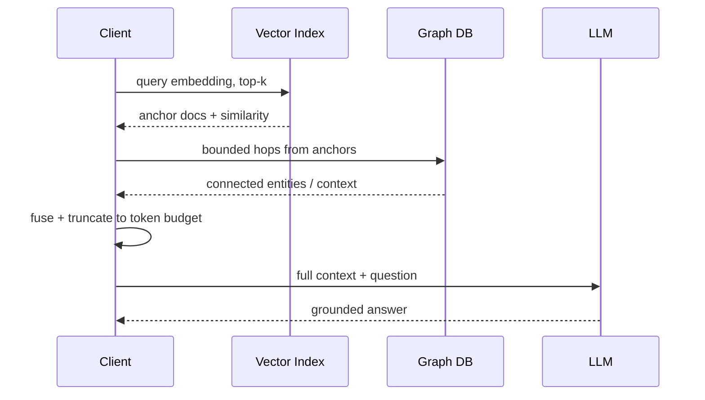

# Chapter 06 — GraphRAG & Hybrid Retrieval

## 6.1 What Is GraphRAG?

**GraphRAG** fuses dense vector retrieval with graph traversal.

| Retrieval Type | Strength | Weakness |
|----------------|----------|----------|
| Vector-only | Semantic similarity, fast | Struggles with multi-hop facts & global questions |
| Graph-only | Multi-hop structured reasoning | Needs anchors; no semantic similarity |
| GraphRAG | Both connected + semantic context | Slightly more latency |

```mermaid
flowchart TB
    Q[Query: "Which hotels near Paris did Alice's friends visit?"]
    
    subgraph Vector Path
    VQ[Vector Embedding]
    VS[Vector Index Search: top-k chunks]
    end
    
    subgraph Graph Path
    AN[Vector anchors → graph nodes]
    TR[Bounded hops (1-2): friends → events → hotels]
    end
    
    F[Fusion: vector context + graph context]
    L[LLM generates grounded answer]
    
    Q --> VQ
    Q --> VS
    VS --> AN
    AN --> TR
    TR --> F
    VQ --> F
    F --> L
```

## 6.2 Neo4j Native Vector Indexes

Neo4j 5+ supports native vector indexes over `embedding` properties (cosine / euclidean / dot-product similarity).

### 6.2.1 Create Vector Index

```cypher
CREATE VECTOR INDEX doc_embeddings IF NOT EXISTS
FOR (d:Document) ON (d.embedding)
OPTIONS {
  indexConfig: {
    `vector.dimensions`: 1536,
    `vector.similarity_function`: 'cosine'
  }
};
```

### 6.2.2 Query Vector Index

```cypher
CALL db.index.vector.queryNodes('doc_embeddings', $k, $queryVector)
YIELD node AS doc, score
WHERE score >= $threshold
RETURN doc.title AS title, doc.summary AS summary, score AS sim_score;
```

## 6.3 Bounded Graph Expansion

After vector search identifies anchor documents, expand **1–2 hops** into the graph to pull connected entities and relationships.

```cypher
// Anchor nodes from vector search
MATCH (d:Document)
WHERE d.id IN $anchorIds
OPTIONAL MATCH (d)-[:MENTIONS]->(e:Entity)
OPTIONAL MATCH (d)-[:BELONGS_TO]->(c:Category)
OPTIONAL MATCH (e)-[:REFERENCES]->(t:Topic)
RETURN d.title, collect(DISTINCT c.name) AS categories,
       collect(DISTINCT e.name) AS entities,
       collect(DISTINCT t.name) AS topics
LIMIT 50;
```

### Why bound hops?

```mermaid
graph TD
    A[Unbounded * traversal] -->|whole graph visited| B[O(|V| + |E|) → timeout]
    C[Bounded *1..3] -->|only local neighborhood| D[O(k × degree^h) → predictable]
    
    style A fill:#fcc,stroke:#999
    style C fill:#cfc,stroke:#333
```

## 6.4 Context Fusion

Merge vector snippets and graph neighbors into a single prompt for the LLM, respecting a token budget.



## 6.5 Hybrid Retrieval Endpoint (Pseudo Code)

```typescript
// Pseudo code — hybrid GraphRAG service endpoint
type HybridRequest = {
  question: string;
  topK?: number;        // vector anchors
  maxHops?: number;     // graph expansion
};

type HybridResponse = {
  answer: string;
  anchors: any[];
  graphContext: any[];
};

class GraphRAGRetriever {
  constructor(
    private driver: any,
    private vectorIndex: string,
    private embedding: (text: string) => Promise<number[]>
  ) {}

  async retrieve(req: HybridRequest): Promise<HybridResponse> {
    const k = req.topK ?? 5;
    const maxHops = req.maxHops ?? 2;

    // 1. Embed question
    const qEmbed = await this.embedding(req.question);

    // 2. Vector search anchors
    const anchors = await this.driver.executeQuery(
      `
      CALL db.index.vector.queryNodes($index, $k, $emb)
      YIELD node AS doc, score
      WHERE score >= 0.7
      RETURN elementId(doc) AS docId, doc.title AS title, score
      ORDER BY score DESC
      `,
      { index: this.vectorIndex, k, emb: qEmbed }
    );

    const docIds = anchors.records.map(r => r.get('docId'));

    // 3. Bounded graph expansion
    const graphCtx = await this.driver.executeQuery(
      `
      UNWIND $ids AS id
      MATCH (d) WHERE elementId(d) = id
      OPTIONAL MATCH (d)-[:MENTIONS|BELONGS_TO|REFERENCES*1..$hops]->(n)
      RETURN d.title AS title, collect(DISTINCT n.name) AS neighbors
      `,
      { ids: docIds, hops: maxHops }
    );

    // 4. Fuse context for LLM
    const fused = this.fuseContext(anchors.records, graphCtx.records);

    // 5. Call LLM (external)
    const answer = await this.completeLLM(fused, req.question);

    return { answer, anchors: anchors.records, graphContext: graphCtx.records };
  }

  private fuseContext(anchors: any[], graphCtx: any[]): string {
    const lines: string[] = [];
    for (const a of anchors) {
      lines.push(`[DOC ${a.get('title')} score=${a.get('score')}]`);
    }
    for (const g of graphCtx) {
      const nbs = g.get('neighbors')?.filter(Boolean).join(', ');
      lines.push(`[CTX ${g.get('title')} → ${nbs || 'none'}]`);
    }
    return lines.join('\n').slice(0, 4000); // token budget
  }

  private async completeLLM(context: string, question: string): Promise<string> {
    // external call to LLM API
    return '';
  }
}
```

## 6.6 GraphRAG vs Vector RAG — Concrete Example

**Question:** *"Which hotels in Paris did Alice's friends visit?"*

| Step | Vector-only RAG | GraphRAG |
|------|-----------------|----------|
| 1 | Embed question, retrieve similar chunks | Embed question, retrieve anchor docs |
| 2 | Return text snippets | Retrieve anchor docs + traverse `Person -[:KNOWS]-> Person -[:STAYED]-> Hotel` |
| 3 | LLM synthesizes snippets | LLM fuses vector snippets + graph path info |
| 4 | May miss "friends" relation | Returns precise multi-hop facts |

## 6.7 Common Mistakes

| Mistake | Why | Fix |
|---------|-----|-----|
| Unbounded graph expansion | Full graph scan on dense neighborhoods | Bound hops `*1..2` |
| Vector index dimension mismatch | `CREATE VECTOR INDEX` rejects wrong dims | Match dimension exactly |
| No similarity threshold | Returns irrelevant low-score docs | `WHERE score >= 0.7` |
| No fusion truncation | Exceeds LLM context window | Slice fused context to budget |
| Querying graph before vector search | Loses semantic anchor points | Always vector first, graph after |

## 6.8 Key Takeaways

- GraphRAG = vector top-k anchors → bounded graph hops → context fusion → LLM.
- Neo4j native vector indexes enable ANN search over `embedding` properties.
- Always bound graph expansion: `*1..2` or `*1..3`.
- Always set a similarity threshold (`score >= 0.7`) for quality anchors.
- Fuse vector snippets + graph neighbors within a token budget for the LLM.

---

**Self-check questions:**
16. Write the `CREATE VECTOR INDEX` statement for 1536-dim cosine embeddings on `Document.embedding`.
17. Why is context fusion (vector + graph) better than vector-only for multi-hop questions?
18. What is the danger of `MATCH (a)-[*]-(b)` without bounds?