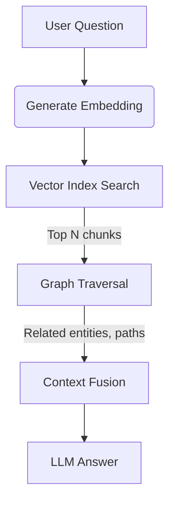

# 🔀 06 — GraphRAG & Hybrid Retrieval

> **Goal:** Understand how to combine vector‑style semantic retrieval with graph‑style traversal to answer complex questions, and build a working GraphRAG endpoint that layers both retrieval modes.

---

## 1. 🌟 Why Hybrid Retrieval?

| Situation | Vector‑only | Graph‑only |
|-----------|-------------|-----------|
| “Find documents about *topic X*” | ✅ Good semantic match | ❌ No concept of “topic” without explicit nodes/edges |
| “Find people who know someone who worked on *project Y*” | ❌ No relationship information | ✅ Traverses `KNOWS` / `WORKED_ON` edges |
| “Answer a factual question that needs both evidence and context” | ⚠️ May retrieve irrelevant facts | ⚠️ May miss semantically similar but disconnected facts |

**Hybrid retrieval** leverages the strengths of each:

* **Vector search** → semantic similarity, surface‑level content matching
* **Graph traversal** → follows `relationship` hops, discovers connected entities, filters by domain constraints

The typical workflow (illustrated in mermaid below) is:



> **Key insight:** Vector search gives you *what* is semantically similar; graph traversal gives you *how* those items connect in the domain model.

---

## 2. 📚 Vector Index in Neo4j

Neo4j (>= 4.x) supports native vector indexes. Below is the minimal setup.

### 2.1 Create a vector index

```cypher
CREATE VECTOR INDEX document_embeddings IF NOT EXISTS
FOR (d:Document) ON (d.embedding)
OPTIONS {
  `vector.dimensions`: 1536,
  `vector.similarity_function`: 'cosine'
};
```

### 2.2 Index a document with an embedding

```cypher
CREATE (d:Document {
  id: "doc_42",
  title: "Intro to Neo4j Cypher",
  content: "...",
  embedding: [0.12, -0.45, 0.78, ...]   // 1536‑dim float list
});
```

### 2.3 Query the vector index (top‑k similar)

```cypher
CALL db.index.vector.queryNodes(
  'document_embeddings',
  5,               // k = 5 nearest neighbours
  $queryEmbedding
)
YIELD node AS doc, score
RETURN doc.title, score
ORDER BY score DESC;
```

> **Pseudo‑code** for the same operation in Node.js driver:

```ts
// TS pseudo‑code (non‑run‑nable, explanatory)
import { Neo4jDriver } from 'neo4j-driver';

async function findSimilarDocs(driver, queryEmbedding: number[]) {
  const session = driver.session({ database: 'neo4j' });
  const result = await session.run(
    `CALL db.index.vector.queryNodes($idx, $k, $embedding)
     YIELD node AS doc, score
     RETURN doc.title, score
     ORDER BY score DESC`,
    { idx: 'document_embeddings', k: 5, embedding: queryEmbedding }
  );
  await session.close();
  return result.records; // [{title:string, score:float}, …]
}
```

---

## 3. 🗺️ Graph Traversal after Vector Retrieval

Once you have the top‑k documents (or any entity nodes), you can extend the context by traversing relationships.

### 3.1 Example: From a Document to its Author & Topics

```cypher
// 1️⃣ Vector retrieval already gave us doc nodes
// 2️⃣ Now follow outgoing relationships

MATCH (doc:Document)
WHERE doc.title = $title
MATCH (doc)-[:WRITTEN_BY]->(author:User)
MATCH (doc)-[:ABOUT]->(topic:Topic)
RETURN author.name, collect(DISTINCT topic.name) AS topics;
```

### 3.2 Variable‑length hop (bounded)

```cypher
MATCH (doc:Document)-[r*1..2]->(related)
WHERE doc.title = $title
RETURN type(r), related;
```

> **Caution:** Unbounded `*` can be expensive; always provide a numeric bound (`1..3`, `1..5`, etc.) and, when possible, add filter predicates to prune the search space.

---

## 4. 🧩 Context Fusion — Merging Vector + Graph Results

The "context fusion" step combines the two result sets into a single payload sent to the LLM.

### 4.1 Simple concatenation (rank‑by‑score)

```ts
type ContextEntry = {
  source: 'vector' | 'graph';
  title: string;
  snippet: string;
  score: number;   // lower is better for vector, any for graph
};

function fuseContext(
  vectorResults: ContextEntry[],
  graphResults: ContextEntry[]
): ContextEntry[] {
  const merged = [...vectorResults, ...graphResults];
  // sort by score ascending (vector) then by relevance for graph entries
  return merged.sort((a, b) => a.score - b.score);
}
```

### 4.2 Weighted blend (optional)

You may want to give vector results a weight factor `α` and graph results `β`:

```ts
merged.sort((a, b) => {
  const aScore = a.source === 'vector' ? a.score * ALPHA : a.score * BETA;
  const bScore = b.source === 'vector' ? b.score * ALPHA : b.score * BETA;
  return aScore - bScore;
});
```

Typical values: `ALPHA = 0.6`, `BETA = 0.4`, tuned on a validation set.

---

## 5. 📤 GraphRAG Endpoint Sketch (Node.js + Express)

Below is a **minimal, non‑production** Express route that demonstrates the full pipeline: embed the user query, query the vector index, traverse one hop in the graph, fuse context, and ask an LLM.

```ts
// TS pseudo‑code – explanatory only
import express from 'express';
import { Neo4jDriver } from 'neo4j-driver';
import { generateEmbedding } from './ai-utils';   // your embedding model

const app = express();
app.use(express.json());

const driver = new Neo4jDriver(
  process.env.NEO4J_URI!,
  neo4j.auth.basic(process.env.NEO4J_USER!, process.env.NEO4J_PASS!)
);

app.post('/rag', async (req, res) => {
  const question = req.body.question || '';
  if (!question) return res.status(400).json({error: 'question required'});

  // 1️⃣ Embed the question
  const qEmbed = await generateEmbedding(question); // → number[1536]

  // 2️⃣ Vector retrieval
  const vecSession = driver.session({ database: 'neo4j' });
  const vecResult = await vecSession.run(
    `CALL db.index.vector.queryNodes($idx, $k, $emb)
     YIELD node AS doc, score
     RETURN doc.title AS title, doc.content AS content, score
     ORDER BY score DESC
     LIMIT 5`,
    { idx: 'document_embeddings', k: 5, emb: qEmbed }
  );
  await vecSession.close();

  // 3️⃣ Graph traversal from those docs (one hop)
  const docTitles = vecResult.records.map(r => r.get('title'));
  const graphSession = driver.session({ database: 'neo4j' });
  const graphResult = await graphSession.run(
    // Example: find authors/topics connected to any of the retrieved docs
    `UNWIND $titles AS t
     MATCH (doc:Document {title: t})
     MATCH (doc)-[:WRITTEN_BY]->(author:User)
     MATCH (doc)-[:ABOUT]->(topic:Topic)
     RETURN DISTINCT author.name AS author, collect(DISTINCT topic.name) AS topics`,
    { titles: docTitles }
  );
  await graphSession.close();

  // 4️⃣ Fuse context (illustrative)
  const vectorCtx = vecResult.records.map(r => ({
    source: 'vector' as const,
    title: r.get('title'),
    snippet: r.get('content').slice(0, 120),
    score: r.get('score')
  }));
  const graphCtx = graphResult.records.flatMap(r => [
    { source: 'graph' as const, title: r.get('author'), snippet: `author: ${r.get('author')}`, score: 1 },
    ...(r.get('topics')?.map((tok: string) => ({
      source: 'graph' as const,
      title: tok,
      snippet: `topic: ${tok}`,
      score: 1
    })) || [])
  ]);

  const fused = [...vectorCtx, ...graphCtx].sort(
    (a, b) => a.score - b.score
  );

  // 5️⃣ Send to LLM (placeholder)
  const llmPrompt = `Answer the question using the context below.\n\nQuestion: ${question}\nContext: ${JSON.stringify(fused, null, 2)}`;
  const llmAnswer = await callLLM(llmPrompt); // your LLM wrapper

  res.json({ answer: llmAnswer });
});

app.listen(3000, () => console.log('GraphRAG service listening on :3000'));
```

> **Note:** This code is **not** meant to run out‑of‑the‑box; it shows the logical flow and wiring. Replace `callLLM`, `generateEmbedding`, and Neo4j credentials with your actual implementations.

---

## 6. 🛠️ Common Mistakes & Gotchas

| Mistake | Why it hurts | Fix |
|---------|--------------|-----|
| **Unbounded variable‑length patterns** `(a)-[*]-(b)` | Explodes on dense graphs, may time‑out or return millions of rows. | Use bounded hops `(a)-[r*1..3]-(b)` and add filter predicates. |
| **Ignoring index configuration** | Vector index missing or wrong similarity function → poor retrieval quality. | Verify `CREATE VECTOR INDEX` with correct dimensions & `cosine`/`l2`. |
| **Fusing without score normalisation** | Vector scores (0‑1) mixed with arbitrary graph scores → noisy ranking. | Normalise or apply weighting factors (`ALPHA`, `BETA`). |
| **Over‑traversing** | Each hop multiplies the result set; can blow up memory. | Limit hops, add `WHERE` clauses, use `DISTINCT`, and consider `SKIP`/`LIMIT`. |
| **Assuming vector search alone is enough** | Misses domain relationships that answer the user’s question. | Always add at least one graph hop when the query asks “who”, “where”, “how”. |

---

## 7. 📌 Key Takeaways

1. **Hybrid = vector + graph.** Vector search gives semantic relevance; graph traversal gives connected context.
2. **Neo4j vector indexes** are created with `CREATE VECTOR INDEX` and queried via `CALL db.index.vector.queryNodes`.
3. **Bounded traversals** are essential for performance; avoid `*` without limits.
4. **Context fusion** can be as simple as concatenating results or as sophisticated as weighted blending.
5. **GraphRAG endpoints** follow a clear pipeline: embed → vector retrieve → graph hop → fuse → LLM prompt.
6. **Avoid common pitfalls**: unbounded traversals, missing indexes, unnormalized scores.

---

## 8. 🧠 Self‑Check Questions (you should be able to answer)

1. How do you create a vector index on a `Document` node with 768‑dimensional embeddings using cosine similarity?  
2. Write a Cypher snippet that, given a document title, returns the author’s name and all topics associated with that document.  
3. What is the difference between `CALL db.index.vector.queryNodes(..., 3, $emb)` and `MATCH (d:Document) WHERE cosineSimilarity(d.embedding, $emb) > 0.8`?  
4. Why is it important to bound variable‑length relationships in production GraphRAG?  
5. In the fusion step, why might you apply a weight (`ALPHA`/`BETA`) to vector vs. graph scores?  
6. Name two concrete risks of using unbounded `*` relationship patterns in Neo4j.  
7. Sketch (in pseudo‑code or outline) the full GraphRAG request lifecycle from user question to LLM answer.  

--- 

*End of chapter.*