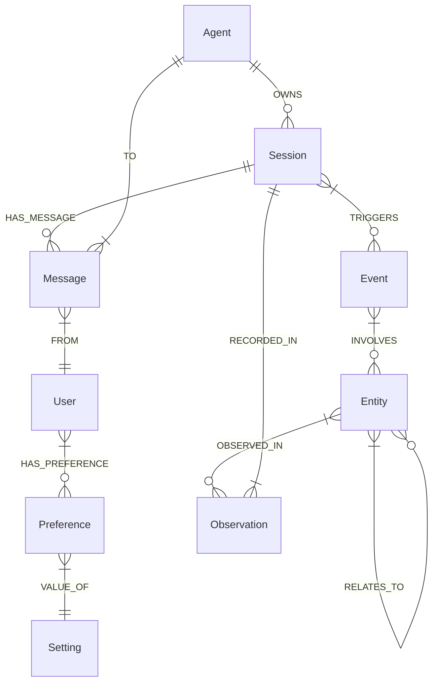

# 🧠 07 — AI Agent Memory Systems on Graphs

> **Goal:** Model factual, episodic, and temporal memory for LLM agents as a property graph; perform entity resolution; build evolving user/agent profiles; and query the memory graph efficiently.

---

## 1. 🗂️ Memory Taxonomy for Agents

| Memory Type | Lifetime | Example Nodes / Edges | Typical Query |
|-------------|----------|------------------------|---------------|
| **Working / Short‑term** | Current session / conversation window | `(Session) -[:HAS_MESSAGE]-> (Message)` | “What did the user say 3 turns ago?” |
| **Episodic** | Past interactions, immutable events | `(Event {timestamp, type}) -[:INVOLVES]-> (Entity)` | “Show all events where Alice booked a flight.” |
| **Semantic / Factual** | Long‑lived world knowledge | `(Person) -[:WORKS_AT]-> (Org)`<br>`(Concept) -[:RELATED_TO]-> (Concept)` | “What company does Alice work for?” |
| **Temporal / Versioned** | Time‑varying facts | `(Person) -[:PREFERS {validFrom, validTo}]-> (Setting)` | “What was Alice’s theme preference in Jan 2025?” |
| **Procedural / Skill** | Learned procedures | `(Agent) -[:HAS_SKILL]-> (Skill {code, version})` | “Retrieve the latest summarisation prompt.” |

> **Design rule:** Choose the memory *type* first, then decide whether a concept is a **property** (simple, owned, rarely traversed) or a **node** (shared, multi‑hop, has its own properties/relationships).

---

## 2. 🏗️ Graph Schema for Agent Memory

Below is a **minimal, extensible** schema used in production‑grade agents.



### 2.1 Core Node Labels & Key Properties

| Label | Key Properties | Notes |
|-------|----------------|-------|
| `Agent` | `id`, `name`, `version` | One row per deployed agent |
| `User` | `id`, `externalId`, `createdAt` | Linked to auth system |
| `Session` | `id`, `startedAt`, `endedAt`, `status` | `status ∈ {active, closed}` |
| `Message` | `id`, `role` (user/assistant/system), `content`, `ts` | Ordered by `ts` |
| `Event` | `id`, `type`, `payload`, `ts` | Immutable log |
| `Entity` | `id`, `type` (Person, Org, Topic…), `name` | Canonicalised via entity resolution |
| `Preference` | `key`, `value`, `validFrom`, `validTo` | Temporal factual memory |
| `Skill` | `id`, `name`, `code`, `version` | Procedural memory |
| `Observation` | `id`, `confidence`, `source` | Links `Entity` → `Session` |

### 2.2 Core Relationship Types

| Type | Direction | When to Use |
|------|-----------|-------------|
| `OWNS` | Agent → Session | Session lifecycle |
| `HAS_MESSAGE` | Session → Message | Conversation log |
| `FROM` / `TO` | Message → User / Agent | Speaker / listener |
| `TRIGGERS` | Session → Event | Side‑effects (tool calls, emails…) |
| `INVOLVES` | Event → Entity | Who/what participated |
| `RELATES_TO` | Entity ↔ Entity | Domain graph (knows, works_at…) |
| `HAS_PREFERENCE` | User → Preference | Temporal key‑value facts |
| `OBSERVED_IN` | Entity → Observation → Session | Provenance & confidence |

---

## 3. 🔍 Entity Resolution (Canonicalisation)

Agents encounter the same real‑world entity under many surface forms (“Apple”, “Apple Inc.”, “AAPL”). Store a **canonical `Entity` node** and link mentions to it.

### 3.1 Resolution Flow (pseudo‑code)

```ts
// TS pseudo‑code
async function resolveEntity(driver, mention: string, type: string): Promise<string> {
  // 1️⃣ Exact match on canonical name
  const exact = await driver.executeQuery(
    `MATCH (e:Entity {type: $type, name: $mention}) RETURN e.id`,
    { type, mention }
  );
  if (exact.records.length) return exact.records[0].get('e.id');

  // 2️⃣ Fuzzy / embedding match (vector index on Entity.name)
  const emb = await embed(mention);
  const fuzzy = await driver.executeQuery(
    `CALL db.index.vector.queryNodes('entity_name_idx', 1, $emb)
     YIELD node AS e, score
     WHERE score > 0.85 AND e.type = $type
     RETURN e.id`,
    { emb, type }
  );
  if (fuzzy.records.length) return fuzzy.records[0].get('e.id');

  // 3️⃣ Create new canonical entity
  const created = await driver.executeQuery(
    `CREATE (e:Entity {id: randomUUID(), type: $type, name: $mention})
     RETURN e.id`,
    { type, mention }
  );
  return created.records[0].get('e.id');
}
```

### 3.2 Linking a Mention → Canonical Entity

```cypher
// When a new Message mentions "Apple"
MATCH (m:Message {id: $msgId})
MERGE (e:Entity {id: $canonId})
MERGE (m)-[:MENTIONS {confidence: $conf}]->(e);
```

> **Tip:** Keep a `Mention` node if you need fine‑grained provenance (`span`, `detector`, `confidence`).

---

## 4. ⏳ Temporal / Versioned Facts

Preferences, roles, and addresses change over time. Model them with **valid‑time intervals** on the relationship.

### 4.1 Schema Fragment

```text
(User)-[:HAS_PREFERENCE {validFrom: datetime, validTo: datetime?}]->(Preference)
```

### 4.2 Query: “What was Alice’s theme on 2025‑01‑15?”

```cypher
MATCH (u:User {id: 'alice'})-[:HAS_PREFERENCE {key: 'theme'}]->(p:Preference)
WHERE p.validFrom <= datetime('2025-01-15')
  AND (p.validTo IS NULL OR p.validTo > datetime('2025-01-15'))
RETURN p.value;
```

### 4.3 Updating a Preference (closes old interval, opens new)

```cypher
MATCH (u:User {id: 'alice'})-[old:HAS_PREFERENCE {key: 'theme'}]->(p:Preference)
WHERE old.validTo IS NULL
SET old.validTo = datetime()          // close previous
CREATE (u)-[:HAS_PREFERENCE {key: 'theme', validFrom: datetime()}]->(:Preference {value: 'dark'});
```

---

## 5. 🧱 Profile Building — Aggregating Observations into a User Profile

A **profile** is a derived, query‑friendly view built from raw events/observations.

### 5.1 Example: Skill Profile from Coding Sessions

```cypher
// Incremental view – run nightly or on‑demand
MATCH (u:User)-[:OWNS]->(s:Session)-[:TRIGGERS]->(e:Event {type: 'code_commit'})
      -[:INVOLVES]->(ent:Entity {type: 'Technology'})
WITH u, ent.name AS tech, count(*) AS freq
MERGE (u)-[r:HAS_SKILL {name: tech}]->(sk:Skill {name: tech})
ON CREATE SET sk.frequency = freq, sk.lastSeen = datetime()
ON MATCH  SET sk.frequency = sk.frequency + freq, sk.lastSeen = datetime();
```

### 5.2 Querying the Profile

```cypher
MATCH (u:User {id: 'alice'})-[h:HAS_SKILL]->(sk:Skill)
WHERE h.frequency > 5
RETURN sk.name, h.frequency, sk.lastSeen
ORDER BY h.frequency DESC;
```

---

## 6. 📚 Retrieval Patterns for Agent Memory

### 6.1 Recent Conversation Context (Working Memory)

```cypher
MATCH (s:Session {id: $sessId})-[:HAS_MESSAGE]->(m:Message)
WHERE m.ts > datetime() - duration({minutes: 30})
RETURN m.role, m.content, m.ts
ORDER BY m.ts ASC
LIMIT 20;
```

### 6.2 Episodic Recall – “All events where Alice interacted with *Project X*”

```cypher
MATCH (u:User {id: 'alice'})-[:OWNS]->(s:Session)-[:TRIGGERS]->(e:Event)
      -[:INVOLVES]->(ent:Entity {name: 'Project X'})
RETURN e.type, e.payload, e.ts
ORDER BY e.ts DESC;
```

### 6.3 Semantic Fact Lookup – “Where does Alice work?”

```cypher
MATCH (u:User {id: 'alice'})-[:WORKS_AT]->(org:Org)
RETURN org.name;
```

### 6.4 Hybrid Memory Retrieval (Vector + Graph)

```cypher
// 1️⃣ Embed the query
// 2️⃣ Vector search over Message.content or Event.payload embeddings
CALL db.index.vector.queryNodes('message_emb_idx', 5, $qEmb)
YIELD node AS msg, score
// 3️⃣ One‑hop graph expansion for context
MATCH (msg)<-[:HAS_MESSAGE]-(s:Session)-[:TRIGGERS]->(e:Event)-[:INVOLVES]->(ent:Entity)
RETURN msg.content, e.type, collect(DISTINCT ent.name) AS entities, score
ORDER BY score DESC;
```

---

## 7. ⚙️ Indexing & Performance for Memory Graphs

| Index | Purpose |
|-------|---------|
| `CREATE INDEX user_id_idx FOR (u:User) ON (u.id)` | Fast user anchor |
| `CREATE INDEX session_user_idx FOR (s:Session) ON (s.userId)` | Session look‑up by user |
| `CREATE INDEX message_ts_idx FOR (m:Message) ON (m.ts)` | Time‑window queries |
| `CREATE VECTOR INDEX message_emb_idx FOR (m:Message) ON (m.embedding) OPTIONS {vector.dimensions: 1536, vector.similarity_function: 'cosine'}` | Semantic message search |
| `CREATE VECTOR INDEX entity_name_idx FOR (e:Entity) ON (e.nameEmbedding) OPTIONS {...}` | Entity resolution |
| `CREATE INDEX event_type_idx FOR (e:Event) ON (e.type)` | Filter events by type |

> **Rule of thumb:** `PROFILE` every memory‑read query that runs in the hot path (context assembly, profile lookup).

---

## 8. 🛑 Common Mistakes

| Mistake | Symptom | Fix |
|---------|---------|-----|
| **Storing every token as a node** | Graph explodes, traversal too slow. | Keep raw text on `Message.content`; only extract *entities* as nodes. |
| **No temporal validity on facts** | Stale preferences used forever. | Add `validFrom`/`validTo` on `HAS_PREFERENCE` and similar edges. |
| **Skipping entity resolution** | Duplicate `Entity` nodes (“Apple” vs “Apple Inc.”). | Centralise canonicalisation (see §3). |
| **Unbounded traversals in context assembly** | Latency spikes, OOM. | Bound hops (`*1..2`), add `WHERE`, use `LIMIT`. |
| **Forgetting to index `Message.ts`** | “Last 30 min” queries scan all messages. | Add `CREATE INDEX message_ts_idx …`. |

---

## 9. 📌 Key Takeaways

1. **Separate memory types** (working, episodic, semantic, temporal, procedural) → distinct sub‑graphs.
2. **Entity resolution** is mandatory; always map surface mentions → canonical `Entity` nodes.
3. **Temporal facts** are modelled with `validFrom`/`validTo` on relationships, not by overwriting properties.
4. **Profiles** are materialised views aggregated from raw events; refresh incrementally.
5. **Hybrid retrieval** (vector + one‑hop graph) gives the best context for LLM answers.
6. **Index hot paths**: `User.id`, `Session.userId`, `Message.ts`, plus vector indexes on embeddings.
7. **Bound every traversal** and `PROFILE` memory‑read queries.

---

## 10. 🧪 Self‑Check Questions

1. Draw the mermaid ER diagram for the core agent‑memory schema (Agent, Session, Message, Event, Entity, Preference).  
2. Write Cypher to close an old `HAS_PREFERENCE` interval and open a new one for user *alice* (theme → dark).  
3. How would you implement “entity resolution” for a new mention “AAPL” → canonical `Entity` node?  
4. What index would you create to make “recent 30‑minute messages” fast?  
5. Explain the difference between *episodic* and *semantic* memory in graph terms.  
6. Why is it dangerous to model every noun in a conversation as a separate `Entity` node?  
7. Sketch a nightly job (pseudo‑code) that rebuilds a user’s `HAS_SKILL` profile from `code_commit` events.  

--- 

*End of chapter.*