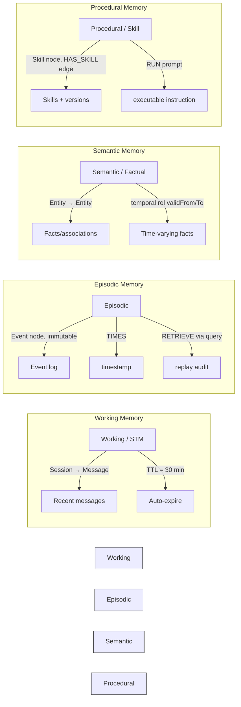
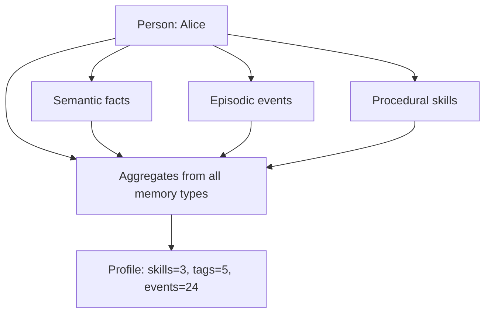

# Chapter 07 — AI Agent Memory Systems on Graphs

## 7.1 Memory Taxonomy for AI Agents

AI agents benefit from multiple memory systems, each with distinct graph constructs:



| Memory type | Node labels | Temporal edge? | TTL? | Typical query |
|-------------|-------------|-----------------|------|----------------|
| Working / STM | `Session → Message` | No | Yes (session TTL) | Last N messages of a session |
| Episodic | `Event → Entity` | No (immutable timestamp) | No (immutable) | All events involving X |
| Semantic / Factual | `Entity → Entity` | Optional | Possibly | "Company of Alice" |
| Temporal / Versioned | `Preference` on `HAS_PREF` | Yes (`validFrom`, `validTo`) | Yes (date window) | Theme on date D |
| Procedural / Skill | `Skill`, `HAS_SKILL` | Version on node | (reactive update) | Latest summarisation prompt |

## 7.2 Entity Resolution — Canonicalising Surface Mentions

Agents often mention ambiguous surface terms ("Apple", "AAPL", "acme"), and text contains noise. **Entity resolution** maps each mention to one canonical `Entity` node.

```mermaid
flowchart TD
    A[Raw mention: "Apple"] --> B[Dedupe against known terms]
    B --> C{Matches existing entity?}
    C -->|Yes, same identifier| D[Reuse canonical entity E1]
    C -->|No, new term| E[Create NEW Entity node]
    C -->|Partial match| F[Clarify & possibly merge]
    
    style D fill:#cfc,stroke:#333
    style E fill:#ccf,stroke:#9f9
    style F fill:#ffd,stroke:#999
```

### Example: "AAPL" vs "Apple"

```cypher
// During entity ingestion
MERGE (e:Entity {name: "Apple"})  // canonical from longer term
MERGE (p:Person {name: "Alice"})
MATCH (p)-[r:WORKS_AT]->(e)
SET r.surfaceTerms = ["AAPL"];   // record alternate mentions
```

The agent query resolves "AAPL" → canonical "Apple" first, then searches `Person -[:WORKS_AT]-> Entity`.

### Common Mistakes

| Mistake | Why it breaks memory | Fix |
|---------|---------------------|-----|
| One node per distinct string ("Alice", "Alicia") | Duplicate working memory paths | Use alias table / canonical label |
| No entity resolution on entry | Fragmented `Person -[:WORKS_AT]-> Company` pairs | Resolve before query |
| Hard-coding entity lists | Miss new entities | Use fuzzy matching + DB constraints |

## 7.3 Profile Building

A **profile** is a materialised, queryable view that summarises a person's observations (skills, interests, recent events). Build it incrementally via aggregation queries.

```cypher
// Summarise Alice's profile across semantic, episodic, procedural memory
MATCH (p:Person {name: $name})
OPTIONAL MATCH (p)-[:OWNS|TRIGGERS]->(f:Fact)
OPTIONAL MATCH (f)-[:INVOLVES]->(e:Entity)
OPTIONAL MATCH (p)-[:INVOLVES|HAPPENED_TO]->(ev:Event)
RETURN collect(DISTINCT e.name) AS associations,
       collect(DISTINCT ev.type) AS activities,
       count(*) AS total_interactions;
```



Store the materialised profile on each refreshed session so subsequent queries are fast.

## 7.4 Indexing Hot Paths

Index the properties queried frequently by indexing their labels and properties together.

```cypher
CREATE INDEX idx_person_name FOR (p:Person) ON (p.name);
CREATE INDEX idx_event_ts FOR (e:Event) ON (e.ts);
CREATE INDEX idx_session_created FOR (s:Session) ON (s.createdAt);
```

Vector index on `Document.embedding` for GraphRAG anchors; unique constraint on `User.id`; full-scan-preventing indexes on hot label/property combos.

## 7.5 JS/TS Pseudo Code — Memory Ingestion Service

```typescript
// Pseudo code — agent memory ingestion into graph
interface IngestItem {
  kind: 'fact' | 'event' | 'skill' | 'preference';
  source?: 'ingestion' | 'user_message';
  payload: Record<string, unknown>;
}

class MemoryIngestionService {
  constructor(private driver: any) {}

  async ingest(items: IngestItem[]): Promise<void> {
    for (const item of items) {
      switch (item.kind) {
        case 'fact':
          await this.writeFact(item);
          break;
        case 'event':
          await this.writeEvent(item);
          break;
        case 'skill':
          await this.upsertSkill(item);
          break;
        case 'preference':
          await this.upsertPreference(item);
          break;
      }
    }
  }

  async writeFact(item: IngestItem): Promise<void> {
    const { subject, relation, object } = item.payload;
    const pattern = `
      MERGE (s:Entity {name: $subject})
      MERGE (o:Entity {name: $object})
      MERGE ()-[r:OWNS|TRIGGERS]{{ key }}->(e) SET r.*
    `.replace(/r\.\*/, 'r').replace(/{ key }/, item.payload.key);
    await this.driver.executeQuery(pattern, {
      subject, object, key: item.payload.relation,
    });
  }

  async upsertPreference(item: IngestItem): Promise<void> {
    const prefs = JSON.parse(item.payload.data) as Array<{value: string; validFrom?: string; validTo?: string}>;
    for (const p of prefs) {
      const at = p.validFrom ?? new Date();
      await this.driver.executeQuery(
        `
        MATCH (u:User {id: $uid})
        MERGE (p:Preference {key: $key})
        MERGE (u)-[:HAS_PREF {key: $key, validFrom: datetime($vfrom), validTo: datetime($vto)}]->(p)
        `,
        { uid: item.payload.userId, key: item.payload.key, vfrom: p.validFrom, vto: p.validTo ?? null }
      );
    }
  }
}
```

## 7.6 Common Mistakes

| Mistake | Why it hurts | Fix |
|---------|--------------|-----|
| Distinct strings per node | Duplicate memory paths; bloated graph | Dedupe via entity resolution table |
| No index on user/session lookups | Full label scan per request | Create indexes on `(label, property)` |
| Profile rebuilt from scratch each time | Slow repeated aggregation | Cache + incremental update |
| Ignoring time windows | Prefer current state over stale | Query with `validFrom <= @at AND validTo > @at` |
| Indexing every node/relationship | Write latency, storage waste | Index only hot paths verified with PROFILE |

## 7.7 Key Takeaways

- Five memory types map naturally to five graph construct patterns (working, episodic, semantic, temporal, procedural).
- Entity resolution canonicalises surface mentions before search.
- Profiles materialise aggregations into an indexed lookup node.
- Index the hot lookup paths; create vector index for GraphRAG.
- Use temporal edges (`validFrom`/`validTo`) for facts that change over time.

---

**Self-check questions:**
15. Sketch the entity-resolution flow for a new mention "AAPL".
16. Which index makes “recent 30-min messages” fast?
17. Difference between *episodic* and *semantic* memory in graph terms.
