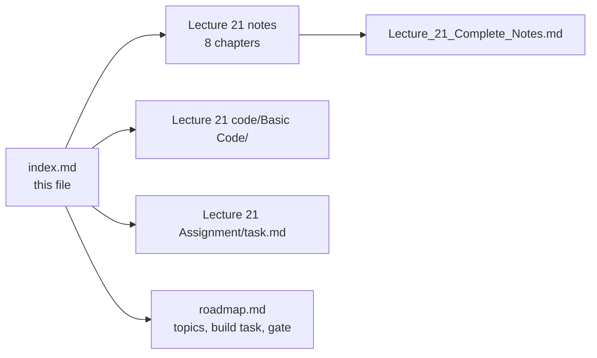

# 📚 Lecture 21 — MCP Core: Chapter Index

> **What this file is:** the chapter index for Lecture 21 — MCP Core. Each section lists
> the lecture's chapters with a number, a title, a one-line summary and a direct link to the file in
> that lecture's `notes/` folder — plus links to the lecture's `code/` and `Assignment/task.md`.
>
> **What this file is not:** the curriculum plan. For the topic list, goal, build task, gate and
> progress tracker of this lecture, use **[../README.md](../README.md)** and **[../../roadmap.md](../../roadmap.md)** —
> they are the single source of truth, so no topic is duplicated here.

**Repository navigation:** [../../README.md](../../README.md) · [../../roadmap.md](../../roadmap.md) · [Progress Tracker (Appendix D)](../../roadmap.md#-appendix-d--progress-tracker)

---

## 🟪 Lecture 21 — MCP Core

**Phase 6 · Integration · 🟡 Intermediate · 8 chapters + 1 consolidated document**
**Folder:** **[📂 Lecture 21 - MCP Core](../)** · **[📄 Roadmap: Phase 6](../../roadmap.md#-phase-6--integration--interoperability)**

| # | Chapter | One-line summary | Notes |
| :---: | :--- | :--- | :--- |
| **01** | **The Integration Problem and Why Standards Win** | N × M bespoke integrations scale badly; one protocol scales as N + M. | [📄 Chapter 01](../notes/01_The_Integration_Problem_and_Why_Standards_Win.md) |
| **02** | **What MCP Is — Protocol, Server and the Standard Interface** | MCP standardises *access*, not *capability*; a server needs no LLM. | [📄 Chapter 02](../notes/02_What_MCP_Is_Protocol_Server_and_Standard_Interface.md) |
| **03** | **MCP vs Tool Calling — Two Complementary Layers** | Tool calling = selection (model); MCP = delivery (application/protocol). | [📄 Chapter 03](../notes/03_MCP_vs_Tool_Calling_Complementary_Layers.md) |
| **04** | **Host, Client and Server — The Three Roles** | The core triad; one client per server; transports stdio + Streamable HTTP. | [📄 Chapter 04](../notes/04_Host_Client_Server_Architecture.md) |
| **05** | **The Tools Primitive — Executable Capability** | Tool definitions (name, description, schema), discovery, invocation, errors. | [📄 Chapter 05](../notes/05_The_Tools_Primitive.md) |
| **06** | **Resources and Prompts — Context and Reusable Instructions** | Tools (do), Resources (know), Prompts (reuse); control model. | [📄 Chapter 06](../notes/06_Resources_and_Prompts.md) |
| **07** | **Discovery, Invocation and Lifecycle** | End-to-end lifecycle; caching; context budget; diagnostics. | [📄 Chapter 07](../notes/07_Discovery_Invocation_and_Lifecycle.md) |
| **08** | **Security, Production and Practical Architecture** | Security stays with the host; threat model, OAuth resource servers, production concerns. | [📄 Chapter 08](../notes/08_Security_Production_and_Practical_Architecture.md) |

### 📄 Consolidated notes

A single document combining all eight chapters — executive summary, one master diagram, decision tables,
cheat sheet, misconceptions, glossary, and 20 self-check questions:

👉 **[Lecture_21_Complete_Notes.md](../notes/Lecture_21_Complete_Notes.md)**

### 🧩 This lecture's other artefacts

| Artefact | Link | Status |
| :--- | :--- | :---: |
| **Basic Code** — Express + TypeScript MCP server: 10 source files (`config/` · `server/` · `tools/` · `resources/` · `prompts/` · `services/` · `index.ts` · `client/client.ts`), 3 tools (`create_task`, `list_tasks`, `complete_task`), 2 resources (`company://policies/return-policy`, `company://policies/refund-policy`), 1 prompt (`review_pull_request`), 6-step client lifecycle demo | [📂 code/Basic Code](../code/Basic%20Code/) | ✅ |
| Chapter-wise implementation guide (9 chapters, 00 → 08: overview + full code + block-by-block explanation) | [📘 implementations guide](../code/Basic%20Code/implementations%20guide/) | ✅ |
| Assignment — chapter-wise practice questions, hands-on coding tasks, completion gate | [📝 Assignment/task.md](../Assignment/task.md) | ✅ |

