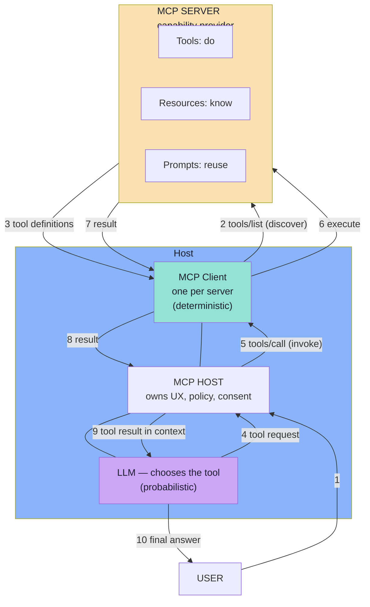

# Lecture 21 — MCP Core: Complete Consolidated Notes

> **Companion to the per-chapter notes in `notes/01_…` through `notes/08_…`.**
> This file is shorter than the chapters and links to them for depth. Use it for review, quick reference, and the self-check questions at the end.

---

## Contents

- [Executive Summary](#executive-summary)
- [The Eight Chapters at a Glance](#the-eight-chapters-at-a-glance)
- [The Complete Flow in One Diagram](#the-complete-flow-in-one-diagram)
- [Decision Tables](#decision-tables)
- [Cheat Sheet: Methods, Roles, Transports](#cheat-sheet)
- [Misconceptions & Corrections](#misconceptions--corrections)
- [Glossary](#glossary)
- [20 Self-Check Questions](#20-self-check-questions)
- [How to Use the Chapter Notes](#how-to-use-the-chapter-notes)

---

## Executive Summary

**MCP (Model Context Protocol)** is an open, standard protocol through which AI applications connect to external tools and data. It solves the **integration problem**: without a standard, every AI application re-integrates every external capability (N × M integrations); with MCP, every application speaks one protocol and every capability provider exposes it once (N + M).

| Component | One-line job |
|---|---|
| **Host** | The AI application; owns UX, policy, consent, context, composition |
| **MCP Client** | Talks the protocol to exactly one server — discovery, invocation, resources, prompts |
| **MCP Server** | Provides capabilities (tools, resources, prompts); does the actual work |

The lecture's three non-negotiable boundaries:

1. **An MCP server does not need an LLM.** It is ordinary business logic behind a standard door.
2. **MCP does not replace tool calling.** Tool calling decides *which* capability; MCP decides *where it comes from and how to reach it*.
3. **MCP standardises communication, not safety.** Security and authorisation remain the host's and server's responsibility.

This lecture covers chapters 01–08 (see below). Lectures 22+ go deeper on Resources, Prompts, and the production gateway.

---

## The Eight Chapters at a Glance

| # | Chapter | File | Core idea |
|---|---------|------|-----------|
| 01 | The Integration Problem and Why Standards Win | `notes/01_The_Integration_Problem_and_Why_Standards_Win.md` | Bespoke integrations scale as N × M; one protocol scales as N + M. |
| 02 | What MCP Is — Protocol, Server and the Standard Interface | `notes/02_What_MCP_Is_Protocol_Server_and_Standard_Interface.md` | MCP standardises *access*, not *capability*; a server needs no LLM. |
| 03 | MCP vs Tool Calling — Two Complementary Layers | `notes/03_MCP_vs_Tool_Calling_Complementary_Layers.md` | Tool calling = selection (model); MCP = delivery (application/protocol). |
| 04 | Host, Client and Server — The Three Roles | `notes/04_Host_Client_Server_Architecture.md` | The core triad; one client per server; transports stdio + Streamable HTTP. |
| 05 | The Tools Primitive — Executable Capability | `notes/05_The_Tools_Primitive.md` | Tool definitions (name, description, schema), discovery, invocation, errors. |
| 06 | Resources and Prompts — Context and Reusable Instructions | `notes/06_Resources_and_Prompts.md` | Tools (do), Resources (know), Prompts (reuse); control model. |
| 07 | Discovery, Selection, Invocation & Lifecycle | `notes/07_Discovery_Invocation_and_Lifecycle.md` | End-to-end lifecycle; caching; context budget; diagnostics. |
| 08 | Security, Production and a Practical Architecture | `notes/08_Security_Production_and_Practical_Architecture.md` | Security stays with the host; threat model, OAuth resource servers, production concerns. |

**Lecture roadmap:** Chapters 06's Resources/Prompts get full depth in **Lecture 22**. Chapter 08's gateway architecture continues in Lecture 22 as well. This lecture's scope is first contact with all three primitives, centred on **Tools**.

---

## The Complete Flow in One Diagram

> **The baton passes exactly once:** after step 4 (the model's choice), everything is deterministic and testable. Everything before step 4 needs evaluation; everything after needs tests.

---

## Decision Tables

### Which primitive should I use?

| Situation | Primitive | Who drives | Protocol call |
|---|-----------|------------|---------------|
| State-changing action the model decides to take | **Tool** | Model | `tools/list`, `tools/call` |
| Addressable content the app already knows is relevant | **Resource** | Application | `resources/list`, `resources/read` |
| Reusable instruction/workflow the user picks | **Prompt** | User | `prompts/list`, `prompts/get` |
| Ranking over a large corpus to find relevant content | **Tool** (backed by RAG) | Model | `tools/call` (e.g. `searchKnowledge`) |
| Content identified by a stable URI, fetched on demand | **Resource** | Application | `resources/read` |

### When to use MCP vs. in-process tool calling

| Situation | Use | Why |
|---|-----|-----|
| One app, tools live inside it, no reuse | **Tool calling only** | Simplest; no protocol needed |
| Tools external/shared/third-party, or multiple consumers | **Tool calling + MCP** | Standard access; N + M scaling |
| Capability also consumed by CLI, tests, other services | **MCP only** | Server is a normal program; no model needed |
| Pure text generation, no external action | **Neither** | Don't over-engineer |

### stdio vs Streamable HTTP

| Question | stdio | Streamable HTTP |
|---|-------|-----------------|
| Where does the server run? | Same machine | Anywhere |
| Who starts it? | The client (subprocess) | Independently |
| Multiple clients per server? | No | Yes |
| Auth needed? | Rarely (local trust) | Yes — OAuth 2.1 resource server |
| Can it be a SaaS product? | No | Yes |
| Best for | Local dev, desktop tools | Shared, hosted, networked capability |

> **Practical rule:** start with stdio locally; move to Streamable HTTP when you must share or host the server.

---

## Cheat Sheet

### Methods you will actually use

| Method | Direction | Purpose |
|---|--------|---------|
| `tools/list` | Client → Server | Discover tools + their input schemas |
| `tools/call` | Client → Server | Invoke a tool (name + arguments) |
| `resources/list` | Client → Server | List concrete resources |
| `resources/templates/list` | Client → Server | List parameterised resource templates |
| `resources/read` | Client → Server | Read a resource's contents by URI |
| `prompts/list` | Client → Server | List available prompt templates |
| `prompts/get` | Client → Server | Get a prompt with arguments substituted |
| `initialize` | Client → Server | Negotiate version + capabilities (classic revision) |
| `notifications/tools/list_changed` | Server → Client | Catalogue changed — re-discover |

### JSON-RPC 2.0 shapes

| Shape | `id`? | Reply? | Example |
|---|-------|--------|---------|
| Request | yes | yes | `{"jsonrpc":"2.0","id":1,"method":"tools/list"}` |
| Response | yes | — | `{"jsonrpc":"2.0","id":1,"result":{…}}` |
| Notification | no | no | `{"jsonrpc":"2.0","method":"notifications/…"}` |
| Error | yes | — | `{"jsonrpc":"2.0","id":1,"error":{…}}` |

### The two error mechanisms (never confuse)

| | Protocol error | Tool execution error (`isError`) |
|---|---|---|
| When | Call never happened | Call ran, outcome failed |
| Envelope | JSON-RPC `error` object | Normal `result` |
| Retry safe? | Usually yes | Only if idempotent |
| Who sees it | Client/host | The model (becomes context) |

### Tool annotations (host policy hints)

| Annotation | Meaning | Host behaviour |
|---|---------|----------------|
| `readOnlyHint` | No modifications | Auto-approve |
| `destructiveHint` | May destroy data | Require user confirmation |
| `idempotentHint` | Repeatable safely | Retry on timeout |
| `openWorldHint` | Unbounded external interaction | Sandbox + rate-limit |

> Annotations are hints, **not guarantees**. Never let an annotation replace your own policy.

### The six questions every integration must answer (and what they become in MCP)

| # | Question | MCP answer |
|---|----------|------------|
| 1 | What capabilities exist? | `tools/list`, `resources/list`, `prompts/list` |
| 2 | Where are they? | MCP endpoint / transport (stdio or Streamable HTTP) |
| 3 | What parameters do they need? | `inputSchema` (JSON Schema) |
| 4 | How should they be called? | `tools/call` with `name` + `arguments` |
| 5 | What do they return? | `content` blocks + optional `structuredContent` |
| 6 | How does authentication work? | OAuth 2.1 / token handling at the transport layer |

---

## Misconceptions & Corrections

| Misconception | Correction | Where |
|---|-----------|-------|
| "MCP replaces tool calling" | MCP delivers what tool calling selects. Complementary layers. | Ch 03 |
| "An MCP server contains an LLM" | MCP servers need no LLM; they are deterministic business logic. | Ch 02 |
| "MCP is just REST with a different name" | REST exposes endpoints to programmers; MCP exposes capabilities to models. They compose — MCP can sit over REST. | Ch 02 |
| "Discovery = permission" | Discovery is an inventory; the host decides what may actually run. | Ch 08 |
| "Trust tool descriptions blindly" | Descriptions can be poisoned; show them in consent UIs and re-consent on change. | Ch 08 |
| "Forward the user's token downstream" | Token passthrough breaks audience binding; the server uses its own credentials. | Ch 08 |
| "Tools are the whole server" | Tools are one third; resources and prompts are the other two. | Ch 05/06 |
| "Call `tools/list` on every message" | It's a cache with an invalidation signal (`list_changed`, TTL), not per-message. | Ch 07 |
| "MCP makes the model smarter" | MCP standardises access, not intelligence. The model still chooses. | Ch 01/03 |

---

## Glossary

| Term | Meaning |
|---|---|
| **Host** | The AI application the user interacts with; orchestrates UX, policy, consent, context |
| **MCP Client** | Protocol speaker; one per server; handles discovery and invocation |
| **MCP Server** | Capability provider; exposes tools/resources/prompts; executes business logic |
| **Tool calling** | The model's decision of which capability to use, with what arguments |
| **Discovery** | `tools/list` — learning what a server offers before offering it to the model |
| **Invocation** | `tools/call` — the host routing a model's tool request to the right server |
| **Resource** | Addressable context/data identified by a URI; read-only; application-controlled |
| **Prompt** | Reusable instruction template/workflow; user-controlled; `prompts/get` |
| **JSON-RPC 2.0** | The message envelope MCP uses (request / response / notification / error) |
| **stdio** | Local transport: client spawns server as a subprocess over stdin/stdout pipes |
| **Streamable HTTP** | Remote transport: single HTTP endpoint supporting POST + GET, optional SSE |
| **Tool context poisoning** | Attacker-controlled tool output that the model treats as instruction |
| **Confused deputy** | A proxy authorised once, then used by an attacker to access things it should not |
| **Progressive least privilege** | Request minimal scopes first; elevate only when a privileged tool is invoked |
| **Idempotency key** | A client-supplied key so a retried call does not duplicate side effects |

---

## 20 Self-Check Questions

> Answer without notes before moving on. Links point to the chapter with the detail.

### Architecture & roles

1. Which component owns the conversation history, consent UI, and which tools to show the model? → Ch 04
2. True or false: one MCP Client can talk to multiple MCP servers simultaneously. → Ch 04
3. The model chooses a tool — but who resolves that tool name to a specific server connection? → Ch 04 / Ch 07
4. Name the three primitives an MCP server can expose and the verb each answers ("do / know / reuse"). → Ch 05 / Ch 06

### MCP vs tool calling

5. What question does tool calling answer? What question does MCP answer? → Ch 03
6. Exactly one of the eight lifecycle steps is tool calling — which one? → Ch 03
7. "MCP does not replace tool calling" — give an example of a system that needs tool calling but not MCP. → Ch 03

### Tools

8. What three things does a model see in a tool definition? → Ch 05
9. Name four tool annotations and the host behaviour each enables. → Ch 05
10. What is the difference between a protocol error and `isError: true`? Which is safe to retry? → Ch 05
11. What is `structuredContent`, and how is it different from "structured output" (schema-constrained generation)? → Ch 05

### Discovery & lifecycle

12. Is `tools/list` required on every user message? If not, what invalidates the cache? → Ch 07
13. Name the eight lifecycle steps and mark which are probabilistic vs deterministic. → Ch 07
14. A server adds a new tool mid-session. What notification tells the client, and what must the host do before the model can use it? → Ch 07 / Ch 08
15. What is the context-budget problem, and name two mitigations? → Ch 07

### Security & production

16. Quote the governing security sentence of this lecture. → Ch 08
17. Name three threats from the MCP threat model and one mitigation for each. → Ch 08
18. True or false: a remote MCP server may accept a token not issued for it. → Ch 08
19. What is progressive least privilege, and why is it better than requesting all scopes up front? → Ch 08
20. Which transport would you choose for a server that must be shared by many users over the network, and what auth model does it require? → Ch 04 / Ch 08

> **Gate for this lecture (from the roadmap):** you can swap a STDIO server for an HTTP/SSE server without changing the host application. If you can explain how the host/client abstraction makes that swap possible, you're ready for Lecture 22.

---

## How to Use the Chapter Notes

| If you want… | Read |
|---|---|
| The "why MCP exists" argument (integration problem, N × M → N + M) | Ch 01 |
| Precise definition of MCP, server vs LLM, protocol vs framework, MCP vs REST | Ch 02 |
| Tool calling vs MCP, the handoff, responsibility matrix | Ch 03 |
| Host / Client / Server in depth, transports, lifecycle, capabilities | Ch 04 |
| Tool definition fields, schema design rules, error handling, security duties | Ch 05 |
| Resources (URIs, templates, annotations), Prompts, control model, Resources vs RAG | Ch 06 |
| End-to-end lifecycle, dynamic discovery, caching, context budget, diagnostics | Ch 07 |
| Security threat model, OAuth resource servers, production concerns, build order | Ch 08 |

Each chapter ends with its own **Common mistakes** and **Key takeaways** sections — start there when reviewing.

---

**Back to:** [Lecture README](../README.md) · [Roadmap (Lecture 21 card)](../../roadmap.md) · [Next: Lecture 22 — MCP: Resources, Prompts & Production Gateway Architecture](../Lecture%2022%20-%20MCP%20Resources%2C%20Prompts%20%26%20Production%20Gateway%20Architecture/)
