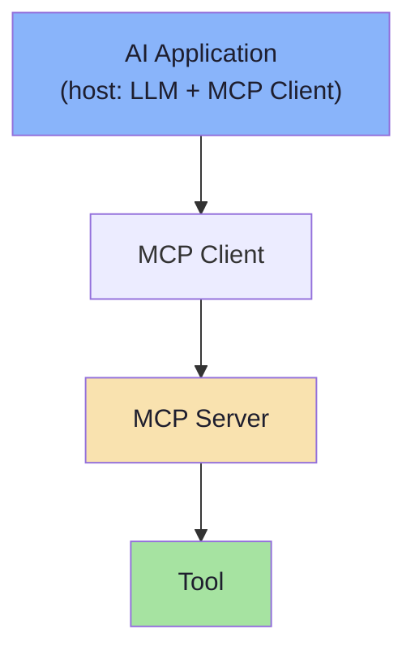
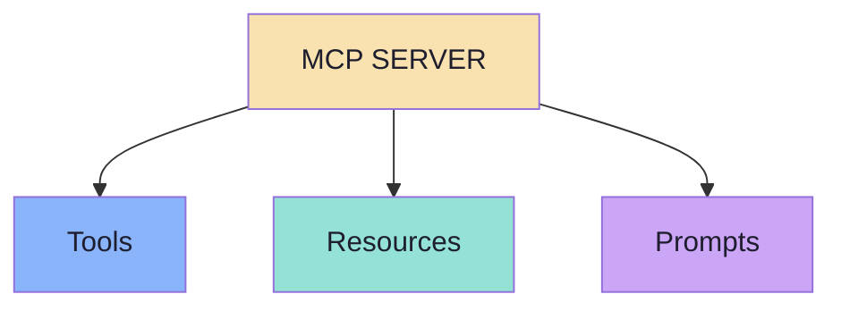
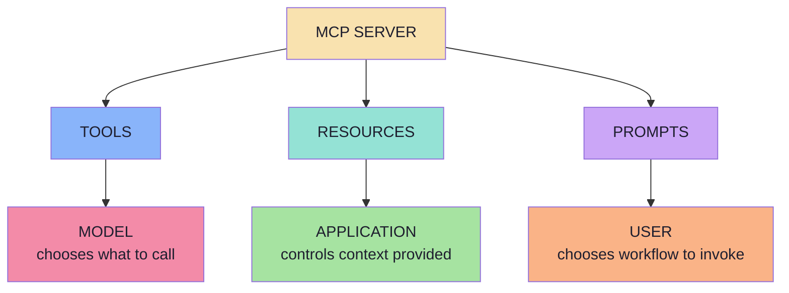
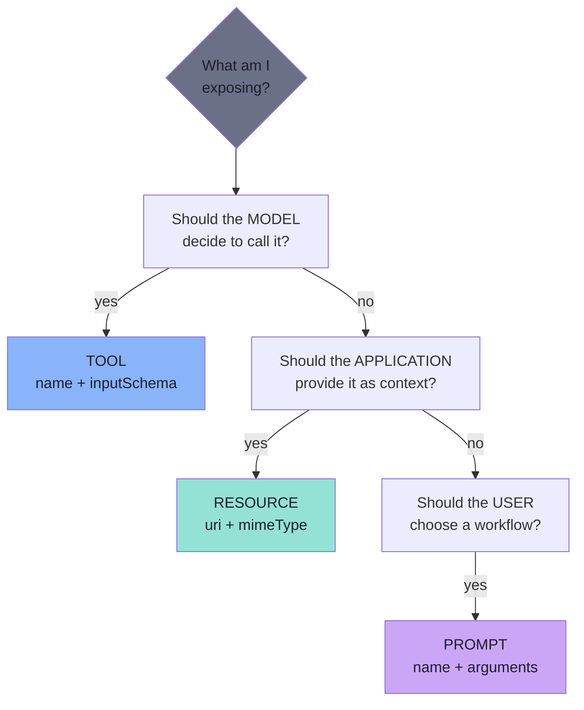
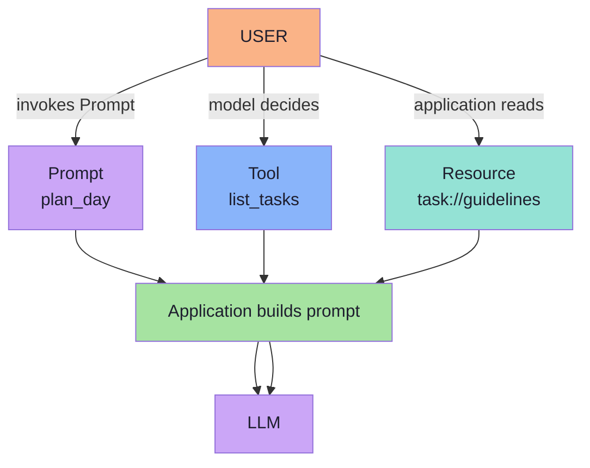

# Chapter 01: The Three Primitives and the Control Model

> **Chapter Goal:** Lecture 14 built an MCP Server that exposed exactly one kind of thing — a **Tool**. This chapter opens the whole surface: an MCP Server can expose **Tools**, **Resources** and **Prompts**. They are not three flavours of the same idea; they differ in *purpose* and, more importantly, in **who is allowed to decide when they run**.
>
> At the end of this chapter you should be able to answer: *I have something to expose to an AI application — which of the three primitives is it, and who should be holding the trigger?*

---

## 1.1 Where Lecture 14 Left Us

Lecture 14 started from a single working `getWeather()` tool and built the case for a standard protocol. It then dissected the **Tool** primitive completely.

The flow it produced looked like this:



An MCP Server may expose tools such as:

```text
createTask()
getWeather()
sendEmail()
```

> **The model drives tools.** The LLM inspects the tool definitions, and *it* decides when one of them should be invoked.

```text
User
 ↓
LLM
 ↓
createTask(...)
 ↓
MCP Server
 ↓
Task created
```

That round trip — model asks, protocol delivers, result returns to context — is the loop Lecture 14 spent eight chapters on.

---

## 1.2 Tools Are Only One Third of the Server

> **Tools, however, are only one thing an MCP Server can expose.**
> An MCP Server can expose **three major primitives**.



The lecture's mental model is deliberately short:

| Primitive | It is about… |
|---|---|
| **Tools** | **Capabilities** |
| **Resources** | **Context** |
| **Prompts** | **Reusable AI workflows** |

```text
Tools       → Capabilities
Resources   → Context
Prompts     → Reusable AI workflows
```

Read that as three different user needs:

- *"I want my AI to **do** something."* → Tool
- *"I want my AI to **know** something."* → Resource
- *"I want a **reusable way** of asking my AI for something."* → Prompt

> **One server can expose any subset.** A server that only registers tools is legal and common — it is simply leaving two thirds of the protocol unused, and some capabilities genuinely fit the other primitives better (Chapters 02 and 06 make that case).

---

## 1.3 The Real Distinction: Who Controls It

Purpose is the friendly explanation. The load-bearing distinction is **control**:



| | Tools | Resources | Prompts |
|---|---|---|---|
| Purpose | Capabilities | Context | Reusable workflows |
| **Controlled by** | **Model** | **Application** | **User** |
| Verb | **Do** | **Know** | **Reuse** |
| Side effects | Usually yes | No — read-only | No |
| Identified by | `name` | `uri` | `name` |
| Discovery call | `tools/list` | `resources/list` | `prompts/list` |
| Retrieval call | `tools/call` | `resources/read` | `prompts/get` |

> **Why control is the important axis, not purpose:** control decides **blast radius** and **who has to consent**. A model-invoked capability can change state on a whim; an application-read resource is a deliberate decision made by code you wrote; a user-invoked prompt is an explicit human act. Getting this wrong is how you end up with an LLM deleting rows because "it seemed relevant".

---

## 1.4 The Three Questions

The lecture ends with a set of questions that map one-to-one onto the primitives. They are the fastest classification tool you will get:



Run them in order. The first `yes` wins, because the earlier question is the one with the larger blast radius.

---

## 1.5 One Server, Three Faces

The same task-management server used throughout this lecture exposes all three at once:

```text
taskServer
│
├── Tools
│    ├── create_task
│    ├── list_tasks
│    └── complete_task
│
├── Resources
│   └── task://guidelines
│
└── Prompts
    └── plan_day
```



| | Tools | Resources | Prompts |
|---|---|---|---|
| Purpose | Capabilities | Context | Reusable workflows |
| **Controlled by** | **Model** | **Application** | **User** |
| Verb | **Do** | **Know** | **Reuse** |
| Side effects | Usually yes | No — read-only | No |
| Identified by | `name` | `uri` | `name` |
| Discovery call | `tools/list` | `resources/list` | `prompts/list` |
| Retrieval call | `tools/call` | `resources/read` | `prompts/get` |

> **The three questions you will always run:**

```text
TOOLS
"What should the MODEL be able to call?"

RESOURCES
"What context should the APPLICATION be able to provide?"

PROMPTS
"What reusable workflows should the USER be able to choose?"
```

---

## 1.6 Key Takeaways

1. **An MCP Server can expose three primitives:** Tools, Resources, and Prompts. They are distinct by purpose and by who controls them.
2. **Tools** → model-controlled, capabilities, may have side effects, identified by `name`.
3. **Resources** → application-controlled, context/data, read-only, identified by `uri`.
4. **Prompts** → user-controlled, reusable interaction templates, generate messages (not final answers), identified by `name`.
5. **The real distinction is control:** model decides → Tool; application provides → Resource; user chooses → Prompt.
6. **One server can expose any subset** of the three primitives.
7. The three classification questions, run in order, give the fastest answer.

---

## 1.7 Common Mistakes

- Assuming "it returns data" means it should be a Tool (Chapter 02 shows that resources also return data, but with different intent).
- Letting the model decide to read a Resource (Resources are application-controlled, not model-controlled).
- Surfacing Prompts as model-invoked capabilities (Prompts are user-controlled; the model should not decide *when* to invoke a Prompt).
- Naming a Resource with a verb (Resources use noun/documents names; Tools use verb-named schemas).

## Key Takeaways (condensed)

| | Tools | Resources | Prompts |
|---|---|---|---|
| Who decides | Model | Application | User |
| What it is | Capability | Context | Reusable workflow |
| Verb | Do | Know | Reuse |
| Side effects | Yes | No | No |


*Next: Chapter 02 — Why Resources, Context as a First-Class Primitive*