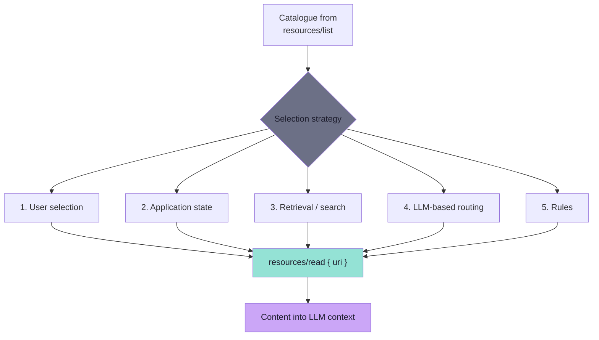
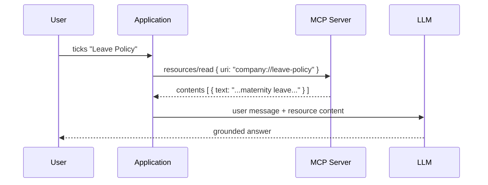
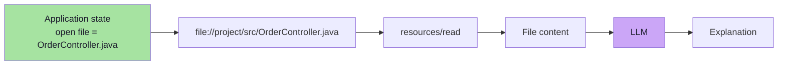
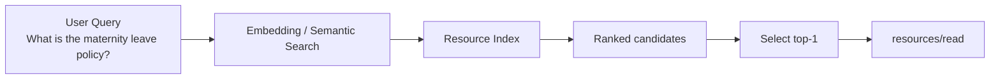
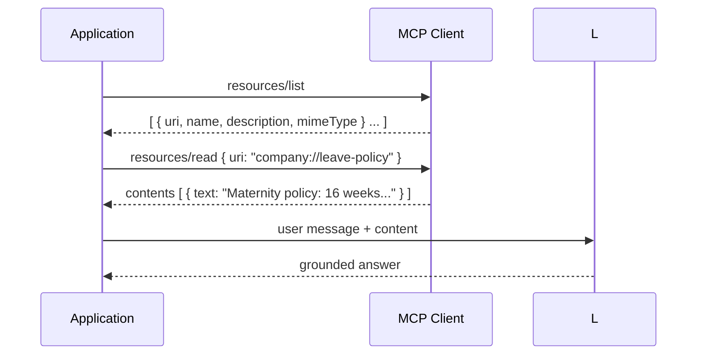
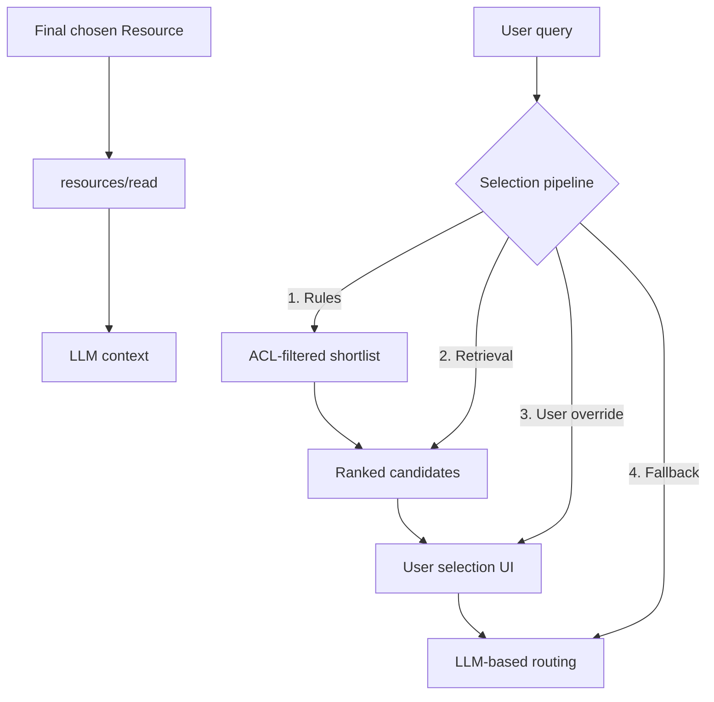
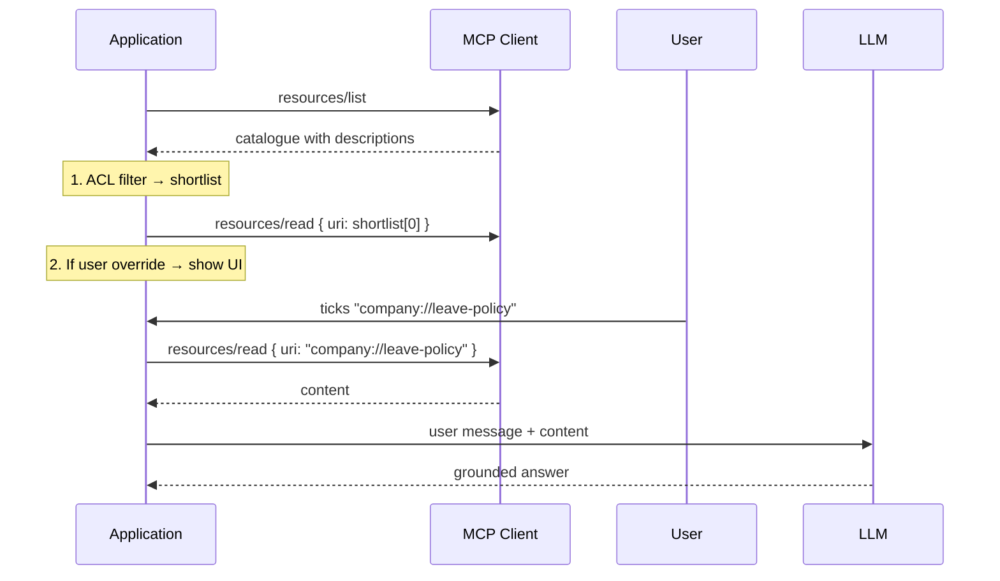

# Chapter 05: How the Application Chooses a Resource

> **Chapter Goal:** "Application-controlled" sounds like an answer. It is actually a **question**: which resource, out of the catalogue, does *my* application read for *this* request? MCP deliberately does not answer that. This chapter covers the four strategies the lecture names — user selection, application state, retrieval, and LLM-based routing — and ends with the Resources-vs-Tools rule that decides whether the choice should exist at all.
>
> At the end of this chapter you should be able to answer: *Given a user message and a catalogue of Resources, what code selects one — and how do I keep that selection honest?*

---

## 5.1 The Missing Piece

> **Calling Resources application-controlled does not mean the application automatically understands natural language.**

> **MCP does not prescribe how a host selects a Resource.**

> **The application can use several strategies.**



The strategies are not exclusive. Real hosts combine them — for example *"rules decide the shortlist, retrieval ranks it, and the user can always override by attaching a resource manually."*

---

## 5.2 Strategy 1 — User Selection

> **A client may allow users to explicitly attach a Resource.**



### UI example

```text
Attach Context

[ ] Coding Guidelines
[✓] Leave Policy
[ ] Architecture
[ ] Security Policy
```

> **Once the user selects `Leave Policy`, the application can perform:**

```text
resources/read
company://leave-policy
```

> **and add the content to the model context.**

### Why this is the highest-quality strategy

| Property | Value |
|---|---|
| **Precision** | Perfect — the human chose it |
| **Explainability** | Perfect — "the user attached this" |
| **Cost** | Zero ranking cost |
| **Failure mode** | The user forgets, or the list is too long to scan |

> **Design note:** this is the strategy that makes `description` (Chapter 03) a *user-facing* field. A checkbox labelled `company://leave-policy` is unusable; a checkbox labelled *"Company policies regarding leave, holidays, maternity leave and time off."* is self-explanatory.

---

## 5.3 Strategy 2 — Application State

> **Sometimes the application already knows what context is relevant.**

> **Consider an IDE. The currently open file is:**

```text
OrderController.java
```

> **The user asks:**

```text
Explain this code.
```

> **The IDE already knows which file the user is referring to.**



### Why this is the strategy people forget

The most valuable context is often *already known* by the application and needs no inference at all:

| Application | State it already has | Resource it implies |
|---|---|---|
| IDE | Open file, selection, cursor | `file://project/src/OrderController.java` |
| Support console | Open ticket | `ticket://48213` |
| Admin dashboard | Current tenant | `tenant://acme/config` |
| Chat with a task list | Today's date and tasks | `task://guidelines`, `user://me/profile` |

> **"No additional AI decision is required" is the punchline.** Every problem you solve with application state is a problem you do not have to solve with a ranking model — and a problem that cannot be hallucinated.

### The rule that follows

```text
If the application already knows the answer to "which resource?",
do not ask a model.
```

---

## 5.4 Strategy 3 — Retrieval or Search

> **If hundreds or thousands of Resources exist, the application can use retrieval.**

> **Example Resource metadata:**

```text
Resource:
leave-policy

Description:
Company policies regarding leave,
holidays, maternity leave and time off.
```

> **User asks:**

```text
What is the maternity leave policy?
```

> **The application could perform:**



> **Select the best-matching Resource and read it.**



> **Example Resource metadata:**

```text
Resource:
leave-policy

Description:
Company policies regarding leave,
holidays, maternity leave and time off.
```

> **User asks:**

```text
What is the maternity leave policy?
```

> **The application could perform:**

1. Take the user query
2. Embed it (same model as Resource descriptions)
3. Compute similarity against all Resource descriptions
4. Rank and pick the best match
5. Call `resources/read` on the top match

### Hybrid approaches in production

| Layer | What it contributes |
|---|---|
| **Rules** | Narrow the shortlist (e.g. "only leave-policy resources") |
| **Retrieval** | Rank the shortlist by similarity |
| **User selection** | Let the human pick from the top-3 candidates |

> **Real host:** *"rules decide the shortlist, retrieval ranks it, and the user can always override by attaching a resource manually."*

---

## 5.5 Strategy 4 — LLM-Based Routing

> **If the application needs the model to help pick a Resource, it can ask the LLM.**

> **Example:**

```text
User asks: "Tell me about our leave policy."

System prompt:
You are a support assistant. The user may need information about company policies.
Available Resources (from resources/list):
- company://leave-policy: Company policies regarding leave, holidays, maternity leave and time off.
- company://coding-guidelines: Coding standards used by our Java development team.
- company://security-policy: Security policies and access control rules.

The user's request is about leave. Which Resource should be read?
```

> **The application sends the list to the model** and asks it to pick the most relevant one. The model returns the choice, the application reads that Resource and places it in context.

### Pros and cons

| | LLM-based routing |
|---|---|
| **Pros** | Works when no good metadata exists; model "understands" intent; flexible |
| **Cons** | Non-deterministic; adds a model call; can be wrong; costs tokens |

> **Design advice:** only use LLM-based routing when rules and retrieval don't suffice. It is the most expensive strategy and should be a fallback, not the default.

---

## 5.6 The Resources-vs-Tools Rule

> **MCP does not choose.** But sometimes the question itself is confused — *"is this a Resource or a Tool?"*. The lecture gives a final rule that maps one-to-one.

```mermaid
flowchart TD
    Q{"Is this something the<br/>MODEL should decide<br/>"or" the APPLICATION?"} -->|"MODEL should decide"| T["TOOL"]
    Q -->|"APPLICATION should decide"| R["RESOURCE"]
```

> **The classification rule, in order:**

```text
1. Should the MODEL decide to call it?
   → Tool

2. Should the APPLICATION provide it as context?
   → Resource
```

> **Why this order:** the earlier question (model decides) has a larger blast radius. If the model can invoke something with side effects, that is a Tool. If the application just needs to supply context, that is a Resource.

---

## 5.7 Selection in Practice — Combining Strategies

Real hosts rarely use just one strategy. A typical production flow:



> **Typical pipeline:**

1. **Rules** — enforce ACL, exclude inaccessible URIs.
2. **Retrieval** — embed user query + Resource descriptions, rank by similarity.
3. **User UI** — present top-3 candidates as checkboxes (descriptions from Chapter 03).
4. **Fallback** — if user doesn't pick, let the model choose from the top-1 (or ask for clarification).



> **The key insight:** the protocol gives you the primitives and their control boundaries. The *selection strategy* is application-level engineering — and the four strategies above are the building blocks.

---

## 5.8 Key Takeaways

1. **MCP does not prescribe** how a host selects a Resource — it is an application-level decision.
2. **Four strategies** exist: user selection, application state, retrieval/search, and LLM-based routing.
3. Strategies are **not exclusive** — real hosts combine them (rules → retrieval → user override → LLM fallback).
4. **The Resources-vs-Tools rule:** if the model should decide → Tool; if the application should provide → Resource.
5. **User selection** is the highest precision but suffers from long lists; descriptions (Chapter 03) are critical.
6. **Application state** is the zero-cost strategy when the context is already known (open file, ticket, tenant).
7. **Retrieval/search** scales to thousands of Resources but requires embedding both queries and descriptions.
8. **LLM-based routing** is the most expensive fallback; use only when no other strategy suffices.

---

## 5.9 Common Mistakes

- Asking the model to choose a Resource when the application already knows the answer (violates application-controlled principle).
- Letting the model invoke a Resource as if it were a Tool (model cannot invoke Resources — only the application can read them).
- No fallback strategy — if retrieval fails and the user can't pick, the request has no context.
- Omitting descriptions — without them, retrieval and user-facing UI are both blind.
- Treating user selection as the only strategy — production systems must combine multiple strategies.

*Next: Chapter 06 — MCP Prompts: Reusable Interaction Templates*