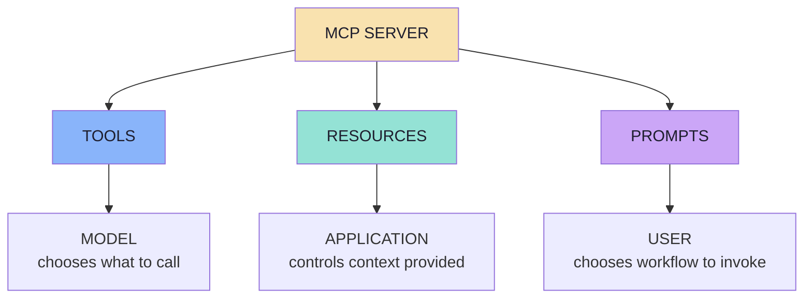
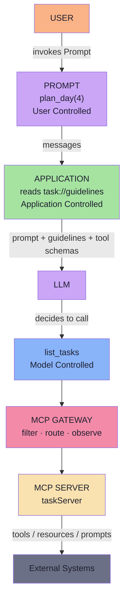

# Lecture 22 — Complete Notes: MCP Resources, Prompts & Production Gateway Architecture

> **Phase:** 6 · Integration · **Level:** 🟠 Advanced · **Prerequisites:** Lecture 21 (MCP from First Principles)
>
> **Goal:** Master all three MCP primitives and put each under the right owner.
>
> **Source mapping:** `FDE L15 · GAC D15` — see `roadmap.md` for exact file paths.

---

# Executive Summary

Lecture 22 completes the MCP story that Lecture 14 began. Lecture 14 showed how an MCP Server exposes **Tools** — capabilities the model decides to call. Lecture 22 adds the other two-thirds of the protocol: **Resources** (context/data the application supplies) and **Prompts** (reusable interaction templates the user invokes). It then layers on the production-grade concerns that appear once you expose many capabilities across many servers: gateway-based tool filtering, context poisoning defence, and boundary security.

The three primitives are a vocabulary, not a checklist:

| Primitive | What it is | Who controls it | It produces |
|---|---|---|---|
| **Tools** | Callable capabilities | **Model** | A result |
| **Resources** | Context / reference data | **Application** | Content |
| **Prompts** | Reusable interaction templates | **User** | Messages |

And the one-sentence compression:

> **A server publishes what can be *done* (Tools), what can be *known* (Resources) and what can be *asked* (Prompts) — and the protocol keeps the model, the application and the user in their own lanes.**

---

# Table of Contents

| # | Chapter | One-line summary |
|---|---|---|
| 01 | [The Three Primitives and the Control Model](notes/01_The_Three_Primitives_and_the_Control_Model.md) | Three primitives; the difference that matters is **control**. |
| 02 | [Why Resources — Context as a First-Class Primitive](notes/02_Why_Resources_Context_as_a_First_Class_Primitive.md) | Tools can return data — Resources exist because of **intent**, not payload. |
| 03 | [Resource Discovery, Reading and Anatomy](notes/03_Resource_Discovery_Reading_and_Anatomy.md) | Discovery and reading are **separate**; the URI is an identifier, **not a URL**. |
| 04 | [Building Resources — Static, Dynamic and Templated](notes/04_Building_Resources_Static_Dynamic_and_Templated.md) | Static, dynamic and **templated** resources — with authorisation in the handler. |
| 05 | [How the Application Chooses a Resource](notes/05_How_the_Application_Chooses_a_Resource.md) | **MCP does not choose.** User, state, retrieval, rules or a router — you decide. |
| 06 | [MCP Prompts — Reusable Interaction Templates](notes/06_MCP_Prompts_Reusable_Interaction_Templates.md) | A Prompt is a **message template**; `MCP Prompt ≠ LLM Response`. |
| 07 | [Prompt Arguments, Discovery and Client Wiring](notes/07_Prompt_Arguments_Discovery_and_Client_Wiring.md) | `getPrompt` talks to the server; the **LLM call happens afterward**. |
| 08 | [Bringing Tools, Resources and Prompts Together](notes/08_Bringing_Tools_Resources_and_Prompts_Together.md) | One request, three controls: **user → prompt, application → resource, model → tool**. |
| 09 | [MCP Gateway, Context Poisoning & Security](notes/09_MCP_Gateway_Context_Poisoning_and_Security.md) | Gateway as a central control layer against tool overload, poisoning, and security gaps. |

For full detail on any topic, read the linked chapter file. The notes below are a condensed reference; they are **not** a copy-paste of the chapters.

---

# Cheat Sheet

## The three primitives at a glance

| | Tool | Resource | Prompt |
|---|---|---|---|
| Purpose | Capability | Context | Reusable workflow |
| Controlled by | Model | Application | User |
| Verb | Do | Know | Reuse |
| Side effects | Possible | None | None |
| Identified by | `name` | `uri` | `name` |
| Discovery | `tools/list` | `resources/list` | `prompts/list` |
| Retrieval | `tools/call` | `resources/read` | `prompts/get` |
| Arguments | `inputSchema` | URI template | argument list |
| Produces | A result | Content | Messages |

## The three classification questions (run in order)

1. Should the **MODEL** decide to call it? → **Tool**
2. Should the **APPLICATION** provide it as context? → **Resource**
3. Should the **USER** choose a workflow? → **Prompt**

## The control model in one picture

## A Resource definition

| Field | When seen | Example |
|---|---|---|
| Name | `resources/list` | `coding-guidelines` |
| URI | `resources/list` + `resources/read` | `company://coding-guidelines` |
| Description | `resources/list` | `Coding standards used by our Java dev team.` |
| MIME type | `resources/list` + `resources/read` | `text/plain` |
| Content | `resources/read` only | `Use Java 21. ...` |

## Resource operations

| Operation | Purpose | Cost | Payload |
|---|---|---|---|
| `resources/list` | Discover what exists | Cheap, cacheable | Metadata only |
| `resources/read` | Read one resource | Expensive, deliberate | `contents[]` array (text / blob) |
| `resources/templates/list` | Discover parameterised resources | Cheap | URI template patterns |

## A Prompt operation

| Operation | Purpose | Payload |
|---|---|---|
| `prompts/list` | Discover workflows | Prompt names, descriptions, arguments |
| `prompts/get` | Render messages for the LLM | `messages[]` + `description` |

## Gateway responsibilities

Discovery → Filtering → Routing → Security → Observability

| Capability | What it does |
|---|---|
| Tool discovery | Lists what exists across servers |
| Tool filtering | Shows only relevant tools per request |
| Routing | Sends `tools/call` to the right downstream server |
| Authentication | Answers *"who are you?"* |
| Authorization | Answers *"what are you allowed to do?"* |
| Credential management | Keeps secrets away from the model |
| Observability | Logs, metrics, traces, audit trail |
| Rate limiting | Caps requests per user / per minute |

---

# Decision Tables

## Tool vs Resource vs Prompt — which to build?

| Situation | Primitive | Why |
|---|---|---|
| The model must decide when to run an action with side effects | **Tool** | Model-controlled, `tools/call`, `inputSchema` |
| The application knows what context the model needs right now | **Resource** | Application-controlled, `resources/read`, URI |
| Users keep repeating the same workflow phrasing | **Prompt** | User-controlled, `prompts/get`, messages |

## Resource selection strategies

| Strategy | Best for | Cost | Failure mode |
|---|---|---|---|
| User selection | Human-verified context | Zero ranking cost | User forgets / list too long |
| Application state | Context already known by app | Zero model inference | None — no inference needed |
| Retrieval / search | Thousands of resources | Embedding + ranking | Wrong rank |
| LLM-based routing | No good metadata exists | Extra model call | Non-deterministic |
| Rules | ACL / policy-driven shortlist | Minimal | Over-filtering |

## Gateway topology choice

| Situation | Recommendation |
|---|---|
| One server, few tools, one application | Direct MCP connection (simpler) |
| Many servers, hundreds of tools, enterprise | MCP Gateway (centralise filtering, auth, observability) |
| Regulated / multi-tenant environment | MCP Gateway (centralised policy layer) |

---

# Misconceptions

| Misconception | Reality |
|---|---|
| "It returns data, so it's a Tool." | Resources also return data; the distinction is **intent** (who decides / why it exists), not payload. |
| "A Resource becomes part of the LLM context automatically." | No — the application must `resources/read` it and place it in the prompt. |
| "URIs are URLs the client fetches." | No — the URI is an identifier the **server resolves**. |
| "The model decides to invoke Prompts." | No — Prompts are user-controlled; the model does not decide when to invoke `plan_day`. |
| "A Prompt generates the final AI answer." | No — a Prompt generates **messages** the LLM then answers. |
| "Gateway filtering is required by MCP." | No — tool filtering is an architectural pattern around MCP, not a protocol primitive. |
| "More tools = more powerful agent." | No — more tools means more context, more latency, and worse selection; filter to what's relevant. |

---

# Glossary

| Term | Definition |
|---|---|
| **MCP** | Model Context Protocol — an open protocol standardising how AI applications interact with external capability servers. |
| **Host** | The AI application the user interacts with (desktop app, IDE plugin, CLI, agent runtime). |
| **Client** | The component responsible for communicating with an MCP server over the MCP protocol. |
| **Server** | A program that exposes capabilities through MCP: Tools, Resources, Prompts. |
| **Tool** | A callable capability the model decides to invoke; identified by `name`; `tools/list` / `tools/call`. |
| **Resource** | Addressable context/data the application supplies; identified by `uri`; `resources/list` / `resources/read`. |
| **Prompt** | A reusable message template the user invokes; identified by `name`; `prompts/list` / `prompts/get`. |
| **JSON-RPC 2.0** | The message format MCP uses (`jsonrpc`, `id`, `method`, `params`). |
| **URI** | A Resource address, not necessarily a URL — the server resolves it, not the client. |
| **MIME type** | Declares the kind of content a Resource contains (e.g. `text/plain`, `application/json`, `image/png`). |
| **Tool context poisoning** | Irrelevant, conflicting, misleading, redundant, or malicious tool information that degrades model reasoning or tool selection. |
| **MCP Gateway** | An intermediary layer between AI applications and multiple MCP servers providing filtering, routing, auth, observability, rate limiting. |
| **Tool overload** | When too many tool definitions are exposed to the model at once. |
| **Template resource** | A single definition covering a family of URIs (e.g. `user://{username}`); discovered via `resources/templates/list`. |

---

# Self-Check Questions (20)

1. What are the three primitives an MCP Server can expose, and what is each for?
2. What is the load-bearing distinction between Tools, Resources, and Prompts — purpose or control?
3. Which primitive does the **model** control?
4. Which primitive does the **application** control?
5. Which primitive does the **user** control?
6. Name the two Resource operations and explain the difference in cost and payload.
7. Is a Resource URI a URL? Why or why not?
8. A Resource returns data. Does that alone make it a Tool? Explain.
9. What does `resources/list` return — metadata or content?
10. Name four Resource selection strategies the application can use.
11. What does an MCP Prompt return — messages or a final answer?
12. Are Prompts model-controlled or user-controlled?
13. Why prefer one `plan_day(availableHours)` over `plan_day_2_hours`, `plan_day_4_hours`, …?
14. Name the two Prompt operations.
15. Which call talks to the MCP Server: `getPrompt()` or `chatClient.prompt()`?
16. Name three tool-filtering approaches a gateway can implement.
17. What is tool context poisoning, and how is it different from tool overload?
18. Name four gateway responsibilities beyond routing.
19. Why should a gateway manage credentials rather than exposing secrets to the model?
20. What is the one-sentence mental model for Tools / Resources / Prompts?

*(Answers: detail-check against the relevant chapter notes linked above.)*

---

# Production Checklist (condensed)

- [ ] Every Tool has a description readable by someone who cannot see the code.
- [ ] Every Resource has a description that doubles as retrieval text and an accurate MIME type.
- [ ] Every Prompt has a description and every required argument is marked `required: true`.
- [ ] Resource templates are used for parameterised families; `resources/list` is paginated.
- [ ] Authorisation is enforced inside every handler, per URI and per argument.
- [ ] Dynamic URIs are validated (path traversal, injection, tenant leakage).
- [ ] Resource/prompt content is delimited in prompts as untrusted text.
- [ ] No secrets templated into Prompts.
- [ ] Per-resource character cap and total context cap enforced.
- [ ] Read handlers are side-effect free; unknown URIs fail loudly.
- [ ] Timeouts differ for `prompts/get`, `resources/read`, and LLM call.
- [ ] One log line per selection, tool call, and prompt use.
- [ ] Golden set for resource selection (`query → expected URI`) runnable offline.
- [ ] Gateway handles discovery → filtering → routing → security → observability.

---

# Final Architecture

---

# After This Lecture

**Gate:** you can state, for every capability in your server, whether the model, the app or the user owns the decision.

**Build:** one "kitchen-sink" MCP server exposing all three primitives (Tools, Resources, Prompts), plus a gateway in front that filters, routes and audits every call.

**Next lecture:** Lecture 23 — Claude Skills & the Agent Skills Open Standard.

---

*End of Lecture 22 Complete Notes. For full detail on any chapter, open the corresponding file in `notes/` listed in the Table of Contents.*