# 📘 Chapter 2 — Planning, Design & Technical Requirements

## 1. Chapter Goal

Before writing a single line of `SKILL.md`, you should answer five foundational questions:

1. **What problem does the Skill solve?**
2. **Who or what triggers it?**
3. **What workflow does it automate or guide?**
4. **What resources / tools does it need?**
5. **How will we test whether it works well?**

These five questions force you to design the Skill **before** you build it. A common beginner mistake is creating the folder and `SKILL.md` first, then trying to figure out what the Skill actually does. That approach produces vague, overbroad Skills that are hard to maintain.

The recommended development flow is:

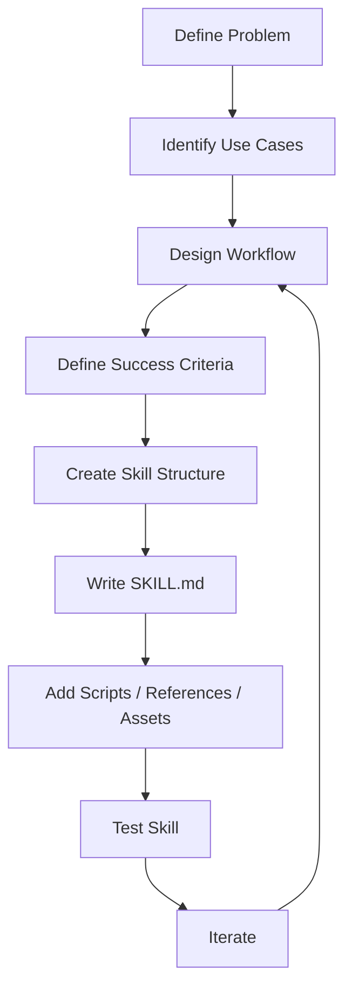

Each box in this flow is a decision point where you can stop, revise, and move forward only when the previous step is solid.

---

## 2. Start With Concrete Use Cases

Do not begin by creating:

```text
my-skill/
└── SKILL.md
```

Instead, first identify **2–3 concrete workflows** that the Skill should handle.

### Weak definition

> "I want to build a project-management Skill."

This is too broad. It does not tell you:

- Which part of project management?
- What triggers the Skill?
- What does "done" look like?
- What tools or APIs are needed?

### Better definition

> "I want a Skill that helps plan a software sprint, converts requirements into tasks, assigns priorities, estimates work, and produces a structured sprint plan."

Now the workflow is measurable. You know:

- **Input:** user requirements, existing issues, team capacity
- **Output:** structured sprint plan with tasks, priorities, estimates
- **Tools:** issue tracker, repository, CI/CD
- **Validation:** task count, estimate accuracy, priority distribution

### Choosing the right scope

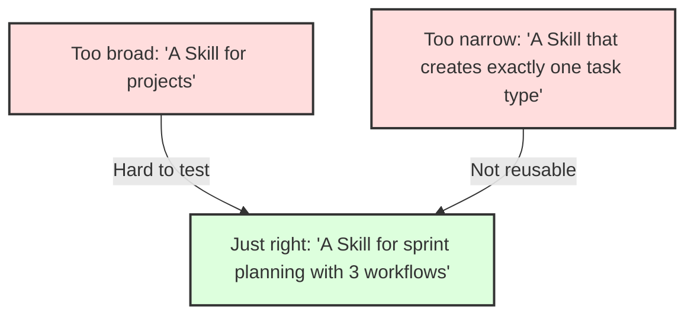

A good rule of thumb:

| Signal | Interpretation |
|---|---|
| Can describe the workflow in 2–3 sentences | Good scope |
| Needs 20+ sentences to describe | Too broad |
| Only handles one exact input shape | Too narrow |
| Has 1–3 distinct user triggers | Good scope |
| Activates on every user message | Too broad |

---

## 3. Identify the Core Workflow

For each use case, define the end-to-end workflow:

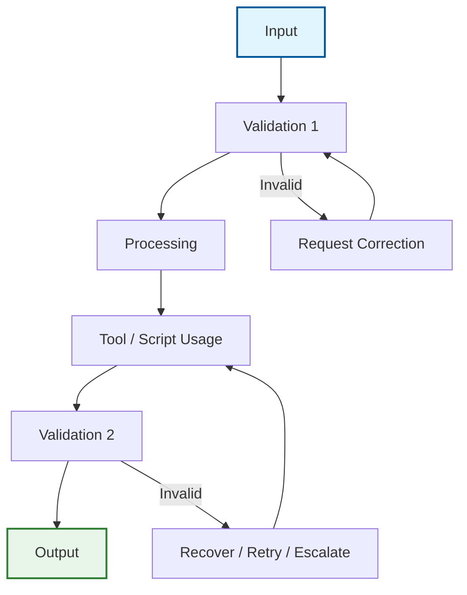

### Sprint Planning Skill Example

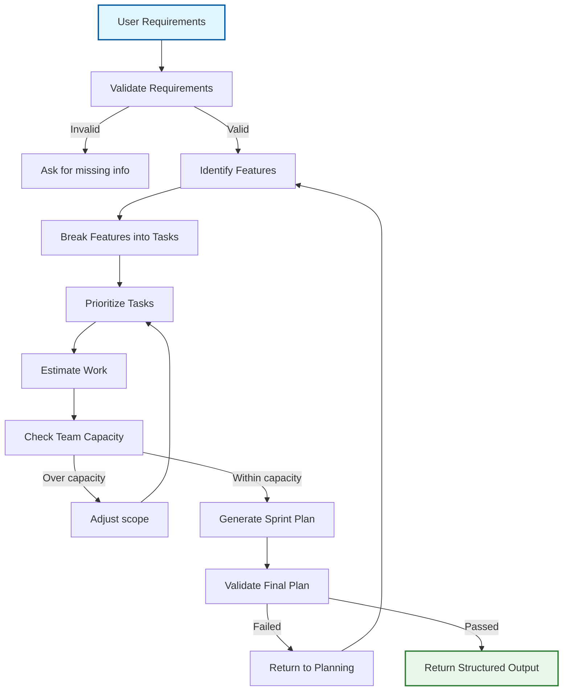

This is much more useful than simply saying:

> "The Skill manages projects."

### Workflow as state machine (TS/JS pseudo code)

```ts
type WorkflowState =
  | 'input'
  | 'validating'
  | 'processing'
  | 'tool_executing'
  | 'validating_result'
  | 'output'
  | 'error'

interface Transition {
  from: WorkflowState
  to: WorkflowState
  condition: (context: SkillContext) => boolean
  action?: (context: SkillContext) => void
}

class SkillWorkflow {
  private state: WorkflowState = 'input'
  private transitions: Transition[] = []

  addTransition(t: Transition): void {
    this.transitions.push(t)
  }

  advance(context: SkillContext): boolean {
    const match = this.transitions.find(
      t => t.from === this.state && t.condition(context)
    )

    if (!match) return false

    if (match.action) match.action(context)

    this.state = match.to
    return true
  }

  getCurrentState(): WorkflowState {
    return this.state
  }
}
```

This state-machine view makes validation gates explicit rather than implicit.

---

## 4. Common Skill Use-Case Categories

A practical way to categorize Skills is into three groups.

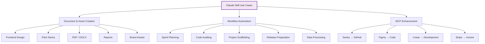

### Category 1 — Document & Asset Creation

**Goal:** Generate consistent artifacts according to a defined structure, style, or specification.

#### Examples:

- Presentation generation
- PDF generation
- DOCX generation
- Frontend design
- Brand-consistent documents
- Reports
- Templates
- Design-to-code handoff documentation

#### Example workflow:

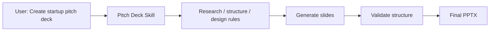

The Skill provides the **rules and workflow**, while available tools perform the actual operations.

Input/output contract:

```ts
interface PitchDeckInput {
  topic: string
  audience: 'investors' | 'customers' | 'internal'
  slideCount: number
  brandGuidelines?: string
}

interface PitchDeckOutput {
  slides: Slide[]
  speakerNotes: string[]
  designSpec: DesignSpec
  validation: ValidationResult
}
```

### Category 2 — Workflow Automation

These Skills focus on **multi-step processes** where the user wants an outcome, not a manual walkthrough.

#### Examples:

- Sprint planning
- Project setup
- Code audits
- Repository analysis
- Data processing
- Release preparation
- Skill creation

#### Example workflow:

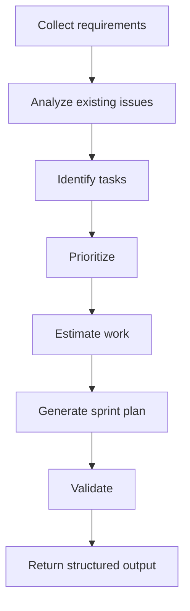

The important characteristic is that the user asks for an **outcome**, rather than manually describing every step.

Input/output contract:

```ts
interface SprintPlanningInput {
  requirements: string
  existingIssues: Issue[]
  teamCapacity: number
  sprintDuration: number // days
}

interface SprintPlanningOutput {
  sprintGoal: string
  tasks: Task[]
  priorities: PriorityMap
  estimates: EstimateMap
  capacityCheck: CapacityResult
}
```

### Category 3 — MCP Enhancement

This is particularly important when building agentic systems. MCP can expose raw capabilities:

```text
Sentry
  ├── get_error
  ├── search_errors
  └── get_event

GitHub
  ├── get_file
  ├── create_branch
  ├── create_commit
  └── create_pr

Slack
  ├── send_message
  ├── search_messages
  └── create_channel
```

A Skill can turn these individual capabilities into a workflow.

#### Example: Sentry → GitHub Bug Fix

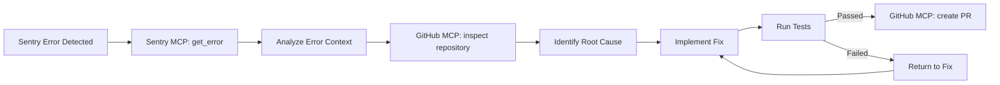

Without workflow guidance, Claude has access to tools but must construct much of this process dynamically. With a Skill, the workflow is explicitly documented and validated at each step.

Input/output contract:

```ts
interface BugFixInput {
  sentryErrorId: string
  repository: string
  targetBranch: string
}

interface BugFixOutput {
  rootCause: string
  filesChanged: string[]
  prUrl: string
  testResults: TestResult
}
```

---

## 5. Define Inputs and Outputs

Every Skill should have a clear contract. Think of the Skill as:

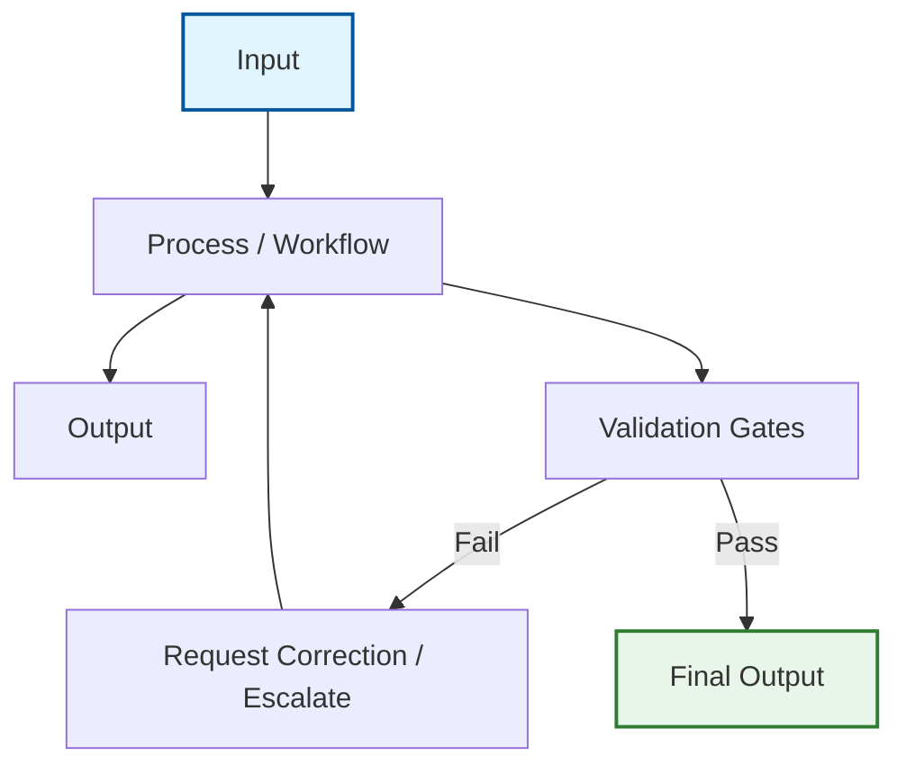

### Input

Define what the Skill needs.

Example:

```text
Required:
- Repository
- Target branch
- Release version

Optional:
- Release notes
- Deployment environment
- Notification channel
```

### Output

Define what the Skill should produce.

Example:

```text
Output:
- Release summary
- Changelog
- Validation results
- PR / release information
- Artifact links
```

### Contract enforcement (TS/JS pseudo code)

```ts
interface SkillContract<Input, Output> {
  name: string
  validateInput: (input: Input) => { valid: boolean; missing?: string[] }
  execute: (input: Input) => Promise<Output>
  validateOutput: (output: Output) => { valid: boolean; issues?: string[] }
}

function createContract<Input, Output>(
  spec: SkillContract<Input, Output>
): SkillContract<Input, Output> {
  return {
    ...spec,
    validateInput: (input) => {
      const missing: string[] = []
      // check required fields
      return { valid: missing.length === 0, missing }
    },
    validateOutput: (output) => {
      // verify output shape
      return { valid: true }
    }
  }
}
```

---

## 6. Define Success Criteria

A Skill needs measurable evaluation criteria. However, avoid treating arbitrary numbers such as **90% trigger rate**, **50% fewer tool calls**, or **zero failed API calls** as universal requirements. Those can be project-specific targets, but they aren't guaranteed properties of Skills.

### 6.1 Quantitative Metrics

#### 1. Trigger accuracy

How often does the Skill activate when it should?

```text
Relevant requests correctly triggered
-------------------------------------- × 100
Total relevant requests
```

You can separately measure false activations:

```text
False activations
----------------- × 100
Total requests
```

#### 2. Workflow completion rate

```text
Successfully completed workflows
-------------------------------- × 100
Total workflow attempts
```

This is often more meaningful than simply counting tool calls.

#### 3. Tool-call efficiency

Measure:

```text
Average tool calls with Skill
vs.
Average tool calls without Skill
```

The goal isn't necessarily "fewer calls." Sometimes a well-designed Skill may intentionally make **more** calls because it performs additional validation. The real question is:

> **Does the Skill accomplish the task reliably and efficiently?**

#### 4. Error rate

Track:

- Tool failures
- Validation failures
- Workflow failures
- Incorrect outputs

```text
Failed workflows
---------------- × 100
Total workflows
```

#### Metrics dashboard concept

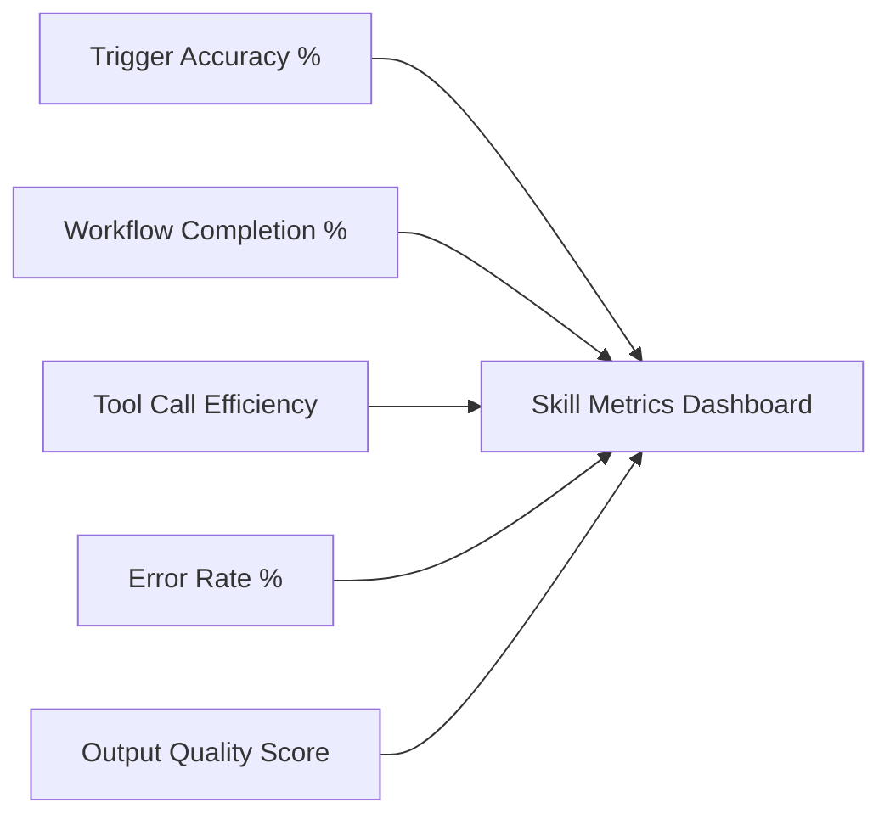

### 6.2 Qualitative Metrics

Some properties are difficult to measure with a single number.

| Metric | What to look for |
|---|---|
| **Workflow consistency** | Does the Skill produce outputs following the expected structure? |
| **User effort** | Does the user have to repeatedly explain the workflow? |
| **Recovery behavior** | Can the Skill recover from common failures? |
| **Output quality** | Does the final result satisfy the defined requirements? |
| **Maintainability** | Can the Skill's instructions and resources be updated without rewriting the entire system? |

### 6.3 Success criteria anti-patterns

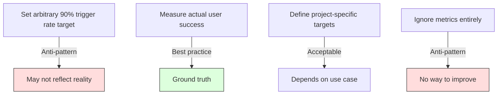

---

## 7. Technical Skill Structure

A typical Skill can have this structure:

```text
your-skill-name/
│
├── SKILL.md
│
├── scripts/
│   ├── validate_input.js
│   └── process_data.js
│
├── references/
│   ├── api-patterns.md
│   └── style-guide.md
│
└── assets/
    ├── report-template.md
    └── example.json
```

### Required

```text
SKILL.md
```

### Optional

```text
scripts/
references/
assets/
```

Only add directories that the Skill actually needs. A tiny Skill doesn't need five layers of supporting files.

### When to add each directory

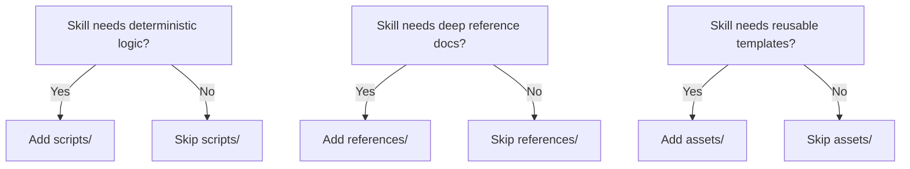

---

## 8. `SKILL.md` — The Main Entrypoint

`SKILL.md` is the central file containing the Skill's metadata and instructions.

Conceptually:

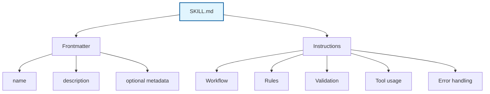

### Structure breakdown

```markdown
SKILL.md
│
├── Frontmatter (YAML, between --- delimiters)
│   ├── name
│   ├── description
│   ├── license (optional)
│   ├── compatibility (optional)
│   └── metadata (optional)
│
└── Instructions (markdown body)
    ├── Purpose
    ├── When to Use
    ├── Inputs
    ├── Workflow (numbered steps)
    ├── Output
    ├── Error Handling
    └── References
```

---

## 9. Directory Naming

Use clear, predictable names.

### Recommended:

```text
payment-gateway-builder/
linear-sprint-planner/
sentry-code-review/
frontend-design/
stripe-invoice-generator/
```

### Avoid:

```text
Payment Gateway
payment_gateway
paymentGateway
my-skill-final-v2/
```

A consistent naming convention makes Skills easier to discover and maintain. Most implementations require **kebab-case** directory names that match the `name` field in frontmatter.

### Naming validation (TS/JS pseudo code)

```ts
function validateSkillName(name: string): {
  valid: boolean
  reason?: string
} {
  const kebabCaseRegex = /^[a-z][a-z0-9-]*[a-z0-9]$/
  const reserved = ['claude', 'anthropic', 'skill', 'mcp']

  if (!kebabCaseRegex.test(name)) {
    return { valid: false, reason: 'Must be kebab-case, start with a letter' }
  }

  if (reserved.includes(name)) {
    return { valid: false, reason: 'Reserved term' }
  }

  return { valid: true }
}
```

---

## 10. Frontmatter

A Skill commonly begins with YAML frontmatter delimited by `---`.

### Example:

```yaml
---
name: payment-gateway-builder
description: Builds and configures payment gateway integrations. Use when the user asks to integrate a payment provider, configure subscriptions, or implement payment APIs.
license: MIT
compatibility: Requires access to the payment service API and environment variables for API keys.
metadata:
  author: DevRel Team
  version: 1.0.0
  created: 2024-01-15
---
```

### Important:

The exact supported frontmatter fields and constraints depend on the Skill implementation/environment you are targeting. Treat the official specification for that environment as authoritative rather than assuming every field is universally supported.

---

## 11. Required vs Optional Metadata

| Field | Purpose | Typical status |
|---|---|---|
| `name` | Identifies the Skill | Required |
| `description` | Explains capability and activation context | Required |
| `license` | Licensing information | Optional |
| `compatibility` | Runtime/dependency information | Optional |
| `metadata` | Additional custom information | Optional |
| `allowed-tools` | Tool-access restrictions where supported | Environment-dependent |

Don't add metadata just because you can. The metadata should serve a purpose.

---

## 12. The `name` Field

### Example:

```yaml
name: linear-sprint-planner
```

Good naming characteristics:

- Clear
- Short
- Specific
- Consistent
- Easy to identify

For implementations that require the name to match the directory name:

```text
linear-sprint-planner/
        ↓
name: linear-sprint-planner
```

Always validate this against the current Skill specification you're implementing.

---

## 13. The `description` Field

The description is particularly important because it helps determine **when the Skill is relevant**.

### A useful formula:

```text
[Capability]
+
[When / user intent]
+
[Trigger examples]
+
[Input / output]
```

### Weak:

```yaml
description: Helps with projects.
```

Too vague. The system cannot determine when to activate this Skill.

### Better:

```yaml
description: Manages Linear project workflows including sprint planning, task creation, prioritization, and status tracking. Use when the user asks about sprint planning, Linear tasks, project planning, or creating tickets.
```

Now we know:

```text
What?
→ Linear project workflows

When?
→ Sprint planning
→ Linear tasks
→ Project planning
→ Ticket creation
```

### Description design pattern:

```yaml
description: Analyzes design specifications and generates developer handoff documentation. Use when the user asks for design specifications, component documentation, or design-to-code handoff.
```

### Avoid:

Overly technical descriptions that don't describe user intent:

```yaml
description: Implements the PaymentProcessingEntity API abstraction.
```

The system needs to understand **when the Skill is useful**, not merely its internal implementation terminology.

---

## 14. `SKILL.md` Body

After frontmatter comes the actual instructions.

A clean structure:

```markdown
# Skill Name

## Purpose

What this Skill does.

## When to Use

When this Skill should be activated.

## Inputs

Required and optional inputs.

## Workflow

### Step 1: Validate Input

...

### Step 2: Analyze

...

### Step 3: Execute

...

### Step 4: Validate Result

...

## Output

Expected output format.

## Error Handling

Common failures and recovery procedures.

## References

Additional resources when needed.
```

---

## 15. Example `SKILL.md`

```markdown
---
name: payment-gateway-builder
description: Builds payment gateway integrations. Use when the user asks to integrate a payment provider, configure subscriptions, or implement payment APIs.
---

# Payment Gateway Builder

## Purpose

Build and validate payment gateway integrations.

## When to Use

Use when integrating Stripe, PayPal, or other payment providers into a project.

## Inputs

Required:
- Payment provider name
- API documentation or credentials
- Target environment (sandbox / production)

Optional:
- Webhook endpoint URL
- Subscription plans

## Workflow

### Step 1: Validate Input

Verify:

- Payment provider
- API documentation
- Required credentials
- Target environment

### Step 2: Inspect Existing Project

Identify:

- Framework
- Backend structure
- Existing payment code
- Environment configuration

### Step 3: Plan Integration

Define:

- Payment flow
- Webhook flow
- Error handling
- Data model changes

### Step 4: Implement

Use the available tools and scripts to implement the integration.

### Step 5: Validate

Check:

- Required environment variables
- API request structure
- Webhook handling
- Error handling
- Test cases

### Step 6: Report

Return:

- Files changed
- Configuration required
- Tests performed
- Remaining actions

## Output

- Integration summary
- File changes list
- Environment variables required
- Test results

## Error Handling

### Missing API Key

Ask the user to configure the required environment variable.

### Invalid Input

Report the missing fields and request them before continuing.

### API Failure

Inspect the error response, determine whether it is retryable,
and retry only when appropriate.

## References

- references/api-schema.md
- references/compliance-rules.md
```

This is much easier to maintain than putting everything into one giant paragraph.

---

## 16. Scripts

Scripts are useful when a task requires deterministic computation or repetitive operations.

### Example directory:

```text
scripts/
├── validate_input.js
├── generate_report.js
└── check_config.js
```

Instead of asking the model to manually perform deterministic processing:

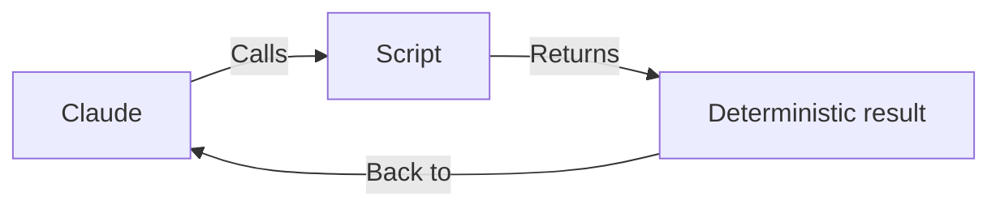

For example:

```bash
node scripts/validate_input.js --file input.json
```

The Skill can then use the result to decide what happens next.

### When to use scripts:

| Use scripts when | Don't use scripts when |
|---|---|
| Deterministic calculation needed | Open-ended creative task |
| Repetitive operation | One-time unique operation |
| Validation logic required | Natural language reasoning |
| File transformation needed | Simple information lookup |

### Script execution flow (TS/JS pseudo code):

```ts
interface ScriptResult {
  success: boolean
  data?: any
  error?: string
}

function runScript(scriptPath: string, args: Record<string, string>): Promise<ScriptResult> {
  try {
    const result = await executeScript(scriptPath, args)
    return { success: true, data: result }
  } catch (err) {
    return { success: false, error: err.message }
  }
}

async function handleWorkflow(context: SkillContext): Promise<void> {
  const validation = await runScript('scripts/validate_input.js', {
    file: context.inputFile
  })

  if (!validation.success) {
    context.requestCorrection(validation.error)
    return
  }

  // proceed with workflow
}
```

---

## 17. References

Use `references/` for information that is useful but doesn't need to be present in the main instructions all the time.

### Example directory:

```text
references/
├── api-patterns.md
├── security-rules.md
├── style-guide.md
└── troubleshooting.md
```

Think of it as the Skill's **documentation library**.

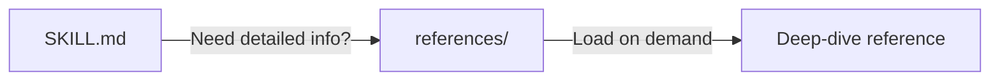

This supports **progressive disclosure** — load the reference only when the workflow needs it.

---

## 18. Assets

Assets are reusable supporting files.

### Examples:

```text
assets/
├── report-template.md
├── example.json
├── logo.svg
├── invoice-template.md
└── presentation-template.pptx
```

They should be actual resources required by the workflow rather than a dumping ground for unrelated files.

### Asset lifecycle:

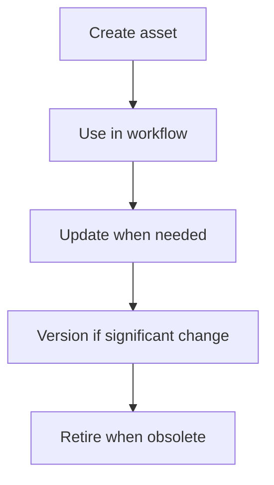

---

## 19. Error Handling

A production-quality Skill should describe common failure conditions.

### Example:

```markdown
## Troubleshooting

### Missing API Key

Cause:
The required API credential is unavailable.

Action:
Ask the user to configure the required environment variable.

### Invalid Input

Cause:
Required fields are missing.

Action:
Report the missing fields and request them before continuing.

### API Failure

Cause:
The external service rejected the request.

Action:
Inspect the error response, determine whether it is retryable,
and retry only when appropriate.

### Tool Timeout

Cause:
An external tool call exceeded the timeout threshold.

Action:
Retry once with exponential backoff, then escalate to user if still failing.
```

This is better than blindly retrying every failure.

### Error handling decision tree:

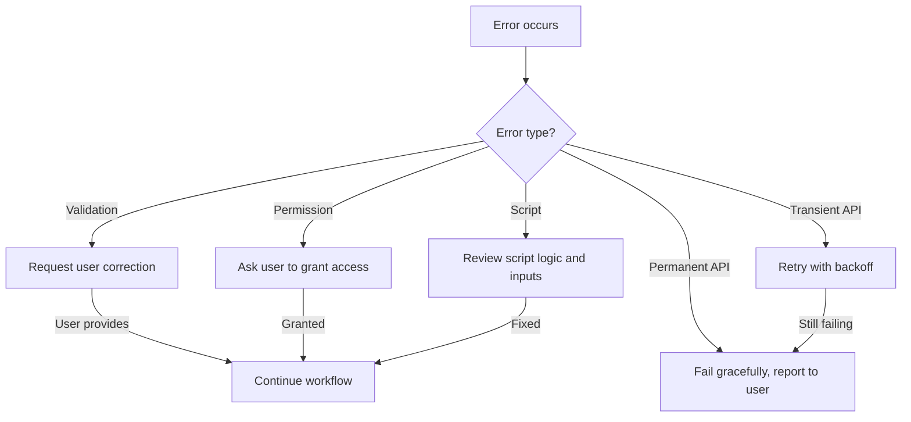

---

## 20. Validation Gates

For multi-step workflows, use explicit validation points.

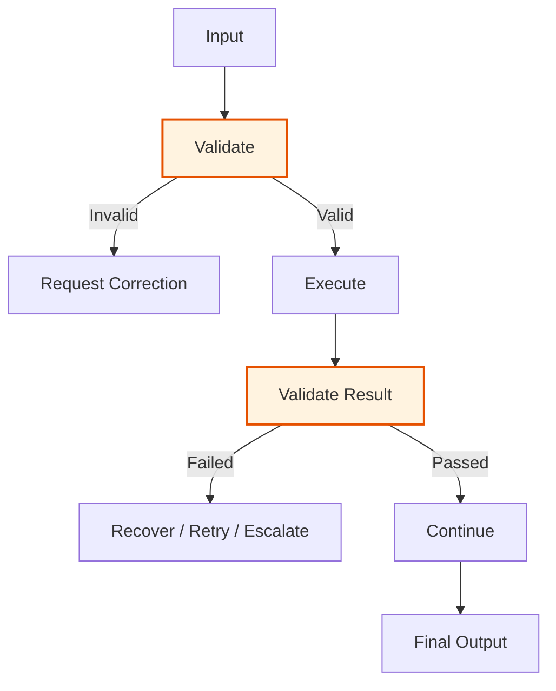

Validation gates make the workflow more robust by catching issues early rather than at the end.

### Validation gate implementation (TS/JS pseudo code):

```ts
type GateResult = 'pass' | 'fail' | 'retry'

interface ValidationGate {
  name: string
  validate: (context: SkillContext) => GateResult
  onFail?: (context: SkillContext) => void
}

class WorkflowWithGates {
  private gates: ValidationGate[] = []

  addGate(gate: ValidationGate): void {
    this.gates.push(gate)
  }

  async run(context: SkillContext): Promise<boolean> {
    for (const gate of this.gates) {
      const result = gate.validate(context)

      if (result === 'fail') {
        gate.onFail?.(context)
        return false
      }

      if (result === 'retry') {
        // retry logic
        continue
      }
    }

    return true
  }
}
```

---

## 21. Security Considerations

Skills may contain instructions, scripts, references, and access to external systems.

Therefore, don't blindly trust every input or resource.

Consider:

- Prompt injection
- Malicious documents
- Untrusted tool results
- Credential exposure
- Dangerous commands
- Excessive permissions
- Unexpected file modifications
- Destructive API operations

A good Skill should define boundaries around what it is allowed to do.

### Security boundary diagram:

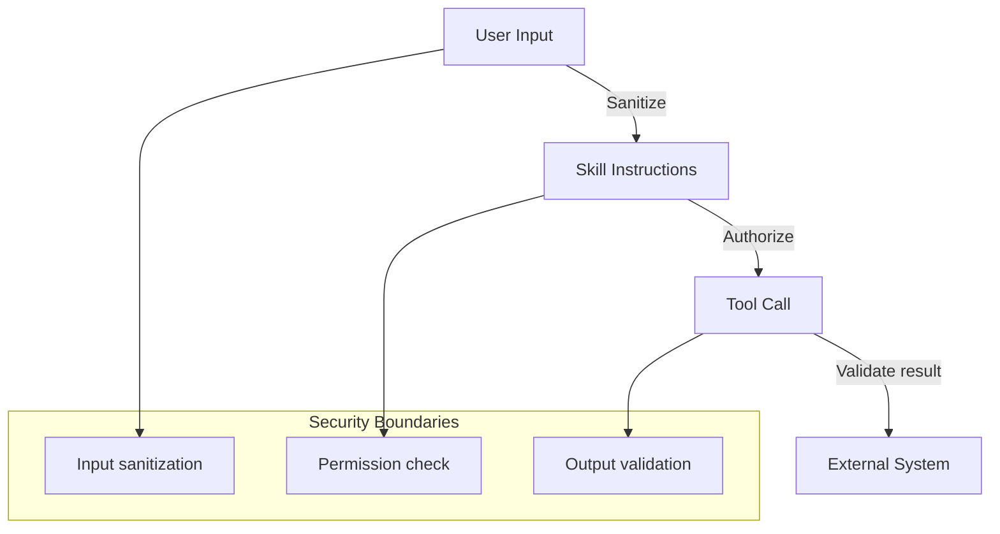

---

## 22. Design Principle: Least Privilege

If a Skill only needs read access:

```text
READ
```

don't give it:

```text
READ + WRITE + DELETE + ADMIN
```

Conceptually:

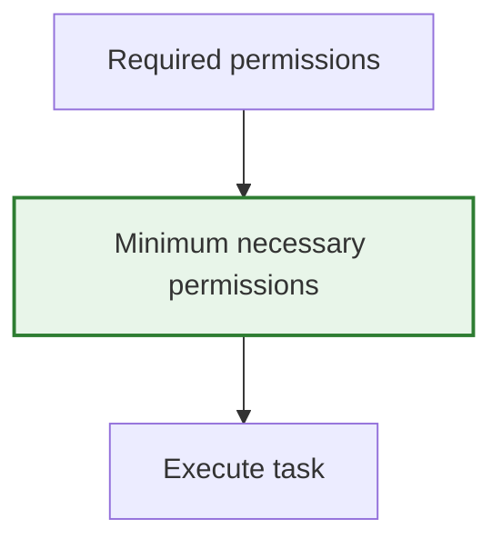

This reduces the impact of accidental or malicious actions.

### Permission matrix example:

| Operation | Skill needs | Granted |
|---|---|---|
| Read repository files | Yes | READ |
| Create GitHub issue | Yes (if workflow requires) | WRITE:issues |
| Delete repository | No | — |
| Admin settings | No | — |

---

## 23. Skill Development Checklist

Before implementation:

### Planning

- [ ] Define the problem
- [ ] Identify 2–3 concrete workflows
- [ ] Define inputs
- [ ] Define outputs
- [ ] Identify required tools
- [ ] Identify required references
- [ ] Identify scripts/assets

### Design

- [ ] Define workflow steps
- [ ] Define validation gates
- [ ] Define failure handling
- [ ] Define security boundaries
- [ ] Define success metrics

### Implementation

- [ ] Create Skill directory (kebab-case)
- [ ] Create `SKILL.md`
- [ ] Add metadata (name, description)
- [ ] Write concise instructions
- [ ] Add references only where necessary
- [ ] Add scripts where deterministic processing helps
- [ ] Add assets/templates when required

### Testing

- [ ] Test expected triggers
- [ ] Test unrelated requests
- [ ] Test incomplete input
- [ ] Test invalid input
- [ ] Test tool failures
- [ ] Test recovery
- [ ] Test final output structure

---

## 24. Interview Questions

### Q1. What should you do before creating a Skill?

Define the problem and identify a small number of concrete workflows the Skill should handle. Then define inputs, outputs, dependencies, validation, and success criteria.

### Q2. Why is the description important?

The description helps the system identify when a Skill is relevant. It should clearly communicate the Skill's capability and the types of user requests that should trigger it.

### Q3. What is the purpose of `SKILL.md`?

`SKILL.md` acts as the primary Skill definition, containing metadata and the instructions needed to execute the Skill's workflow.

### Q4. Why use `references/`?

To keep supporting documentation separate from the core instructions and make detailed information available when needed (progressive disclosure).

### Q5. Why use scripts?

Scripts are useful for deterministic, repetitive, or computation-heavy operations where explicit code can be more reliable than asking the model to perform the operation manually.

### Q6. What makes a good Skill?

A good Skill has:

```text
Clear purpose
      +
Clear trigger conditions
      +
Well-defined workflow
      +
Validation
      +
Error handling
      +
Appropriate resources
      +
Good testing
```

### Q7. How do you decide what goes in `SKILL.md` vs `references/`?

`SKILL.md` contains the core workflow and instructions needed every time the Skill runs. `references/` contains deep-dive documentation that is loaded only when needed — supporting progressive disclosure.

### Q8. What is the least privilege principle for Skills?

Grant only the minimum permissions required for the Skill to perform its task. If a Skill only needs read access, do not grant write, delete, or admin permissions.

---

## 25. Chapter 2 Cheat Sheet

```text
                  BUILDING A SKILL
                         │
                         ▼
                 1. Define Problem
                         │
                         ▼
                  2. Define Use Cases
                         │
                         ▼
                 3. Define Workflow
                         │
                         ▼
           4. Define Input / Output
                         │
                         ▼
          5. Define Success Metrics
                         │
                         ▼
                  6. Create Skill Folder
                         │
                         ▼
                     SKILL.md
                         │
              ┌──────────┼──────────┐
              ↓          ↓          ↓
           scripts/  references/  assets/
              │          │          │
              └──────────┼──────────┘
                         ↓
                     Test Skill
                         │
                         ▼
                     Iterate
```

### 8 key things to remember:

1. **Start with workflows, not files.**
2. **Define exactly what the Skill should accomplish.**
3. **Keep `SKILL.md` focused on the core workflow.**
4. **Use progressive disclosure for detailed resources.**
5. **Use scripts for deterministic operations.**
6. **Use references for supporting knowledge.**
7. **Add validation and error-handling gates.**
8. **Measure actual workflow quality instead of assuming fewer tool calls always means better performance.**

### The key relationship:

```text
SKILL.md
   │
   ├── WHAT → Description / Purpose
   ├── WHEN → Trigger conditions
   ├── HOW → Workflow instructions
   ├── VALIDATE → Input/output checks
   ├── RECOVER → Error handling
   │
   ├── scripts/     → Deterministic execution
   ├── references/  → Deep knowledge
   └── assets/      → Reusable resources
```

**Chapter 1 taught you what Skills are and why they exist.**
**Chapter 2 now gives you the engineering process for designing one.**
**The natural next step is Chapter 3: Testing, Evaluation & Iteration.**
