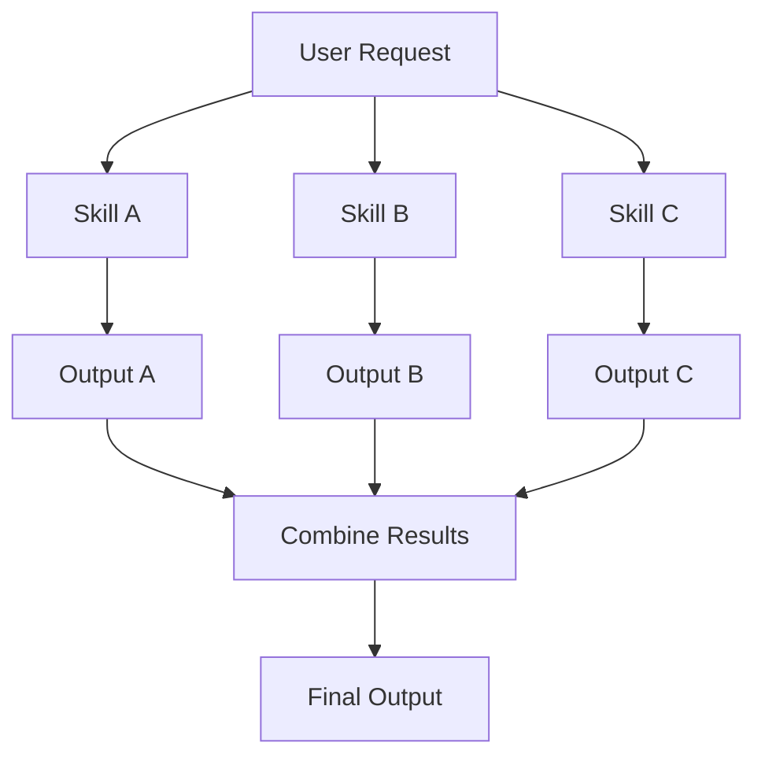
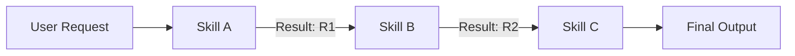
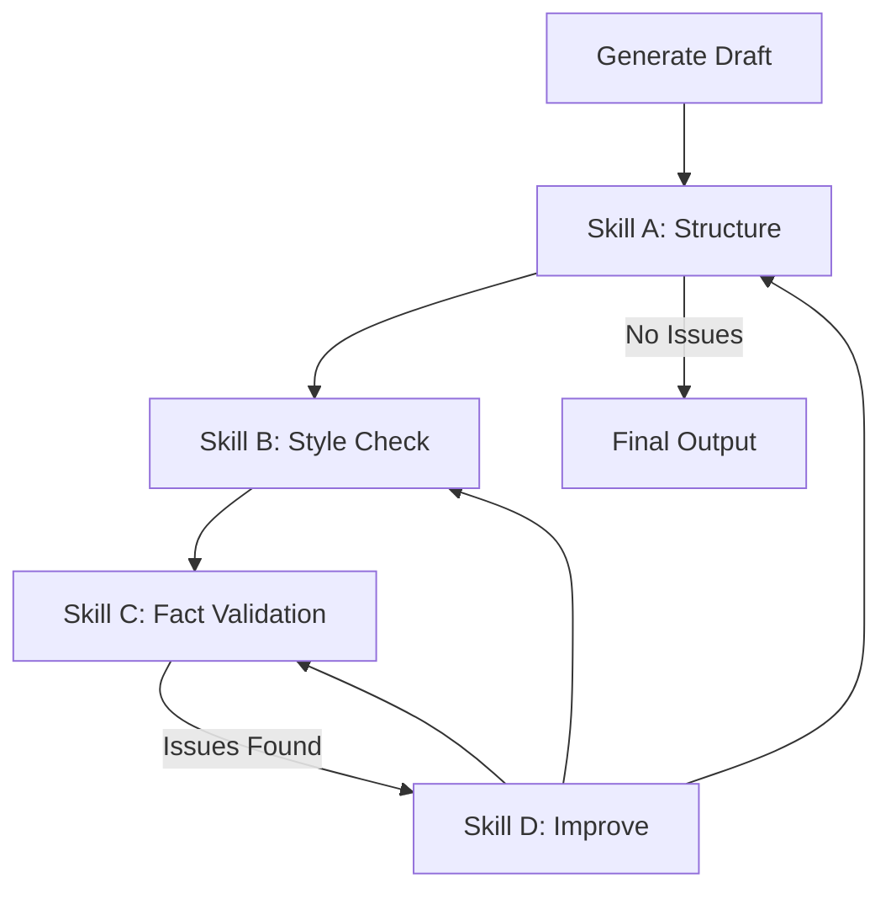
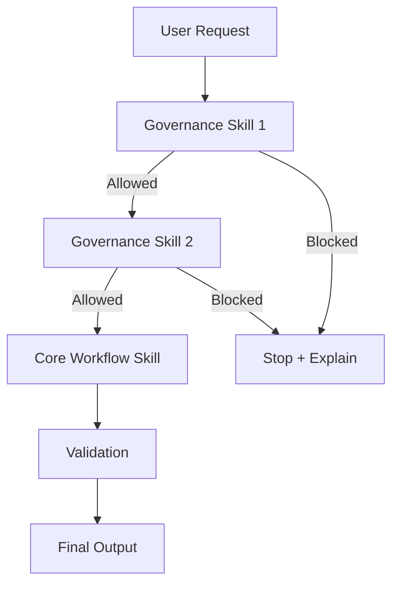
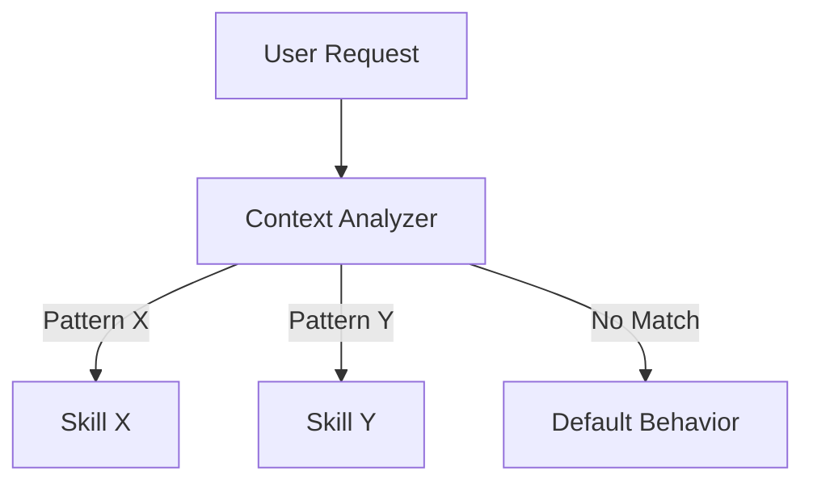
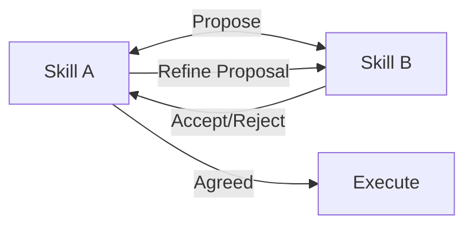
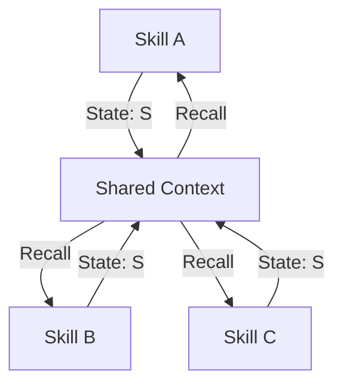
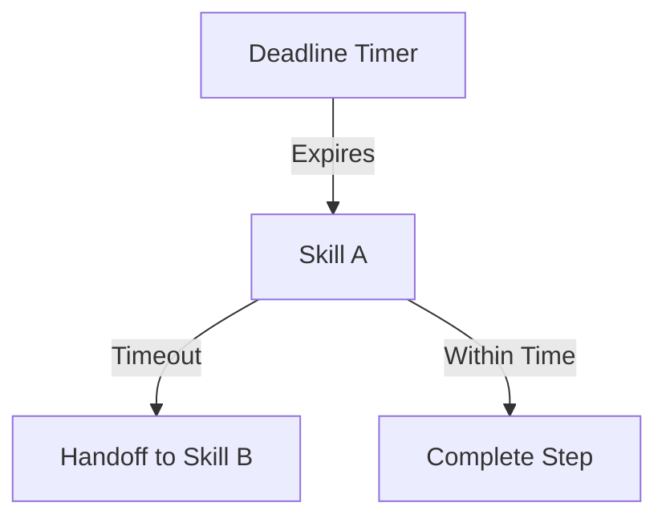
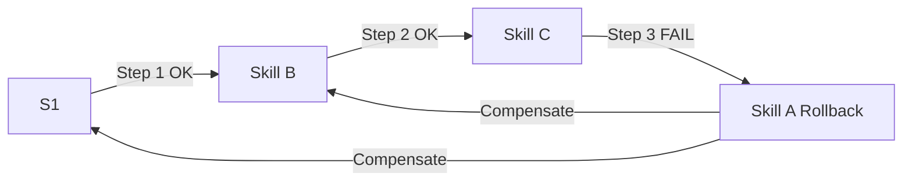
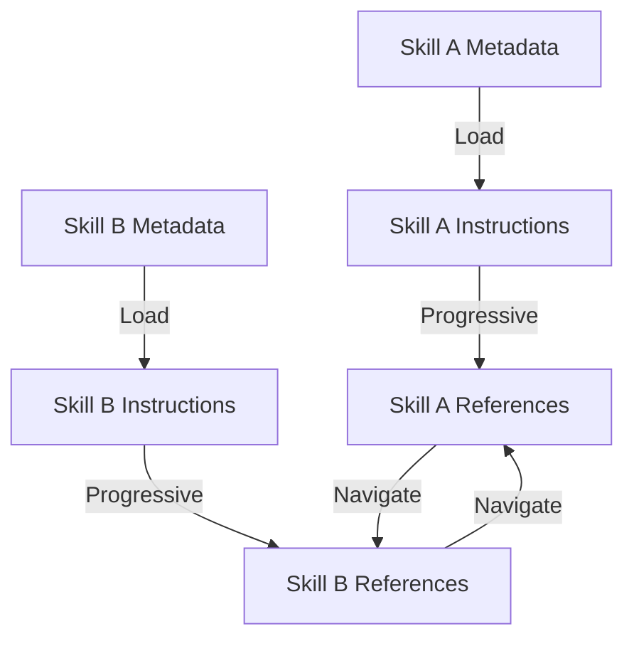

# 📘 Chapter 7 — Skill Composability & Advanced Patterns

## 1. Chapter Overview

The previous chapters established architectural patterns for single Skills. This chapter focuses on **combining Skills** and **advanced patterns** that emerge when multiple Skills interact, when Skills must coordinate with complex workflows, and when Skills need to adapt to dynamic contexts.

### The Core Idea

Skills are **modular** and **composable**. A complex task rarely maps to a single Skill. Instead, multiple Skills can be composed to handle:

- Different sub-tasks within a larger workflow
- Different tool domains (MCP servers)
- Different stages of refinement
- Different governance layers

This chapter covers:

- Skill composition strategies
- Advanced patterns beyond the core five
- Cross-Skill coordination
- State management across composed Skills
- Progressive disclosure in composed systems

---

## 2. Skill Composition Strategies

### 2.1. Parallel Composition

When sub-tasks can execute independently and concurrently.



**Example:** "Design a landing page, create API endpoints, and set up the database schema" — these can run in parallel once requirements are gathered.

### 2.2. Sequential Composition

When Skills must execute in a defined order, with each Skill's output becoming the next Skill's input.



**Example:** "Onboard a customer" → Design Skill → Provisioning Skill → Notification Skill.

### 2.3. Refinement Loop Composition

When iterative improvement spans multiple Skills, each contributing to the refinement.



**Example:** Report generation where each Skill validates a different concern (structure, style, facts).

### 2.4. Guardrails & Governance Composition

When multiple governance Skills wrap a core workflow Skill.



**Example:** Financial workflow where compliance and permission checks wrap the payment execution.

### 2.5. Conditional Composition

When which Skills activate depends on runtime context.



**Example:** File storage where the file type determines which storage Skill activates.

---

## 3. Advanced Patterns Beyond the Core Five

### 3.1. Pattern 6 — Cross-Skill Negotiation

When two Skills need to agree on how to proceed with a shared sub-task.

**Negotiation Flow:**



**Use Case:** Two design Skills negotiating which design direction to pursue for a given component.

### 3.2. Pattern 7 — State-Preserving Composition

When Skills must share and preserve state across composition without losing context.



**Use Case:** Multi-step workflow where each Skill adds to a shared context (e.g., accumulating design requirements, project constraints, stakeholder preferences).

### 3.3. Pattern 8 — Timeout & Deadline Composition

When a composed workflow must respect time constraints, and Skills must know when to yield or handoff.



**Use Case:** Long-running workflows where each Skill must complete within allocated time slices.

### 3.4. Pattern 9 — Rollback Composition

When a composed workflow requires coordinated rollback across multiple Skills if any step fails.



**Use Case:** When Skill A creates a resource, Skill B modifies it, and Skill C deletes it — if any step fails, all previous Skills must execute compensation.

### 3.5. Pattern 10 — Progressive Disclosure Composition

When composed Skills each apply progressive disclosure independently, and the agent must navigate between them.



**Use Case:** When multiple Skills are active simultaneously, each manages its own disclosure layers without overwhelming the agent's context.

---

## 4. Cross-Skill Coordination Patterns

### 4.1. Skill Handfformation

When one Skill explicitly hands off to another Skill.

**Example:** "Analyze this design" → Design Skill → "Now create tickets" → Development Skill

**Implementation Pattern:**

```markdown
## Handoff to Another Skill

If the user's need expands beyond my scope, I may hand off to another Skill:

> "For project planning and task creation, the `sprint-planner` Skill handles those workflows. I'll activate it now."

- Skill A explicitly references Skill B by name
- Skill A may pass relevant context/state to Skill B
- Skill A does not attempt to execute Skill B's workflow
- The agent coordinates which Skill is active at any time
```

### 4.2. Skill as Plugin

When a Skill discovers and loads another Skill dynamically based on runtime conditions.

**Implementation Pattern:**

```markdown
## Dynamic Skill Loading

When encountering unknown domains:

1. Assess whether an existing Skill covers this domain
2. If yes, activate that Skill with relevant parameters
3. If no, note the gap and proceed with available Skills
4. Return partial results + gap summary to user
```

### 4.3. Shared Context across Skills

When Skills share a common context object that persists across Skill activations.

**Implementation Pattern (pseudo-code):**

```typescript
// Shared context persisted across Skill activations
interface SkillContext {
  userId: string
  projectId?: string
  sessionId: string
  accumulatedData: Record<string, any>
  previousSkills: string[]
  workflowState: 'idle' | 'in_progress' | 'complete' | 'failed'
}

// Each Skill can read and update context
skillA.execute(context) // may update accumulatedData
skillB.execute(context) // reads accumulatedData from skillA
```

---

## 5. State Management in Composed Systems

### 5.1. Transaction Boundaries

When composing Skills, define clear transaction boundaries.

**Pattern:**

```text
Before: Define what constitutes a "transaction"
        ↓
During: Each Skill knows which parts of the state it owns
        ↓
After: Compensation is defined for each transaction boundary
```

### 5.2. Idempotency

Skills in a composition should be **idempotent** where possible — executing them multiple times produces the same result.

**Implementation:**
- Use unique identifiers for operations
- Check existing state before creating
- Report "already exists" rather than re-creating

### 5.3. Error Propagation

When a Skill in a composition fails, define:

1. Which preceding Skills must execute compensation
2. Which subsequent Skills should not execute
3. What partial results to report to the user

**Pattern:**

```text
Skill A fails → Execute A's compensation → Report to user
Skills B, C after A → Skip execution → Report "partial completion"
```

---

## 6. Progressive Disclosure in Composed Systems

When multiple Skills are active, progressive disclosure becomes critical to avoid context overload.

### 6.1. Layered Activation

Only load the metadata and core instructions for currently active Skills. Deeper references load on demand.

### 6.2. Context Budgets

Allocate context budget per Skill:

```text
Total context: 100%
Skill A: 40% (core workflow)
Skill B: 30% (secondary concerns)
References: 20% (on-demand)
Reserve: 10% (user turns, conversation history)
```

### 6.3. Selective Disclosure

Each Skill decides what to disclose at each level:

| Level | Skill A | Skill B |
|---|---|---|
| Metadata | ✓ Always | ✓ Always |
| Core Instructions | ✓ Relevant | ✓ Relevant |
| Detailed References | ✓ On demand | ✓ On demand |
| Scripts | ✓ Execute if needed | ✓ Execute if needed |
| Assets | ✓ Load if referenced | ✓ Load if referenced |

---

## 7. Composability Checklist

Before composing Skills, verify:

```text
[ ] Each Skill has a clearly defined scope (no overlap ambiguity)
[ ] Input/output contracts are compatible between Skills
[ ] Governance/permission layers are defined
[ ] Compensation/rollback is defined for each Skill
[ ] Progressive disclosure is configured for each Skill
[ ] State management strategy is documented
[ ] Error propagation paths are defined
[ ] Timeout/deadline limits are set
[ ] Handoff conditions are specified
```

---

## 8. Interview Questions

### Q1. How do you compose multiple Skills for a complex task?

> I identify the sub-tasks required, then determine which Skills handle each sub-task. I define clear input/output contracts between Skills, establish governance layers, and design compensation logic for failures. Progressive disclosure ensures no single Skill overwhelms the agent's context.

### Q2. What is cross-Skill negotiation?

> When two or more Skills need to agree on how to proceed with a shared sub-task. Each Skill proposes an approach, and the agent (or a coordinating Skill) evaluates the proposals and selects one. This prevents conflicting approaches within the same workflow.

### Q3. How do you manage state across composed Skills?

> I use a shared context that persists across Skill activations. Each Skill reads and updates the context according to defined contracts. Idempotent operations and clear transaction boundaries prevent state corruption. Compensation logic is defined for each transaction boundary.

### Q4. What happens when a Skill in a composed workflow fails?

> I define rollback compensation for each preceding Skill, skip subsequent Skills that depend on the failed step, and report partial completion to the user. The system never claims success when any component failed.

### Q5. How do you avoid context overload when multiple Skills are active?

> I use progressive disclosure: only load metadata and core instructions for active Skills. Deeper references load on demand. I allocate context budgets per Skill and use selective disclosure to ensure critical information is always available.

---

## 9. Chapter References

- Previous: **Chapter 6 — Resources, Checklists & Reference Templates**
- This chapter introduces composability patterns beyond single-Skill design

---

## 10. Final Mental Model — Skill Composition

```text
Single Skill
  ↓
Composition Strategies (parallel, sequential, refinement, guardrails, conditional)
  ↓
Advanced Patterns (negotiation, state-preserving, timeout, rollback, progressive disclosure)
  ↓
Cross-Skill Coordination (handoff, plugin, shared context)
  ↓
State Management (transactions, idempotency, error propagation)
  ↓
Production Composability
```

**Key takeaway:** Skills become truly powerful when they can be composed. A single Skill automates a workflow; composed Skills enable complex, adaptive, multi-domain agent systems.