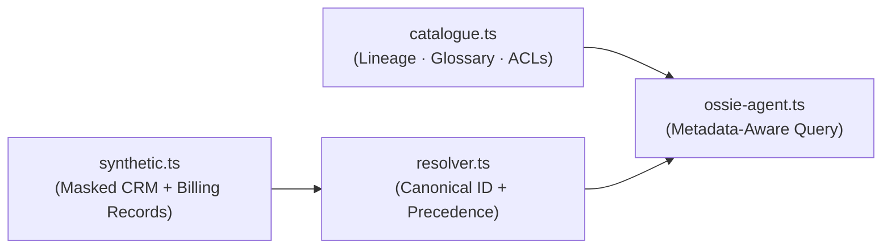

# Chapter 00: Overview, Architecture & File Structure

> **Chapter goal:** understand *what* this codebase is, how a metadata-aware query travels through the catalogue, resolver, and precedence engine, and which file maps to which notes chapter.

---

## 0.1 What this codebase is

This is the **minimum working TypeScript engine** proving Lecture 24:
- Every module has one clear responsibility (catalogue, entity/precedence resolver, synthetic data generator, Ossie query engine).
- Zero external DB dependencies — all tests run deterministically offline in `< 1 second`.

| File | Responsibility | Notes Chapter |
| :--- | :--- | :---: |
| `package.json` & `tsconfig.json` | ESM + strict TypeScript setup (`tsx`, `@types/node`) | — |
| `src/types.ts` | Shared contracts for estates, assets, metrics, canonical entities, and precedence | 01–07 |
| `src/catalogue.ts` | Open metadata catalogue (lineage DAG, glossary synonyms, column-level ACLs) | 01, 02, 05, 07 |
| `src/resolver.ts` | Cross-system canonical entity resolver & field-level SoR precedence engine | 04, 06 |
| `src/synthetic.ts` | Deterministic HMAC PII masking + conflicting CRM/Billing synthetic dataset | 03 |
| `src/ossie-agent.ts` | Metadata-aware query engine combining catalogue, crosswalk, ACLs, and precedence | 07 |
| `src/index.ts` | Runnable end-to-end demo | 01–07 |
| `src/release-gate.test.ts` | 5 automated release-gate assertions (`node:test`) | All |

---

## 0.2 Architecture



---

## 0.3 Commands

```bash
cd "Lecture 24 - Enterprise Data Discovery and Apache Ossie/code/Basic Code"
npm install
npm run typecheck
npm start
npm test
```

