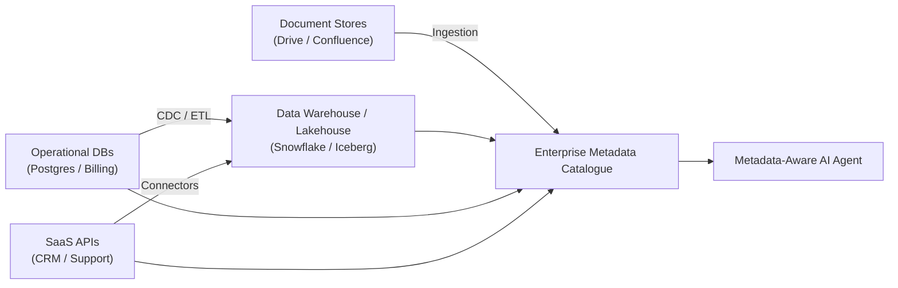

# Chapter 01 — Mapping Enterprise Data Estates

> **Lecture 24 · Chapter 01 of 07** · Level: 🟠 Advanced · Phase 6 — Enterprise Data, Semantics & SQL
> **Source:** `FDE S09` · **Roadmap Reference:** [`roadmap-v1.md`](../../roadmap-v1.md#lecture-24--enterprise-data-discovery-ontologies--apache-ossie)
> **Roadmap topics:** Enterprise data estate taxonomy · operational DBs vs. analytical warehouses vs. SaaS APIs · shadow spreadsheets · data estate inventory & discovery matrix.

---

## 01.0 What this chapter is for

Enterprise AI projects rarely fail because the LLM is weak. They fail because **the agent does not know where truth lives**. In a real company, "customer data" is scattered across a PostgreSQL operational database, a Salesforce CRM API, a Stripe billing ledger, a Snowflake warehouse, and three finance spreadsheets.

Before connecting an agent to tools or RAG, a Forward Deployed Engineer must **map the enterprise data estate**.

By the end of this chapter you should be able to:

1. Classify every data source in an enterprise into one of five estate tiers.
2. Identify the latency, freshness, schema-stability, and access-control characteristics of each tier.
3. Produce a structured **Data Estate Inventory** before writing ingestion or tool-calling code.

---

## 01.1 The five tiers of an enterprise data estate

| Estate Tier | Examples | Freshness | Schema Stability | Safe for Direct Agent Queries? |
| :--- | :--- | :---: | :---: | :--- |
| **1. Operational DBs (OLTP)** | PostgreSQL, MySQL, DynamoDB | Real-time (`ms`) | High (migrations) | **Read-replica only** — never run analytical scans on primary OLTP |
| **2. Cloud Warehouses / Lakehouses** | Snowflake, BigQuery, Iceberg/Delta | Batch / Micro-batch (`15m–24h`) | Medium | **Yes** (via semantic layer & read-only role) |
| **3. SaaS & Operational APIs** | Salesforce, Stripe, Jira, Zendesk | Real-time | High (versioned API) | **Yes** (rate-limited, scoped OAuth) |
| **4. Unstructured & Document Stores** | S3, SharePoint, Google Drive, Confluence | Eventual | None | **Via RAG / Document AI** with ACL filtering |
| **5. Shadow Spreadsheets & Exports** | `Q4_ARR_final_v3.xlsx`, ad-hoc CSVs | Stale / Manual | Fragile | **No** — must be promoted or quarantined |

---

## 01.2 Why agents fail without an estate map

1. **Duplicate, conflicting tables:** A warehouse often has `raw.customers`, `staging.stg_customers`, and `mart.dim_customers`. An unguided agent picks `raw.customers` and reports uncleaned test accounts to the CFO.
2. **OLTP vs. Analytical confusion:** Querying Stripe's API for a 12-month cohort aggregation hits rate limits; querying yesterday's Snowflake snapshot for *"is this invoice paid right now?"* returns stale data.
3. **Shadow data:** When finance maintains overrides in a local spreadsheet, the warehouse silently disagrees with board slides.

---

## 01.3 The Data Estate Inventory contract

Record six fields for every asset discovered during Phase 0/1 engagement:
- `assetId` (e.g., `crm.salesforce.accounts`)
- `tier` (`OLTP` | `WAREHOUSE` | `SAAS_API` | `DOCUMENT` | `SHADOW`)
- `ownerTeam` & `stewardEmail`
- `freshnessSla` (e.g., `real-time`, `1h`, `24h`)
- `piiClassification` (`PUBLIC` | `INTERNAL` | `CONFIDENTIAL` | `RESTRICTED`)
- `systemOfRecordFor` (e.g., `["contact_email", "account_owner"]`)

---

## 01.4 Key takeaways

1. **Map the estate before building RAG or Text-to-SQL.** Knowing *where* truth lives prevents querying raw/staging tables.
2. **Match query freshness to estate tier:** use OLTP/SaaS APIs for live state, warehouses for historical analytics.
3. **Quarantine shadow spreadsheets** or promote them into governed tables with explicit ownership.

---

**Next:** [Chapter 02 — Metadata Discovery, Ownership & Lineage](./02_Metadata_Discovery_Ownership_and_Lineage.md)

