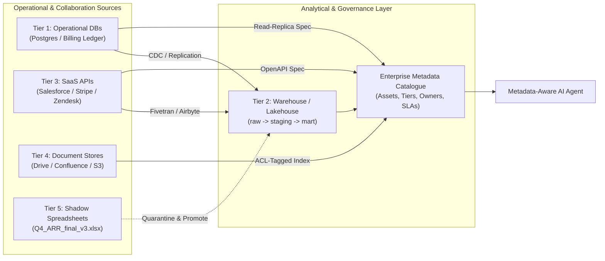
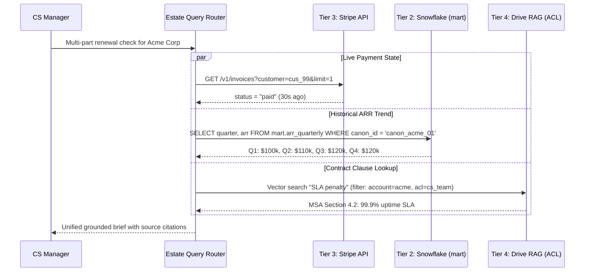

# Chapter 01 — Mapping Enterprise Data Estates

> **Lecture 24 · Chapter 01 of 07** · Level: 🟠 Advanced · Phase 6 — Enterprise Data, Semantics & SQL
> **Source:** `FDE S09` · **Roadmap Reference:** [`roadmap-v1.md`](../../roadmap-v1.md#lecture-24--enterprise-data-discovery-ontologies--apache-ossie)
> **Roadmap topics:** Enterprise data estate taxonomy · operational DBs vs. analytical warehouses vs. SaaS APIs · shadow spreadsheets · data estate inventory & discovery matrix.

---

## 01.0 What this chapter is for

Enterprise AI projects rarely fail because the LLM is weak. They fail because **the agent does not know where truth lives**. In a real company, "customer data" is not sitting in one clean table waiting to be queried. It is scattered across a PostgreSQL operational database, a Salesforce CRM API, a Stripe billing ledger, a Snowflake warehouse, a Confluence wiki, and three finance spreadsheets sitting on someone's laptop.

When an unguided agent is given tools to all of these without a map, it guesses. It queries a `raw` staging table instead of a certified `mart`, hammers a rate-limited SaaS API with analytical scans, or reads a stale spreadsheet from last quarter. Before writing a single line of RAG ingestion or Text-to-SQL code, a Forward Deployed Engineer must **map the enterprise data estate**.

By the end of this chapter you should be able to:

1. Classify every data source in an enterprise into one of **five estate tiers** based on workload, freshness, and governance.
2. Identify the **latency, freshness, schema-stability, and blast-radius** characteristics of each tier.
3. Diagnose why AI agents fail when they confuse operational (OLTP) systems with analytical (OLAP) warehouses.
4. Produce a machine-readable **Data Estate Inventory** contract before connecting any agent tool.
5. Apply deterministic **routing rules** to send live-state queries to operational APIs and historical queries to the warehouse, while quarantining shadow data.

---

## 01.1 The five tiers of an enterprise data estate

An enterprise data estate is not flat. Every system was built for a different physics: some optimize for millisecond single-row writes, others for petabyte-scale analytical scans, and others for human collaboration.

| Estate Tier | Examples | Freshness | Schema Stability | Safe for Direct Agent Queries? |
| :--- | :--- | :---: | :---: | :--- |
| **1. Operational DBs (OLTP)** | PostgreSQL, MySQL, DynamoDB | Real-time (`ms`) | High (strict migrations) | **Read-replica only** — never run analytical scans on primary OLTP |
| **2. Cloud Warehouses / Lakehouses** | Snowflake, BigQuery, Iceberg/Delta | Batch / Micro-batch (`15m–24h`) | Medium (layered: `raw` $\rightarrow$ `mart`) | **Yes** — via semantic layer & read-only role on certified marts |
| **3. SaaS & Operational APIs** | Salesforce, Stripe, Jira, Zendesk | Real-time (`s`) | High (versioned REST/GraphQL) | **Yes** — rate-limited, scoped OAuth, single-entity lookups |
| **4. Unstructured & Document Stores** | S3, SharePoint, Google Drive, Confluence | Eventual (`minutes–days`) | None (free-form) | **Via RAG / Document AI** with strict ACL filtering |
| **5. Shadow Spreadsheets & Exports** | `Q4_ARR_final_v3.xlsx`, ad-hoc CSVs | Stale / Manual | Fragile (human edits) | **No** — must be quarantined or promoted to governed `dbt` models |



> [!IMPORTANT]
> **Operational physics vs. analytical physics.** An OLTP database is optimized for looking up one customer by primary key in `2 ms`. A warehouse is optimized for scanning `50 million` rows in `3 seconds`. Routing an analytical `GROUP BY` to an OLTP primary database can lock tables and take down production checkout.

---

## 01.2 Why agents fail without an estate map

Without an explicit map of where each tier sits and what it is authoritative for, agents hit four predictable failure modes in production.

### Failure Scenario 1: The `raw` vs. `mart` trap
Inside a Snowflake warehouse, a `customers` entity often exists in three schemas simultaneously:
- `raw.salesforce_account` (uncleaned sync, includes deleted and QA test accounts)
- `staging.stg_customers` (intermediate `dbt` model, column names in flux)
- `mart.dim_customers` (Gold-certified, deduplicated, test accounts filtered out)

An unguided Text-to-SQL agent searches for `"customer"` in `INFORMATION_SCHEMA`, picks `raw.salesforce_account` because it appeared first alphabetically, and reports `$420,000` of fake QA sandbox revenue to the CFO.

### Failure Scenario 2: The OLTP vs. OLAP mismatch
- **Wrong direction A (Analytics on SaaS/OLTP):** A user asks *"Compare Q1–Q4 churn by region."* The agent loops over Stripe's `/v1/subscriptions` REST API with 400 paginated calls, hits `429 Too Many Requests`, and times out after 45 seconds.
- **Wrong direction B (Live state on Batch DWH):** A support agent asks *"Did Acme Corp's wire payment clear 2 minutes ago?"* The agent queries `mart.daily_invoices` in BigQuery, which refreshes every 6 hours, and tells the customer *"Unpaid"*—even though the payment already cleared in Stripe.

### Failure Scenario 3: Shadow spreadsheet drift
Finance exports `customers.csv` from Snowflake, manually edits three enterprise contract overrides in Excel (`Q4_ARR_final_v3.xlsx`), and pastes the result into a board deck. When the AI agent queries the warehouse, its numbers disagree with the board deck by `$180,000`. Neither the agent nor the user knows why until an engineer hunts down the local spreadsheet.

### Traps & Where Estate Assumptions Break

| Trap | What It Looks Like | Why It Breaks | Production Fix |
| :--- | :--- | :--- | :--- |
| **"Everything is in the warehouse"** | Agent only has a Snowflake connector | Misses real-time state (`<15m` old) and unstructured contract PDFs | Route live-state lookups to OLTP read-replicas / SaaS APIs; route PDFs to ACL-filtered RAG |
| **"Read-only means safe on OLTP"** | Agent runs `SELECT COUNT(*)` with `ILIKE '%acme%'` on primary Postgres | Full table scan saturates IOPS and degrades customer-facing writes | Restrict agents to **dedicated read-replicas** with statement timeouts (`5s`) |
| **"We'll just ingest that Excel file"** | Uploading `Q4_ARR_final_v3.xlsx` to RAG or a staging table | Manual edits go stale immediately and have no lineage or owner | **Quarantine** shadow sheets; promote business logic into versioned `dbt` seeds/models |

---

## 01.3 The Data Estate Inventory contract

Before building connectors, every Forward Deployed Engineer should audit the customer's estate and emit a structured **Data Estate Inventory**. This inventory becomes the seed input for the metadata catalogue.

```json
[
  {
    "assetId": "oltp.billing_pg.invoices",
    "tier": "OLTP_READ_REPLICA",
    "ownerTeam": "@payments-platform",
    "freshnessSla": "real-time (< 5s lag)",
    "piiClassification": "CONFIDENTIAL",
    "systemOfRecordFor": ["invoice_payment_status", "latest_charge_attempt"],
    "agentAccess": "ALLOWED_SINGLE_KEY_LOOKUP"
  },
  {
    "assetId": "dwh.snowflake.mart.dim_customers",
    "tier": "CLOUD_WAREHOUSE",
    "qualityTier": "GOLD",
    "ownerTeam": "@data-platform",
    "freshnessSla": "15m",
    "piiClassification": "INTERNAL",
    "systemOfRecordFor": ["historical_arr", "cohort_retention"],
    "agentAccess": "ALLOWED_ANALYTICAL_SQL"
  },
  {
    "assetId": "crm.salesforce.accounts",
    "tier": "SAAS_API",
    "ownerTeam": "@revops",
    "freshnessSla": "real-time",
    "piiClassification": "CONFIDENTIAL",
    "systemOfRecordFor": ["account_owner", "sales_stage"],
    "agentAccess": "ALLOWED_RATE_LIMITED_API"
  },
  {
    "assetId": "shadow.finance.q4_arr_v3_xlsx",
    "tier": "SHADOW",
    "ownerTeam": "unknown (local export)",
    "freshnessSla": "manual",
    "piiClassification": "CONFIDENTIAL",
    "systemOfRecordFor": [],
    "agentAccess": "DENIED_QUARANTINE_AND_MIGRATE"
  }
]
```

> [!TIP]
> **Quick Routing Rule of Thumb.**
> - Need **live state right now** (*"Was this invoice paid 30 seconds ago?"*) $\rightarrow$ **OLTP Read-Replica** or **SaaS API**.
> - Need **historical aggregation** (*"Compare Q1–Q4 churn by region"*) $\rightarrow$ **Warehouse / Lakehouse (`mart.*`)**.
> - Need **clauses, policies, or meeting context** (*"What is Acme's SLA penalty clause?"*) $\rightarrow$ **Document Store (ACL-filtered RAG)**.
> - Found a **Shadow Spreadsheet** $\rightarrow$ **Block agent access immediately** and schedule a `dbt` promotion ticket.

---

## 01.4 Routing queries across the estate (Worked Example)

Consider a Customer Success agent answering: *"Acme Corp's renewal is today. Did their latest invoice clear, what was their 4-quarter ARR trend, and are there any custom SLA terms in their signed MSA?"*



Notice that **no single data source** could answer all three parts safely:
1. Snowflake could not confirm a payment from 30 seconds ago.
2. Stripe could not compute a governed 4-quarter ARR trend without hitting pagination limits and missing finance adjustments.
3. Neither structured database holds the unstructured MSA PDF.

---

## 01.5 Common mistakes

| # | Common Mistake | Why It Hurts | What To Do Instead |
| :---: | :--- | :--- | :--- |
| 1 | **Pointing Text-to-SQL at `raw.*` schemas** | Raw tables contain duplicates, soft-deleted rows, and QA test accounts | Restrict agent roles to certified `mart.*` or `gold.*` schemas only |
| 2 | **Running analytical `GROUP BY` scans on primary OLTP** | Saturates CPU/IOPS and causes latency spikes or outages in production apps | Route aggregations to the Warehouse; allow only indexed single-key lookups on OLTP read-replicas |
| 3 | **Using a batch warehouse for real-time operational checks** | Returns stale state (`15m–24h` behind) on live support or payment questions | Route live-state intents to SaaS APIs or OLTP read-replicas |
| 4 | **Connecting an agent to shadow spreadsheets** | Manual exports drift from governed data and break silently on column renames | Quarantine shadow files and promote their logic into versioned `dbt` models |
| 5 | **Skipping the inventory before building RAG/SQL** | Engineers discover missing owners, broken joins, and PII leaks mid-project | Complete the 6-field Data Estate Inventory in Phase 0/1 before writing connectors |

---

## 01.6 Key takeaways

1. **Map the estate before building RAG or Text-to-SQL.** Knowing *where* truth lives prevents querying uncleaned `raw` tables or stale exports.
2. **Match query physics to estate tier:** use OLTP read-replicas and SaaS APIs for live single-entity state, warehouses for historical analytics, and ACL-filtered RAG for unstructured documents.
3. **Quarantine shadow spreadsheets** rather than indexing them; promote their business logic into governed warehouse models with explicit owners.
4. **Codify the estate in a machine-readable inventory** (`assetId`, `tier`, `ownerTeam`, `freshnessSla`, `piiClassification`, `systemOfRecordFor`) so downstream agents can route deterministically.

---

**Next:** [Chapter 02 — Metadata Discovery, Ownership & Lineage](./02_Metadata_Discovery_Ownership_and_Lineage.md)
