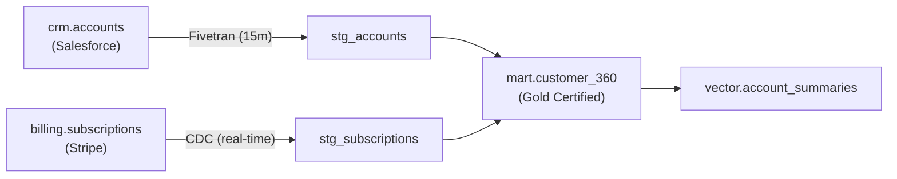

# Chapter 02 — Metadata Discovery, Ownership & Lineage

> **Lecture 24 · Chapter 02 of 07** · Level: 🟠 Advanced · Phase 6 — Enterprise Data, Semantics & SQL
> **Source:** `FDE S09` · **Roadmap Reference:** [`roadmap-v1.md`](../../roadmap-v1.md#lecture-24--enterprise-data-discovery-ontologies--apache-ossie)
> **Roadmap topics:** Technical vs. business vs. operational metadata · automated schema crawling · table ownership & stewardship · upstream/downstream lineage graphs · column-level ACLs.

---

## 02.0 What this chapter is for

Once you know which databases and APIs exist, you need **live, queryable metadata** about them. Relying on a static Confluence page written 18 months ago guarantees broken SQL and unauthorized PII leaks.

By the end of this chapter you should be able to:

1. Distinguish **technical**, **business**, and **operational** metadata.
2. Trace **upstream and downstream data lineage** to diagnose stale or corrupted agent answers.
3. Use **ownership and PII/ACL tags** to enforce least-privilege access before an agent ever sees a row.

---

## 02.1 Three pillars of enterprise metadata

| Metadata Pillar | What It Captures | Example |
| :--- | :--- | :--- |
| **Technical Metadata** | Schemas, column types, primary/foreign keys, partition keys, API specs | `billing.subscriptions.status: ENUM('active','past_due','canceled')` |
| **Business Metadata** | Human descriptions, glossary terms, domain tags, owner team, SLA tier | `Owner: @revops-team · Gold-tier certified table` |
| **Operational Metadata** | Last refresh timestamp, row count, null rate, query latency, upstream job status | `lastSyncedAt: 2026-11-26T12:00:00Z · freshness: 15m` |

---

## 02.2 Data lineage & blast-radius tracing

**Lineage** is the directed acyclic graph (DAG) of how data flows from source systems through transforms (`dbt`, Spark, CDC) into downstream marts and AI indexes:



Why lineage matters for AI agents:
- **Root-cause debugging:** If `mart.customer_360` shows stale MRR, lineage immediately points to a failed upstream `stg_subscriptions` CDC job.
- **Trust scoring:** Certified `Gold` downstream marts outrank `raw` or `staging` tables in agent retrieval.
- **PII propagation:** If `crm.accounts.ssn_last4` is tagged `RESTRICTED_PII`, lineage automatically propagates that tag to every downstream view and vector index.

---

## 02.3 Worked Example: Catching Stale Data via Operational Metadata

Suppose a CFO asks the agent: *"What is Acme's current MRR?"*
The catalogue returns `mart.customer_360` with **operational metadata**:
```json
{
  "assetId": "mart.customer_360",
  "qualityTier": "GOLD",
  "lastSyncedAt": "2026-11-24T02:00:00Z",
  "expectedFreshnessHours": 2,
  "upstreamStatus": "FAILED (stg_subscriptions_cdc)"
}
```
Because `now - lastSyncedAt` (`58 hours`) exceeds `expectedFreshnessHours` (`2 hours`), a metadata-aware agent **warns the user** (*"Warning: `mart.customer_360` is 58h stale due to a failed `stg_subscriptions_cdc` job"*) or falls back to the live Billing API—instead of confidently reporting outdated numbers!

---

## 02.4 Ownership & access control lists (ACLs)

Every catalogued asset must carry:
1. **Data Owner:** Accountable for schema changes and quality SLAs.
2. **Access Policy / ACL:** Which roles or agent service principals may read which columns (e.g., `billing_agent` can read `plan_tier`, but `ssn_last4` is masked or denied).

---

## 02.4 Key takeaways

1. **Combine technical, business, and operational metadata** — schema alone does not tell an agent whether a table is certified or stale.
2. **Track upstream/downstream lineage** to propagate PII tags and debug stale answers.
3. **Never grant an agent blind `SELECT *`:** enforce column-level ACLs from catalogue metadata.

---

**Next:** [Chapter 03 — Synthetic Data Environments for Safe Dev](./03_Synthetic_Data_Environments_for_Safe_Dev.md)

