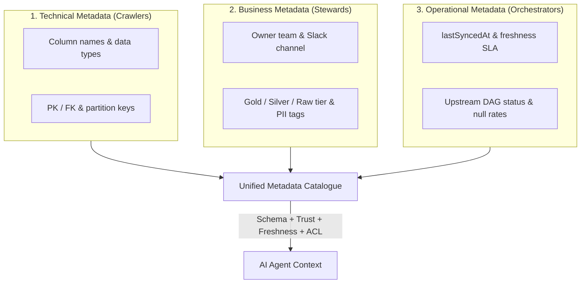
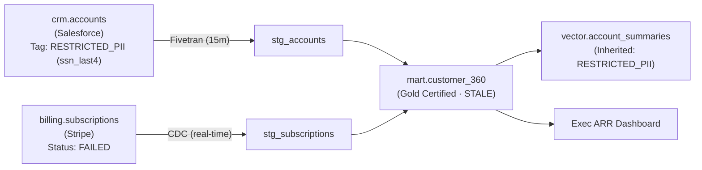

# Chapter 02 — Metadata Discovery, Ownership & Lineage

> **Lecture 24 · Chapter 02 of 07** · Level: 🟠 Advanced · Phase 6 — Enterprise Data, Semantics & SQL
> **Source:** `FDE S09` · **Roadmap Reference:** [`roadmap-v1.md`](../../roadmap-v1.md#lecture-24--enterprise-data-discovery-ontologies--apache-ossie)
> **Roadmap topics:** Technical vs. business vs. operational metadata · automated schema crawling · table ownership & stewardship · upstream/downstream lineage graphs · column-level ACLs.

---

## 02.0 What this chapter is for

Once you have mapped which databases, warehouses, and SaaS APIs exist (Chapter 01), you hit the next wall: **schemas alone do not tell an agent whether a table is trustworthy, current, or permitted.**

Relying on a static Confluence page written 18 months ago guarantees broken SQL, stale answers, and unauthorized PII leaks. Production AI agents need **live, queryable metadata**—automatically crawled from schemas, enriched with business ownership, updated with pipeline health, and connected through an end-to-end lineage graph.

By the end of this chapter you should be able to:

1. Distinguish **technical**, **business**, and **operational** metadata and explain what each contributes to agent reliability.
2. Design an **automated metadata discovery pipeline** that keeps the catalogue synchronized with schema migrations and pipeline runs.
3. Trace **upstream and downstream data lineage** to diagnose stale answers, rank certified tables, and propagate PII tags.
4. Enforce **ownership and column-level ACLs** from catalogue metadata before an agent ever reads a row.

---

## 02.1 Three pillars of enterprise metadata

A complete metadata catalogue organizes information about every data asset into three distinct pillars:

| Metadata Pillar | What It Captures | Update Frequency | Concrete Example |
| :--- | :--- | :---: | :--- |
| **Technical Metadata** | Schemas, column types, primary/foreign keys, partition keys, OpenAPI specs | On schema migration / crawl | `billing.subscriptions.status: ENUM('active','past_due','canceled')` |
| **Business Metadata** | Human descriptions, glossary terms, domain tags, owner team, certification tier | On governance / PR review | `owner: @revops-team · qualityTier: GOLD · domain: Revenue` |
| **Operational Metadata** | Last refresh timestamp, row count, null rate, query latency, upstream job status | Every pipeline run (`5m–1h`) | `lastSyncedAt: 2026-11-26T12:00:00Z · rowCount: 48,210 · status: HEALTHY` |



> [!IMPORTANT]
> **Why schema-only catalogues fail.** Most naive Text-to-SQL demos only extract **technical metadata** (`CREATE TABLE` DDL). Without **business metadata**, the agent cannot tell `raw_users` from `dim_users`. Without **operational metadata**, it cannot tell that the nightly ETL job failed 3 days ago.

---

## 02.2 Automated schema crawling vs. manual documentation

Human-maintained wikis rot within weeks. Enterprise metadata platforms (like OpenMetadata, DataHub, or Apache Ossie) use **scheduled metadata ingestion connectors** to harvest all three pillars continuously:

1. **Schema Crawlers:** Query `INFORMATION_SCHEMA`, Glue Catalog, or SaaS `/describe` endpoints to detect new columns, dropped fields, and type changes.
2. **Query-Log Miners:** Parse warehouse query history (`SNOWFLAKE.ACCOUNT_USAGE.QUERY_HISTORY`) to infer **popularity**, common `JOIN` keys, and which tables analysts actually trust.
3. **Orchestrator Webhooks:** Receive `SUCCESS` / `FAILED` events from Airflow, Dagster, or `dbt` Cloud to update `lastSyncedAt` and `upstreamStatus` in real time.

---

## 02.3 Data lineage & blast-radius tracing

**Lineage** is the directed acyclic graph (DAG) of how data flows from source systems through transforms (`dbt`, Spark, CDC) into downstream marts, BI dashboards, and AI vector indexes.



Lineage gives an AI platform three critical capabilities:

1. **Root-cause debugging:** When `mart.customer_360` reports stale MRR, walking upstream immediately reveals that `stg_subscriptions_cdc` failed 58 hours ago.
2. **Trust scoring & table ranking:** Certified `Gold` downstream marts outrank `raw` or `staging` tables during agent table discovery.
3. **Automatic PII tag propagation:** If `crm.accounts.ssn_last4` is tagged `RESTRICTED_PII`, lineage automatically propagates that classification to `stg_accounts`, `mart.customer_360`, and `vector.account_summaries`—even if the downstream view renamed the column to `tax_suffix`.

---

## 02.4 Worked example: Catching stale data via operational metadata

Suppose a CFO asks an enterprise agent: *"What is Acme's current MRR?"*

The agent queries the metadata catalogue for `mart.customer_360` and receives the following operational + business payload:

```json
{
  "assetId": "mart.customer_360",
  "qualityTier": "GOLD",
  "ownerTeam": "@revops-data",
  "lastSyncedAt": "2026-11-24T02:00:00Z",
  "expectedFreshnessHours": 2,
  "upstreamStatus": "FAILED",
  "failedUpstreamNode": "stg_subscriptions_cdc",
  "columns": [
    { "name": "customer_id", "type": "STRING", "classification": "INTERNAL" },
    { "name": "mrr_cents", "type": "INT64", "classification": "CONFIDENTIAL" },
    { "name": "ssn_last4", "type": "STRING", "classification": "RESTRICTED_PII", "acl": "DENY_AGENT" }
  ]
}
```

Watch how a metadata-aware agent behaves deterministically before running SQL:
1. **Freshness check:** `now - lastSyncedAt` is `58 hours`, which violates `expectedFreshnessHours: 2`.
2. **Lineage check:** `failedUpstreamNode` is `stg_subscriptions_cdc`.
3. **Action:** Instead of silently returning a 58-hour-old number, the agent either **falls back to the live Billing API** (if authorized) or **warns the CFO explicitly**:
   > *"Warning: `mart.customer_360` is 58 hours stale because `stg_subscriptions_cdc` failed. Falling back to live Stripe Billing API (owner: `@revops-data`)."*

---

## 02.5 Ownership & column-level access control (ACLs)

Every catalogued asset must carry two governance bindings:

1. **Data Owner (`@team`):** Accountable for schema changes, data quality tests, and freshness SLAs. If an agent encounters a broken table, it knows which team to page.
2. **Column-Level ACLs:** Policy tags (`PUBLIC`, `INTERNAL`, `CONFIDENTIAL`, `RESTRICTED_PII`) bound to caller roles.

> [!WARNING]
> **Prompt instructions are not access control.** Telling an LLM *"Do not output `ssn_last4`"* in a system prompt will fail under prompt injection or accidental `SELECT *`. Enforce column-level ACLs **at the catalogue and SQL-execution layer** by stripping restricted columns from the schema context *and* blocking them in the database role.

### Where Metadata Governance Breaks

| Failure Mode | What Happened | Impact | Mitigation |
| :--- | :--- | :--- | :--- |
| **Orphaned tables** | Creator left the company; `ownerTeam` is blank | Quality degrades; no one fixes failing pipelines | Require `ownerTeam` in CI before merging any `dbt` model |
| **Unpropagated PII** | `email` renamed to `contact_handle` in a downstream view | Restricted PII leaks into a public RAG vector index | Propagate `PII` tags automatically along column-level lineage |
| **Silent staleness** | Pipeline failed on Friday; agent answers Monday morning | Executives make decisions on 72-hour-old metrics | Gate agent queries on `now - lastSyncedAt <= expectedFreshnessHours` |

---

## 02.6 Common mistakes

| # | Common Mistake | Why It Hurts | What To Do Instead |
| :---: | :--- | :--- | :--- |
| 1 | **Documenting schemas manually in Confluence** | Docs drift from reality on the very next schema migration | Use automated crawlers (`INFORMATION_SCHEMA`, OpenAPI, `dbt` manifests) |
| 2 | **Ignoring operational metadata** | Agents treat a broken, 3-day-old table as live truth | Check `lastSyncedAt`, `expectedFreshnessHours`, and `upstreamStatus` before answering |
| 3 | **Granting agents `SELECT *` permissions** | Exposes `RESTRICTED_PII` columns to LLM context and logs | Enforce column-level ACLs in both the metadata filter and DB role |
| 4 | **Skipping column-level lineage** | Renamed PII columns bypass naive column-name regex filters | Propagate classification tags automatically down the lineage DAG |
| 5 | **No table quality tiers (`raw` vs. `gold`)** | Agents cannot distinguish experimental tables from certified marts | Tag every asset `RAW`, `SILVER`, or `GOLD` and restrict agents to `GOLD` |

---

## 02.7 Key takeaways

1. **Combine technical, business, and operational metadata**—schema alone never tells an agent whether a table is certified, owned, or fresh.
2. **Automate metadata harvesting** from schema crawlers, query logs, and pipeline orchestrators so the catalogue never rots.
3. **Use lineage for three jobs:** root-cause debugging of stale data, ranking certified `Gold` tables, and propagating PII tags downstream.
4. **Enforce column-level ACLs deterministically** before the LLM ever sees a schema or query result.

---

**Next:** [Chapter 03 — Synthetic Data Environments for Safe Dev](./03_Synthetic_Data_Environments_for_Safe_Dev.md)
