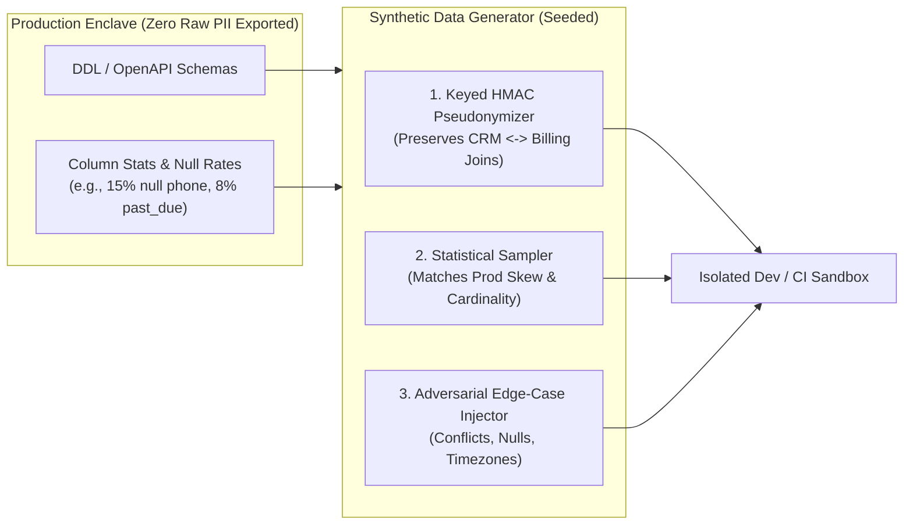
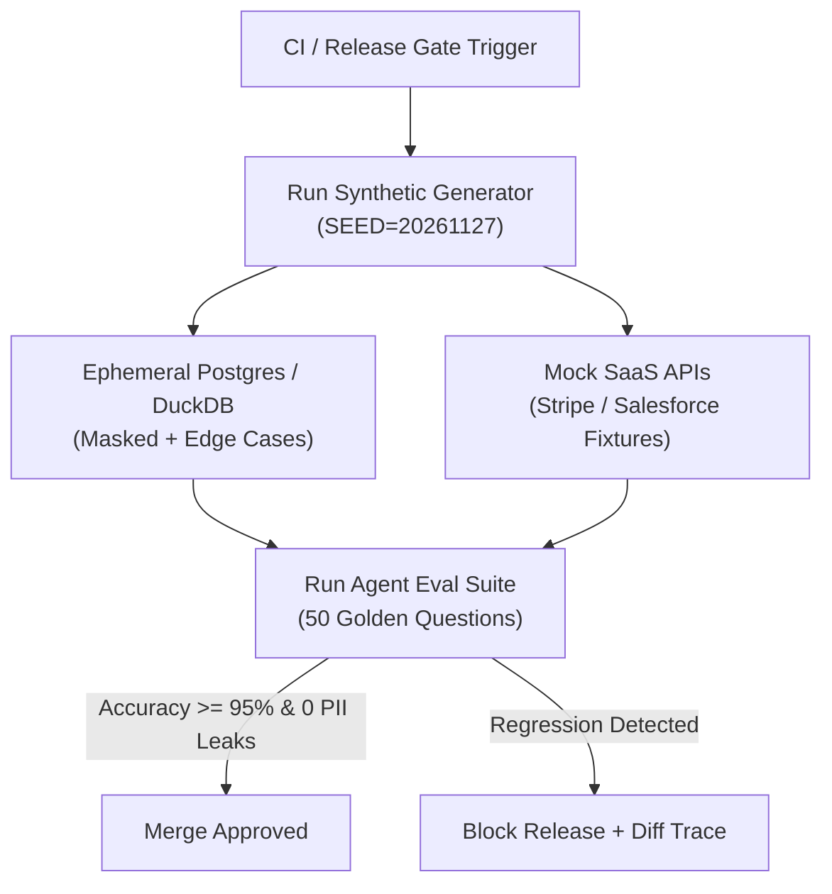

# Chapter 03 — Synthetic Data Environments for Safe Dev

> **Lecture 24 · Chapter 03 of 07** · Level: 🟠 Advanced · Phase 6 — Enterprise Data, Semantics & SQL
> **Source:** `FDE S09` · **Roadmap Reference:** [`roadmap-v1.md`](../../roadmap-v1.md#lecture-24--enterprise-data-discovery-ontologies--apache-ossie)
> **Roadmap topics:** Why production data cannot be used in dev/evals · schema-preserving synthetic generation · differential privacy / PII masking · edge-case injection for agent testing.

---

## 03.0 What this chapter is for

Forward Deployed Engineers face a classic catch-22 on day one of an enterprise engagement: you need realistic multi-system data to build, debug, and evaluate your AI agent, **but security and compliance (GDPR, SOC2, HIPAA) strictly forbid copying production customer PII onto developer laptops or into third-party LLM eval sandboxes.**

At the same time, toy hand-written fixtures (`Alice`, `Bob`, `Acme Corp` with 3 clean rows) hide the exact data messiness that breaks agents in production—null currencies, mismatched emails, timezone boundary bugs, and duplicate accounts. **Synthetic data environments** bridge this gap by generating realistic, schema-identical, privacy-safe datasets that preserve referential integrity and inject deliberate edge cases.

By the end of this chapter you should be able to:

1. Explain why raw production dumps violate least-privilege, data-residency, and LLM-provider privacy boundaries.
2. Compare three synthetic data strategies: **deterministic masking/pseudonymization**, **statistical/copula synthesis**, and **adversarial edge-case injection**.
3. Implement **keyed HMAC pseudonymization** so cross-system joins (`CRM` $\leftrightarrow$ `Billing` $\leftrightarrow$ `Support`) remain intact without exposing real PII.
4. Design **seeded, reproducible synthetic test suites** that catch real enterprise failure modes in CI.

---

## 03.1 Why production data cannot be used in dev or evals

Sending production rows to a dev environment or an external eval harness creates three immediate risks:

1. **Compliance & Data Residency Violations:** Copying EU customer emails or health records to a US developer laptop or third-party eval SaaS violates GDPR/HIPAA boundaries.
2. **LLM Provider Retention & Leakage:** Even with zero-data-retention APIs, debugging traces, prompt logs, and CI artifacts often persist inputs in plain text.
3. **Blast Radius of Write/Tool Bugs:** An agent bug in dev that triggers a mutating webhook or leaks a support ticket affects real customers if pointed at production data.

> [!IMPORTANT]
> **The Golden Rule of Enterprise Sandboxes.** Production schemas and aggregate statistics may leave the secure enclave; **raw production PII must never leave it.**

---

## 03.2 Three synthetic data strategies

No single technique handles every testing need. Production teams combine three complementary strategies:

| Strategy | How It Works | Preserves Cross-System Joins? | Best Use Case |
| :--- | :--- | :---: | :--- |
| **1. Deterministic Masking / Pseudonymization** | Replace PII (`email`, `name`, `phone`, `ssn`) with keyed HMAC tokens or seeded Faker values | **Yes** (if keyed identically across systems) | Integration tests, identity resolution, & Text-to-SQL benchmarks |
| **2. Statistical Distribution Synthesis** | Fit marginal distributions + column correlations (e.g., SDV / Gaussian Copula) on numeric & categorical columns | **Yes** (with foreign-key constraints) | Volume benchmarking, query-plan testing, & skew simulation |
| **3. Adversarial Edge-Case Injection** | Deterministically seed known enterprise failure cases (`NULL` currency, CRM vs. Billing conflict, Unicode names) | **Yes** | Agent release gates, guardrails, & regression suites |



---

## 03.3 Rules for production-grade synthetic fixtures

### Rule 1: Preserve foreign-key & cross-system joins
If `CRM` and `Billing` link via `email` or `domain`, naive random replacement (`faker.email()`) destroys the join: `ops@acme.com` becomes `john42@example.com` in CRM and `sarah99@example.org` in Billing!

Instead, use **deterministic keyed HMAC pseudonymization** with a secret salt kept inside the generator:

```typescript
import crypto from "node:crypto";

/**
 * Deterministically maps an email across all systems (CRM, Billing, Support)
 * without storing or exposing the original PII.
 */
export function pseudonymizeEmail(rawEmail: string, hmacSecret: string): string {
  const normalized = rawEmail.trim().toLowerCase();
  const digest = crypto
    .createHmac("sha256", hmacSecret)
    .update(normalized)
    .digest("hex")
    .slice(0, 10);

  return `anon_${digest}@synthetic.local`;
}

// CRM:     "ops@acme.com" -> "anon_8f3a19c204@synthetic.local"
// Billing: "OPS@acme.com" -> "anon_8f3a19c204@synthetic.local" (Join preserved!)
```

### Rule 2: Match production skew, nulls, and dirty strings
Clean textbook fixtures hide real bugs. If production `crm.accounts` has:
- `15%` `NULL` phone numbers,
- `4%` duplicate accounts with `"Inc."` vs. `"Incorporated"`,
- `8%` `past_due` subscriptions, and
- multi-currency invoices (`USD`, `EUR`, `GBP`),

then your synthetic generator must reproduce those exact percentages. Otherwise, your Text-to-SQL agent will pass 100% of dev tests and crash on day one in production with `ZeroDivisionError` or `NULL` concatenation bugs.

### Rule 3: Inject deliberate adversarial edge cases
Every synthetic environment should include a dedicated **adversarial slice** testing known failure modes:

| Injected Edge Case | What It Tests | Expected Agent Behavior |
| :--- | :--- | :--- |
| **Conflicting Status** (`CRM=active`, `Billing=past_due`) | Source-of-Truth precedence (Chapter 06) | Picks `Billing` and cites the CRM conflict |
| **Midnight UTC Boundary** (`2026-11-30T23:59:59Z`) | Date-truncation & timezone handling in SQL | Uses explicit UTC window, not local server time |
| **Internal QA Account** (`is_internal_test = true`, `$50k MRR`) | Semantic metric filters (Chapter 05) | Excludes QA account from ARR calculation |
| **SQL-Injection-Like Name** (`O'Reilly & Co; --`) | Parameterized SQL & escaping | Escapes cleanly without syntax error |

### Rule 4: Seeded reproducibility
Always pass a fixed PRNG `seed` (e.g., `SEED=20261127`) so every CI run generates the exact same synthetic database. Non-deterministic test data makes regression debugging impossible.

---

## 03.4 Architecture of an isolated CI eval sandbox



> [!TIP]
> **DuckDB + SQLite for instant CI.** You do not need a live Snowflake cluster for every PR. Generate your synthetic warehouse tables into local **DuckDB** or **Postgres** containers in CI so the full 50-question agent eval runs in under 20 seconds.

---

## 03.5 Common mistakes

| # | Common Mistake | Why It Hurts | What To Do Instead |
| :---: | :--- | :--- | :--- |
| 1 | **Randomly faking join keys (`faker.email()`)** | Breaks cross-system joins between CRM, Billing, and Support | Use **keyed HMAC pseudonymization** on normalized natural keys |
| 2 | **Generating "too clean" synthetic rows** | Hides `NULL`, duplicate, and timezone bugs until production | Match production null rates, skew, and inject adversarial edge cases |
| 3 | **Using production data in LLM eval harnesses** | Leaks customer PII into prompt logs, traces, and third-party APIs | Run all dev and CI evals strictly against synthetic sandboxes |
| 4 | **Unseeded random generation in tests** | Causes flaky CI failures that engineers cannot reproduce locally | Pin a deterministic PRNG `seed` for every fixture suite |
| 5 | **Skipping schema parity checks** | Synthetic schema drifts from production DDL, giving false confidence | Generate synthetic tables directly from production DDL / `dbt` schemas |

---

## 03.6 Key takeaways

1. **Never send raw production PII to dev sandboxes or eval harnesses**—compliance and blast-radius risks are too high.
2. **Use deterministic keyed HMAC pseudonymization** so cross-system joins (`CRM` $\leftrightarrow$ `Billing`) remain testable without exposing real identities.
3. **Mirror production messiness** (null rates, skew, duplicates) and **inject adversarial edge cases** to catch real agent failures before release.
4. **Pin a fixed PRNG seed** so synthetic fixtures are 100% reproducible in CI.

---

**Next:** [Chapter 04 — Canonical Entities & Cross-System Identity](./04_Canonical_Entities_and_Cross_System_Identity.md)
