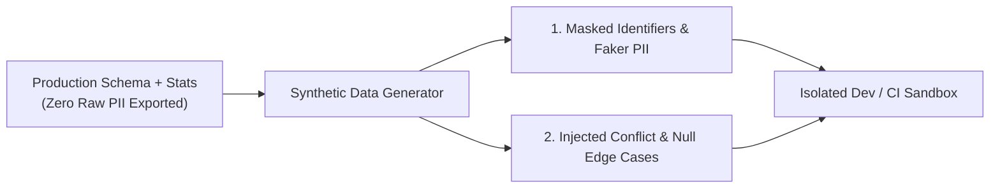

# Chapter 03 — Synthetic Data Environments for Safe Dev

> **Lecture 24 · Chapter 03 of 07** · Level: 🟠 Advanced · Phase 6 — Enterprise Data, Semantics & SQL
> **Source:** `FDE S09` · **Roadmap Reference:** [`roadmap-v1.md`](../../roadmap-v1.md#lecture-24--enterprise-data-discovery-ontologies--apache-ossie)
> **Roadmap topics:** Why production data cannot be used in dev/evals · schema-preserving synthetic generation · differential privacy / PII masking · edge-case injection for agent testing.

---

## 03.0 What this chapter is for

Forward Deployed Engineers face a classic catch-22: you need realistic enterprise data to build and evaluate your AI agent, **but security and compliance (GDPR, SOC2, HIPAA) forbid copying production customer PII into developer laptops or third-party LLM eval sandboxes.**

**Synthetic data environments** solve this by generating realistic, schema-identical, privacy-safe datasets that mirror production distributions and edge cases.

By the end of this chapter you should be able to:

1. Explain why raw production dumps violate least-privilege and data-residency controls.
2. Compare three synthetic data techniques: **deterministic masking/tokenization**, **statistical/copula synthesis**, and **LLM-assisted edge-case generation**.
3. Inject **deliberate enterprise edge cases** (nulls, timezone boundaries, cross-system conflicts) into synthetic fixtures for deterministic testing.

---

## 03.1 Three synthetic data strategies

| Strategy | How It Works | Preserves Referential Integrity? | Best Use Case |
| :--- | :--- | :---: | :--- |
| **1. Deterministic Masking / Pseudonymization** | Replace PII (`email`, `name`, `phone`) with keyed HMAC tokens or Faker values while keeping `customer_id` joins intact | **Yes** | Integration tests & Text-to-SQL benchmarks |
| **2. Statistical Distribution Synthesis** | Fit marginal distributions + correlations (e.g., SDV / Gaussian Copula) on numeric/categorical columns | **Yes** | Load testing, volume benchmarking, skew simulation |
| **3. Adversarial Edge-Case Injection** | Deterministically seed known failure cases (conflicting CRM vs. Billing status, `NULL` currency, Unicode names) | **Yes** | Agent release gates & regression suites |

---

## 03.2 Rules for production-grade synthetic fixtures

1. **Preserve foreign-key & cross-system joins:** If `CRM` uses `cust_101` and `Billing` uses `stripe_991` linked by `email`, masking `email` must be **deterministic** (`hmac(email)`) so cross-system identity resolution still works!
2. **Match production skew and nulls:** Production data has `15%` missing phone numbers, duplicate accounts, and `past_due` edge cases. Clean textbook fixtures hide real agent bugs.
3. **Seeded reproducibility:** Always pass a fixed PRNG `seed` so CI release gates produce identical synthetic rows on every run.

---

## 03.3 Key takeaways

1. **Never send raw production PII to dev sandboxes or eval harnesses.**
2. **Use deterministic pseudonymization** so cross-system joins (`CRM` $\leftrightarrow$ `Billing`) remain testable.
3. **Deliberately inject conflicts, nulls, and skew** into synthetic data to stress-test agent reasoning.

---

**Next:** [Chapter 04 — Canonical Entities & Cross-System Identity](./04_Canonical_Entities_and_Cross_System_Identity.md)

