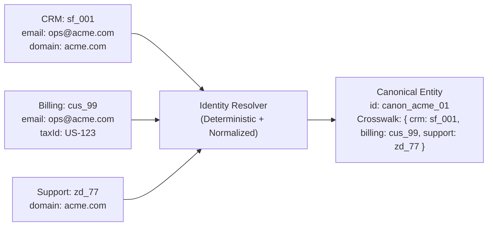

# Chapter 04 — Canonical Entities & Cross-System Identity

> **Lecture 24 · Chapter 04 of 07** · Level: 🟠 Advanced · Phase 6 — Enterprise Data, Semantics & SQL
> **Source:** `FDE S09 & S10` · **Roadmap Reference:** [`roadmap-v1.md`](../../roadmap-v1.md#lecture-24--enterprise-data-discovery-ontologies--apache-ossie)
> **Roadmap topics:** Entity proliferation across SaaS/DBs · canonical entity modeling · deterministic vs. probabilistic identity resolution · crosswalk tables (`canonical_id` mapping).

---

## 04.0 What this chapter is for

Ask three departments in the same company for *"Customer Acme Corp"*:
- **Salesforce (CRM)** calls it `AccountId = "001Dn00000A"`, domain `"acme.com"`, status `"Active"`.
- **Stripe (Billing)** calls it `cus_P9x881`, email `"billing@acme.com"`, status `"past_due"`.
- **Zendesk (Support)** calls it `org_7741`, name `"Acme Corporation Inc."`.

If an AI agent joins these systems on `name` string equality, it misses half the records or merges two different companies. **Canonical Entities** and **Identity Resolution** solve this by mapping every local system ID to a single **Canonical Entity ID** (`ent_cust_001`).

By the end of this chapter you should be able to:

1. Model a **Canonical Entity** (`Customer`, `Subscription`, `Invoice`, `Employee`) independent of any vendor schema.
2. Implement **tiered identity resolution**: exact external-ID match $\rightarrow$ normalized domain/email match $\rightarrow$ fuzzy/probabilistic match (with human review threshold).
3. Maintain an **Identity Crosswalk Table** linking local system keys to `canonicalId`.

---

## 04.1 The Crosswalk Pattern



### Tiered matching precedence

| Match Tier | Signal Used | Confidence | Auto-Merge? |
| :--- | :--- | :---: | :---: |
| **Tier 1 (Exact Key)** | Shared immutable external key (`stripe_customer_id` stored on CRM account) | `1.00` | **Yes** |
| **Tier 2 (Normalized Natural Key)** | Lowercased/trimmed `email`, verified `domain`, or `taxId` | `0.95` | **Yes** |
| **Tier 3 (Fuzzy / Probabilistic)** | Jaro-Winkler / Levenshtein on `company_name` + `address` | `0.70–0.89` | **No — queue for steward review** |

> [!CAUTION]
> **Never auto-merge on fuzzy company name alone.** `"Delta Airlines"` and `"Delta Faucets"` share a prefix; `"Acme Corp (US)"` and `"Acme Corp (UK)"` may be separate legal billing entities. Require deterministic keys or human steward sign-off for Tier 3 matches.

### Concrete Crosswalk Output (`canon_acme_01`)
```json
{
  "canonicalId": "canon_acme_01",
  "entityType": "Customer",
  "displayName": "Acme Corporation",
  "matchedBy": "TIER_2_NORMALIZED_DOMAIN (acme.com)",
  "crosswalk": {
    "salesforce": "001Dn00000A",
    "stripe": "cus_P9x881",
    "zendesk": "org_7741"
  }
}
```

---

## 04.2 Key takeaways

1. **Decouple agent reasoning from vendor IDs** (`sf_001`, `cus_99`) using a **Canonical Entity** model.
2. **Resolve identities in tiers:** exact foreign key $\rightarrow$ normalized email/domain/taxId $\rightarrow$ steward-reviewed fuzzy match.
3. **Expose the Identity Crosswalk** in the metadata catalogue so any agent can traverse `CRM` $\leftrightarrow$ `Billing` $\leftrightarrow$ `Support` deterministically.

---

**Next:** [Chapter 05 — Business Vocabularies & Semantic Metrics](./05_Business_Vocabularies_and_Semantic_Metrics.md)

