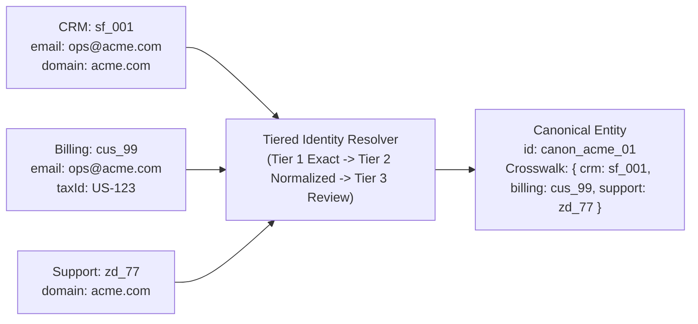
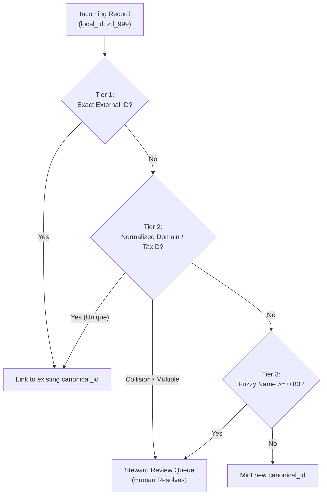

# Chapter 04 — Canonical Entities & Cross-System Identity

> **Lecture 24 · Chapter 04 of 07** · Level: 🟠 Advanced · Phase 6 — Enterprise Data, Semantics & SQL
> **Source:** `FDE S09 & S10` · **Roadmap Reference:** [`roadmap-v1.md`](../../roadmap-v1.md#lecture-24--enterprise-data-discovery-ontologies--apache-ossie)
> **Roadmap topics:** Entity proliferation across SaaS/DBs · canonical entity modeling · deterministic vs. probabilistic identity resolution · crosswalk tables (`canonical_id` mapping).

---

## 04.0 What this chapter is for

Ask three departments in the same company for *"Customer Acme Corp"* and you will get three completely incompatible records:
- **Salesforce (CRM)** calls it `AccountId = "001Dn00000A"`, domain `"acme.com"`, status `"Active"`.
- **Stripe (Billing)** calls it `cus_P9x881`, email `"billing@acme.com"`, status `"past_due"`.
- **Zendesk (Support)** calls it `org_7741`, name `"Acme Corporation Inc."`, tier `"Enterprise"`.

If an AI agent tries to join these systems using naive `name` string equality, it misses half the records (`"Acme Corp"` $\neq$ `"Acme Corporation Inc."`) or worse, merges two unrelated companies (`"Delta Airlines"` and `"Delta Faucets"`). **Canonical Entities** and **Cross-System Identity Resolution** solve this by mapping every vendor-specific ID to a single **Canonical Entity ID** (`canon_acme_01`).

By the end of this chapter you should be able to:

1. Model a **Canonical Entity** (`Customer`, `Subscription`, `Invoice`, `Employee`) decoupled from any single SaaS vendor's schema.
2. Implement **tiered identity resolution**: exact external-ID match $\rightarrow$ normalized natural-key match $\rightarrow$ fuzzy/probabilistic match with human steward review.
3. Build and maintain an **Identity Crosswalk Table** linking every local system key to `canonicalId`.
4. Explain why **auto-merging on fuzzy company names** causes catastrophic cross-tenant data leaks.

---

## 04.1 The Crosswalk Pattern

Instead of forcing every agent and SQL query to remember how Salesforce, Stripe, and Zendesk happen to spell a company's name, we introduce an **Identity Resolver** that produces a persistent **Crosswalk Table**:



### Canonical Entity Schema

A Canonical Entity defines the **enterprise's own language** for core nouns:

```json
{
  "canonicalId": "canon_acme_01",
  "entityType": "Customer",
  "displayName": "Acme Corporation",
  "verifiedDomain": "acme.com",
  "matchedBy": "TIER_2_NORMALIZED_DOMAIN",
  "confidence": 0.95,
  "crosswalk": {
    "salesforce": "001Dn00000A",
    "stripe": "cus_P9x881",
    "zendesk": "org_7741"
  },
  "updatedAt": "2026-11-26T12:00:00Z"
}
```

---

## 04.2 Tiered matching precedence

Identity resolution should never be a single heuristic. Use a **strict three-tier waterfall** where deterministic signals always run first:

| Match Tier | Signal Used | Confidence | Auto-Merge? | Example |
| :--- | :--- | :---: | :---: | :--- |
| **Tier 1 (Exact External Key)** | Shared immutable foreign key stored across systems (`stripe_customer_id` on CRM Account) | `1.00` | **Yes** | `crm.stripe_id == "cus_P9x881"` |
| **Tier 2 (Normalized Natural Key)** | Lowercased/trimmed `email`, verified corporate `domain`, or `taxId` | `0.95` | **Yes** (exclude free webmail like `gmail.com`) | `normalizeDomain(crm.website) == "acme.com"` |
| **Tier 3 (Fuzzy / Probabilistic)** | Jaro-Winkler / Levenshtein similarity on `company_name` + `address` | `0.70–0.89` | **No — queue for human steward** | `"Acme Corp."` vs. `"Acme Corporation Inc."` |

> [!CAUTION]
> **Never auto-merge on fuzzy company name alone.** `"Delta Airlines"` and `"Delta Faucets"` share a strong prefix; `"Acme Corp (US)"` and `"Acme Corp (UK)"` may be separate legal billing entities with different tax IDs. Merging them leaks one customer's invoices into another customer's support brief. Always route Tier 3 matches to a **Steward Review Queue**.

### The Free-Email Trap in Tier 2
Never match on domain if the domain is a consumer webmail provider (`gmail.com`, `yahoo.com`, `outlook.com`). Otherwise, two unrelated sole proprietors using `@gmail.com` will be merged into a single canonical customer! Maintain an explicit `PUBLIC_EMAIL_DOMAINS` blocklist in your normalizer.

---

## 04.3 Worked example: Resolving three messy records

Suppose our ingestion pipeline receives three records:

| System | Local ID | Raw Name | Email / Domain | External Key |
| :--- | :--- | :--- | :--- | :--- |
| **Salesforce** | `001Dn00000A` | `Acme Corp` | `https://www.ACME.com/` | `stripe_id: null` |
| **Stripe** | `cus_P9x881` | `Acme Corporation` | `billing@acme.com` | — |
| **Zendesk** | `org_7741` | `ACME` | `ops@acme.com` | — |

**Step-by-step resolution:**
1. **Tier 1 check:** `stripe_id` on Salesforce is `null` $\rightarrow$ no Tier 1 match.
2. **Normalize natural keys:**
   - Salesforce website `https://www.ACME.com/` $\rightarrow$ domain `acme.com`.
   - Stripe email `billing@acme.com` $\rightarrow$ domain `acme.com` (not in `PUBLIC_EMAIL_DOMAINS`).
   - Zendesk email `ops@acme.com` $\rightarrow$ domain `acme.com`.
3. **Tier 2 match:** All three share verified domain `acme.com` $\rightarrow$ merge into `canon_acme_01` with `confidence: 0.95`.
4. **Persist to Crosswalk Table (`dim_entity_crosswalk`):**

```sql
CREATE TABLE mart.dim_entity_crosswalk (
    canonical_id   VARCHAR NOT NULL,
    entity_type    VARCHAR NOT NULL, -- 'Customer'
    source_system  VARCHAR NOT NULL, -- 'salesforce' | 'stripe' | 'zendesk'
    local_id       VARCHAR NOT NULL,
    match_tier     VARCHAR NOT NULL, -- 'TIER_1_EXACT' | 'TIER_2_DOMAIN' | 'TIER_3_STEWARD'
    confidence     DECIMAL(3,2) NOT NULL,
    PRIMARY KEY (source_system, local_id)
);
```

Now any downstream Text-to-SQL query or RAG agent simply joins through `mart.dim_entity_crosswalk` instead of guessing string matches.

---

## 04.4 Handling splits, merges, and unmerged ambiguity

Crosswalks are living state, not write-once:



If two systems match **different** existing canonical IDs (a collision), **do not silently overwrite**—send the pair to the Steward Review Queue and mark the entity as `PENDING_MERGE` so agents warn operators of potential duplicate records.

---

## 04.5 Common mistakes

| # | Common Mistake | Why It Hurts | What To Do Instead |
| :---: | :--- | :--- | :--- |
| 1 | **Joining CRM and Billing on `company_name`** | Misses abbreviations (`Corp` vs. `Inc.`) and merges unrelated homonyms | Join through a governed `dim_entity_crosswalk` table using `canonical_id` |
| 2 | **Auto-merging Tier 3 fuzzy matches** | Merges distinct legal entities or unrelated companies, causing data leaks | Require human steward approval for all Tier 3 probabilistic matches |
| 3 | **Matching on `@gmail.com` / `@outlook.com` domains** | Merges unrelated small-business customers into one canonical record | Maintain a `PUBLIC_EMAIL_DOMAINS` blocklist in Tier 2 domain matching |
| 4 | **Hardcoding vendor IDs in agent prompts/tools** | Couples every agent workflow to Salesforce or Stripe ID formats | Pass `canonical_id` across tools and resolve local IDs via the crosswalk |
| 5 | **No audit trail for merges** | Impossible to undo an accidental merge when a steward spots an error | Store `match_tier`, `confidence`, and `matched_by` on every crosswalk row |

---

## 04.6 Key takeaways

1. **Decouple agent reasoning from vendor IDs** (`sf_001`, `cus_99`, `org_77`) by introducing a **Canonical Entity** model (`canon_acme_01`).
2. **Resolve identities in strict tiers:** exact foreign key (`1.00`) $\rightarrow$ normalized non-public domain/email/taxId (`0.95`) $\rightarrow$ steward-reviewed fuzzy match (`0.70–0.89`).
3. **Never auto-merge on fuzzy name similarity alone**—cross-company merges are silent security and accuracy disasters.
4. **Expose the Identity Crosswalk** in the metadata catalogue and warehouse so every agent and SQL query traverses `CRM` $\leftrightarrow$ `Billing` $\leftrightarrow$ `Support` deterministically.

---

**Next:** [Chapter 05 — Business Vocabularies & Semantic Metrics](./05_Business_Vocabularies_and_Semantic_Metrics.md)
