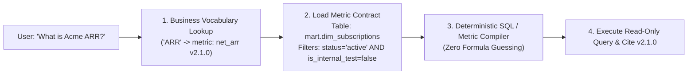
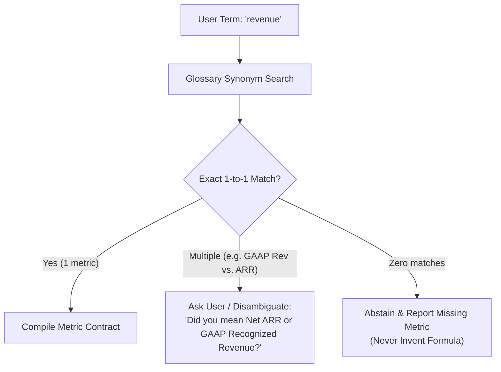

# Chapter 05 — Business Vocabularies & Semantic Metrics

> **Lecture 24 · Chapter 05 of 07** · Level: 🟠 Advanced · Phase 6 — Enterprise Data, Semantics & SQL
> **Source:** `FDE S10` · **Roadmap Reference:** [`roadmap-v1.md`](../../roadmap-v1.md#lecture-24--enterprise-data-discovery-ontologies--apache-ossie)
> **Roadmap topics:** Business glossaries · semantic metric definitions (ARR, Churn, Active User) · preventing LLM metric hallucination · versioned metric contracts.

---

## 05.0 What this chapter is for

Ask two departments in the same enterprise *"What is our ARR?"* or *"How many active customers do we have?"* and you will get two conflicting numbers—both backed by SQL queries:
- **Sales** counts signed contracts including future start dates and one-time implementation fees.
- **Finance** counts only recognized recurring revenue from active subscriptions, excluding one-time fees, internal QA accounts, and accounts `past_due > 30 days`.

If you give an AI agent raw SQL access without a **Business Vocabulary & Semantic Metric Registry**, the LLM will *invent* its own `SUM(amount)` formula from column names alone—producing plausible, confident, **wrong** executive numbers.

By the end of this chapter you should be able to:

1. Define a **Business Vocabulary** that maps ambiguous human synonyms (`"ARR"`, `"annual revenue"`, `"active customer"`) to one canonical concept.
2. Author machine-readable **Semantic Metric Contracts** specifying formula SQL, required filters, grain, authoritative table, and owner.
3. Ground agent queries in the metric registry so the LLM **never guesses** a business calculation.
4. Version and test metric contracts like production code so definition changes never silently break agents.

---

## 05.1 Why LLMs hallucinate business metrics

LLMs are trained on public SQL tutorials where `revenue` is simply `SUM(price * quantity)`. Enterprise metrics are almost never that simple:

| Ambiguous Business Term | What an Unguided LLM Writes | What Finance Actually Requires |
| :--- | :--- | :--- |
| **"ARR"** | `SUM(amount)` on `invoices` | `SUM(mrr_cents * 12) / 100.0` on `billing.subscriptions` where `status = 'active'` and `is_internal_test = false` |
| **"Active Customer"** | `COUNT(*) FROM customers` | `COUNT(DISTINCT canonical_id)` with at least one `active` subscription and `seat_usage_30d > 0` |
| **"Logo Churn Rate"** | `canceled / total` | `churned_logos_in_period / active_logos_at_period_start` (excluding mid-period upgrades/downgrades) |
| **"Net Dollar Retention"** | `current_arr / prior_arr` | `(start_arr + expansion - contraction - churn) / start_arr` on a fixed **cohort** of customers from 12 months ago |

> [!IMPORTANT]
> **Metric hallucination is a specification gap, not a model flaw.** An LLM cannot infer your CFO's exclusion rules from `CREATE TABLE billing.subscriptions`. If the filter `is_internal_test = false` is not in a machine-readable metric contract, the model *will* miss it.

---

## 05.2 Anatomy of a semantic metric contract

Every governed metric in the enterprise catalogue should be stored as a structured, versioned contract (compatible with MetricFlow / Cube / Apache Ossie glossaries):

| Field | Example (`net_arr`) | Why It Prevents Agent Hallucination |
| :--- | :--- | :--- |
| **`id` & `synonyms`** | `net_arr` (`["ARR", "Annual Recurring Revenue", "run rate"]`) | Resolves natural-language variations to one canonical metric |
| **`version`** | `2.1.0` | Allows safe evolution and auditability across quarters |
| **`formulaSql`** | `SUM(mrr_cents * 12) / 100.0` | Eliminates LLM-invented math and integer-cent unit errors |
| **`requiredFilters`** | `["status = 'active'", "is_internal_test = false"]` | Prevents counting test, sandbox, or canceled accounts |
| **`allowedDimensions`** | `["region", "plan_tier", "account_owner"]` | Prevents invalid `GROUP BY` grain explosions |
| **`authoritativeAsset`** | `mart.dim_subscriptions` | Forces the agent to query the Gold-certified table |
| **`ownerTeam`** | `@finance-revops` | Clear escalation path when definitions change |

```yaml
metric:
  id: net_arr
  version: "2.1.0"
  displayName: "Net Annual Recurring Revenue (ARR)"
  synonyms: ["ARR", "Annual Recurring Revenue", "recurring run rate"]
  authoritativeAsset: "mart.dim_subscriptions"
  grain: "subscription_id"
  formulaSql: "SUM(mrr_cents * 12) / 100.0"
  unit: "USD"
  requiredFilters:
    - "status = 'active'"
    - "is_internal_test = false"
  allowedDimensions: ["region", "plan_tier", "segment"]
  ownerTeam: "@finance-revops"
```



---

## 05.3 Worked example: Stopping a \$72,000 hallucination

Suppose `mart.dim_subscriptions` for **Acme Corp** (`canon_acme_01`) contains three rows:

| `subscription_id` | `plan` | `mrr_cents` | `status` | `is_internal_test` |
| :--- | :--- | :---: | :--- | :---: |
| `sub_01` | `enterprise` | `1000000` (`$10,000/mo`) | `active` | `false` |
| `sub_02` | `sandbox_qa` | `500000` (`$5,000/mo`) | `active` | `true` |
| `sub_03` | `starter` | `100000` (`$1,000/mo`) | `canceled` | `false` |

Compare the two execution paths:

1. **Without a Metric Contract (Metadata-Blind SQL):**
   ```sql
   -- LLM guesses from column names:
   SELECT SUM(mrr_cents * 12) / 100.0 AS arr
   FROM mart.dim_subscriptions
   WHERE customer_id = 'canon_acme_01';
   -- Returns: $192,000 (WRONG by $72,000!)
   ```
2. **With the `net_arr` Semantic Contract:**
   The agent's metric compiler injects `formulaSql` and `requiredFilters` deterministically:
   ```sql
   SELECT SUM(mrr_cents * 12) / 100.0 AS net_arr
   FROM mart.dim_subscriptions
   WHERE customer_id = 'canon_acme_01'
     AND status = 'active'
     AND is_internal_test = false;
   -- Returns: $120,000 (100% Finance-accurate!)
   ```

> [!TIP]
> **Compile metrics deterministically when possible.** Rather than pasting the metric definition into the prompt and *hoping* the LLM remembers every `WHERE` clause, have the LLM output a **structured metric request** (`{ metric: "net_arr", filters: { customer: "canon_acme_01" } }`) and let deterministic code compile the SQL.

---

## 05.4 Handling metric ambiguity and synonym collisions

What happens when a user asks *"What is our revenue?"*—and the glossary has **two** metrics: `recognized_revenue_gaap` and `net_arr`?



Never let an agent silently pick between two competing financial definitions or invent a formula for an uncatalogued metric.

---

## 05.5 Common mistakes

| # | Common Mistake | Why It Hurts | What To Do Instead |
| :---: | :--- | :--- | :--- |
| 1 | **Letting the LLM write metric math from column names** | Misses exclusion filters (`is_internal_test`), unit scaling (`cents`), and status rules | Store exact `formulaSql` and `requiredFilters` in a Semantic Metric Registry |
| 2 | **Leaving synonyms out of the glossary** | Users ask for `"run rate"` or `"bookings"` and the agent misses `net_arr` | Maintain explicit `synonyms` arrays and map ambiguous terms to disambiguation prompts |
| 3 | **Unversioned metric definitions** | When Finance updates `churn`, historical comparisons silently break | Version every metric contract (`v2.1.0`) and log the version in agent citations |
| 4 | **Allowing arbitrary `GROUP BY` on pre-aggregated ratios** | Averaging or summing ratios (like `churn_rate`) across regions produces mathematically invalid numbers | Declare `allowedDimensions` and `nonAdditive: true` in the metric contract |
| 5 | **Treating metric contracts as prompt-only text** | Long prompts still drop `WHERE` clauses under context pressure | Compile metric requests into SQL deterministically in application code |

---

## 05.6 Key takeaways

1. **Never let an LLM invent business metric definitions** from raw column names.
2. **Store synonyms, exact formulas, required filters, allowed dimensions, and certified tables** in a queryable Business Vocabulary.
3. **Compile metric queries deterministically** whenever possible, and **disambiguate or abstain** when a user term matches multiple or zero metrics.
4. **Treat metric definitions as versioned code** owned by domain stewards (`@finance-revops`, `@product-analytics`).

---

**Next:** [Chapter 06 — Source Precedence & Knowledge Provenance](./06_Source_Precedence_and_Knowledge_Provenance.md)
