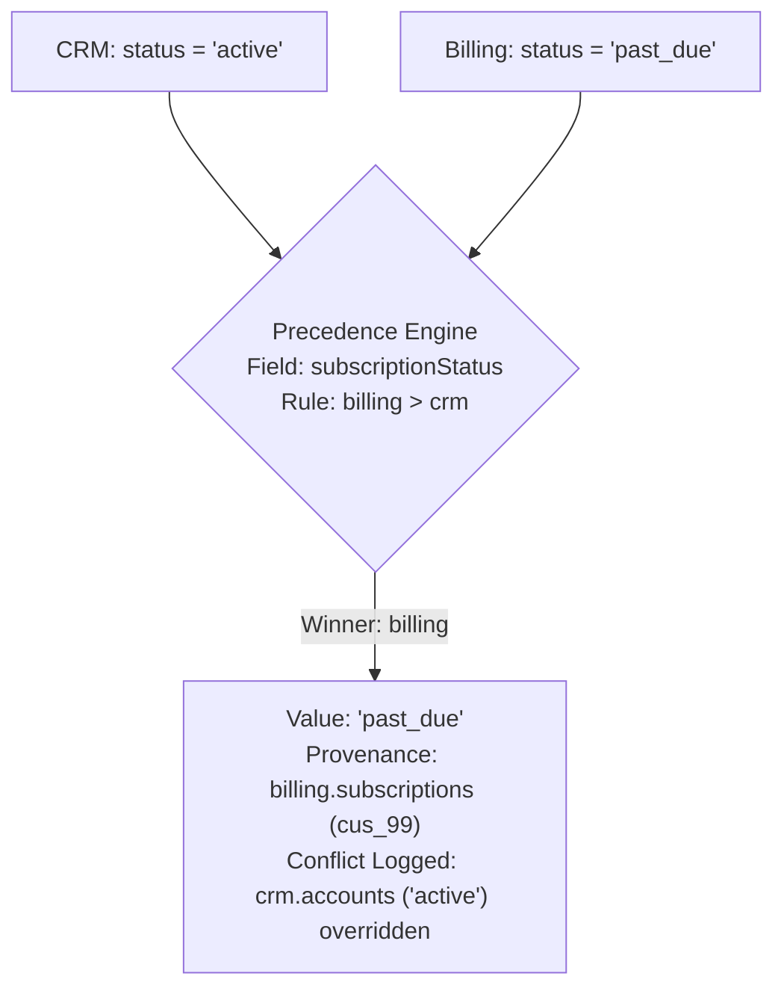

# Chapter 06 — Source Precedence & Knowledge Provenance

> **Lecture 24 · Chapter 06 of 07** · Level: 🟠 Advanced · Phase 6 — Enterprise Data, Semantics & SQL
> **Source:** `FDE S10` · **Roadmap Reference:** [`roadmap-v1.md`](../../roadmap-v1.md#lecture-24--enterprise-data-discovery-ontologies--apache-ossie)
> **Roadmap topics:** Conflicting cross-system records · System-of-Record (SoR) precedence rules · field-level authority · knowledge provenance & citations · abstention on unresolved ties.

---

## 06.0 What this chapter is for

Even after resolving canonical customer IDs (Chapter 04), **systems disagree**:
- **CRM (`crm.accounts`)** says `Acme Corp` has `status = "active"` and `account_owner = "Alice"`.
- **Billing (`billing.subscriptions`)** says `Acme Corp` has `status = "past_due"` and `mrr_usd = 12000`.

Which system is right? **It depends on the field.** Billing is the **System of Record (SoR)** for payment/subscription `status` and `mrr_usd`; CRM is the System of Record for `account_owner` and `sales_stage`.

By the end of this chapter you should be able to:

1. Define **field-level Source-of-Truth (SoR) precedence rules** across enterprise systems.
2. Implement a deterministic **Conflict Resolver** that selects the authoritative value and logs the overridden conflict.
3. Attach **Knowledge Provenance** (`sourceSystem`, `recordId`, `updatedAt`, `precedenceRuleId`) to every answer an agent returns.

---

## 06.1 Field-level System-of-Record (SoR) precedence

Precedence is **per attribute**, not per table:

| Canonical Field | Rank 1 (Authoritative SoR) | Rank 2 (Fallback) | Why |
| :--- | :--- | :--- | :--- |
| **`subscriptionStatus`** | `billing.subscriptions` | `crm.accounts` | Payment processor reflects actual invoice/charge state; CRM lags behind |
| **`mrrUsd`** | `billing.subscriptions` | `crm.opportunities` | Closed-won estimates in CRM drift from actual billed/discounted amounts |
| **`accountOwner`** | `crm.accounts` | `support.organizations` | Sales/CS territory assignments live in CRM |
| **`supportTier`** | `support.organizations` | `billing.subscriptions` | SLA routing overrides are managed in Support |

---

## 06.2 Provenance & Conflict Transparency

A metadata-aware agent must **never silently hide a cross-system conflict**. Its response should include:
1. **Authoritative Value:** `"past_due"`
2. **Provenance Citation:** `"billing.subscriptions (cus_99, updated 2026-11-26T10:00Z)"`
3. **Conflict Note:** `"Note: crm.accounts reports 'active', overridden by precedence rule billing > crm for subscriptionStatus."`

This gives human operators immediate trust and surfaces data-sync drift between CRM and Billing.

### When to Abstain Instead of Guessing
If **both** Rank 1 (`billing.subscriptions`) and Rank 2 (`crm.accounts`) are missing or their timestamps are older than the freshness SLA, **do not average or guess**—return `status: "ABSTAINED_INSUFFICIENT_AUTHORITY"` with the exact missing system name so an operator can investigate.

---

## 06.3 Key takeaways

1. **System-of-Truth precedence is field-level**, not whole-system.
2. **Resolve conflicts deterministically in code** before the LLM formats the final response.
3. **Always emit provenance citations and conflict notes** so users know *why* a value was chosen.

---

**Next:** [Chapter 07 — Apache Ossie & Metadata-Aware AI](./07_Apache_Ossie_and_Metadata_Aware_AI.md)

