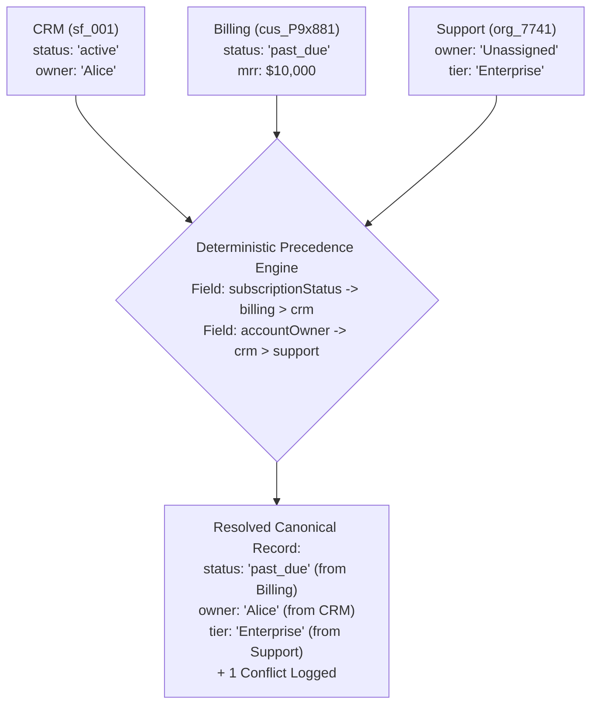
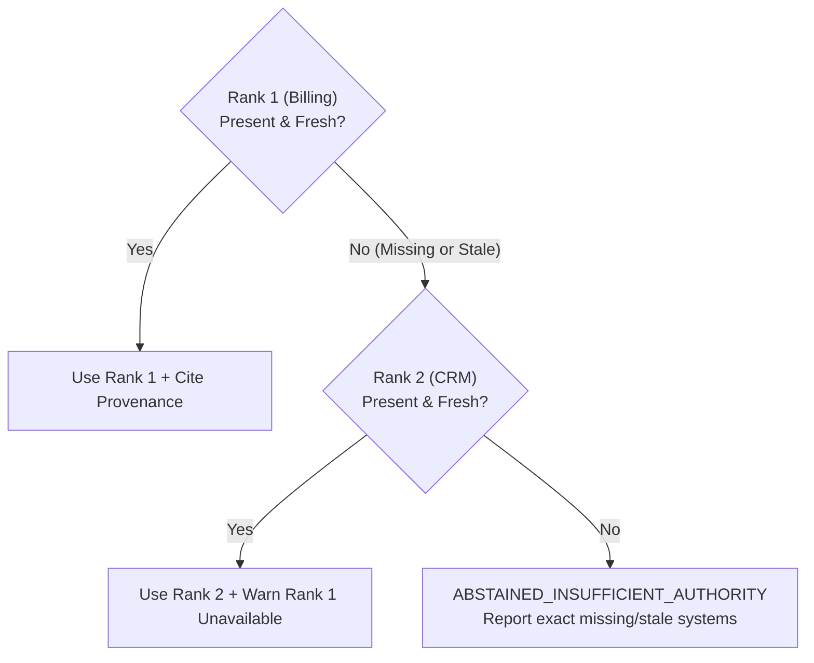

# Chapter 06 — Source Precedence & Knowledge Provenance

> **Lecture 24 · Chapter 06 of 07** · Level: 🟠 Advanced · Phase 6 — Enterprise Data, Semantics & SQL
> **Source:** `FDE S10` · **Roadmap Reference:** [`roadmap-v1.md`](../../roadmap-v1.md#lecture-24--enterprise-data-discovery-ontologies--apache-ossie)
> **Roadmap topics:** Conflicting cross-system records · System-of-Record (SoR) precedence rules · field-level authority · knowledge provenance & citations · abstention on unresolved ties.

---

## 06.0 What this chapter is for

Even after you map the estate (Chapter 01), link canonical customer IDs (Chapter 04), and standardize metric formulas (Chapter 05), **enterprise systems still disagree with each other**:
- **CRM (`crm.accounts`)** says `Acme Corp` (`sf_001`) has `status = "active"`, `account_owner = "Alice"`, and `estimated_arr = 140000`.
- **Billing (`billing.subscriptions`)** says `Acme Corp` (`cus_P9x881`) has `status = "past_due"` and `mrr_usd = 10000` (`$120,000 ARR`).
- **Support (`support.organizations`)** says `Acme Corp` (`org_7741`) has `tier = "Enterprise"`.

Which system is right? **It depends on the field.** Billing is the **System of Record (SoR)** for payment `status` and `mrr_usd`; CRM is the System of Record for `account_owner` and `sales_stage`. If you let an LLM pick whichever tool returned first—or worse, average them—your agent becomes a coin-flip machine.

By the end of this chapter you should be able to:

1. Define **field-level System-of-Record (SoR) precedence rules** across enterprise systems.
2. Implement a deterministic **Conflict Resolver** that selects the authoritative value and logs every overridden conflict.
3. Attach structured **Knowledge Provenance** (`sourceSystem`, `recordId`, `updatedAt`, `precedenceRuleId`) to every claim an agent returns.
4. Enforce **abstention rules** when authoritative sources are stale, missing, or deadlocked.

---

## 06.1 Field-level System-of-Record (SoR) precedence

Precedence is **per attribute**, never per whole system. No single SaaS tool owns every attribute of a customer:

| Canonical Field | Rank 1 (Authoritative SoR) | Rank 2 (Fallback) | Why This Precedence Holds |
| :--- | :--- | :--- | :--- |
| **`subscriptionStatus`** | `billing.subscriptions` | `crm.accounts` | Payment processor reflects actual invoice/charge state; CRM syncs lag behind |
| **`mrrUsd`** | `billing.subscriptions` | `crm.opportunities` | Closed-won estimates in CRM drift from actual billed/discounted amounts |
| **`accountOwner`** | `crm.accounts` | `support.organizations` | Sales/CS territory assignments live in CRM |
| **`supportTier`** | `support.organizations` | `billing.subscriptions` | Temporary SLA escalations and overrides are managed in Support |
| **`legalEntityName`** | `erp.netsuite_customers` | `billing.subscriptions` | Signed tax/W-9 legal entity lives in ERP |



> [!IMPORTANT]
> **Resolve conflicts in deterministic code, not in the LLM.** Never dump both `CRM: active` and `Billing: past_due` into a prompt and ask the model *"Which one do you think is right?"* Run the precedence table in TypeScript/Python first, then pass the resolved value + conflict metadata to the LLM for formatting.

---

## 06.2 Implementing a deterministic conflict resolver

A production conflict resolver evaluates each canonical field against its ordered SoR list, checks freshness SLAs, and emits both the winning value and an audit trail:

```typescript
interface FieldObservation {
  sourceSystem: string;
  recordId: string;
  value: unknown;
  updatedAt: string;
}

interface ResolvedField {
  value: unknown;
  status: "RESOLVED" | "ABSTAINED_INSUFFICIENT_AUTHORITY";
  provenance?: {
    sourceSystem: string;
    recordId: string;
    updatedAt: string;
    precedenceRuleId: string;
  };
  conflicts: Array<{
    overriddenSystem: string;
    overriddenValue: unknown;
    reason: string;
  }>;
}
```

When `CRM` says `active` and `Billing` says `past_due` for `subscriptionStatus`:
- **Winner:** `Billing` (`past_due`) via rule `sor.subscriptionStatus.v1 (billing > crm)`.
- **Conflict logged:** `crm.accounts` (`active`) was overridden.
- **Provenance attached:** `billing.subscriptions (cus_P9x881, updated 2026-11-26T10:00:00Z)`.

---

## 06.3 Provenance & conflict transparency

A metadata-aware agent must **never silently hide a cross-system conflict**. Hiding overrides makes operators distrust the agent when they look at Salesforce later and see `"Active"`.

Every agent response backed by resolved enterprise state should surface three elements:
1. **Authoritative Value:** `"past_due"`
2. **Provenance Citation:** `"Source: billing.subscriptions (cus_P9x881, updated 2026-11-26T10:00Z)"`
3. **Conflict Note:** `"Note: crm.accounts (sf_001) still reports 'active', overridden by SoR precedence rule billing > crm for subscriptionStatus."`

This gives human operators immediate confidence *and* turns the AI agent into an automated detector for broken CRM-to-Billing syncs.

---

## 06.4 When to abstain instead of guessing

What if **Rank 1 (`billing.subscriptions`)** is unreachable or its `updatedAt` timestamp violates the freshness SLA (`> 24h` old), AND **Rank 2 (`crm.accounts`)** is missing the field?



> [!WARNING]
> **Never average, interpolate, or fall back to stale unverified values.** If both Rank 1 and Rank 2 fail freshness or availability checks, return `ABSTAINED_INSUFFICIENT_AUTHORITY` naming the exact missing system (`billing.subscriptions`) and owner (`@payments-platform`).

---

## 06.5 Common mistakes

| # | Common Mistake | Why It Hurts | What To Do Instead |
| :---: | :--- | :--- | :--- |
| 1 | **Assigning precedence at the whole-system level** | Picking "Billing wins everything" breaks `account_owner` and `sales_stage` | Define SoR precedence **per canonical field** |
| 2 | **Letting the LLM arbitrate conflicting values** | Non-deterministic; model may pick CRM on Monday and Billing on Tuesday | Resolve conflicts deterministically in code before LLM synthesis |
| 3 | **Silently dropping overridden values** | Operators see a different value in CRM and assume the AI hallucinated | Emit explicit conflict notes showing which system was overridden and why |
| 4 | **Omitting record IDs and timestamps in citations** | Impossible to audit or debug a disputed number | Include `sourceSystem`, `recordId`, `updatedAt`, and `precedenceRuleId` |
| 5 | **Guessing when all SoRs are stale or down** | Confidently serves outdated or fabricated state during outages | Abstain with `ABSTAINED_INSUFFICIENT_AUTHORITY` and name the failing source |

---

## 06.6 Key takeaways

1. **System-of-Record precedence is field-level**, not whole-system (`Billing` owns `subscriptionStatus`; `CRM` owns `accountOwner`).
2. **Resolve cross-system conflicts deterministically in code** using an explicit precedence table before the LLM formats the response.
3. **Always attach Knowledge Provenance and conflict notes** so operators can verify the exact source record and spot sync drift.
4. **Abstain rather than guess** when authoritative sources are missing or violate their freshness SLA.

---

**Next:** [Chapter 07 — Apache Ossie & Metadata-Aware AI](./07_Apache_Ossie_and_Metadata_Aware_AI.md)
