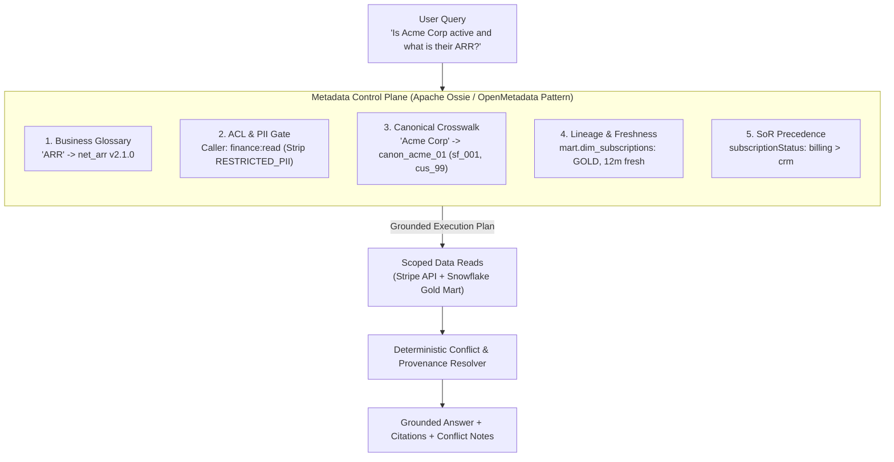
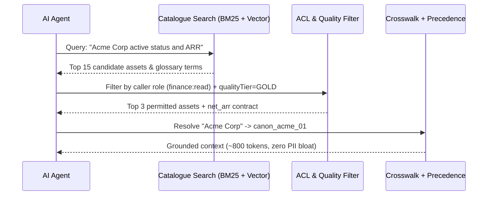

# Chapter 07 — Apache Ossie & Metadata-Aware AI

> **Lecture 24 · Chapter 07 of 07** · Level: 🟠 Advanced · Phase 6 — Enterprise Data, Semantics & SQL
> **Source:** `FDE S10` · **Roadmap Reference:** [`roadmap-v1.md`](../../roadmap-v1.md#lecture-24--enterprise-data-discovery-ontologies--apache-ossie)
> **Roadmap topics:** Apache Ossie / OpenMetadata-style open metadata architectures · injecting catalogue, lineage, vocabulary, and precedence into agent context · metadata-aware RAG & Text-to-SQL · access-aware retrieval.

---

## 07.0 What this chapter is for

Traditional AI agents are **metadata-blind**: they are handed a flat list of documents or raw table names and forced to guess their way through. They do not know which tables are `Gold`-certified, how `"ARR"` is defined by Finance, which columns contain `RESTRICTED_PII`, or whether CRM or Billing is authoritative for subscription status.

**Apache Ossie** (and open metadata architectures like OpenMetadata and DataHub) represent the architectural shift to **Metadata-Aware AI**: agents that consult a live **Catalogue + Lineage + Glossary + Crosswalk + Precedence Graph** *before* touching a single row of operational data.

By the end of this chapter you should be able to:

1. Describe the **Apache Ossie / Open Metadata-Aware AI** architecture and how its four core services work together.
2. Implement **progressive metadata injection** so an agent gets exact context from a 10,000-table estate without blowing up its token budget.
3. Trace an **end-to-end metadata-aware query** combining Glossary, ACLs, Crosswalk, Operational Freshness, and SoR Precedence.
4. Enforce **access-aware retrieval** across both structured SQL and unstructured RAG pipelines.

---

## 07.1 The Metadata-Aware AI architecture

A metadata-aware agent never talks directly to raw databases or vector stores first. Every query passes through the **Metadata Control Plane**:

### Metadata-Blind vs. Metadata-Aware AI

| Capability | Metadata-Blind Agent | Metadata-Aware Agent (Apache Ossie Pattern) |
| :--- | :--- | :--- |
| **Table / API Selection** | Guesses from names (`raw_cust` vs. `dim_cust`) | Selects `GOLD`-certified assets with healthy lineage |
| **Metric Calculation** | Invents SQL `SUM()` formulas from column names | Uses canonical `net_arr` formula & `requiredFilters` from Glossary |
| **Cross-System Joins** | Joins on fragile `company_name` strings | Traverses `dim_entity_crosswalk` via `canonical_id` |
| **Cross-System Conflicts** | Picks whichever API responded first | Applies deterministic field-level SoR precedence (`billing > crm`) |
| **Staleness Detection** | Silently reports 3-day-old numbers | Checks `lastSyncedAt` vs. `expectedFreshnessHours` and warns/falls back |
| **Access Control** | Relies on fragile prompt instructions | Filters denied/PII columns and ACL-restricted docs *before* retrieval |

---

## 07.2 Progressive metadata injection (Avoiding context bloat)

An enterprise catalogue easily holds **10,000+ tables and 150,000+ columns**. Dumping the entire catalogue into an LLM's system prompt causes three failures: context-window overflow, massive token cost, and "lost-in-the-middle" retrieval degradation.

Use a **three-stage progressive injection pipeline**:

1. **Stage 1 — Catalogue Search:** Search asset descriptions, glossary synonyms, and tags to retrieve only the **top 3–5 relevant tables/APIs and metrics**.
2. **Stage 2 — ACL & Quality Pruning:** Strip any asset below `GOLD` certification (unless explicitly requested for debugging) and remove all columns tagged `RESTRICTED_PII` that the caller's role cannot read.
3. **Stage 3 — Entity & Precedence Binding:** Resolve entity names to `canonical_id`s and attach the applicable SoR precedence rules—keeping total injected metadata under `~1,000 tokens`.

> [!TIP]
> **Keep the static system prompt prefix cacheable.** Put the *stable* instructions and tool schemas in the system prompt, and inject the *per-query* progressive metadata slice in the user/tool context so prompt caching stays hot.

---

## 07.3 End-to-end trace: *"Is Acme Corp active and what is their ARR?"*

Let us trace every component from Chapters 01–06 working together on one real executive question:

1. **Estate Routing (Ch 01):** `"active"` is live operational state $\rightarrow$ check SaaS API / OLTP; `"ARR"` is an analytical metric $\rightarrow$ check `GOLD` warehouse mart.
2. **Glossary Lookup (Ch 05):** `"ARR"` matches `net_arr` (`v2.1.0`): `SUM(mrr_cents * 12) / 100.0` on `mart.dim_subscriptions` with `status = 'active' AND is_internal_test = false`.
3. **ACL Check (Ch 02):** Caller has `finance:read`. Allowed to read `mrr_cents` and `status`; `ssn_last4` is stripped.
4. **Canonical Crosswalk (Ch 04):** `"Acme Corp"` resolves via Tier 2 domain match (`acme.com`) to `canon_acme_01` $\rightarrow$ `salesforce: 001Dn00000A`, `stripe: cus_P9x881`.
5. **Freshness & Precedence (Ch 02 & 06):** `mart.dim_subscriptions` is healthy (`12m` old). For `subscriptionStatus`, rule `billing > crm` applies: Stripe reports `past_due`, while Salesforce reports `active`.
6. **Final Grounded Response:**
   > *"Acme Corp (`canon_acme_01`) is currently **`past_due`** (per `billing.subscriptions` `cus_P9x881`, updated 10m ago; note `crm.accounts` `001Dn00000A` still reports `active`, overridden by SoR rule `billing > crm`). Because they have no `active` subscriptions, their `net_arr` (`v2.1.0`) is **`$0`**."*

Every single claim in that two-sentence answer is deterministic, auditable, access-controlled, and backed by provenance.

---

## 07.4 Access-aware RAG (Unstructured + Metadata)

Metadata-awareness applies equally to unstructured document stores (SharePoint, Confluence, Google Drive):
- **Ingest-time:** Every document chunk is tagged with `tenant_id`, `acl_groups`, `canonical_entity_ids`, and `pii_classification`.
- **Query-time:** The vector database applies a **pre-retrieval metadata filter** (`WHERE 'cs_team' IN acl_groups AND tenant_id = 't_123'`) *before* cosine similarity runs. Never retrieve restricted chunks and ask the LLM to "ignore" them.

---

## 07.5 Common mistakes

| # | Common Mistake | Why It Hurts | What To Do Instead |
| :---: | :--- | :--- | :--- |
| 1 | **Dumping 1,000+ table DDLs into the prompt** | Blows token budgets, breaks prompt caching, and degrades SQL accuracy | Use progressive metadata injection (top 3–5 relevant assets/metrics) |
| 2 | **Filtering ACLs *after* LLM generation** | Sensitive data already entered the LLM context and prompt logs | Filter restricted columns and ACL-protected chunks *before* retrieval/prompting |
| 3 | **Building RAG and Text-to-SQL without a shared Crosswalk** | Structured SQL and unstructured PDFs cannot agree on which customer is which | Tag both warehouse tables and RAG chunks with `canonical_id` |
| 4 | **Skipping operational freshness checks in the agent loop** | Agent confidently cites stale marts during upstream pipeline outages | Gate every query on `lastSyncedAt` vs. `expectedFreshnessHours` |
| 5 | **Treating Apache Ossie / OpenMetadata as a passive UI** | Stewards browse it, but agents still guess raw tables | Wire the catalogue API directly into the agent's planning step |

---

## 07.6 Key takeaways

1. **Metadata-aware AI queries the catalogue first**—resolving glossary terms, ACLs, canonical IDs, lineage freshness, and SoR precedence before touching operational data.
2. **Progressive metadata injection** keeps prompts lean (`< 1,000` tokens of catalogue context) even across 10,000-table enterprise estates.
3. **Deterministic resolution + LLM synthesis** guarantees consistent metric math, zero silent conflicts, and full provenance citations.
4. **Access control must be pre-retrieval** across both SQL roles and vector-DB metadata filters.

---

**Next:** [Lecture 24 — Complete Notes (Master Consolidation)](./Lecture_24_Complete_Notes.md)
