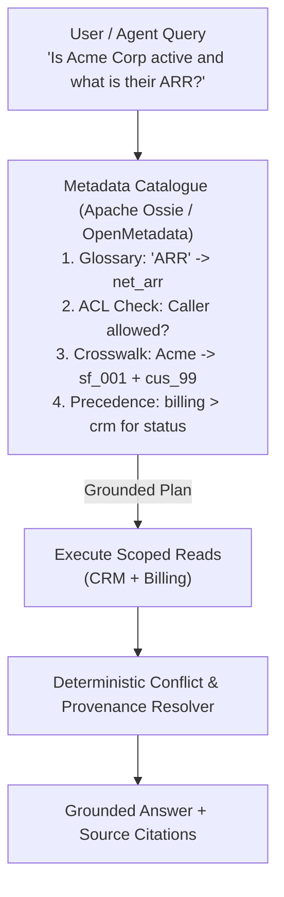

# Chapter 07 — Apache Ossie & Metadata-Aware AI

> **Lecture 24 · Chapter 07 of 07** · Level: 🟠 Advanced · Phase 6 — Enterprise Data, Semantics & SQL
> **Source:** `FDE S10` · **Roadmap Reference:** [`roadmap-v1.md`](../../roadmap-v1.md#lecture-24--enterprise-data-discovery-ontologies--apache-ossie)
> **Roadmap topics:** Apache Ossie / OpenMetadata-style open metadata architectures · injecting catalogue, lineage, vocabulary, and precedence into agent context · metadata-aware RAG & Text-to-SQL · access-aware retrieval.

---

## 07.0 What this chapter is for

Traditional AI agents are **metadata-blind**: they see a flat list of documents or raw table names and guess their way through. **Apache Ossie** (and open metadata-catalogue architectures like OpenMetadata) represent the shift toward **Metadata-Aware AI**: agents that query a live **Catalogue + Ontology + Precedence Graph** *before* touching operational data.

By the end of this chapter you should be able to:

1. Describe the **Apache Ossie / Open Metadata-Aware AI** architecture and its four core services (Catalogue, Lineage, Glossary, Governance).
2. Inject **filtered, role-scoped metadata** into an agent's context without causing context bloat.
3. Combine **Canonical Entity Resolution + Precedence + Provenance** into an end-to-end metadata-aware agent pipeline.

---

## 07.1 The Metadata-Aware AI architecture

### Why metadata-aware AI beats metadata-blind AI

| Capability | Metadata-Blind Agent | Metadata-Aware Agent (Apache Ossie Pattern) |
| :--- | :--- | :--- |
| **Table/API Selection** | Guesses from names (`raw_cust` vs. `dim_cust`) | Queries `Gold`-certified assets & lineage |
| **Metric Calculation** | Invents SQL `SUM()` formulas | Reads canonical `net_arr` formula & filters from Glossary |
| **Cross-System Conflicts** | Picks whichever system responded first | Applies field-level SoR precedence (`billing > crm`) |
| **Access Control** | Relies on prompt instructions | Filters denied/PII columns *before* retrieval |

---

## 07.2 Progressive metadata injection (Avoiding context bloat)

An enterprise catalogue can hold 10,000 tables. Never dump the whole catalogue into the system prompt:
1. **Step 1 (Search):** Use keyword/semantic search over asset names, glossary synonyms, and tags to retrieve only the **top 3–5 relevant assets & metrics**.
2. **Step 2 (Lineage & ACL Filter):** Strip restricted PII columns and uncertified `raw` tables.
3. **Step 3 (Resolve & Cite):** Run deterministic identity resolution + precedence rules, then let the LLM format the grounded, cited answer.

### End-to-End Trace: *"Is Acme Corp active and what is their ARR?"*
1. **Glossary:** `"ARR"` $\rightarrow$ `net_arr` (`status = 'active' AND is_internal_test = false`).
2. **Crosswalk:** `"Acme Corp"` $\rightarrow$ `canon_acme_01` (`sf_001` + `cus_99`).
3. **ACL & Precedence:** Caller has `finance:read`; `billing > crm` for `subscriptionStatus`.
4. **Result:** *"Acme Corp is **`past_due`** (per `billing.subscriptions` `cus_99`; note `crm.accounts` still shows `active`), with `$0` active `net_arr`."*

---

## 07.3 Key takeaways

1. **Metadata-aware AI queries the catalogue first** (glossary, lineage, ACLs, crosswalk, precedence) before querying data.
2. **Retrieve metadata progressively** (top 3–5 relevant assets/metrics) to keep prompts lean and prefix-cache friendly.
3. **Deterministic resolution + LLM synthesis** guarantees 100% consistent conflict handling and provenance citations.

---

**Next:** [Lecture 24 — Complete Notes (Master Consolidation)](./Lecture_24_Complete_Notes.md)

