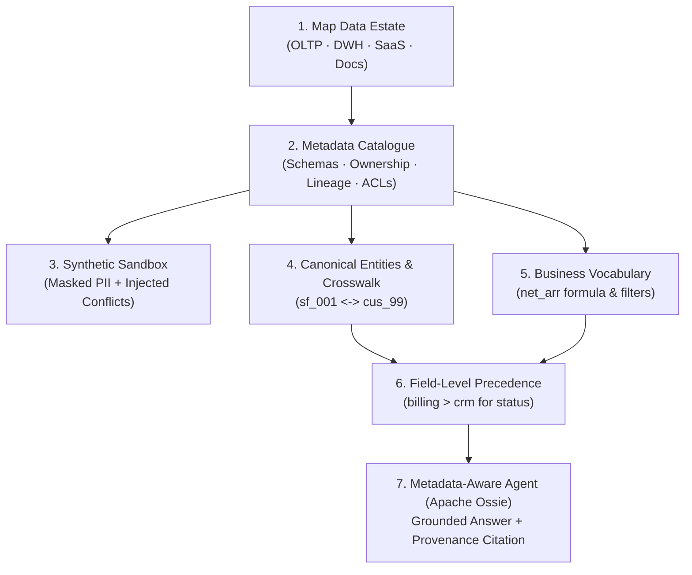

# Lecture 24 — Complete Notes
## Enterprise Data Discovery, Ontologies & Apache Ossie

> **Phase:** 6 · Enterprise Data, Semantics & SQL · **Level:** 🟠 Advanced
> **Scope:** A single-pass consolidation of the seven chapter notes in this folder.
> **How to use this file:** Read it to *revise and navigate*. Every section links back to the chapter that explains it in full.
>
> | Chapter | File |
> | :--- | :--- |
> | 01 · Mapping enterprise data estates | [01_Mapping_Enterprise_Data_Estates.md](./01_Mapping_Enterprise_Data_Estates.md) |
> | 02 · Metadata discovery, ownership & lineage | [02_Metadata_Discovery_Ownership_and_Lineage.md](./02_Metadata_Discovery_Ownership_and_Lineage.md) |
> | 03 · Synthetic data environments for safe dev | [03_Synthetic_Data_Environments_for_Safe_Dev.md](./03_Synthetic_Data_Environments_for_Safe_Dev.md) |
> | 04 · Canonical entities & cross-system identity | [04_Canonical_Entities_and_Cross_System_Identity.md](./04_Canonical_Entities_and_Cross_System_Identity.md) |
> | 05 · Business vocabularies & semantic metrics | [05_Business_Vocabularies_and_Semantic_Metrics.md](./05_Business_Vocabularies_and_Semantic_Metrics.md) |
> | 06 · Source precedence & knowledge provenance | [06_Source_Precedence_and_Knowledge_Provenance.md](./06_Source_Precedence_and_Knowledge_Provenance.md) |
> | 07 · Apache Ossie & metadata-aware AI | [07_Apache_Ossie_and_Metadata_Aware_AI.md](./07_Apache_Ossie_and_Metadata_Aware_AI.md) |

---

## 1. Executive summary

**The lecture in five sentences.**

1. Before connecting an agent to enterprise data, an FDE maps the **five estate tiers** (OLTP, Warehouse/Lakehouse, SaaS APIs, Document Stores, Shadow Spreadsheets) so queries match freshness and safety requirements.
2. **Metadata discovery** (technical, business, operational), **data lineage**, and **ownership/ACLs** prevent agents from querying stale `raw` tables or leaking restricted PII.
3. **Synthetic data environments** use deterministic pseudonymization and injected conflict/null edge cases so agents can be developed and tested without exporting production PII.
4. **Canonical Entities** and **Identity Crosswalks** unify fragmented vendor IDs (`sf_001` $\leftrightarrow$ `cus_99`), while a **Business Vocabulary** locks down metric formulas (`net_arr`) so LLMs never hallucinate definitions.
5. **Field-level Source-of-Truth Precedence** (`billing > crm` for `subscriptionStatus`) and **Apache Ossie-style metadata-aware AI** resolve cross-system conflicts deterministically and cite exact provenance.

---

## 2. The arc of the lecture in one diagram

---

## 3. Cheat sheet

| Concept | One-line definition | Chapter |
| :--- | :--- | :--- |
| **Data Estate Tiers** | OLTP, Warehouse/Lakehouse, SaaS APIs, Document Stores, Shadow Spreadsheets | [01](./01_Mapping_Enterprise_Data_Estates.md) |
| **Three Metadata Pillars** | Technical (schema), Business (glossary/owner), Operational (freshness/nulls) | [02](./02_Metadata_Discovery_Ownership_and_Lineage.md) |
| **Lineage DAG** | Upstream/downstream flow propagating quality status and PII tags | [02](./02_Metadata_Discovery_Ownership_and_Lineage.md) |
| **Deterministic Masking** | Keyed pseudonymization preserving cross-system joins without raw PII | [03](./03_Synthetic_Data_Environments_for_Safe_Dev.md) |
| **Canonical Entity & Crosswalk** | Vendor-neutral entity (`canon_01`) linking local IDs across CRM/Billing/Support | [04](./04_Canonical_Entities_and_Cross_System_Identity.md) |
| **Semantic Metric Contract** | Versioned formula, required filters, and certified table for terms like `ARR` | [05](./05_Business_Vocabularies_and_Semantic_Metrics.md) |
| **Field-Level SoR Precedence** | Deterministic rule (`billing > crm` for `subscriptionStatus`) per attribute | [06](./06_Source_Precedence_and_Knowledge_Provenance.md) |
| **Apache Ossie Pattern** | Querying catalogue, glossary, ACLs, and precedence before touching data | [07](./07_Apache_Ossie_and_Metadata_Aware_AI.md) |

---

## 4. Self-check questions (Release Gate Prep)

1. Why is querying a primary OLTP database for a 12-month cohort aggregation an architectural anti-pattern?
2. How does column-level lineage help prevent PII leaks in downstream vector indexes?
3. Why must email/ID masking in a synthetic dev environment be **deterministic**?
4. Why should an identity resolver never auto-merge two enterprise accounts on fuzzy company name alone?
5. When CRM says `status = "active"` and Billing says `status = "past_due"`, how does a metadata-aware agent decide and what must it cite?

