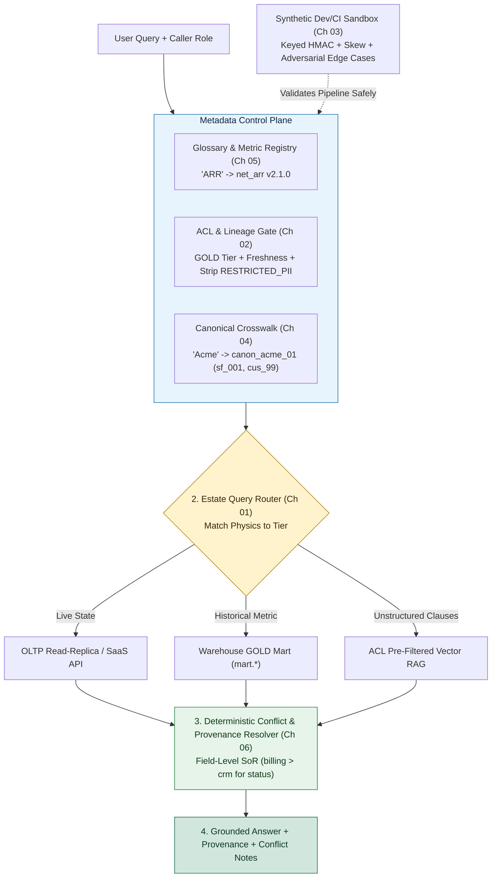

# Lecture 24 — Complete Notes
## Enterprise Data Discovery, Ontologies & Apache Ossie

> **Phase:** 6 · Enterprise Data, Semantics & SQL · **Level:** 🟠 Advanced
> **Scope:** Master revision guide consolidating all seven chapters of Lecture 24.
> **Thesis:** Enterprise AI agents fail when they are **metadata-blind**; reliable enterprise answers require mapping the **five data estate tiers**, harvesting **technical/business/operational metadata**, developing safely in **HMAC-masked synthetic sandboxes**, unifying identities via **Canonical Crosswalks**, locking down **Semantic Metric Contracts**, and resolving conflicts via **field-level SoR precedence + Apache Ossie metadata-aware control planes**.

---

## 1. Executive Summary

**The lecture in five sentences:**

1. Before connecting an agent to enterprise data, an FDE maps the **five estate tiers** (OLTP read-replicas, Warehouse/Lakehouse `mart.*`, SaaS APIs, ACL-filtered Document Stores, and quarantined Shadow Spreadsheets) so live-state vs. historical queries match system physics.
2. **Metadata discovery** (technical schemas, business owners/certification tiers, operational freshness) and **column-level lineage** prevent agents from querying uncleaned `raw` tables, serving stale marts, or leaking `RESTRICTED_PII`.
3. **Synthetic data environments** use deterministic **keyed HMAC pseudonymization**, production skew/null parity, and injected adversarial edge cases so agents can be tested in CI without exporting production PII.
4. **Canonical Entities** and **Identity Crosswalks** (`dim_entity_crosswalk`) unify fragmented vendor IDs (`sf_001` $\leftrightarrow$ `cus_99` $\leftrightarrow$ `org_77`) via strict tiered matching, while a **Business Vocabulary** compiles governed formulas (`net_arr`) deterministically.
5. **Field-level System-of-Record (SoR) precedence** (`billing > crm` for `subscriptionStatus`) and **Apache Ossie-style metadata-aware AI** (progressive metadata injection + pre-retrieval ACLs) resolve cross-system conflicts in code and cite exact provenance.

### Chapter Index

| Chapter | Topic | Core Focus | File |
| :---: | :--- | :--- | :--- |
| **01** | Mapping Data Estates | 5 estate tiers, OLTP vs. OLAP physics, `raw` vs. `mart`, Data Estate Inventory | [01_Mapping_Enterprise_Data_Estates.md](./01_Mapping_Enterprise_Data_Estates.md) |
| **02** | Metadata, Ownership & Lineage | Technical/business/operational pillars, lineage DAG, PII propagation, ACLs | [02_Metadata_Discovery_Ownership_and_Lineage.md](./02_Metadata_Discovery_Ownership_and_Lineage.md) |
| **03** | Synthetic Data Environments | Keyed HMAC masking, production skew parity, adversarial edge-case injection | [03_Synthetic_Data_Environments_for_Safe_Dev.md](./03_Synthetic_Data_Environments_for_Safe_Dev.md) |
| **04** | Canonical Entities & Identity | `dim_entity_crosswalk`, 3-tier matching, `PUBLIC_EMAIL_DOMAINS`, steward queue | [04_Canonical_Entities_and_Cross_System_Identity.md](./04_Canonical_Entities_and_Cross_System_Identity.md) |
| **05** | Business Vocabularies & Metrics | Semantic Metric Contracts (`net_arr`), deterministic SQL compilation, disambiguation | [05_Business_Vocabularies_and_Semantic_Metrics.md](./05_Business_Vocabularies_and_Semantic_Metrics.md) |
| **06** | Source Precedence & Provenance | Field-level SoR rules, deterministic Conflict Resolver, citations & abstention | [06_Source_Precedence_and_Knowledge_Provenance.md](./06_Source_Precedence_and_Knowledge_Provenance.md) |
| **07** | Apache Ossie & Metadata-Aware AI | Metadata Control Plane, 3-stage progressive injection, access-aware RAG/SQL | [07_Apache_Ossie_and_Metadata_Aware_AI.md](./07_Apache_Ossie_and_Metadata_Aware_AI.md) |

---

## 2. Master Architecture Diagram

---

## 3. Chapter-by-Chapter Short Revision Notes

### 3.1 Chapter 01 — Mapping Enterprise Data Estates

Enterprise data spans five tiers with different physics: **Operational DBs (OLTP)** (real-time, read-replica single-key lookups only), **Cloud Warehouses/Lakehouses** (`raw` $\rightarrow$ `staging` $\rightarrow$ `mart`, historical analytics), **SaaS APIs** (real-time, rate-limited), **Document Stores** (ACL-filtered RAG), and **Shadow Spreadsheets** (stale manual exports — **quarantine and promote to `dbt`**). Agents fail when they query `raw.salesforce_account` (including QA test accounts), run `GROUP BY` scans on primary OLTP, or check batch warehouses for 30-second-old payments.

- **Routing Rule:** Live state $\rightarrow$ OLTP Read-Replica / SaaS API; Historical trends $\rightarrow$ `mart.*`; Clauses/policies $\rightarrow$ ACL-filtered RAG; Shadow Excel $\rightarrow$ Block & promote.
- **Deliverable:** Author a machine-readable **Data Estate Inventory** (`assetId`, `tier`, `ownerTeam`, `freshnessSla`, `piiClassification`, `systemOfRecordFor`, `agentAccess`) before building connectors.

> 📖 **Need depth?** Read [Chapter 01 — Mapping Enterprise Data Estates](./01_Mapping_Enterprise_Data_Estates.md)

### 3.2 Chapter 02 — Metadata Discovery, Ownership & Lineage

Schemas alone cannot tell an agent whether a table is certified, fresh, or permitted. A live metadata catalogue harvests three pillars continuously via schema crawlers, query-log miners, and orchestrator webhooks: **Technical** (columns, PK/FK), **Business** (glossary, `@ownerTeam`, `RAW`/`SILVER`/`GOLD` tier, PII tags), and **Operational** (`lastSyncedAt`, `expectedFreshnessHours`, `upstreamStatus`).

- **Lineage DAG:** Enables root-cause debugging of stale marts (e.g., `stg_subscriptions_cdc` failed 58h ago), ranking `GOLD` tables above `raw`, and **automatic column-level PII tag propagation** (even when downstream views rename `ssn_last4` to `tax_suffix`).
- **Hard Rule:** Enforce column-level ACLs at the catalogue and DB-role layer — never rely on prompt instructions.

> 📖 **Need depth?** Read [Chapter 02 — Metadata Discovery, Ownership & Lineage](./02_Metadata_Discovery_Ownership_and_Lineage.md)

### 3.3 Chapter 03 — Synthetic Data Environments for Safe Dev

Compliance (GDPR/SOC2/HIPAA) forbids copying production PII to dev laptops or third-party evals, while toy clean fixtures hide real bugs. Build **seeded, reproducible** (`SEED=20261127`) synthetic sandboxes in DuckDB/Postgres combining:
- **Deterministic Keyed HMAC Pseudonymization:** Maps `ops@acme.com` $\rightarrow$ `anon_8f3a19c204@synthetic.local` identically across CRM and Billing so cross-system joins survive without raw PII.
- **Statistical Parity & Edge-Case Injection:** Match production null rates/skew and inject CRM vs. Billing conflicts, midnight UTC boundaries, internal QA accounts (`is_internal_test = true`), and SQL-injection-like names (`O'Reilly & Co; --`).

> 📖 **Need depth?** Read [Chapter 03 — Synthetic Data Environments for Safe Dev](./03_Synthetic_Data_Environments_for_Safe_Dev.md)

### 3.4 Chapter 04 — Canonical Entities & Cross-System Identity

Vendor IDs (`001Dn00000A`, `cus_P9x881`, `org_7741`) fragment customer identity across CRM, Billing, and Support. Unify them into a **Canonical Entity** (`canon_acme_01`) persisted in `mart.dim_entity_crosswalk` using a strict **three-tier matching waterfall**:

| Match Tier | Signal | Confidence | Auto-Merge? |
| :--- | :--- | :---: | :--- |
| **Tier 1 (Exact External Key)** | Shared immutable foreign key (`crm.stripe_id`) | `1.00` | **Yes** |
| **Tier 2 (Normalized Natural Key)** | Lowercased `email`, corporate `domain`, `taxId` | `0.95` | **Yes** (block `PUBLIC_EMAIL_DOMAINS`) |
| **Tier 3 (Fuzzy / Probabilistic)** | Jaro-Winkler / Levenshtein on name + address | `0.70–0.89` | **No — Steward Review Queue** |

- **Critical Guard:** Never auto-merge on fuzzy name alone (`"Delta Airlines"` $\neq$ `"Delta Faucets"`), and block `@gmail.com` / `@outlook.com` in Tier 2. Route collisions to `PENDING_MERGE`.

> 📖 **Need depth?** Read [Chapter 04 — Canonical Entities & Cross-System Identity](./04_Canonical_Entities_and_Cross_System_Identity.md)

### 3.5 Chapter 05 — Business Vocabularies & Semantic Metrics

LLMs invent naive `SUM(amount)` formulas when given raw schemas (causing `$72,000` errors when QA/canceled rows leak in). A **Business Vocabulary & Semantic Metric Registry** stores versioned contracts (`net_arr v2.1.0`) specifying `synonyms`, `authoritativeAsset` (`mart.dim_subscriptions`), `grain`, `formulaSql` (`SUM(mrr_cents * 12) / 100.0`), `requiredFilters` (`status = 'active'`, `is_internal_test = false`), `allowedDimensions`, and `ownerTeam`.

- **Deterministic Compilation:** Have the LLM emit a structured metric request (`{ metric: "net_arr", filters: ... }`) and compile the SQL in code so `WHERE` clauses are never dropped. Disambiguate multi-match terms (`"revenue"`) and abstain on uncatalogued metrics.

> 📖 **Need depth?** Read [Chapter 05 — Business Vocabularies & Semantic Metrics](./05_Business_Vocabularies_and_Semantic_Metrics.md)

### 3.6 Chapter 06 — Source Precedence & Knowledge Provenance

Cross-system disagreements are resolved **per attribute**, never per whole system: **Billing** owns `subscriptionStatus` and `mrrUsd` (`billing > crm`); **CRM** owns `accountOwner` (`crm > support`); **Support** owns `supportTier`; **ERP** owns `legalEntityName`. Run a deterministic **Conflict Resolver** in code *before* LLM formatting.

- **Provenance & Abstention:** Every answer surfaces (1) authoritative value, (2) provenance (`sourceSystem`, `recordId`, `updatedAt`, `precedenceRuleId`), and (3) explicit conflict notes on overridden values. If both Rank 1 and Rank 2 are missing or stale, return `ABSTAINED_INSUFFICIENT_AUTHORITY`.

> 📖 **Need depth?** Read [Chapter 06 — Source Precedence & Knowledge Provenance](./06_Source_Precedence_and_Knowledge_Provenance.md)

### 3.7 Chapter 07 — Apache Ossie & Metadata-Aware AI

**Apache Ossie / OpenMetadata** architectures put a **Metadata Control Plane** in front of all data access. Because enterprise catalogues hold 10,000+ tables, use **three-stage progressive metadata injection** (`< 1,000` tokens): (1) BM25/vector catalogue search for top 3–5 assets/metrics; (2) ACL & `GOLD`-tier pruning (stripping `RESTRICTED_PII`); (3) `canonical_id` + SoR precedence binding.

- **Access-Aware RAG:** Tag document chunks with `tenant_id`, `acl_groups`, and `canonical_id` at ingest time, and enforce pre-retrieval metadata filters before cosine similarity runs.

> 📖 **Need depth?** Read [Chapter 07 — Apache Ossie & Metadata-Aware AI](./07_Apache_Ossie_and_Metadata_Aware_AI.md)

---

## 4. Cheat Sheet & Common Traps

### 4.1 Quick Reference

| Pillar | Core Mechanism | What It Prevents |
| :--- | :--- | :--- |
| **Estate Map** | 5-tier inventory (`OLTP`, `DWH`, `SaaS`, `Docs`, `Shadow`) | Analytical scans on OLTP; querying `raw.*` or Excel |
| **Metadata + Lineage** | Technical/Business/Operational + DAG | Stale answers; renamed PII leaking to vectors |
| **Synthetic Dev** | Keyed HMAC + skew + edge-case injection | GDPR leaks in dev; broken `CRM` $\leftrightarrow$ `Billing` joins |
| **Crosswalk + Vocab** | `canonical_id` + versioned `MetricContract` | String-join misses; `$72k` metric hallucinations |
| **SoR + Ossie** | Field-level precedence + 3-stage injection | Coin-flip conflict resolution; 10k-table prompt bloat |

### 4.2 Common Traps

| Trap | Why It Breaks Production | Fix |
| :--- | :--- | :--- |
| **Pointing Text-to-SQL at `raw.*` schemas** | Includes deleted rows and QA test accounts | Restrict agent roles to `GOLD` / `mart.*` schemas only. |
| **Using `faker.email()` in synthetic fixtures** | Breaks cross-system joins (`CRM` $\leftrightarrow$ `Billing`) | Use deterministic **keyed HMAC pseudonymization**. |
| **Auto-merging Tier 3 fuzzy company matches** | Merges distinct legal entities, leaking customer data | Route Tier 3 (`0.70–0.89`) to Steward Review; block `@gmail.com`. |
| **Letting the LLM arbitrate CRM vs. Billing** | Non-deterministic coin flips; silent sync drift | Resolve conflicts in code via field-level SoR precedence + cite overrides. |
| **Dumping 1,000+ DDLs or post-filtering ACLs** | Blows context & leaks PII into LLM logs | Use 3-stage progressive injection + pre-retrieval ACL filters. |

---

## 5. Self-Check Questions (Release Gate Prep)

1. Why is running a 12-month `GROUP BY` on primary OLTP an anti-pattern, and why is querying a batch warehouse for a 30-second-old payment equally wrong?
2. How do **operational metadata** and **column-level lineage** stop an agent from serving 58-hour-old MRR or leaking a renamed PII column into a vector index?
3. Why must email/domain masking in a synthetic CI environment be **deterministic (keyed HMAC)**, and what four adversarial edge cases should be injected?
4. Walk through the 3-tier identity resolution waterfall and explain why Tier 3 fuzzy matches and `@gmail.com` domains must never auto-merge.
5. When CRM says `status = "active"` and Billing says `status = "past_due"`, how does a metadata-aware agent resolve the conflict, what must it cite, and when must it abstain?
