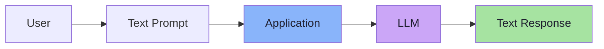
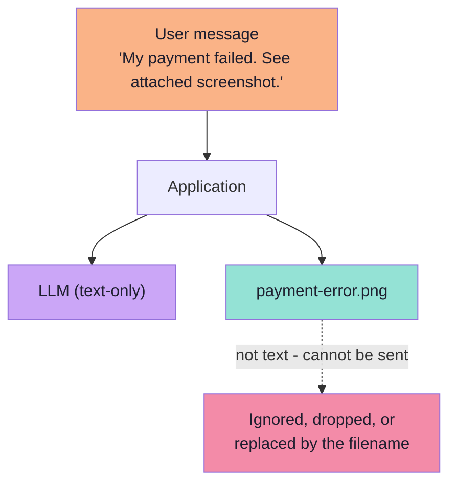
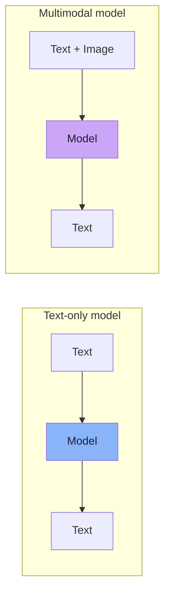
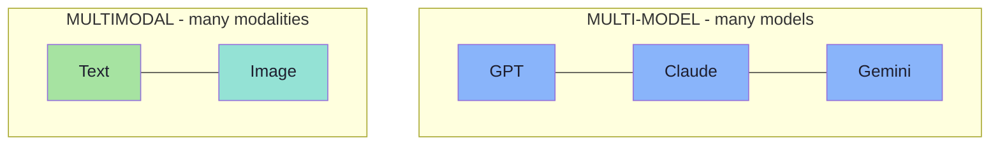
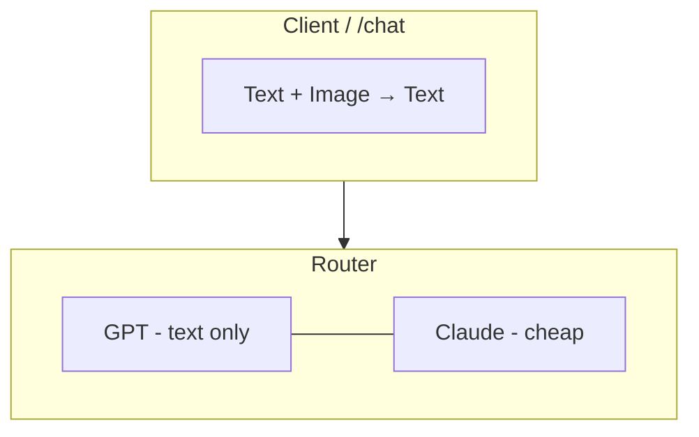

# Chapter 01: Why Text-Only AI Is Not Enough

## 1.1 The Contract Every LLM Application Has Obeyed So Far

Most basic LLM applications follow exactly one flow:

```text
Text Prompt → Application → LLM → Text Response
```

Conceptually:

```text
String → LLM → String
```

A concrete example:

> "Summarize this support ticket."

The application sends text to the model; the model returns text. This works extremely well **when all useful information is available as text**. That qualifier is doing all the work in this lecture.



---

## 1.2 Where the Contract Breaks

Real-world information does not always arrive as text. A user may write:

> "My payment failed. See attached screenshot."

The sentence is text. **The evidence is not.** The information that lets you answer — the error code, the amount, the reason, the timestamp, the merchant — lives *inside* a file such as `payment-error.png`.

A naive pipeline usually degrades into one of three bad behaviours instead of failing loudly:

| Bad behaviour | What the user sees | What actually happened |
|---|---|---|
| **Silent drop** | "I don't see an attachment." | The image was never sent; the model only received the caption text. |
| **Filename-only** | "I can see you uploaded `payment-error.png`." | The model was told the *name* of the file and nothing about its contents. |
| **Confident guess** | "Your payment probably failed due to network issues." | The model invented a plausible answer because it had no evidence. |



> **The engineering lesson:** a text-only pipeline cannot "try harder". There is no prompt that recovers information the model never received. **The missing modality is a missing input, not a missing instruction.**

Users upload the same shape of evidence constantly:

```text
payment-error.png
invoice.jpg
receipt.png
dashboard-screenshot.png
error-screenshot.png
product-image.jpg
```

Every one of these is a *text-shaped problem wearing an image costume*. The task is not "look at a picture"; it is "read a document that happened to be rendered as pixels".

---

## 1.3 What Is a Modality?

> **A modality is simply a form in which information exists.**

Common modalities:

```text
Text
Image
Audio
Video
```

A traditional text model maps one modality to the same modality:

```text
Text
 ↓
Model
 ↓
Text
```

A **multimodal model** can work with more than one type of information:

```text
Text + Image
      ↓
    Model
      ↓
     Text
```



This lecture focuses specifically on one combination:

```text
Text + Image → Model → Text
```

That is a deliberate scoping decision. The general idea generalises to audio and video, but the *mechanism* dissected in this lecture — patches, a vision encoder, a projection into language space — is the **image** mechanism. Everything else is an analogue of it (audio uses a speech encoder; video uses frames plus temporal ordering).

> **The output is still text.** A multimodal model consumes several modalities but produces text in this lecture's framing. That is why your application architecture barely changes even though the model internals change completely.

---

## 1.4 Multimodal vs Multi-Model — Two Different Things

These two terms sound similar and mean entirely different things. Confusing them is the single most common vocabulary error in this space.

### Multi-model

**Using multiple different AI models.**

```text
GPT
 +
Claude
 +
Gemini
```

An application that routes easy questions to a cheap model and hard ones to an expensive model is **multi-model**. So is an ensemble that asks three models and votes.

### Multimodal

**Using multiple forms of information with a model.**

```text
Text
 +
Image
```

An application that sends a question *along with an image* is a **multimodal AI application**.



| Axis | Multi-model | Multimodal |
|---|---|---|
| The word "multi" refers to | **models** | **modalities** |
| Example | GPT + Claude + Gemini behind one router | Text + image in one request |
| The hard problem | Routing, cost, consistency across vendors | Making one model understand more than one input type |
| Orthogonal to | Multimodal | Multi-model |

> **They are orthogonal.** A production system can be **multi-model *and* multimodal**: route an image task to a vision-capable model and a text-only task to a cheap text model. Nothing about one implies the other.



---

## 1.5 The Modality Combinations You Will Actually Meet

The lecture scopes to text + image, but you will be asked about the others.

| Combination | What the model receives | Typical use case | Where it is covered |
|---|---|---|---|
| **Text → Text** | Prompt only | Everything built so far in this course | Lectures 02–15 |
| **Text + Image → Text** | Prompt + picture | Screenshot triage, invoice extraction, receipt OCR, UI understanding | **This lecture** |
| **Text + Audio → Text** | Prompt + recording | Meeting transcription, voice notes, call-centre QA | Analogue of this lecture (speech encoder) |
| **Text + Video → Text** | Prompt + clip | Video QA, surveillance review, tutorial summarisation | Frames → image pipeline + temporal ordering |
| **Image → Text** | Picture only | Auto-captioning, alt text | Degenerate case of text + image |
| **Text + Image → Image** | Prompt + picture | Image editing, product photo generation | Generation, not understanding (out of scope) |

> **Why the lecture picks text + image:** the mechanism is fully visible there (patches, encoder, projection) without the extra confound of time (video) or waveform sampling (audio). Master the image path and the others become "swap the encoder".

---

## 1.6 The Business Case: What the Old Workaround Costs

Before multimodal models, teams shipped **OCR + hand-written parsers**:

```text
Image → OCR → raw text → regex / heuristics → structured fields
```

That pipeline works — until it does not. The costs are predictable:

| Cost of the old workaround | Why it happens |
|---|---|
| **Brittle regex** | Every new vendor invoice layout is a new parser. |
| **No layout understanding** | OCR flattens a two-column invoice into a stream of words; the *meaning* of position is lost. |
| **No semantics** | OCR returns `Insufficient Balance`; it cannot answer *"why did this fail?"* |
| **Glue everywhere** | Image handling, OCR, parsing, retry, error correction — all bespoke. |
| **Fails on the interesting cases** | Handwriting, low contrast, rotated photos, dense dashboards. |

A multimodal model does not eliminate that pipeline — it **absorbs most of it** into a single call.

> **FDE framing:** the value proposition is rarely "look at pictures". It is *"delete three services and a parser farm from the architecture, and stop writing a new parser per vendor."*

---

## 1.7 Common Mistakes at This Stage

| Mistake | Why it hurts | Correct habit |
|---|---|---|
| Treating an image attachment as an edge case | Becomes a silent-failure class that never gets logged | Make "attachment present?" an explicit branch in the request handler |
| Believing a better prompt can describe an unseen image | The information is absent, not misunderstood | Route image-bearing requests to a vision-capable model |
| Confusing **multi-model** with **multimodal** | Wrong architecture discussions, wrong vendor questions | Model count ≠ modality count; they are orthogonal axes |
| Assuming the output will also be an image | Mismatched expectations and API design | In this lecture the output is **text**; generation is a different problem |
| Assuming multimodal = "bigger LLM" | Underestimates the new components (encoder, projection) | Name the pipeline: pixels → patches → embeddings → projection → fusion |
| Sending the file **name** and calling it "handling images" | The model hallucinates around the gap | Send bytes/URL as an actual image content part |
| Ignoring modality at the schema level | The API contract silently drops the image | Make the message type express `{ text, image }` explicitly |

---

## 1.8 Chapter Summary

| Idea | Statement |
|---|---|
| The baseline contract | `String → LLM → String`, excellent when everything is text |
| The break | Real evidence arrives as screenshots, invoices, receipts, dashboards, product photos |
| The failure mode | Silent drop, filename-only, or confident hallucination — never a clean error |
| The root cause | A **missing modality is a missing input**, not a missing instruction |
| Modality | A form in which information exists: text, image, audio, video |
| Multimodal | One model, **many modalities** (text + image) |
| Multi-model | Many models behind a router; **orthogonal** to multimodal |
| This lecture's scope | `Text + Image → Model → Text` |
| The old workaround | OCR + hand-written parsers: brittle, layout-blind, semantics-free |
| The output | Still text — which is why your application barely changes |

> **Final mental model:** the question is never *"can the model see?"* It is *"did the evidence ever reach the model as a modality it accepts?"* Everything else in this lecture is how the answer becomes **yes**.

---

## Where This Goes Next

- **[Chapter 02](./02_What_Multimodal_Models_Understand_And_OCR_vs_MLLM.md)** — what a multimodal model can actually understand, and the precise line between OCR and a multimodal LLM.
- **[Chapter 03](./03_The_Text_Pipeline_Recap.md)** — the text pipeline restated as the pattern images will follow.
- Foundations: Lecture 02 for tokens, embeddings and attention.
