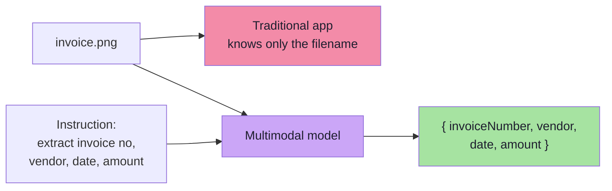
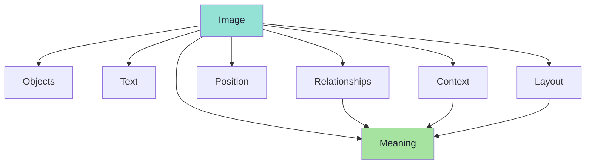
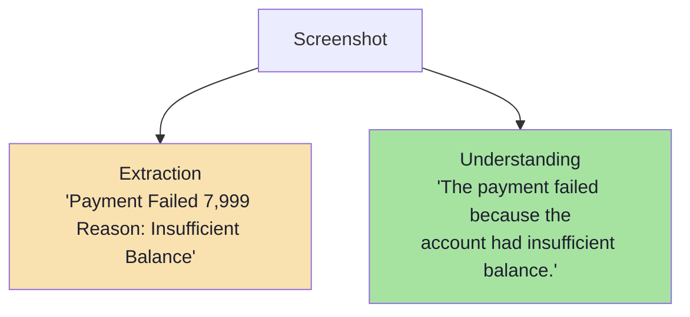
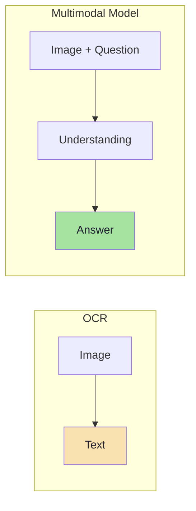
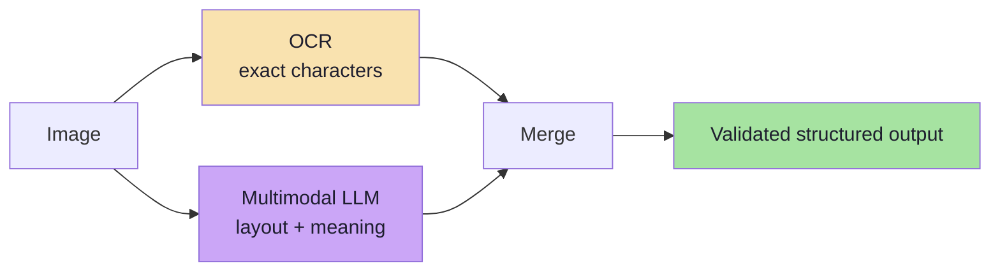

# Chapter 02: What Multimodal Models Understand and OCR vs MLLM

## 2.1 The Invoice Example

Suppose a user uploads an invoice:

```text
--------------------------------
ABC Electronics

Invoice No: INV-3821
Date: 07 Oct 2026

MacBook Air             ₹82,000

Total                   ₹82,000
--------------------------------
```

A **traditional application** only knows the filename:

```text
invoice.png
```

That is the entire extent of its knowledge: a filename and a byte size.

A **multimodal model** can receive the image *along with an instruction*.

> Extract Invoice number, Vendor, Date, Total amount.

And return structured data:

```json
{
  "invoiceNumber": "INV-3821",
  "vendor": "ABC Electronics",
  "date": "07 Oct 2026",
  "amount": 82000
}
```

> **The important change is:** *the image itself has now become part of the model input.*



The *shape* of the result is a **typed object**, not prose — exactly the contract called **structured output** (schema-constrained response), except the source material is a picture instead of a prompt.

### Pseudo-code: the request shape

```ts
// TypeScript-style PSEUDO-CODE — not runnable production code.
// The point is the SHAPE of a multimodal request, not the SDK call.
const request = {
  model: "vision-capable-model",
  messages: [
    {
      role: "user",
      content: [
        { type: "text", text: "Extract invoice number, vendor, date, total amount." },
        { type: "image", source: { kind: "file", path: "invoice.png" } },
      ],
    },
  ],
  responseFormat: { type: "json_schema", schema: InvoiceSchema },
};
```

The single structural difference from every request before is that `content` is a **list of parts**, one of which is an image. Everything downstream — parsing, validation, retry — is unchanged.

---

## 2.2 What a Multimodal Model Can Understand

> A multimodal model does **more than simply read text from an image.**

It may understand:

```text
Objects
Text
Layout
Position
Relationships
Context
Meaning
```

| Capability | What it means | Example from a screenshot |
|---|---|---|
| **Objects** | Recognise things, not just characters | A credit-card icon, a logo, a product |
| **Text** | Read rendered characters (OCR-like) | `Insufficient Balance` |
| **Layout** | Understand regions, columns, hierarchy | Header vs body vs footer; two-column invoice |
| **Position** | Where something is relative to something else | An error badge *next to* the amount field |
| **Relationships** | How elements connect | `Total` label *belongs to* the number beside it |
| **Context** | What situation the whole image depicts | This is a *checkout* screen, not a *settings* screen |
| **Meaning** | What it implies | Payment failed because the balance was too low |



> **Read the list as a ladder.** OCR stops near the top (Text). A multimodal model keeps climbing to Meaning — and *that* is the difference.

---

## 2.3 Understanding vs Extraction: The Payment Screenshot

Consider this screenshot:

```text
Payment Failed

₹7,999

Reason:
Insufficient Balance
```

If we ask:

> What happened?

The model may answer:

> The payment failed because the account had insufficient balance.

This is **different from simply extracting the characters** visible in the screenshot. A pure text extractor returns:

```text
Payment Failed ₹7,999 Reason: Insufficient Balance
```

Both outputs contain the same words. Only one contains the **answer**.



> **The load-bearing sentence:** a multimodal model does not merely *transcribe* an image — it **interprets** it. That interpretation is what a downstream agent, router or support workflow can act on.

---

## 2.4 OCR vs Multimodal LLM — The Core Comparison

Both consume images and produce text — which is exactly why they get confused.

### OCR

**OCR** stands for Optical Character Recognition. Its primary job is:

```text
Image
 ↓
Recognize Characters
 ↓
Extract Text
```

OCR is mainly concerned with one mapping:

```text
Image → Text
```

It is **not** concerned with *why* the text is there, *where* it sits relative to other elements, or what it *means*. Classic OCR engines emit text plus bounding boxes; assembling those boxes into meaning is a separate hand-written problem.

### Multimodal LLM

A multimodal model can go beyond character extraction. Suppose we ask:

> "What is the order number and total amount?"

The model returns:

```text
Order Number: 82931
Total Amount: ₹4,999
```

We could also ask:

> "Has this order been paid successfully?"

The model can **reason about the meaning** of the image.



### The intuition

> **OCR is like asking someone to read everything written on a page.**
>
> **A multimodal LLM is closer to asking:** *"Look at this page and tell me what is important."*

### The comparison table

| Dimension | OCR | Multimodal LLM |
|---|---|---|
| **Input** | Image | Image **+ question/instruction** |
| **Output** | Characters / text + boxes | Answer, structured data, reasoning |
| **Understands layout?** | Partially (boxes, reading order) | Yes — regions, hierarchy, columns |
| **Understands meaning?** | No | Yes |
| **Reasoning?** | No | Yes (e.g. "has it been paid?") |
| **Handles questions?** | No — you get all text, then post-process | Yes — you ask the question you care about |
| **Determinism** | Very high — same image, same text | Probabilistic — may vary between runs |
| **Cost** | Low per page | Higher per call (image tokens) |
| **Latency** | Very low | Higher (vision encoding + generation) |
| **Handwriting / rotation / low light** | Often poor without tuning | Often good, but not guaranteed |
| **Language / layout drift** | New template = new work | Often handles unseen layouts |
| **Auditability** | Easy — the text is the output | Harder — the *reasoning* is the output |
| **Best at** | High-volume, fixed-format, exact character capture | Ambiguous, mixed-layout, question-driven tasks |

---

## 2.5 When OCR Is Still the Right Tool

The temptation after 2.4 is to conclude "never use OCR again". That is wrong and expensive.

| Reach for **OCR** when… | Reach for a **multimodal LLM** when… |
|---|---|
| Volume is huge and format is fixed (millions of scanned forms) | Layouts vary, or you have never seen this vendor before |
| You need **exact** character fidelity (IDs, amounts, serial numbers) | You need interpretation, summarisation, or a decision |
| Cost per page must be near-zero | Cost is acceptable per *useful* answer |
| You must be fully deterministic and auditable | Probabilistic output is acceptable (with validation) |
| The downstream step is a hand-written parser anyway | The downstream step is a question or a workflow |
| Regulation requires raw text capture | The task is "tell me what matters" |

### The hybrid pattern (very common in production)



Two well-known hybrids:

1. **OCR-for-truth, MLLM-for-meaning.** Use OCR for the exact digits (`INV-3821`, `₹82,000`) and the multimodal model to decide *what the document is* and *which fields matter*. Cross-check: if the model's amount disagrees with OCR's characters, flag it.
2. **MLLM-for-routing, OCR-for-extraction.** The model classifies the document ("this is an invoice, not a receipt") and routes it to the correct deterministic OCR template.

> **The rule of thumb:** *use OCR when you need **characters**, use a multimodal LLM when you need **comprehension** — and use both when you need comprehension you can audit.*

---

## 2.6 Beyond the Lecture: Where This Lands in Real Systems

### Document AI / Intelligent Document Processing (IDP)

The invoice example is the entry point to a whole industry: **Intelligent Document Processing**. The production shape is:

```text
Ingest (scan, email, upload)
   ↓
Classify (invoice? receipt? ID? contract?)
   ↓
Extract (fields, tables, line items)
   ↓
Validate (totals add up? date in range? vendor known?)
   ↓
Route (approve, flag, escalate)
```

Modern "document AI" models are exactly the multimodal architecture this chapter describes, fine-tuned for dense pages and tables. The important engineering note: **extraction is the easy half; validation is the hard half.** A field that looks right but does not reconcile (line items ≠ total) is worse than a missing field, because it looks trustworthy.

### Grounding: making the model point at its evidence

When a multimodal model extracts `amount: 82000`, a reviewer will ask *"where did you see that?"*. Production systems request **grounding** — the model returns the field *plus a bounding box or a quoted region*:

```ts
// PSEUDO-CODE — the shape of a grounded extraction.
type Grounded<T> = {
  value: T;
  evidence: { bbox: [number, number, number, number]; page: number };
  confidence: "high" | "medium" | "low";
};
```

This is the vision analogue of citations in RAG. It turns "trust me" into "check here".

### Hallucination in extraction is real

A multimodal model can produce a plausible invoice number that is **not in the image**. This is the same failure mode as hallucinations in text, but harder to spot because the output *looks* like data. Mitigations:

- constrain output to a **schema**;
- require **grounding** where possible;
- cross-check high-stakes fields against **OCR characters**;
- add a **"not present"** escape value to every field instead of forcing an answer.

### Spatial reasoning is genuinely weaker than it looks

Attention gives the model *access* to position, not *precision*. Known weaknesses:

| Task | Why it is hard |
|---|---|
| Counting many objects | Attention is soft; counts blur |
| Precise coordinates | Position is encoded coarsely at patch granularity |
| Fine spatial relations ("just left of") | Sub-patch relations are below resolution |
| Reading tiny text | Below the patch size, characters vanish |

> **FDE implication:** never build a workflow whose correctness depends on the model *counting* or *measuring*. Ask it to *identify and quote*; do the arithmetic in code.

---

## 2.7 Common Mistakes at This Stage

| Mistake | Why it hurts | Correct habit |
|---|---|---|
| Believing the model transcribes exactly | It may normalise, round, or "fix" digits | For exact values, use OCR or a schema + validation |
| Forcing a value for every field | The model invents data when a field is absent | Add an explicit `"unknown"` / `null` escape |
| Treating extraction output as trusted | A wrong-but-plausible field passes review | Reconcile (totals, dates, cross-fields) and ground |
| Asking one giant question about a dense page | Attention is diluted; small text is missed | Ask targeted questions, or crop regions |
| Expecting deterministic output | Same image can yield different text | Pin temperature where supported; validate against a schema |
| Ignoring that "what happened?" ≠ "what text is there?" | You ship a transcriber when the user needed an answer | Design the question around the decision, not the pixels |
| Bolting OCR in front of a multimodal model "just in case" | Doubles cost and latency; OCR errors now poison the model | Decide per task: characters (OCR) vs comprehension (MLLM) |

---

## 2.8 Chapter Summary

| Idea | Statement |
|---|---|
| The invoice example | An image + an instruction becomes a **typed object** — structured output from a picture |
| What it understands | Objects, text, layout, position, relationships, context, **meaning** |
| Extraction vs understanding | Same words, different value: one is text, the other is an answer |
| OCR | `Image → Text`; deterministic, cheap, layout-blind, semantics-free |
| Multimodal LLM | `Image + Question → Understanding → Answer`; probabilistic, costly, comprehension-capable |
| The intuition | OCR reads the page; a multimodal LLM tells you **what matters on it** |
| Production pattern | OCR for **characters**, MLLM for **comprehension**, both when you need auditable comprehension |
| The risk | Plausible-but-absent values — validate, ground, and allow "unknown" |

> **Final mental model:** OCR answers *"what characters are here?"*. A multimodal model answers *"what does this mean, and what should I do?"*. Choose by the question you actually need answered.

---

## Where This Goes Next

- **[Chapter 03](./03_The_Text_Pipeline_Recap.md)** — how text reaches an LLM as numbers; the pattern the image pipeline will mirror.
- **[Chapter 04](./04_Images_Are_Numbers_Pixels_Patches_And_Visual_Embeddings.md)** — pixels, patches and visual embeddings.
