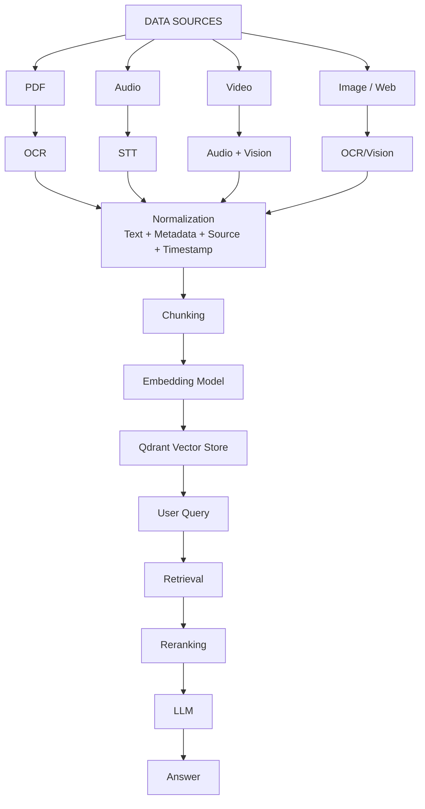
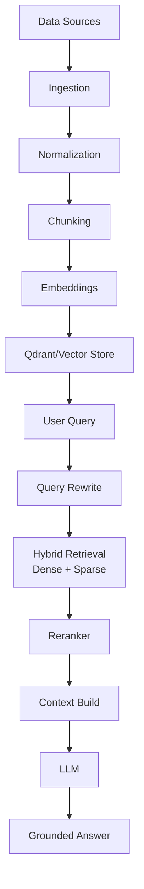
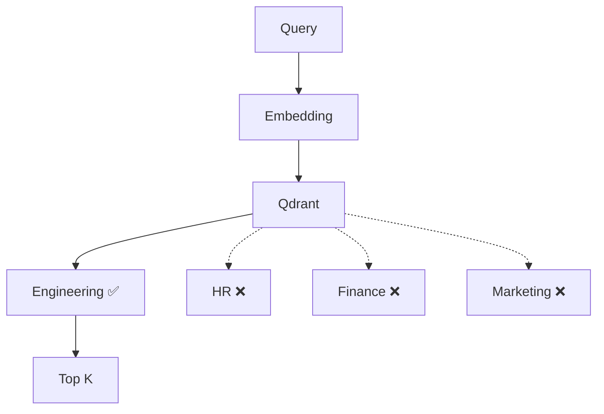
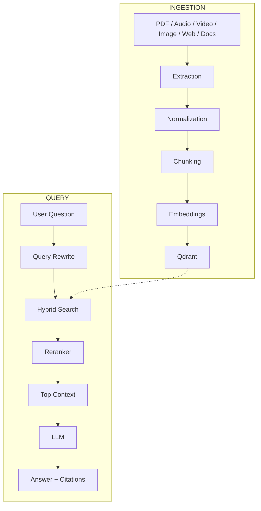

# Chapter 09: Multimodal Data Ingestion & Advanced RAG

## 9.1 What is Data Ingestion?

**Data ingestion** is the process of taking raw data from different sources and converting it into a format that your AI system can process, search, and retrieve.

```text
PDF
 │
 ▼
Text Extraction
 │
 ▼
Chunking
 │
 ▼
Embeddings
 │
 ▼
Vector Database
```

But real applications rarely contain only PDFs.

```text
             ┌── PDF
             ├── DOCX
             ├── Website
             ├── Audio
User Data ───┼── Video
             ├── Images
             └── Database
```

The challenge is:

> **How do we make all these different formats searchable by the same RAG system?**

---

## 9.2 The Universal RAG Ingestion Principle

A common approach is to convert heterogeneous sources into a **semantic representation**, often text, before generating embeddings.

```text
PDF ───────► Text
DOCX ──────► Text
Web ───────► Clean Text
Audio ─────► Transcript
Video ─────► Transcript + timestamps
Image ─────► OCR / Caption / Description
                     │
                     ▼
                Normalize
                     │
                     ▼
                  Chunk
                     │
                     ▼
                Embedding
                     │
                     ▼
                Vector DB
```

Mathematically:

```text
Raw Data
   →
Semantic Representation
   →
Chunks
   →
Embeddings
   →
Vector Index
```

### Important clarification

It is **not always necessary to convert everything to plain text**.

Modern multimodal systems can sometimes embed or reason directly over images, audio, or other modalities.

However, converting information into text/transcripts is often simpler and extremely useful for traditional text-based RAG systems.

---

## 9.3 Multi-Modal Data Sources

| Source   | Extraction             | Typical Representation | Useful Metadata        |
| -------- | ---------------------- | ---------------------- | ---------------------- |
| PDF      | PDF parser/OCR         | Text                   | Page number            |
| DOCX     | Document parser        | Text                   | Heading, section       |
| Audio    | Speech-to-text         | Transcript             | Speaker, timestamp     |
| Video    | Audio extraction + STT | Transcript             | Timestamp, chapter     |
| Image    | OCR/Vision             | Text/caption           | Image URL, coordinates |
| Website  | HTML parser            | Clean text/Markdown    | URL, title             |
| Database | SQL/API                | Structured records     | IDs, timestamps        |

> **The RAG system doesn't care where the information originally came from. It needs a good semantic representation + metadata.**

---

## 9.4 PDF & Document Ingestion

PDF is one of the most common RAG data sources.

### Normal PDF

```text
PDF
 │
 ▼
PDF Parser
 │
 ▼
Text
 │
 ▼
Chunks
 │
 ▼
Embeddings
 │
 ▼
Qdrant
```

For scanned PDFs:

```text
Scanned PDF
     │
     ▼
    OCR
     │
     ▼
    Text
```

### Example with LangChain (pseudo-code)

```ts
// PSEUDO-CODE — not runnable code
import { PDFLoader } from "@langchain/community/document_loaders/fs/pdf";

const loader = new PDFLoader("./docs/manual.pdf");
const documents = await loader.load();

console.log(documents[0].pageContent);
console.log(documents[0].metadata);
```

A document might contain:

```javascript
{
  pageContent: "Black box testing is...",
  metadata: {
    source: "./docs/manual.pdf",
    loc: {
      pageNumber: 14
    }
  }
}
```

That metadata becomes extremely useful later for citations.

---

## 9.5 Audio Ingestion

Audio cannot directly be searched using traditional text RAG.

```text
Audio
  │
  ▼
Speech-to-Text
  │
  ▼
Transcript
  │
  ▼
Chunking
  │
  ▼
Embedding
  │
  ▼
Vector DB
```

For example:

```text
meeting.mp3

"Today we discussed the database migration.
The migration will start on Monday..."
```

becomes:

```javascript
{
  text: "Today we discussed the database migration...",
  metadata: {
    source: "meeting.mp3",
    startTime: 83,
    endTime: 142
  }
}
```

Now the user can ask:

> "When will the database migration start?"

The system can retrieve the relevant transcript section.

### Why timestamps matter

Without timestamps:

```text
meeting.mp3 → transcript
```

With timestamps:

```text
meeting.mp3
00:00 ─ Introduction
01:23 ─ Database migration discussion
05:42 ─ Deployment discussion
```

You can potentially return:

> The migration will start on Monday.
> **Source: meeting.mp3 — 01:23**

---

## 9.6 Video Ingestion

Video is more complicated because it contains multiple information channels:

```text
                 VIDEO
                   │
       ┌───────────┴───────────┐
       ▼                       ▼
     Audio                   Frames
       │                       │
       ▼                       ▼
     STT                    Vision/OCR
       │                       │
       └───────────┬───────────┘
                   ▼
             Unified Data
```

For example, a programming tutorial may contain:

```text
Audio:
"Let's create a Qdrant collection."

Screen:
Code showing:
QdrantClient(...)
```

If you only transcribe the audio, you might miss the code shown on screen.

A more advanced system can store:

```javascript
{
  text: "Let's create a Qdrant collection.",
  metadata: {
    source: "rag-course.mp4",
    timestamp: 325
  }
}
```

and separately:

```javascript
{
  text: "QdrantClient configuration shown on screen",
  metadata: {
    source: "rag-course.mp4",
    timestamp: 327,
    type: "visual"
  }
}
```

---

## 9.7 Image Ingestion

Images are especially interesting.

Suppose you upload:

```text
architecture.png
```

The image contains:

```text
User
  ↓
API
  ↓
Backend
  ↓
Qdrant
```

Traditional text embedding cannot understand the image directly.

Possible approaches:

### Approach 1 — OCR

Extract visible text:

```text
User
API
Backend
Qdrant
```

### Approach 2 — Vision model

Generate a description:

```text
"The diagram shows a user sending requests
through an API to a backend service connected
to Qdrant."
```

### Approach 3 — Multimodal embeddings

Use a model designed to represent images and text in a shared embedding space.

This can enable:

```text
Query:
"Show me architecture diagrams containing Qdrant"

              ↓

Image embeddings
              ↓

Similarity search
```

---

## 9.8 Web Ingestion

Web pages contain lots of unnecessary information:

```text
HTML
 ├── Navigation
 ├── Ads
 ├── Footer
 ├── Sidebar
 ├── Article
 └── Comments
```

You generally don't want to embed all of it.

Instead:

```text
Website
   │
   ▼
HTML Parser
   │
   ▼
Remove Navigation / Ads / Scripts
   │
   ▼
Clean Text
   │
   ▼
Markdown/Text
   │
   ▼
Chunks
   │
   ▼
Embeddings
```

---

## 9.9 Unified Multi-Modal Architecture

A production system might look like this:



---

## 9.10 Metadata: The Hidden Superpower

One of the biggest mistakes beginners make is storing only:

```javascript
{
  text: "...",
  vector: [...]
}
```

Instead, store rich metadata.

```javascript
{
  text: "Black box testing...",
  metadata: {
    source: "software-testing.pdf",
    page: 14,
    section: "Testing Techniques",
    type: "pdf"
  }
}
```

For audio:

```javascript
{
  text: "The migration starts Monday.",
  metadata: {
    source: "meeting.mp3",
    type: "audio",
    startTime: 83,
    endTime: 92,
    speaker: "Speaker 2"
  }
}
```

For video:

```javascript
{
  text: "Qdrant collection creation...",
  metadata: {
    source: "rag-course.mp4",
    type: "video",
    timestamp: 325
  }
}
```

### Metadata enables filtering

```text
User:
"Search only the HR documents."
```

Instead of searching everything:

```text
Qdrant
 ├── Engineering
 ├── HR          ◄── filter
 ├── Finance
 └── Marketing
```

You can retrieve:

```javascript
{
  filter: {
    department: "HR"
  }
}
```

This is extremely important for **multi-tenant and permission-aware RAG systems**.

---

## 9.11 Where Naive RAG Fails

The simplest RAG pipeline is:

```text
Query
 ↓
Embedding
 ↓
Vector Search
 ↓
Top K
 ↓
LLM
```

This works surprisingly well for simple applications.

But production systems expose several problems.

### 9.11.1 Query Ambiguity

User:

> "How do I fix it?"

What is **it**?

The vector database doesn't know.

### 9.11.2 Chunk Boundary Problems

Suppose the original document says:

```text
The server returned an error.
This happened because the API key was expired.
Therefore, generate a new API key.
```

Bad chunking:

```text
Chunk 1: "The server returned an error."
Chunk 2: "This happened because the API key was expired."
Chunk 3: "Therefore, generate a new API key."
```

If the user asks:

> "Why did the server fail?"

Retrieval may return only:

```text
"The server returned an error."
```

The explanation is missing.

This is why **chunk size and overlap matter**.

### 9.11.3 Lost Global Context

Imagine a chunk says:

```text
"It increased by 20%."
```

Without metadata/context, what increased? Revenue? Users? Expenses?

A better chunk can include contextual information:

```text
Document: Q3 2025 Revenue Report
Section: Revenue

Revenue increased by 20%.
```

### 9.11.4 Exact Keyword Failure

Dense retrieval is excellent for semantic meaning, but exact identifiers can be problematic.

Example:

```text
ERR_NODE_9942
```

A user searches:

```text
ERR_NODE_9942
```

A traditional keyword/BM25 search may be better at finding the exact identifier.

This leads to:

> **Hybrid Search = Dense + Sparse retrieval**

### 9.11.5 Top-K ≠ Best-K

Suppose:

```text
Top 5 vector results:

1. 0.91 → somewhat relevant
2. 0.89 → irrelevant
3. 0.87 → very relevant
4. 0.85 → irrelevant
5. 0.84 → relevant
```

Vector similarity alone doesn't guarantee the best ordering.

A reranker can reorder them:

```text
Original:  A B C D E
Reranked:  C E A B D
```

---

## 9.12 Advanced RAG

Advanced RAG improves the basic pipeline.

### Naive RAG

```text
Query
 ↓
Embedding
 ↓
Vector Search
 ↓
LLM
```

### Advanced RAG

```text
User Query
     │
     ▼
Query Understanding
     │
     ▼
Query Rewriting
     │
     ▼
Hybrid Retrieval
     │
     ▼
Top 20 Documents
     │
     ▼
Reranking
     │
     ▼
Top 3-5 Documents
     │
     ▼
Context Construction
     │
     ▼
LLM
     │
     ▼
Grounded Answer
```

---

## 9.13 Query Rewriting

Users don't always ask good search queries.

User:

> "Why doesn't it work?"

An LLM can rewrite this into a better query based on conversation context.

```text
Original:
"Why doesn't it work?"

        ↓

Query Rewriter

        ↓

"Why does the Qdrant similarity search
return irrelevant documents for the current
RAG query?"
```

You can also generate multiple queries:

```text
Original:
"How does RAG retrieve documents?"

        ↓

1. How does vector retrieval work in RAG?
2. How are document embeddings searched?
3. How does Qdrant retrieve relevant chunks?
```

Then search all three. This is sometimes called **multi-query retrieval**.

---

## 9.14 HyDE

**HyDE = Hypothetical Document Embeddings**

Instead of directly embedding the user's question:

```text
Question
   ↓
Embedding
   ↓
Search
```

HyDE does:

```text
User Question
      │
      ▼
      LLM
      │
      ▼
Hypothetical Answer
      │
      ▼
Embedding
      │
      ▼
Vector Search
```

### Example

User:

> "How does black box testing work?"

LLM generates a hypothetical document:

```text
Black box testing is a software testing
technique where testers evaluate functionality
without knowing the internal implementation...
```

That hypothetical answer is embedded and searched against the document collection.

> **Important:** HyDE does **not** mean the hypothetical answer is trusted as truth. It is primarily used to improve retrieval. The actual answer should still be grounded in retrieved source documents.

---

## 9.15 Hybrid Search

Hybrid search combines:

```text
Dense Search
+
Sparse / Keyword Search
```

### Dense Search

Good for:

```text
"How can I repair my notebook display?"
```

finding:

```text
"Steps to fix a laptop screen"
```

### Keyword Search

Good for:

```text
ERR_NODE_9942
```

finding the exact string.

### Combined

```text
                 Query
                   │
          ┌────────┴────────┐
          ▼                 ▼
     Vector Search      BM25 Search
          │                 │
          ▼                 ▼
       Results A          Results B
          │                 │
          └────────┬────────┘
                   ▼
               Fusion
                   │
                   ▼
             Final Results
```

A common strategy is to retrieve candidates from both systems and combine their rankings.

---

## 9.16 Re-ranking

Retrieval might return:

```text
20 documents
```

But sending all 20 to the LLM may be expensive and noisy.

Instead:

```text
Vector/BM25 Search
       │
       ▼
    20 chunks
       │
       ▼
    Reranker
       │
       ▼
     Top 5
       │
       ▼
      LLM
```

A reranker examines:

```text
Query + Candidate Document
```

and estimates how relevant the document actually is to the query.

### Why this helps

```text
Retriever → Recall
Reranker  → Precision
```

This is an important mental model.

---

## 9.17 Production RAG Pipeline



---

## 9.18 Practical JavaScript Example: Normalization Layer

```ts
// PSEUDO-CODE — a simplified multimodal ingestion layer.
export function normalizeDocument({
  text,
  source,
  type,
  metadata = {},
}) {
  return {
    pageContent: text.trim(),

    metadata: {
      source,
      type,
      ...metadata,
    },
  };
}
```

Now every source can produce the same structure.

### PDF

```javascript
const pdfDoc = normalizeDocument({
  text: "Black box testing is...",
  source: "testing.pdf",
  type: "pdf",
  metadata: {
    page: 14,
  },
});
```

### Audio

```javascript
const audioDoc = normalizeDocument({
  text: "The database migration starts Monday.",
  source: "meeting.mp3",
  type: "audio",
  metadata: {
    startTime: 83,
    endTime: 92,
    speaker: "Speaker 2",
  },
});
```

### Video

```javascript
const videoDoc = normalizeDocument({
  text: "We are creating a Qdrant collection.",
  source: "rag-course.mp4",
  type: "video",
  metadata: {
    timestamp: 325,
  },
});
```

Now your application has a common format:

```javascript
[
  pdfDoc,
  audioDoc,
  videoDoc
]
```

---

## 9.19 Metadata Filtering Example

Suppose Qdrant contains documents from multiple departments.

```javascript
const results = await vectorStore.similaritySearch(
  userQuery,
  5,
  {
    must: [
      {
        key: "department",
        match: {
          value: "engineering",
        },
      },
    ],
  }
);
```



This becomes especially important when building RAG for organizations where users should only retrieve documents they're authorized to access.

---

## 9.20 Important Design Rules

### Rule 1 — Don't treat all data the same

PDF, audio, video, and images require different extraction pipelines.

### Rule 2 — Preserve metadata

Bad:

```javascript
{
  text: "Revenue increased 20%"
}
```

Better:

```javascript
{
  text: "Revenue increased 20%",
  metadata: {
    source: "q3-report.pdf",
    page: 12,
    section: "Revenue"
  }
}
```

### Rule 3 — Chunk according to content

There is no universally perfect:

```text
chunkSize = 500
```

For different data:

```text
Code        → preserve functions/classes
Legal docs  → preserve clauses/sections
Books       → paragraphs/sections
Audio       → semantic time windows
Video       → chapters/time windows
```

### Rule 4 — Dense search isn't enough

For production systems, consider:

```text
Dense Search
+
Keyword Search
+
Reranking
```

### Rule 5 — Retrieval and generation are separate problems

Think of RAG as:

```text
Retrieval Problem
       +
Generation Problem
```

If retrieval returns the wrong document, even a powerful LLM may produce the wrong answer.

> **Better LLM ≠ automatically better RAG.**

---

### Rule 6 — Don't blindly trust retrieved context

Retrieved documents can contain:

- outdated information
- duplicated content
- malicious instructions
- irrelevant text
- conflicting information

Your application still needs validation, access control, and prompt-injection defenses.

---

## 9.21 The Complete Mental Model



---

## 9.22 Key Takeaways

### Multi-modal ingestion

> Convert different data sources into useful semantic representations before indexing.

```text
Audio → Transcript
Video → Transcript + Visual Information
Image → OCR / Caption / Image Embedding
PDF → Extracted Text
Web → Clean Text
```

### Naive RAG

```text
Query
 ↓
Embedding
 ↓
Vector Search
 ↓
LLM
```

Good for simple applications.

### Advanced RAG

```text
Query
 ↓
Rewrite / Expand
 ↓
Hybrid Retrieval
 ↓
Reranking
 ↓
Context Selection
 ↓
LLM
```

Better suited for production systems.

### Most important concept

**RAG quality depends heavily on retrieval quality.**

```text
Bad Retrieval
     ↓
Bad Context
     ↓
LLM
     ↓
Potentially Bad Answer
```

Whereas:

```text
Good Retrieval
     ↓
Relevant Context
     ↓
LLM
     ↓
Grounded Answer
```

> **Remember:** An LLM is the **reasoning and generation engine**. Your retrieval system is responsible for finding the **right information**. Advanced RAG is largely about making that retrieval process more accurate, contextual, and reliable.

---

## Where This Goes Next

- **[Chapter 10](./10_Multimodal_RAG_And_Complete_Picture.md)** — multimodal RAG architectures and the complete picture of how images fit into the retrieval pipeline.
- Cross-lecture: [Lecture 16](../../Lecture%2016%20-%20RAG/notes/README.md) for RAG fundamentals, [Lecture 17](../../Lecture%2017%20-%20Advanced%20RAG/notes/README.md) for advanced techniques.