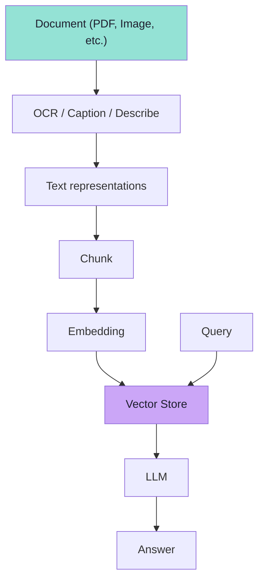
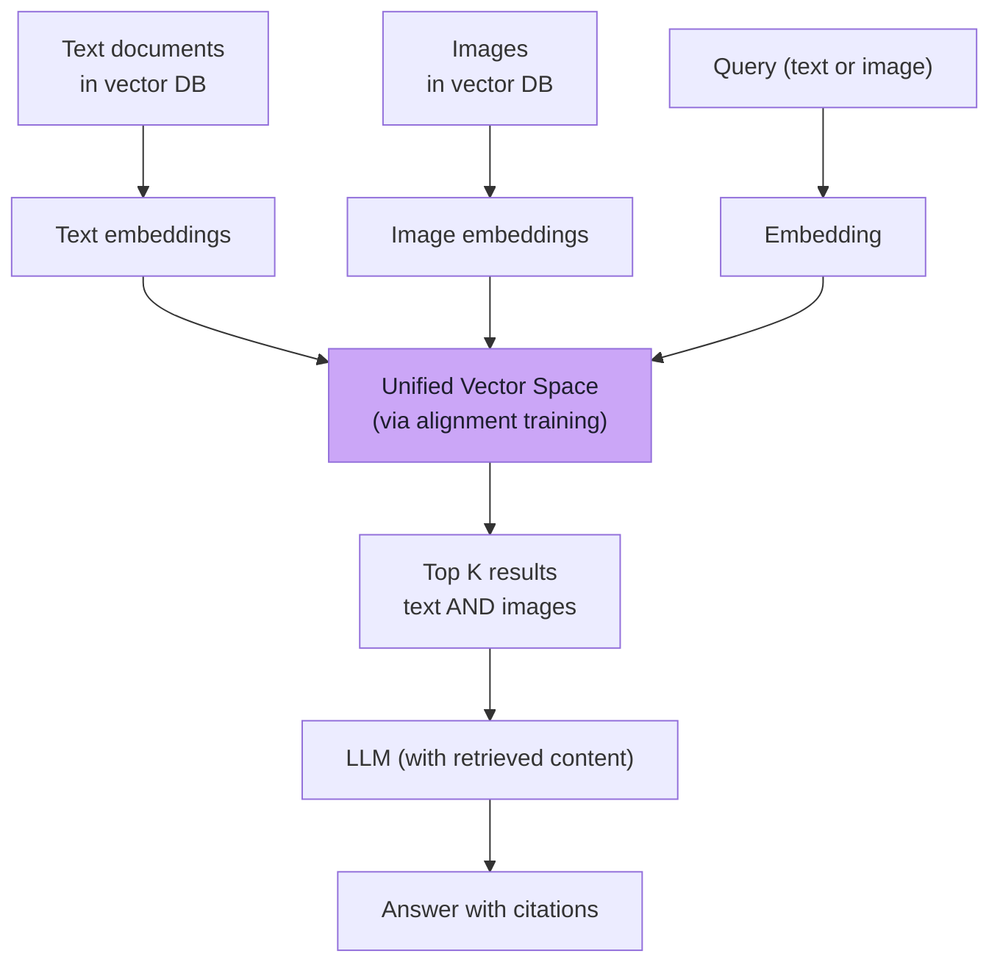
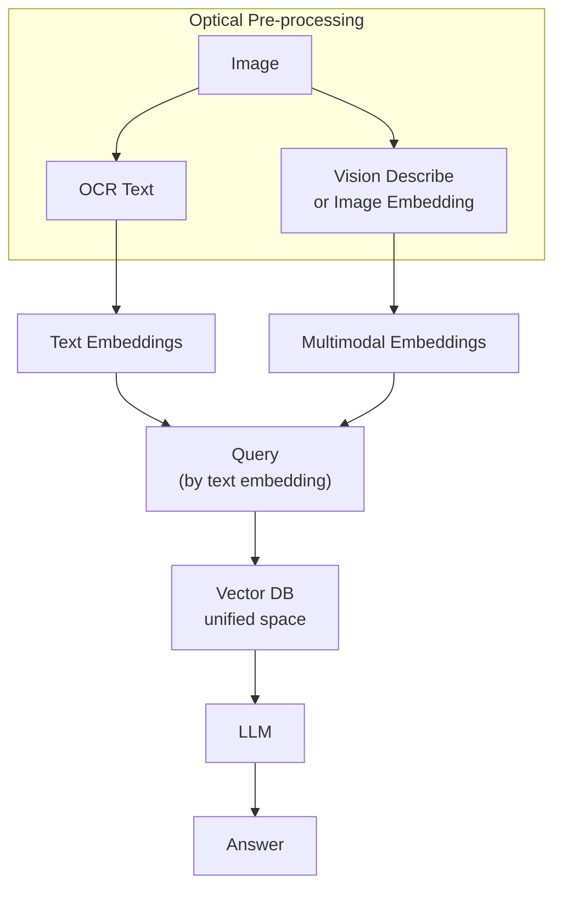
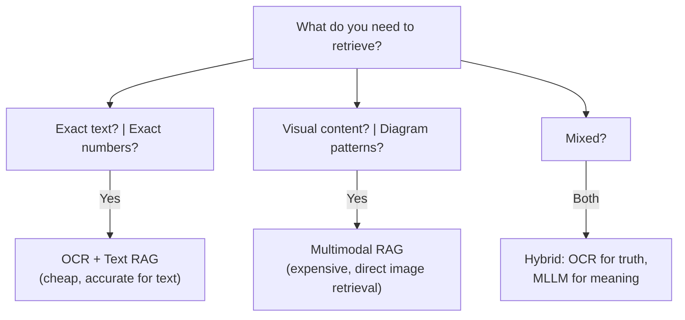
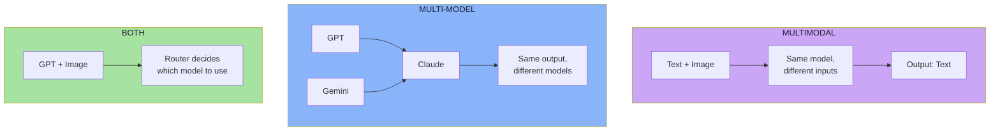

# Chapter 10: Multimodal RAG & The Complete Picture

## 10.1 Review: Text-Only RAG

The traditional RAG pipeline looks like this:

```text
User Query
    ↓
Text Embedding
    ↓
Vector Search
    ↓
Retrieved Text Chunks
    ↓
Context + Query → LLM
    ↓
Answer
```

Simple, clean, works well for text-heavy knowledge bases.

---

## 10.2 Text-RAG over Image-Derived Text

The first (and most common) approach to multimodal RAG is **text-RAG over image-derived text**:



This is:
- OCR a screenshot → get text → embed → search → answer
- Describe an image → get text → embed → search → answer

**Pros:**
- Cheap: uses existing text RAG infrastructure
- Proven: battle-tested workflows
- Auditable: you can trace the text back to the source

**Cons:**
- Loses visual layout, spatial relationships
- Requires good OCR/deskew quality
- Cannot retrieve visual content directly

---

## 10.3 True Multimodal Retrieval

**True multimodal retrieval** embeds images and text into a **shared embedding space** so a query can retrieve *the image itself*, not just text about it.



This is what **vision-language alignment** (Chapter 06) makes possible.

**Pros:**
- Can retrieve images directly by visual content
- Can answer "show me documents about X" where X is a diagram
- Richer grounding: can cite both text and images

**Cons:**
- More expensive: need a vision encoder during both indexing and querying
- Requires larger models trained on multimodal data
- Harder to implement: need vector databases that support multimodal storage

---

## 10.4 Hybrid Pattern: The Best of Both Worlds

A common production pattern combines both:



For example, in a product catalog RAG:
1. Document the image with OCR (extract labels, model numbers)
2. Also embed the image itself via CLIP-style model
3. When querying "router AC2100", match against both text and visual features

---

## 10.5 When to Use Which Approach



| Scenario | Approach |
|---|---|
| **Invoice number extraction** | OCR + text RAG (need exact digits) |
| **Product recommendation from screenshot** | Multimodal RAG (need visual similarity) |
| **Document classification** | Text RAG (use OCR output) |
| **Diagram explanation** | Multimodal RAG (the diagram IS the answer) |
| **Multipage PDF** | OCR + text RAG (cheaper, scales) |
| **Security camera footage** | Multimodal RAG (need to find visual events) |

---

## 10.6 The Schema Contract for Multimodal RAG

Just as Lecture 13 discussed **structured outputs**, multimodal RAG benefits from explicit schemas:

```ts
// PSEUDO-CODE — schema for groundable extraction
type GroundedInvoice = {
  invoiceNumber: {
    value: string;
    evidence: { bbox: [number, number, number, number]; page: number };
    confidence: "high" | "medium" | "low";
  };
  totalAmount: {
    value: number;
    evidence: { bbox: [number, number, number, number]; page: number };
    confidence: "high" | "medium" | "low";
  };
  vendor: string;
};
```

This lets you:
- Validate that values match what was in the image
- Show users evidence ("I found this in the top-left corner")
- Detect hallucinations

---

## 10.7 The Complete Mental Model: The Multimodal Pipeline

Let's tie together everything from all chapters:

```mermaid
flowchart TD
    subgraph PRELAY["Phase 1: Preparing Inputs (Ch 3, 4, 9)"]
        TXT["Text Input"] --> TOK["Tokenize"]
        TOK --> T_EB["Text Embeddings"]
        IMG["Image Input"] --> PATCH["Split into Patches"]
        PATCH --> VENC["Vision Encoder"]
        VENC --> V_EB["Visual Embeddings"]
    end

    subgraph PROJ["Phase 2: Projection & Alignment (Ch 5, 6)"]
        T_EB --> PROJ["Projection Layer"]
        V_EB --> PROJ
        PROJ --> SHARED["Shared Vector Space<br/>(via contrastibe training)"]
    end

    subgraph STORE ["Phase 3: Storage (Ch 9)"]
        SHARED --> STORED["Stored in Vector DB<br/>with rich metadata"]
    end

    subgraph QUERY["Phase 4: Retrieval (Ch 9)"]
        UQ["User Query"] --> Q_EMB["Query Embedding"]
        Q_EMB --> SEARCH["Vector Search"]
        SEARCH --> DOCS["Retrieved Documents"]
        DOCS --> RERANK["Reranker"]
    end

    subgraph GEN["Phase 5: Generation (Ch 7, 8)"]
        RERANK --> CONTEXT["Context"]
        CONTEXT --> LLM["Multimodal LLM"]
        LLM --> ANSWER["Answer + Citations"]
        ANSWER --> VALID["Validate & Render"]
    end

    STORED --> SEARCH
    style PRELAY fill:#89b4fa,color:#1e1e2e
    style PROJ fill:#cba6f7,color:#1e1e2e
    style STORE fill:#6ab189,color:#1e1e2e
    style QUERY fill:#fab387,color:#1e1e2e
    style GEN fill:#f9e2af,color:#1e1e2e
```

---

## 10.8 The Journey So Far: 10 Chapters

| Chapter | Title | Core Idea |
|---|---|---|
| 1 | Why Text-Only AI Is Not Enough | Real evidence is often images |
| 2 | What Multimodal Models Understand | Beyond OCR: meaning, layout, context |
| 3 | The Text Pipeline Recap | Text → tokens → embeddings |
| 4 | Images Are Numbers | Pixels → patches → visual embeddings |
| 5 | Connecting Vision to Language | Projection, position, cross-modal attention |
| 6 | How Models Learn Alignment | Training on paired image-text data |
| 7 | The End-to-End Pipeline | Application boundary, history, streaming |
| 8 | Production Systems | Cost, security, evaluation, governance |
| 9 | Multimodal Data Ingestion | PDF, audio, video, web → text/embeddings |
| 10 | Multimodal RAG | Retrieval architectures, complete picture |

---

## 10.9 The Multimodal vs Multi-Model Distinction (Recap)

One final diagram to make sure the distinction sticks:



---

## 10.10 When to Use a Multimodal Model

Ask yourself these questions:

**1. Do you need to understand a screenshot or document image?**
- Yes → Consider multimodal

**2. Do you need exact character detection (IDs, amounts)?**
- Use OCR, not pure multimodal

**3. Is the image content the answer (diagram, chart, screenshot)?**
- Yes → Multimodal RAG

**4. What's your budget?**
- Image tokens cost more
- Preprocess aggressively (crop, downscale)

**5. What's your latency requirement?**
- Vision encoding adds 500ms-2s before first token
- Show "reading image" UI state

**6. What's your security posture?**
- Images are untrusted input
- Plan for visual prompt injection

---

## 10.11 The Complete Pipeline Contract

Your application's contract with a multimodal model:

```text
Input:
  - Text message(s)
  - Optional image(s)

Model does:
  1. Encode image → visual embeddings
  2. Project to shared space
  3. Attend across text + image tokens
  4. Generate text output

Output:
  - Text answer
  - Optional: citations/grounding markers
```

What you must do:
- Validate inputs
- Preprocess large images
- Track cost (image tokens × turns)
- Handle history compaction
- Validate responses
- Mask PII
- Guard against injection

What the provider does:
- Vision encoding
- Multimodal attention
- Generation

---

## Chapter 10 Summary

| Concept | Statement |
|---|---|
| Text-RAG | OCR/desc → text → embed → search → answer |
| Multimodal RAG | Embed image+text together → search in unified space |
| Hybrid | Both: use OCR for truth, multimodal for meaning |
| Schema contracts | Ground outputs with evidence (bbox, page) |
| The complete pipeline | Tokenization → Embedding → Alignment → Storage → Retrieval → Generation |
| Multimodal vs multi-model | Different inputs vs different models; can be combined |
| Production considerations | Cost, latency, security, privacy, evaluation (Chapter 08) |

> **Final mental model:** Multimodal AI is not a magical capability. It is a **pipeline** — and every stage of that pipeline (resolution, tokens, order, history, trust) is a decision *you* make. The model learns to connect images and text through alignment training. Your job is to build the plumbing around it and ensure it works safely at scale.