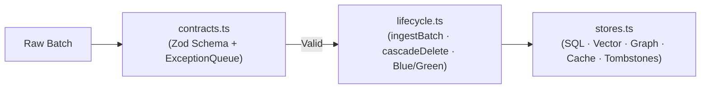

# Chapter 00: Overview, Architecture & File Structure

> **Chapter goal:** understand *what* this codebase is, how records flow through Zod contracts into SQL/Vector/Graph/Cache stores, and how cascade deletions and Blue/Green migrations work.

---

## 0.1 What this codebase is

This is the **minimum working TypeScript engine** proving Lecture 25:
- Uses `zod` for producer/consumer AI Data Contract enforcement.
- Simulates SQL, Vector (Blue/Green), Graph, and Cache stores with zero external DB setup so all 5 release gates run deterministically in `< 1 second`.

| File | Responsibility | Notes Chapter |
| :--- | :--- | :---: |
| `package.json` & `tsconfig.json` | ESM + strict TypeScript + `zod` + `tsx` | — |
| `src/contracts.ts` | Zod `IngestionRecordSchema`, deterministic normalization, `ExceptionQueue` | 01, 02 |
| `src/stores.ts` | Multi-store KB (SQL, Blue/Green Vector, Graph, Cache, Tombstones, Lineage, Tenant Pre-Filter) | 03, 05, 06 |
| `src/lifecycle.ts` | `ingestBatch()`, `cascadeDelete()`, and `runBlueGreenReembedding()` | 02, 04, 07 |
| `src/index.ts` | Runnable end-to-end demo | 01–07 |
| `src/release-gate.test.ts` | 5 automated release-gate assertions (`node:test`) | All |

---

## 0.2 Architecture



---

## 0.3 Commands

```bash
cd "Lecture 25 - AI Data Contracts and Lakehouse Lifecycle/code/Basic Code"
npm install
npm run typecheck
npm start
npm test
```

