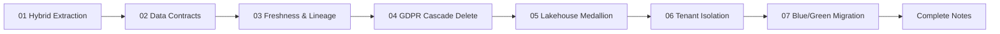

# Lecture 25 — Chapter Index

**AI Data Contracts, Lakehouse Storage & Knowledge Lifecycle**
Phase 6 · Enterprise Data, Semantics & SQL · 🟠 Advanced · **7 chapters**

> Source of truth for topics, goal, build task and gate: **[../roadmap-v1.md](../roadmap-v1.md)** → *"Lecture 25"*.
> Source mapping: `FDE S11 & S12`.

---

## 📚 Chapters

| # | Chapter | One-line summary | File |
| :---: | :--- | :--- | :--- |
| 01 | **LLM-Powered Extraction & Deterministic Transforms** | Hybrid ingestion pipeline, content-hash idempotency, deterministic pre/post-transforms | [01_LLM_Powered_Extraction_and_Deterministic_Transforms.md](./notes/01_LLM_Powered_Extraction_and_Deterministic_Transforms.md) |
| 02 | **AI Data Contracts & Exception Queues** | Producer/consumer Zod contracts, freshness SLAs, quarantine exception queues | [02_AI_Data_Contracts_and_Exception_Queues.md](./notes/02_AI_Data_Contracts_and_Exception_Queues.md) |
| 03 | **Knowledge Freshness SLAs & Lineage Tracking** | Derived-artifact lineage ledger (`sourceId` $\rightarrow$ SQL/Vector/Graph/Cache), staleness detection | [03_Knowledge_Freshness_SLAs_and_Lineage_Tracking.md](./notes/03_Knowledge_Freshness_SLAs_and_Lineage_Tracking.md) |
| 04 | **GDPR & Cascade Deletion Propagation** | Tombstones against zombie resurrection, multi-store cascade delete, post-delete verification | [04_GDPR_and_Cascade_Deletion_Propagation.md](./notes/04_GDPR_and_Cascade_Deletion_Propagation.md) |
| 05 | **Lakehouse & Warehouse Integration** | Bronze/Silver/Gold Medallion AI layering, incremental snapshot deltas, time-travel evals | [05_Lakehouse_and_Warehouse_Integration.md](./notes/05_Lakehouse_and_Warehouse_Integration.md) |
| 06 | **Tenant-Aware Filtering & Isolation** | Mandatory `tenant_id` pre-filtering, shared vs. isolated collections, retention policies | [06_Tenant_Aware_Filtering_and_Isolation.md](./notes/06_Tenant_Aware_Filtering_and_Isolation.md) |
| 07 | **Zero-Downtime Re-Embedding & Migrations** | Blue/Green index aliases, dual-write + backfill, recall parity gate, instant rollback | [07_Zero_Downtime_Re_Embedding_and_Migrations.md](./notes/07_Zero_Downtime_Re_Embedding_and_Migrations.md) |

---

## 📄 Complete notes

A single consolidated document with the executive summary, architecture diagram, cheat sheet, and self-check questions:

👉 **[Lecture_25_Complete_Notes.md](./notes/Lecture_25_Complete_Notes.md)**

---

## 🔗 Related

- **[./code/Basic Code](./code/Basic%20Code)** — runnable TypeScript Zod Data Contract + Cascade Deletion + Blue/Green Re-Embedding demo, release-gate tests, and chapter-wise `implementations guide/`
- **[./Assignment/task.md](./Assignment/task.md)** — hands-on assignment & release gate checklist
- **[./README.md](./README.md)** — lecture objectives, phase, level, source mapping and checklist
- **[../roadmap-v1.md](../roadmap-v1.md)** — complete topic list, goal, build task and completion gate

---

## 🧭 Reading order

