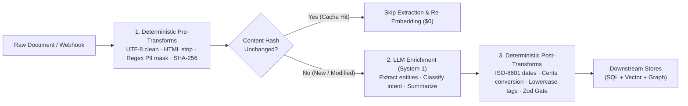
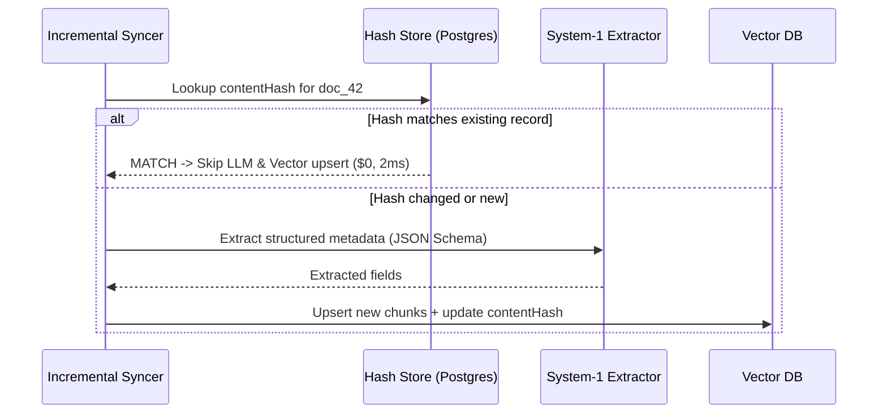

# Chapter 01 — LLM-Powered Extraction & Deterministic Transforms

> **Lecture 25 · Chapter 01 of 07** · Level: 🟠 Advanced · Phase 6 — Enterprise Data, Semantics & SQL
> **Source:** `FDE S11` · **Roadmap Reference:** [`roadmap-v1.md`](../../roadmap-v1.md#lecture-25--ai-data-contracts-lakehouse-storage--knowledge-lifecycle)
> **Roadmap topics:** Hybrid ingestion pipelines · semantic LLM extraction/enrichment vs. deterministic transforms · idempotent normalization · cost-efficient model routing during ingestion.

---

## 01.0 What this chapter is for

Enterprise knowledge arrives messy: PDFs, support transcripts, Slack threads, CRM notes, and JSON webhooks. You genuinely need **LLMs** for the semantic parts—extracting entities, classifying intent, summarizing long threads, and tagging risks. **But you should never pay an LLM to do work that deterministic code does cheaper, faster, and with 100% repeatability**, such as date normalization, currency parsing, SHA-256 deduplication, or regex PII redaction.

When teams hand the entire ingestion pipeline to an LLM prompt, two things happen: token bills explode on unchanged documents, and subtle formatting drift (`"Nov 26, 2026"` vs. `"2026-11-26"`) breaks downstream SQL filters. A **Hybrid Ingestion Pipeline** puts deterministic code on both sides of the LLM.

By the end of this chapter you should be able to:

1. Split an enterprise ingestion pipeline into **Deterministic Pre-Transforms**, **LLM Enrichment**, and **Deterministic Post-Transforms**.
2. Enforce **content-hash idempotency** (`sha256`) so unchanged documents are skipped at `$0` cost during incremental syncs.
3. Apply **System-1 model routing** (fast, cheap models with structured outputs) for high-volume ingestion workloads.
4. Validate every LLM-extracted payload through a **deterministic schema gate** before writing to SQL, Vector, or Graph stores.

---

## 01.1 The Hybrid Ingestion Pipeline

Every enterprise ingestion job should follow a three-stage sandwich: **Deterministic $\rightarrow$ Probabilistic (LLM) $\rightarrow$ Deterministic**.



### Division of labor: Deterministic code vs. LLM

| Ingestion Task | Deterministic Code | LLM (System-1) | Why |
| :--- | :---: | :---: | :--- |
| **Deduplication (`sha256(cleanText)`)** | ✅ | ❌ | Exact, `$0`, sub-millisecond |
| **Date & currency normalization (`ISO-8601`, `cents`)** | ✅ | ❌ | LLMs occasionally flip `DD/MM` vs. `MM/DD` or drop decimals |
| **Regex PII redaction (credit cards, SSNs, API keys)** | ✅ | ❌ | Must be 100% reliable before data ever leaves the boundary |
| **HTML / boilerplate stripping** | ✅ | ❌ | Saves 30–60% of input tokens before the LLM even runs |
| **Classifying a messy ticket into 12 categories** | ❌ | ✅ | Requires semantic understanding of prose |
| **Extracting `{ risks, actionItems, entities }` from calls** | ❌ | ✅ | Unstructured-to-structured semantic mapping |

> [!IMPORTANT]
> **Deterministic first, LLM second, deterministic last.** Stripping HTML and redacting PII *before* the LLM call cuts token costs and prevents sensitive strings from reaching model providers. Normalizing and validating *after* the LLM call guarantees downstream databases never receive malformed dates or invalid enums.

---

## 01.2 Content-hash idempotency (Never pay twice)

In enterprise syncs, 95–99% of records in a nightly batch have not changed since yesterday. If you re-extract and re-embed every record blindly, you burn 20x–100x more tokens and risk overwriting stable timestamps.

Compute a **canonical content hash** after deterministic cleaning:

```typescript
import crypto from "node:crypto";

export function computeContentHash(cleanText: string, metadataVersion: string): string {
  // Normalize whitespace so insignificant formatting changes don't trigger re-extraction
  const normalized = cleanText.replace(/\s+/g, " ").trim();
  return crypto
    .createHash("sha256")
    .update(`${metadataVersion}:${normalized}`)
    .digest("hex");
}
```



Notice the `metadataVersion` prefix in `computeContentHash`. If you upgrade your extraction prompt or add a new required tag (e.g., `v1` $\rightarrow$ `v2`), bumping `metadataVersion` cleanly invalidates old hashes so the pipeline re-extracts the corpus on purpose.

---

## 01.3 Worked trace: Ingesting a messy support ticket

Suppose Zendesk emits a raw webhook for ticket `#9041`:
- Raw body: `"<div>Hi team, our card 4111-2222-3333-4444 was charged $1,250.00 on Nov 26, 2026 for Acme Corp. Please refund ASAP!</div>"`

Watch how each stage transforms it:

1. **Deterministic Pre-Transform:**
   - Strip HTML tags (`<div>...</div>`).
   - Redact credit card regex $\rightarrow$ `[REDACTED_CARD]`.
   - Compute `contentHash = sha256("v1:Hi team, our card [REDACTED_CARD] was charged...")`.
2. **Idempotency Gate:**
   - `contentHash` is new $\rightarrow$ proceed to extraction.
3. **LLM Enrichment (System-1, `temperature: 0`, Structured Output):**
   ```json
   {
     "category": "billing_dispute",
     "urgency": "high",
     "mentionedEntities": ["Acme Corp"],
     "rawDateMentioned": "Nov 26, 2026",
     "rawAmountMentioned": "$1,250.00"
   }
   ```
4. **Deterministic Post-Transform & Schema Gate:**
   - Parse `"Nov 26, 2026"` $\rightarrow$ `"2026-11-26T00:00:00Z"` (`ISO-8601`).
   - Parse `"$1,250.00"` $\rightarrow$ `125000` (`amountCents`, integer).
   - Lowercase & trim tags (`"billing_dispute"`).
   - Validate the final payload against a Zod **AI Data Contract** (Chapter 02) before writing to Postgres/Qdrant.

### Traps & Where Hybrid Ingestion Breaks

| Trap | What It Looks Like | Why It Breaks | Production Fix |
| :--- | :--- | :--- | :--- |
| **Asking the LLM to output integer cents** | Prompt says *"Convert `$1,250.00` to cents"* | LLMs occasionally drop a zero (`12500`) or add commas | Have the LLM extract the raw string/number; convert to cents in deterministic code |
| **Hashing raw HTML instead of cleaned text** | Changing a CSS class or tracking pixel triggers re-embedding | Re-embeds the entire website every night for `$0` value | Strip HTML/boilerplate *before* computing `sha256` |
| **Using a frontier reasoning model for ingestion** | Running Opus/Pro on 500,000 support tickets | 20x higher cost and 5x slower throughput | Route ingestion extraction to a fast System-1 model with strict JSON Schema |

---

## 01.4 Common mistakes

| # | Common Mistake | Why It Hurts | What To Do Instead |
| :---: | :--- | :--- | :--- |
| 1 | **Using an LLM for regex, hashing, or date formatting** | Slow, expensive, and non-deterministic on edge formats | Run deterministic pre- and post-transforms around the LLM call |
| 2 | **Skipping content-hash idempotency** | Re-extracts and re-embeds unchanged records on every sync | Gate LLM calls on `sha256(metadataVersion + normalizedText)` |
| 3 | **Sending raw unredacted PII to external LLM APIs** | Violates compliance and leaks secrets into provider/debug logs | Run deterministic PII/secret redaction in Stage 1 *before* calling the LLM |
| 4 | **Trusting LLM JSON without post-validation** | Subtle type or enum drift crashes downstream SQL/Vector writers | Validate every extracted record through a Zod / JSON Schema gate |
| 5 | **Not versioning the extraction schema in the hash** | Prompt upgrades don't trigger backfill of existing unchanged docs | Include `metadataVersion` in the content-hash input |

---

## 01.5 Key takeaways

1. **Deterministic first, LLM second, deterministic last:** never pay an LLM to normalize dates, strip HTML, or hash strings.
2. **Content-hash gating (`sha256`)** keeps incremental ingestion costs proportional to *changes*, not total corpus size.
3. **Redact PII before the LLM sees it**, and **normalize units/dates after the LLM returns** so downstream stores stay clean.
4. **Every LLM extraction must pass a deterministic AI Data Contract** (Chapter 02) before touching production indexes.

---

**Next:** [Chapter 02 — AI Data Contracts & Exception Queues](./02_AI_Data_Contracts_and_Exception_Queues.md)
