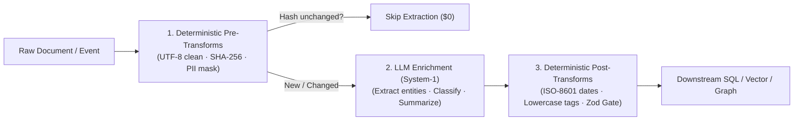

# Chapter 01 — LLM-Powered Extraction & Deterministic Transforms

> **Lecture 25 · Chapter 01 of 07** · Level: 🟠 Advanced · Phase 6 — Enterprise Data, Semantics & SQL
> **Source:** `FDE S11` · **Roadmap Reference:** [`roadmap-v1.md`](../../roadmap-v1.md#lecture-25--ai-data-contracts-lakehouse-storage--knowledge-lifecycle)
> **Roadmap topics:** Hybrid ingestion pipelines · semantic LLM extraction/enrichment vs. deterministic transforms · idempotent normalization · cost-efficient model routing during ingestion.

---

## 01.0 What this chapter is for

Enterprise knowledge arrives messy: PDFs, support transcripts, Slack threads, and JSON webhooks. You need **LLMs** for semantic work (extracting entities, classifying intent, summarizing), **but you should never use an LLM for things deterministic code does cheaper, faster, and with 100% repeatability** (date normalization, currency parsing, SHA-256 deduplication, PII redaction).

By the end of this chapter you should be able to:

1. Split an ingestion pipeline into **Deterministic Transforms** vs. **LLM Enrichment** stages.
2. Enforce **content-hash idempotency** so unchanged documents are never re-embedded or re-extracted.
3. Combine System-1 routing (Lecture 08) with deterministic post-validation before writing to downstream stores.

---

## 01.1 The Hybrid Ingestion Pipeline

### Division of labor

| Task | Use Deterministic Code | Use LLM (System-1) |
| :--- | :---: | :---: |
| Deduplication (`sha256(content)`) | ✅ | ❌ |
| Date/currency normalization (`ISO-8601`, cents) | ✅ | ❌ |
| Regex PII redaction (SSN, credit card) | ✅ | ❌ |
| Classifying unstructured ticket into 12 categories | ❌ | ✅ |
| Extracting `{risks, actionItems, entities}` from prose | ❌ | ✅ |

---

## 01.2 Key takeaways

1. **Deterministic first, LLM second, deterministic last:** never pay an LLM to normalize dates or hash strings.
2. **Content-hash gating** prevents re-extracting unchanged documents on incremental pipeline runs.
3. **Every LLM extraction must pass a deterministic schema gate** (Chapter 02) before touching production stores.

---

**Next:** [Chapter 02 — AI Data Contracts & Exception Queues](./02_AI_Data_Contracts_and_Exception_Queues.md)

