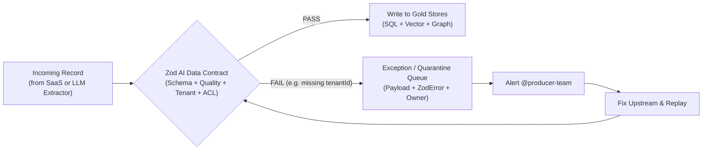
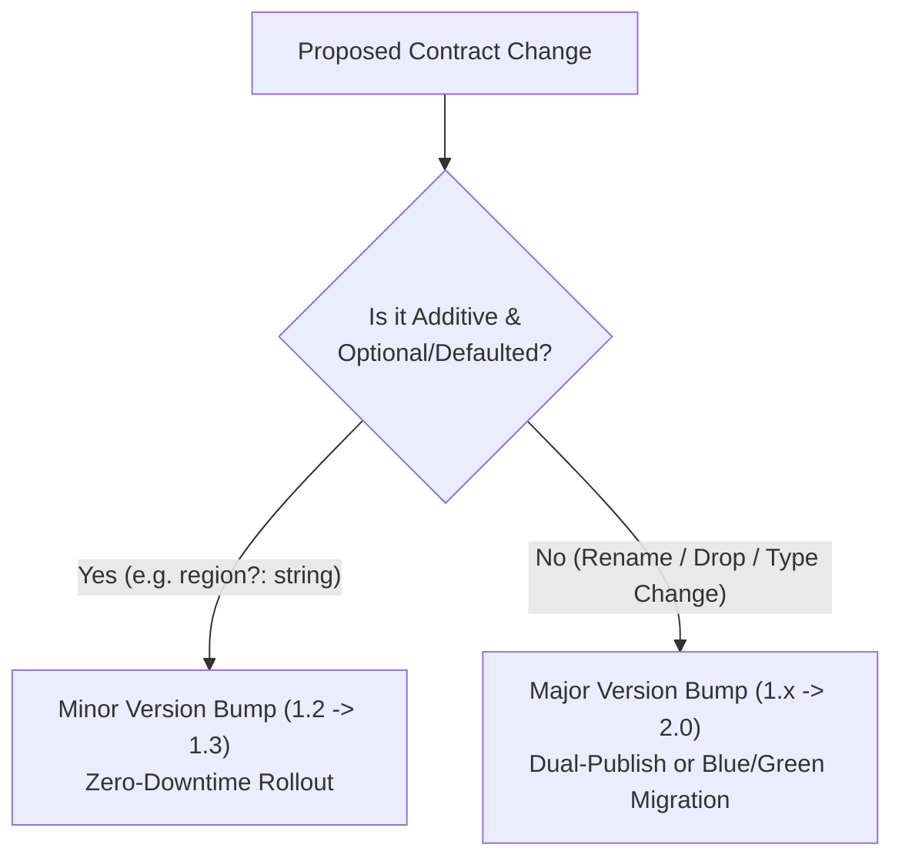

# Chapter 02 — AI Data Contracts & Exception Queues

> **Lecture 25 · Chapter 02 of 07** · Level: 🟠 Advanced · Phase 6 — Enterprise Data, Semantics & SQL
> **Source:** `FDE S11` · **Roadmap Reference:** [`roadmap-v1.md`](../../roadmap-v1.md#lecture-25--ai-data-contracts-lakehouse-storage--knowledge-lifecycle)
> **External Reference:** [Data Contracts Specification](https://datacontract.com/)
> **Roadmap topics:** Producer/consumer AI data contracts · Zod/JSON-Schema enforcement · freshness & quality SLAs · Dead-Letter / Exception Queues (quarantine) · schema evolution.

---

## 02.0 What this chapter is for

In traditional data engineering, a broken upstream column silently breaks a nightly BI dashboard—annoying, but localized. In **AI systems**, a broken upstream record **poisons your vector database and knowledge graph**, causing confident hallucinations or cross-tenant leaks across thousands of user queries.

An **AI Data Contract** is a formal, machine-enforced agreement between data producers (ingestion pipelines, SaaS connectors, LLM extractors) and AI consumers (RAG retrievers, Text-to-SQL agents). Records that violate the contract are **quarantined in an Exception Queue (Dead-Letter Queue)** with full diagnostics instead of corrupting the live index or crashing the entire batch.

By the end of this chapter you should be able to:

1. Define the **four clauses of an AI Data Contract** (Schema, Semantic Quality, Freshness SLA, and Ownership/Security).
2. Enforce contracts deterministically at the ingestion boundary using **Zod** or **JSON Schema**.
3. Route invalid records to an **Exception / Quarantine Queue** so valid records keep flowing without silent data loss.
4. Manage **backward-compatible schema evolution** without breaking downstream RAG or agent consumers.

---

## 02.1 Anatomy of an AI Data Contract

An AI Data Contract goes beyond SQL column types. It encodes the metadata required for safe retrieval, tenant isolation, and lifecycle management:

| Contract Clause | What It Enforces | Concrete Example |
| :--- | :--- | :--- |
| **1. Schema & Types** | Required fields, non-empty strings, valid enums, mandatory `tenantId` | `tenantId: z.string().min(1)`, `content: z.string().min(20)` |
| **2. Semantic & Quality Rules** | No placeholder slop (`"TBD"`, `"N/A"`), valid `sourceUri`, ISO-8601 `updatedAt` | `sourceUri: z.string().url()`, `content` not in `BLOCKED_PLACEHOLDERS` |
| **3. Freshness & SLA** | Maximum allowed age (`freshnessSlaMinutes`) before consumer flags staleness | `freshnessSlaMinutes: z.number().int().positive().default(60)` |
| **4. Ownership & Security** | Producer team, alert channel, and `piiClassification` / `aclGroups` | `owner: "@data-ingestion"`, `aclGroups: z.array(z.string()).min(1)` |



---

## 02.2 Concrete Zod contract & Exception Queue record

Here is a production-grade AI Data Contract enforced in TypeScript before any chunk is embedded or indexed:

```typescript
import { z } from "zod";

export const KnowledgeRecordContract = z.object({
  tenantId: z.string().min(1, "tenantId is mandatory for isolation"),
  sourceId: z.string().min(1),
  version: z.number().int().positive(),
  sourceUri: z.string().url(),
  content: z
    .string()
    .min(20, "Content too short to carry meaningful semantic signal")
    .refine((val) => !["N/A", "TBD", "null"].includes(val.trim()), {
      message: "Placeholder slop rejected",
    }),
  aclGroups: z.array(z.string()).min(1, "At least one ACL group required"),
  updatedAt: z.string().datetime(),
  freshnessSlaMinutes: z.number().int().positive().default(60),
});

export type KnowledgeRecord = z.infer<typeof KnowledgeRecordContract>;
```

When record `doc_8812` arrives with `tenantId: ""` and `content: "TBD"`, the ingestion worker **does not crash** and **does not index it**. It writes an Exception Queue entry:

```json
{
  "queue": "ai_ingestion_dlq",
  "contractVersion": "1.2.0",
  "sourceId": "doc_8812",
  "owner": "@data-ingestion",
  "errors": [
    { "path": ["tenantId"], "message": "tenantId is mandatory for isolation" },
    { "path": ["content"], "message": "Placeholder slop rejected" }
  ],
  "rawPayload": { "tenantId": "", "sourceId": "doc_8812", "content": "TBD" },
  "quarantinedAt": "2026-11-26T09:00:00Z"
}
```

---

## 02.3 Why Exception Queues beat crashing or dropping

Suppose nightly batch `#402` processes `10,000` updated support articles: `9,998` are valid and `2` have malformed `updatedAt` timestamps.

| Strategy | What Happens to the 9,998 Valid Docs | What Happens to the 2 Bad Docs | Verdict |
| :--- | :--- | :--- | :--- |
| **1. Crash on First Error** | **Blocked** — entire batch aborts; freshness SLA breached for everyone | Visible in crash log | ❌ Fragile |
| **2. `try/catch` & Silently Ignore** | Indexed | **Lost forever** — nobody knows data is missing | ❌ Dangerous |
| **3. Quarantine to Exception Queue** | **Indexed on schedule** (SLA met) | **Preserved** with exact `ZodError` path + owner alert for replay | ✅ Production Standard |

> [!TIP]
> **Make the Exception Queue replayable.** Store the `rawPayload` alongside the `errors` array. Once the producer fixes the upstream bug (or you patch a normalizer), a single replay script can re-drive quarantined records through the Zod gate without re-scraping the entire source system.

---

## 02.4 Schema evolution without breaking AI consumers

Schemas evolve—new metadata fields like `region` or `productLine` get added. Follow two rules to avoid breaking live RAG and agent pipelines:



- **Additive changes** (new optional fields or fields with `.default(...)`) are safe minor bumps.
- **Breaking changes** (renaming `sourceId` $\rightarrow$ `docId`, changing `updatedAt` format) require a **major version bump** and dual-support in consumers until all producers migrate.

> [!WARNING]
> **Never weaken a contract to "fix" a failing pipeline.** Removing `.min(1)` on `tenantId` or `aclGroups` to silence DLQ alerts opens a direct cross-tenant security vulnerability. Fix the producer or quarantine the bad rows.

---

## 02.5 Common mistakes

| # | Common Mistake | Why It Hurts | What To Do Instead |
| :---: | :--- | :--- | :--- |
| 1 | **Validating only at the database `INSERT` layer** | Embeddings are already computed (wasted money) and partial state leaks | Enforce the Zod/JSON-Schema contract *before* chunking and embedding |
| 2 | **Aborting the whole batch on 1 bad record** | 9,999 healthy documents miss their freshness SLA | Quarantine failing records in an Exception Queue and continue the batch |
| 3 | **Silently `catch`-ing and dropping bad records** | Silent data loss; users ask why a document is missing from RAG | Log full `ZodError` diagnostics + `rawPayload` to a replayable DLQ |
| 4 | **Making `tenantId` or `aclGroups` optional** | Unscoped records become invisible or leak across tenants | Require `tenantId` and `aclGroups` on every AI Data Contract |
| 5 | **No producer `owner` on the contract** | Quarantined records pile up in the DLQ with nobody fixing them | Bind every contract to an `@owner-team` and page on DLQ growth |

---

## 02.6 Key takeaways

1. **Validate every AI record at the ingestion boundary** with Zod or JSON Schema before spending tokens on chunking or embedding.
2. **Quarantine, don't crash or silently drop:** route contract violations to a replayable Exception Queue with producer diagnostics.
3. **Require `tenantId`, `sourceId`, `version`, `aclGroups`, and `updatedAt`** on every AI Data Contract so downstream isolation, freshness, and GDPR deletion work.
4. **Evolve contracts safely** with additive minor bumps and dual-published major migrations.

---

**Next:** [Chapter 03 — Knowledge Freshness SLAs & Lineage Tracking](./03_Knowledge_Freshness_SLAs_and_Lineage_Tracking.md)
