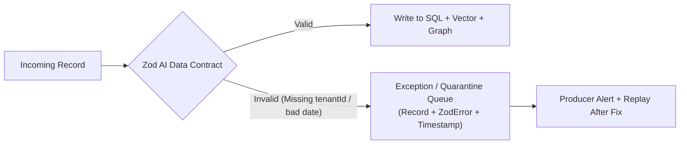

# Chapter 02 — AI Data Contracts & Exception Queues

> **Lecture 25 · Chapter 02 of 07** · Level: 🟠 Advanced · Phase 6 — Enterprise Data, Semantics & SQL
> **Source:** `FDE S11` · **Roadmap Reference:** [`roadmap-v1.md`](../../roadmap-v1.md#lecture-25--ai-data-contracts-lakehouse-storage--knowledge-lifecycle)
> **External Reference:** [Data Contracts Specification](https://datacontract.com/)
> **Roadmap topics:** Producer/consumer AI data contracts · Zod/JSON-Schema enforcement · freshness & quality SLAs · Dead-Letter / Exception Queues (quarantine) · schema evolution.

---

## 02.0 What this chapter is for

In traditional data engineering, a broken upstream column silently breaks a nightly BI dashboard. In **AI systems**, a broken upstream record **poisons your vector database and RAG context** — causing hallucinations across thousands of user queries.

An **AI Data Contract** is a formal, machine-enforced agreement between data producers (ingestion pipelines, SaaS connectors) and AI consumers (RAG retrievers, agents). Records that violate the contract are **quarantined in an Exception Queue** instead of corrupting the index.

By the end of this chapter you should be able to:

1. Define the four sections of an **AI Data Contract** (Schema, Ownership, Quality/Freshness SLAs, Security/Tenant rules).
2. Enforce contracts at ingestion time using **Zod** (or JSON Schema).
3. Route invalid records to a **Quarantine / Exception Queue** with structured error diagnostics so valid records keep flowing.

---

## 02.1 Anatomy of an AI Data Contract

| Contract Clause | What It Enforces | Example |
| :--- | :--- | :--- |
| **1. Schema & Types** | Required fields, enums, non-empty text, valid `tenantId` | `tenantId: z.string().min(1)`, `content: z.string().min(20)` |
| **2. Semantic & Quality Rules** | No placeholder slop, valid `sourceUri`, `updatedAt` ISO timestamp | `sourceUri: z.string().url()` |
| **3. Freshness SLA** | Maximum allowed age (`maxAgeMs`) before consumer flags staleness | `freshnessSlaMinutes: 60` |
| **4. Ownership & Escalation** | Producer team + exception-queue alert channel | `owner: "@data-ingestion"` |

---

## 02.2 Why Exception Queues beat crashing the pipeline

If batch #402 contains 9,998 valid documents and 2 malformed records:
- **Crashing the whole job** blocks 9,998 fresh documents from reaching users (violating freshness SLAs).
- **Silently dropping errors** hides data loss.
- **Quarantining into an Exception Queue** keeps the 9,998 valid records flowing while preserving the 2 bad records + exact `ZodError` path for replay.

---

## 02.3 Key takeaways

1. **Validate every AI record at the ingestion boundary** with Zod/JSON Schema before embedding or indexing.
2. **Quarantine, don't crash or silently drop:** route contract violations to an Exception Queue with producer diagnostics.
3. **Require `tenantId`, `sourceId`, `version`, and `updatedAt`** on every AI data contract so downstream lifecycle operations work.

---

**Next:** [Chapter 03 — Knowledge Freshness SLAs & Lineage Tracking](./03_Knowledge_Freshness_SLAs_and_Lineage_Tracking.md)

