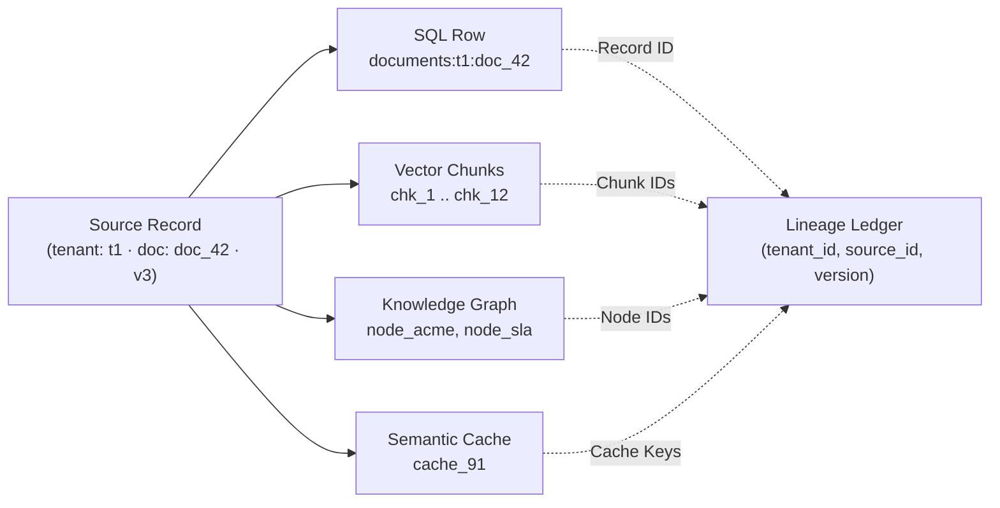
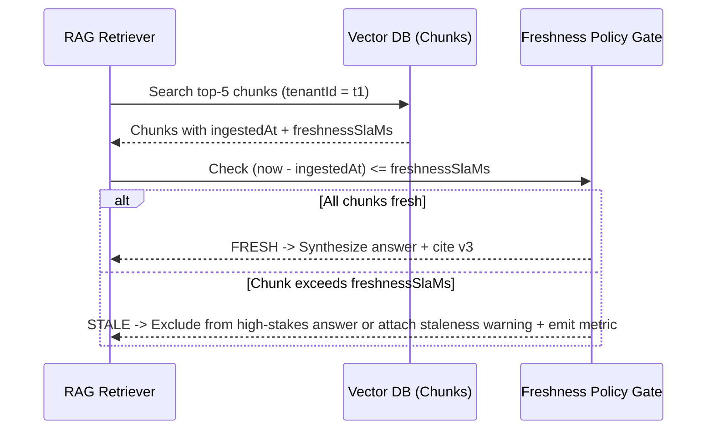

# Chapter 03 — Knowledge Freshness SLAs & Lineage Tracking

> **Lecture 25 · Chapter 03 of 07** · Level: 🟠 Advanced · Phase 6 — Enterprise Data, Semantics & SQL
> **Source:** `FDE S11` · **Roadmap Reference:** [`roadmap-v1.md`](../../roadmap-v1.md#lecture-25--ai-data-contracts-lakehouse-storage--knowledge-lifecycle)
> **Roadmap topics:** Knowledge freshness SLAs · staleness detection & TTLs · derived-artifact lineage (`sourceId -> chunkIds + graphNodeIds + cacheKeys`) · citation traceability.

---

## 03.0 What this chapter is for

A single enterprise document (`doc_42`, e.g., *"2026 Enterprise Pricing Policy"*) does not live in just one place. Once it passes the AI Data Contract (Chapter 02), it fans out across four different storage engines:
- **1 metadata row** in PostgreSQL (`documents`)
- **12 vector chunks** in Qdrant or pgvector (`chunks`)
- **5 entity/relationship nodes** in Neo4j (`graph_nodes`)
- **Cached LLM answers** in Redis (`rag_cache`)

Without **derived-artifact lineage** and **freshness SLAs**, your AI platform is flying blind. You cannot answer *"Is this retrieved chunk too stale to trust?"*, you cannot trace a hallucinated citation back to its exact source version, and you cannot cleanly update or delete `doc_42` across all four stores.

By the end of this chapter you should be able to:

1. Attach **freshness metadata (`sourceUpdatedAt`, `ingestedAt`, `freshnessSlaMs`, `expiresAt`)** to every derived artifact.
2. Implement **query-time staleness detection** so expired chunks trigger warnings, re-syncs, or abstention instead of silent hallucinations.
3. Maintain a **Derived-Artifact Lineage Ledger** mapping `(tenantId, sourceId, version)` $\rightarrow$ `[sqlRowId, vectorChunkIds, graphNodeIds, cacheKeys]`.
4. Trace any agent citation back to the exact source document version that produced it.

---

## 03.1 The Derived-Artifact Lineage Ledger

Every time an ingestion pipeline writes derived artifacts for a source record, it must atomically record their IDs in a **Lineage Ledger** (typically a PostgreSQL table indexed by `(tenant_id, source_id)`):



### Concrete Lineage Ledger Record

```json
{
  "tenantId": "tenant_acme",
  "sourceId": "doc_42",
  "version": 3,
  "contentHash": "9f86d081884c7d659a2feaa0c55ad015",
  "sourceUpdatedAt": "2026-11-26T07:55:00Z",
  "ingestedAt": "2026-11-26T08:00:00Z",
  "freshnessSlaMs": 3600000,
  "derivedArtifacts": {
    "sqlRowId": "documents:tenant_acme:doc_42",
    "vectorChunkIds": ["chk_1", "chk_2", "chk_3"],
    "graphNodeIds": ["node_acme", "node_sla_policy"],
    "cacheKeys": ["rag_cache:tenant_acme:q_refund_policy"]
  }
}
```

> [!IMPORTANT]
> **Why versioned lineage matters for updates.** When `doc_42` updates from `v3` (12 chunks) to `v4` (9 chunks), upserting `chk_1..chk_9` without consulting the `v3` Lineage Ledger leaves **3 orphaned `v3` chunks (`chk_10..chk_12`)** in your vector database—creating "ghost" contradictions in RAG! Always diff against the previous version's `vectorChunkIds` and delete orphaned chunks.

---

## 03.2 Knowledge Freshness SLAs & staleness detection

Not all enterprise knowledge ages at the same speed. Assign a `freshnessSlaMs` (or TTL) per document class:

| Knowledge Class | Example | Typical Freshness SLA | Behavior When SLA Breached |
| :--- | :--- | :---: | :--- |
| **Live Pricing / Inventory** | `pricing_tiers_2026.md` | `15m–1h` | **Abstain or fall back** to live API; never quote stale prices |
| **Support Runbooks / Docs** | `api_auth_guide.md` | `24h` | **Warn user** (*"Last synced 26h ago"*) + trigger async re-sync |
| **Static Legal / Historical** | `signed_msa_2024.pdf` | `30d` (or immutable) | Serve normally with `signedAt` citation |



### Query-Time Staleness Check (TypeScript)

```typescript
export function evaluateFreshness(ingestedAtIso: string, freshnessSlaMs: number, nowMs = Date.now()) {
  const ageMs = nowMs - new Date(ingestedAtIso).getTime();
  const isStale = ageMs > freshnessSlaMs;
  return {
    isStale,
    ageMinutes: Math.round(ageMs / 60_000),
    action: isStale ? "WARN_OR_ABSTAIN" : "SERVE",
  };
}
```

---

## 03.3 Citation traceability & semantic cache invalidation

When an agent cites `[doc_42 v3]`, an auditor should be able to click that citation and see:
- the exact `sourceUri` and `version`,
- the `ingestedAt` timestamp, and
- the exact chunk text that was retrieved.

Equally important: **semantic caches (`cacheKeys`)** in Redis must be linked in the Lineage Ledger. If `doc_42` is updated to `v4` (or deleted), the pipeline reads `derivedArtifacts.cacheKeys` and **invalidates those Redis keys immediately** so users do not receive cached answers generated from `v3`.

> [!WARNING]
> **Stale caches defeat fresh ingestion.** Teams often build a 5-minute CDC pipeline to update Qdrant, then wonder why users still see yesterday's refund policy—because Redis cached the old RAG answer for 24 hours without lineage-linked invalidation.

---

## 03.4 Common mistakes

| # | Common Mistake | Why It Hurts | What To Do Instead |
| :---: | :--- | :--- | :--- |
| 1 | **Overwriting `v3` chunks without deleting orphaned IDs** | If `v4` has fewer chunks than `v3`, old chunks stay in Vector DB forever | Diff `v3` vs. `v4` `vectorChunkIds` in the Lineage Ledger and delete orphans |
| 2 | **Treating all documents as having the same freshness** | Stale pricing quotes cause financial/legal errors; over-syncing static PDFs wastes money | Assign `freshnessSlaMs` per document class and enforce it at query time |
| 3 | **Ignoring Redis / semantic cache in lineage** | Updated or deleted documents keep surfacing from cached answers | Track `cacheKeys` in the Lineage Ledger and invalidate on update/delete |
| 4 | **Storing only `ingestedAt` without `sourceUpdatedAt`** | You know when your pipeline ran, not how old the underlying source doc actually is | Store both `sourceUpdatedAt` and `ingestedAt` on every record |
| 5 | **No `version` on vector chunk payloads** | Impossible to tell which version of a doc produced a bad answer | Stamp `(sourceId, version, contentHash)` on every chunk payload |

---

## 03.5 Key takeaways

1. **Track every derived artifact** (SQL row, vector chunks, graph nodes, cache keys) in a **Lineage Ledger** keyed by `(tenantId, sourceId, version)`.
2. **Delete orphaned chunks on version updates** so shorter `v4` documents never leave `v3` ghost chunks behind.
3. **Enforce `freshnessSlaMs` at query time**—stale RAG chunks are silent hallucinations waiting to happen.
4. **The Lineage Ledger is the mandatory foundation for GDPR cascade deletion** (Chapter 04).

---

**Next:** [Chapter 04 — GDPR & Cascade Deletion Propagation](./04_GDPR_and_Cascade_Deletion_Propagation.md)
