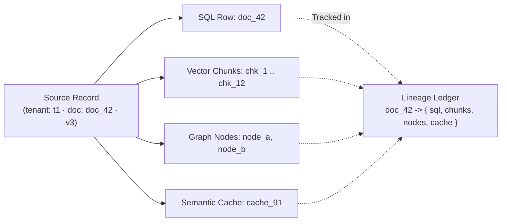

# Chapter 03 — Knowledge Freshness SLAs & Lineage Tracking

> **Lecture 25 · Chapter 03 of 07** · Level: 🟠 Advanced · Phase 6 — Enterprise Data, Semantics & SQL
> **Source:** `FDE S11` · **Roadmap Reference:** [`roadmap-v1.md`](../../roadmap-v1.md#lecture-25--ai-data-contracts-lakehouse-storage--knowledge-lifecycle)
> **Roadmap topics:** Knowledge freshness SLAs · staleness detection & TTLs · derived-artifact lineage (`sourceId -> chunkIds + graphNodeIds + cacheKeys`) · citation traceability.

---

## 03.0 What this chapter is for

A single source document (`doc_42`) does not live in one place. After ingestion, it fans out into:
- **1 metadata row** in PostgreSQL (`documents`)
- **12 vector chunks** in Qdrant/pgvector (`chunks`)
- **5 entity/relationship nodes** in Neo4j (`graph_nodes`)
- **Cached query responses** in Redis (`cache_entries`)

Without **derived-artifact lineage** and **freshness SLAs**, you cannot answer two critical production questions: *"Is this retrieved chunk stale?"* and *"Which chunks and graph nodes came from `doc_42`?"*

By the end of this chapter you should be able to:

1. Attach **freshness timestamps (`ingestedAt`, `sourceUpdatedAt`, `expiresAt`)** to every derived artifact.
2. Enforce **staleness detection** at query time so expired knowledge triggers warnings or abstention.
3. Maintain a **Lineage Ledger** mapping `sourceId` $\rightarrow$ `[chunkIds, graphNodeIds, cacheKeys]` for auditing and cascade deletion.

---

## 03.1 The Derived-Artifact Lineage Ledger

### Freshness SLA enforcement at query time

Every record carries `freshnessSlaMs` (e.g., `3,600,000 ms` = 1 hour for pricing docs). At retrieval time:
- If `now - ingestedAt > freshnessSlaMs`, mark the result **`stale: true`** (or exclude it from high-stakes answers) and emit an SLA breach metric.

---

## 03.2 Key takeaways

1. **Track every derived artifact** (SQL rows, vector chunks, graph nodes, cache keys) back to its `(tenantId, sourceId, version)`.
2. **Enforce freshness SLAs at query time** — stale RAG chunks are silent hallucinations waiting to happen.
3. **The Lineage Ledger is the prerequisite for GDPR cascade deletion** (Chapter 04).

---

**Next:** [Chapter 04 — GDPR & Cascade Deletion Propagation](./04_GDPR_and_Cascade_Deletion_Propagation.md)

