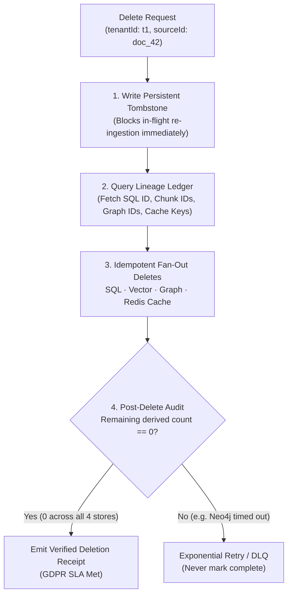
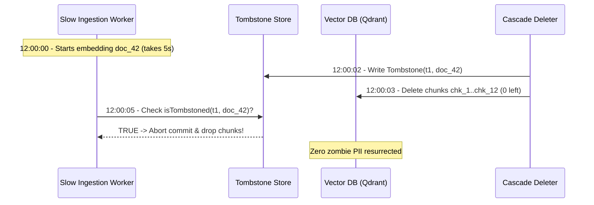

# Chapter 04 — GDPR & Cascade Deletion Propagation

> **Lecture 25 · Chapter 04 of 07** · Level: 🟠 Advanced · Phase 6 — Enterprise Data, Semantics & SQL
> **Source:** `FDE S11 & S12` · **Roadmap Reference:** [`roadmap-v1.md`](../../roadmap-v1.md#lecture-25--ai-data-contracts-lakehouse-storage--knowledge-lifecycle)
> **Roadmap topics:** GDPR Right to Erasure (`Art. 17`) · cascade deletion across SQL, Vector, Graph, and Cache · tombstone records · idempotent delete retries & deletion verification.

---

## 04.0 What this chapter is for

When an enterprise customer exercises their **GDPR Right to Erasure (Article 17)**—or when a sensitive HR/legal document is revoked—deleting the row from PostgreSQL is **nowhere near enough**. If 12 vector embeddings in Qdrant, 5 entity nodes in Neo4j, and 2 cached responses in Redis still exist, **your AI agent will continue retrieving and leaking deleted data** weeks later.

Even worse, distributed ingestion pipelines have race conditions: an in-flight worker embedding `doc_42` can finish 3 seconds *after* your delete job ran, **resurrecting** the deleted PII. A production **Cascade Deletion Propagator** solves both problems with lineage-driven fan-out, persistent tombstones, and post-delete verification.

By the end of this chapter you should be able to:

1. Design a **Cascade Deletion Propagator** that wipes a source record and all derived artifacts across SQL, Vector, Graph, and Cache stores.
2. Use **tombstone records** to prevent in-flight ingestion workers from resurrecting deleted documents ("zombie resurrection").
3. Make cascade deletes **idempotent and retry-safe** so partial store outages never leave orphaned PII.
4. Verify deletion completeness with a **post-delete audit check** and emit a signed **Deletion Receipt** within SLA.

---

## 04.1 The Cascade Deletion State Machine

A compliant delete executes in four strict phases—starting with a tombstone, not a `DELETE` query:



> [!IMPORTANT]
> **Tombstone first, delete second.** If you delete from Qdrant *before* writing the tombstone, an in-flight ingestion job can commit new chunks into Qdrant in the 200ms gap between your delete and the tombstone write.

---

## 04.2 Why tombstones prevent "zombie resurrection"

Consider this classic distributed-systems race condition during a live GDPR erasure:



Every ingestion worker must perform a **pre-commit tombstone check** (`isTombstoned(tenantId, sourceId)`) immediately before writing to SQL, Vector, or Graph. If a tombstone exists, the worker drops the payload cleanly and logs `DROPPED_BY_TOMBSTONE`.

---

## 04.3 Idempotency, partial failures, and audit receipts

Because four separate databases are involved, **partial failure is normal**: SQL and Redis might succeed while Qdrant returns `503 Service Unavailable`.

1. **Idempotent Delete Operations:** Every store adapter must treat "record already missing" (`404` / `0 rows affected`) as **success**, not an error, so retries are 100% safe.
2. **Post-Delete Verification:** Never trust a `200 OK` from the delete call alone. Run a verification query across all four stores confirming `count(tenantId, sourceId) === 0`.
3. **Signed Deletion Audit Receipt:** Persist an immutable compliance record (containing **zero PII**, only IDs and counts) proving erasure within the GDPR SLA:

```json
{
  "receiptId": "gdpr_del_99104",
  "tenantId": "tenant_acme",
  "sourceId": "doc_42",
  "tombstoneWrittenAt": "2026-11-26T12:00:02Z",
  "deletedCounts": {
    "sqlRows": 1,
    "vectorChunks": 12,
    "graphNodes": 5,
    "cacheKeys": 2
  },
  "remainingDerivedCount": 0,
  "verified": true,
  "completedAt": "2026-11-26T12:00:04Z"
}
```

> [!WARNING]
> **Watch out for backups and logs.** Vector/SQL stores are only half the story: ensure prompt logs, DLQ `rawPayload` entries (Chapter 02), and Lakehouse Bronze tables either obey retention TTLs or are included in your erasure sweep.

---

## 04.4 Common mistakes

| # | Common Mistake | Why It Hurts | What To Do Instead |
| :---: | :--- | :--- | :--- |
| 1 | **Deleting only from the primary SQL database** | Vector chunks, graph nodes, and Redis cache keep leaking deleted PII | Fan out deletes across SQL, Vector, Graph, and Cache using the Lineage Ledger |
| 2 | **Deleting without writing a tombstone first** | In-flight ingestion workers re-insert deleted chunks seconds later | Write a persistent tombstone first and check `isTombstoned()` before every commit |
| 3 | **Failing retries on `404 Not Found`** | Partial-failure retries get stuck when one store was already cleaned | Make every store's delete adapter **idempotent** (missing = success) |
| 4 | **Marking GDPR erasure done without verification** | Silent timeouts leave orphaned vectors in the index | Run a post-delete count check (`remainingDerivedCount === 0`) and emit a receipt |
| 5 | **Forgetting DLQ payloads and semantic caches** | Deleted user data lingers in Exception Queues or Redis | Include `cacheKeys` and DLQ entries in the cascade sweep |

---

## 04.5 Key takeaways

1. **A delete is incomplete until SQL, Vector, Graph, and Cache all report `0` remaining derived artifacts.**
2. **Write a persistent tombstone first** so in-flight ingestion jobs cannot resurrect deleted data.
3. **Make cascade deletes idempotent and retry-safe** so transient store outages never leave partial PII behind.
4. **Verify deletion completeness** and emit an immutable, PII-free **Deletion Audit Receipt** for compliance.

---

**Next:** [Chapter 05 — Lakehouse & Warehouse Integration](./05_Lakehouse_and_Warehouse_Integration.md)
