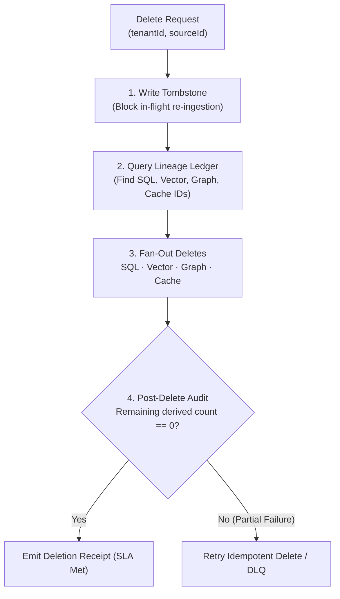

# Chapter 04 — GDPR & Cascade Deletion Propagation

> **Lecture 25 · Chapter 04 of 07** · Level: 🟠 Advanced · Phase 6 — Enterprise Data, Semantics & SQL
> **Source:** `FDE S11 & S12` · **Roadmap Reference:** [`roadmap-v1.md`](../../roadmap-v1.md#lecture-25--ai-data-contracts-lakehouse-storage--knowledge-lifecycle)
> **Roadmap topics:** GDPR Right to Erasure (`Art. 17`) · cascade deletion across SQL, Vector, Graph, and Cache · tombstone records · idempotent delete retries & deletion verification.

---

## 04.0 What this chapter is for

When a customer exercises their **GDPR Right to Erasure** (or a confidential document is revoked), deleting the row from PostgreSQL is **not enough**. If 12 vector embeddings, 5 knowledge-graph nodes, and a cached LLM response still exist, **your AI agent will continue leaking deleted data**.

By the end of this chapter you should be able to:

1. Design a **Cascade Deletion Propagator** that removes a source record and all derived artifacts across SQL, Vector, Graph, and Cache stores.
2. Use **tombstone records** to block in-flight ingestion workers from resurrecting a deleted document.
3. Verify deletion completeness with a **post-delete audit check** within SLA.

---

## 04.1 The Cascade Deletion State Machine

### Why tombstones prevent "zombie resurrection"

Suppose an ingestion worker started embedding `doc_42` at `12:00:00`, and a GDPR delete arrives at `12:00:02`. If the delete finishes at `12:00:03` and the slow ingestion worker finishes writing chunks at `12:00:05`, **`doc_42` comes back to life**. Checking a persistent **tombstone (`deleted_sources`)** before writing prevents zombie resurrection.

---

## 04.2 Key takeaways

1. **A delete is incomplete until SQL, Vector, Graph, and Cache all return 0 derived artifacts.**
2. **Write a tombstone first** so in-flight ingestion jobs cannot resurrect deleted data.
3. **Make cascade deletes idempotent and auditable** with a post-delete verification check.

---

**Next:** [Chapter 05 — Lakehouse & Warehouse Integration](./05_Lakehouse_and_Warehouse_Integration.md)

