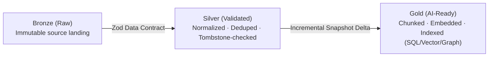

# Chapter 05 — Lakehouse & Warehouse Integration

> **Lecture 25 · Chapter 05 of 07** · Level: 🟠 Advanced · Phase 6 — Enterprise Data, Semantics & SQL
> **Source:** `FDE S12` · **Roadmap Reference:** [`roadmap-v1.md`](../../roadmap-v1.md#lecture-25--ai-data-contracts-lakehouse-storage--knowledge-lifecycle)
> **Roadmap topics:** Lakehouse patterns (Apache Iceberg, Snowflake, BigQuery) · incremental snapshot reads (watermarks & CDC) · time-travel & reproducibility · separating bronze/silver/gold AI layers.

---

## 05.0 What this chapter is for

Enterprise AI pipelines cannot re-scan 50 million warehouse rows on every sync. Integrating with a **Lakehouse** (Apache Iceberg, Delta Lake) or **Cloud Warehouse** (Snowflake, BigQuery) gives you **incremental snapshot deltas**, **ACID time-travel**, and **Bronze/Silver/Gold layering**.

By the end of this chapter you should be able to:

1. Structure AI ingestion using the **Medallion Lakehouse pattern** (Bronze raw $\rightarrow$ Silver contract-validated $\rightarrow$ Gold chunked/embedded).
2. Read **incremental deltas** using Iceberg snapshot IDs or high-watermark timestamps instead of full table scans.
3. Use **Lakehouse time-travel** (`AS OF SNAPSHOT`) to reproduce exact RAG evaluation runs.

---

## 05.1 Medallion architecture for AI knowledge

| Layer | Purpose | Failure Behavior |
| :--- | :--- | :--- |
| **Bronze** | Append-only raw payloads from SaaS/docs | Never blocks on schema errors |
| **Silver** | Enforces AI Data Contract & PII masking | Invalid rows go to Exception Queue |
| **Gold** | Serves live RAG & agents | Only certified, fresh, tenant-scoped records |

---

## 05.2 Incremental snapshot syncs

Instead of `SELECT * FROM silver_docs`, store `lastProcessedSnapshotId` (Iceberg) or `lastUpdatedAt` watermark:
- **Inserts/Updates:** Embed and upsert only rows changed since `lastProcessedSnapshotId`.
- **Deletes:** Emit `DELETE` tombstones to the Cascade Deletion Propagator (Chapter 04).

---

## 05.3 Key takeaways

1. **Use Bronze $\rightarrow$ Silver $\rightarrow$ Gold** so raw ingestion never pollutes live AI indexes.
2. **Sync incrementally via snapshots/watermarks** to keep embedding costs linear with *changes*, not total corpus size.
3. **Leverage Lakehouse time-travel** for reproducible offline RAG evaluations.

---

**Next:** [Chapter 06 — Tenant-Aware Filtering & Isolation](./06_Tenant_Aware_Filtering_and_Isolation.md)

