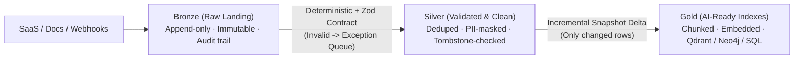
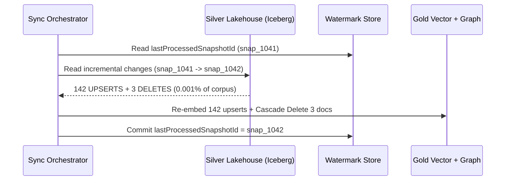

# Chapter 05 — Lakehouse & Warehouse Integration

> **Lecture 25 · Chapter 05 of 07** · Level: 🟠 Advanced · Phase 6 — Enterprise Data, Semantics & SQL
> **Source:** `FDE S12` · **Roadmap Reference:** [`roadmap-v1.md`](../../roadmap-v1.md#lecture-25--ai-data-contracts-lakehouse-storage--knowledge-lifecycle)
> **Roadmap topics:** Lakehouse patterns (Apache Iceberg, Snowflake, BigQuery) · incremental snapshot reads (watermarks & CDC) · time-travel & reproducibility · separating bronze/silver/gold AI layers.

---

## 05.0 What this chapter is for

Enterprise AI pipelines cannot run `SELECT *` over 50 million warehouse rows and re-embed the entire company every night. That approach burns tens of thousands of dollars in embedding API calls, saturates vector DB write throughput, and breaks reproducibility when you try to debug why yesterday's RAG evaluation suddenly regressed.

Integrating your AI ingestion pipeline with a **Lakehouse** (Apache Iceberg, Delta Lake) or **Cloud Warehouse** (Snowflake, BigQuery) gives you three superpowers: **Medallion layering (Bronze/Silver/Gold)**, **incremental snapshot deltas**, and **ACID time-travel**.

By the end of this chapter you should be able to:

1. Structure AI knowledge pipelines using the **Medallion Lakehouse pattern** (Bronze raw $\rightarrow$ Silver contract-validated $\rightarrow$ Gold chunked/embedded).
2. Read **incremental snapshot deltas** (Iceberg snapshot IDs, Snowflake Streams, or monotonic watermarks) instead of full table scans.
3. Propagate **incremental `DELETE` and `UPDATE` events** cleanly into downstream Vector and Graph stores.
4. Use **Lakehouse time-travel** (`VERSION AS OF`) to make offline RAG and agent evaluations 100% reproducible.

---

## 05.1 Medallion architecture for AI knowledge

Just as analytics teams separate raw landing zones from executive marts, AI teams must isolate raw messy ingestion from live vector/graph indexes:



| Medallion Layer | Purpose | Schema Enforcement | Failure Behavior |
| :--- | :--- | :---: | :--- |
| **Bronze (Raw)** | Append-only raw payloads from CRM, Support, SharePoint | Schema-on-read (flexible) | Never drops data on schema errors |
| **Silver (Validated)** | Enforces AI Data Contract, PII redaction, and canonical IDs | **Strict Zod / Iceberg schema** | Invalid rows route to Exception Queue (Ch 02) |
| **Gold (AI-Ready)** | Serves live RAG, GraphRAG, and Text-to-SQL agents | **Strict + Freshness SLA** | Only certified, fresh, tenant-scoped records |

> [!IMPORTANT]
> **Never embed directly from Bronze.** Embedding raw Bronze payloads bakes unredacted PII, HTML boilerplate, and contract-violating records straight into your vector index. Always embed from **Silver**.

---

## 05.2 Incremental snapshot syncs (Linear cost, not quadratic)

Instead of re-scanning `10,000,000` Silver rows every hour, store a persistent **sync watermark** (`lastProcessedSnapshotId` in Iceberg, or a `STREAM` offset in Snowflake):



### Concrete Incremental Delta Query (Iceberg / Snowflake)

```sql
-- 1. Read only rows inserted or updated since the last committed watermark:
SELECT tenant_id, source_id, version, content_hash, clean_content, updated_at
FROM lakehouse.silver_knowledge
WHERE updated_at > :last_watermark_ts
  AND is_deleted = false;

-- 2. Read explicit deletes to feed the Cascade Deletion Propagator (Chapter 04):
SELECT tenant_id, source_id
FROM lakehouse.silver_knowledge
WHERE updated_at > :last_watermark_ts
  AND is_deleted = true;
```

Notice the **commit order**: only advance `:last_watermark_ts` *after* all 142 upserts and 3 cascade deletes succeed. If the worker crashes halfway, re-running from the old watermark is safe because Chapter 01's `contentHash` gate and Chapter 04's idempotent deletes prevent duplicate work.

---

## 05.3 Time-travel for reproducible RAG evaluations

Imagine your RAG evaluation score drops from `91%` to `84%` overnight. Did your **prompt change** break it, or did someone edit 500 knowledge-base articles in Silver?

With Lakehouse **time-travel**, you pin your eval suite to an exact immutable snapshot ID:

```sql
-- Reproducible RAG evals pinned to a specific Iceberg Snapshot ID:
SELECT tenant_id, source_id, clean_content, updated_at
FROM lakehouse.silver_knowledge VERSION AS OF 84920194821;
```

Pinning evals to `VERSION AS OF <snapshot_id>` separates **model/prompt regressions** from **corpus drift**, making CI release gates deterministic.

### Traps & Where Lakehouse Syncs Break

| Trap | What It Looks Like | Why It Breaks | Production Fix |
| :--- | :--- | :--- | :--- |
| **Advancing watermark before write succeeds** | Watermark updates, then Qdrant times out | Those changed rows are skipped forever on future runs | Advance watermark **only after** downstream upserts/deletes commit |
| **Using `>=` without tie-breaking on timestamps** | 50 rows share `updated_at = 12:00:00Z` | Using `>` skips rows at the boundary; `>=` re-processes infinitely | Use `(updated_at, source_id)` tuple watermarks or Iceberg snapshot IDs |
| **Hard-deleting rows in Silver without tombstones** | `DELETE FROM silver_knowledge` removes the row | Incremental reader never sees the delete, so Vector DB keeps stale chunks | Use soft deletes (`is_deleted = true`) or CDC change feeds |

---

## 05.4 Common mistakes

| # | Common Mistake | Why It Hurts | What To Do Instead |
| :---: | :--- | :--- | :--- |
| 1 | **Re-embedding the full Silver table on every schedule** | Embedding costs and vector write load scale with total corpus size | Sync incrementally via Iceberg snapshots, CDC streams, or `(updated_at, id)` watermarks |
| 2 | **Embedding directly from Bronze raw tables** | Indexes unvalidated slop, HTML tags, and unredacted PII | Enforce Bronze $\rightarrow$ Silver Zod Data Contract before embedding into Gold |
| 3 | **Hard-deleting Silver rows without emitting CDC events** | Vector and Graph stores never learn the document was deleted | Emit soft-delete tombstones (`is_deleted = true`) so Cascade Deleter runs |
| 4 | **Running RAG evals against a mutable live table** | Corpus edits make eval scores fluctuate even when code didn't change | Pin offline evals to a Lakehouse `VERSION AS OF <snapshot_id>` |
| 5 | **Updating the sync watermark before downstream commits** | Crash mid-batch causes permanent missed updates | Commit the watermark transactionally *after* Gold writes succeed |

---

## 05.5 Key takeaways

1. **Use the Medallion pattern (Bronze $\rightarrow$ Silver $\rightarrow$ Gold)** so raw ingestion errors never pollute live AI indexes.
2. **Sync incrementally via snapshot IDs, CDC streams, or watermarks** to keep embedding costs proportional to *changes*, not total corpus size.
3. **Propagate soft deletes (`is_deleted = true`)** into the Cascade Deletion Propagator so Vector and Graph stores stay in sync.
4. **Leverage Lakehouse time-travel (`VERSION AS OF`)** for 100% reproducible offline RAG and agent evaluations.

---

**Next:** [Chapter 06 — Tenant-Aware Filtering & Isolation](./06_Tenant_Aware_Filtering_and_Isolation.md)
