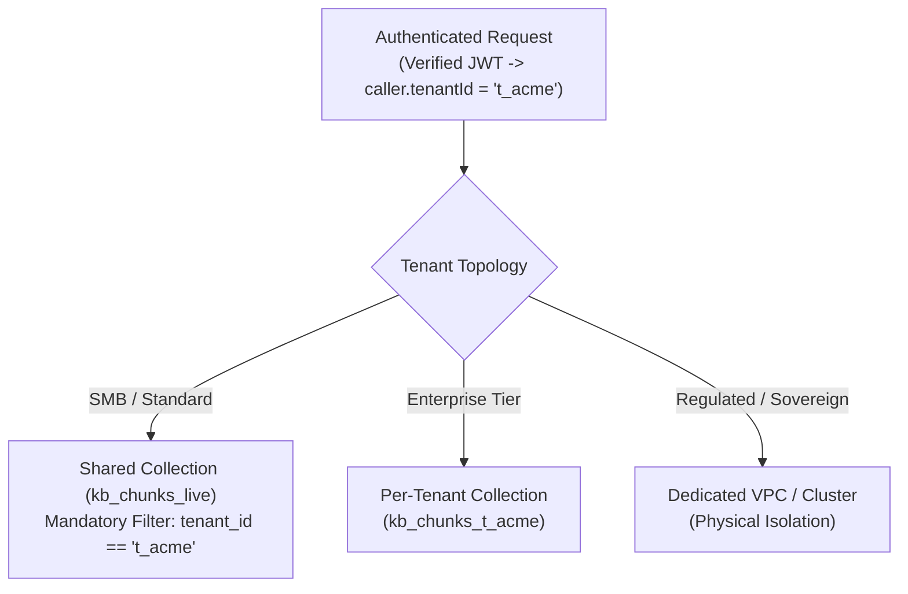
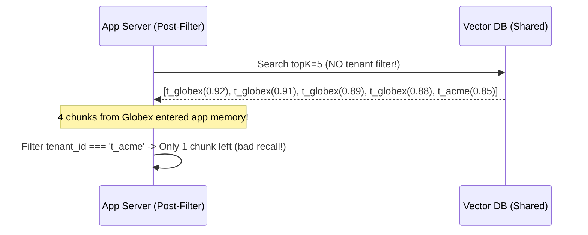

# Chapter 06 — Tenant-Aware Filtering & Isolation

> **Lecture 25 · Chapter 06 of 07** · Level: 🟠 Advanced · Phase 6 — Enterprise Data, Semantics & SQL
> **Source:** `FDE S12` · **Roadmap Reference:** [`roadmap-v1.md`](../../roadmap-v1.md#lecture-25--ai-data-contracts-lakehouse-storage--knowledge-lifecycle)
> **External Reference:** [Qdrant Multitenancy Guide](https://qdrant.tech/documentation/guides/multiple-partitions/)
> **Roadmap topics:** Multi-tenant vector & graph isolation · mandatory `tenant_id` pre-filtering · shared index + payload index vs. per-tenant collections · preventing cross-tenant RAG leakage.

---

## 06.0 What this chapter is for

In a multi-tenant B2B AI product, **cross-tenant data leakage is a company-ending security incident**. If Tenant A (`acme_corp`) asks *"What is our Q4 enterprise discount policy?"* and your vector search accidentally retrieves Tenant B's (`globex_inc`) confidential pricing chunk, no clever system prompt can undo the breach—the data has already entered the LLM context.

Multi-tenant isolation is not a single `if` statement; it is an architectural invariant enforced across **storage topology**, **query-time pre-filtering**, **graph traversal**, and **retention TTLs**.

By the end of this chapter you should be able to:

1. Compare the three multi-tenant storage topologies (**Shared Partitioned Index**, **Per-Tenant Collection**, and **Dedicated Cluster**) and choose the right one for your tenant scale.
2. Enforce **mandatory `tenant_id` pre-filtering** inside Vector, SQL, and Graph engines—and explain why **post-filtering** leaks data and breaks recall.
3. Combine **tenant isolation** with **document-level ACLs** (`aclGroups`) in a single query filter.
4. Automate **per-tenant retention & TTL purging** so expired knowledge disappears on schedule.

---

## 06.1 Multi-tenant storage topologies

| Pattern | Isolation Strength | Operational Cost | Best For |
| :--- | :---: | :---: | :--- |
| **1. Shared Index + Mandatory `tenant_id` Payload Index** | Logical (enforced in query engine + RLS) | **Low** | 1,000+ SMB/mid-market tenants; Qdrant `is_tenant: true` payload index / Postgres RLS |
| **2. Per-Tenant Collection / Schema** | Strong namespace isolation | **Medium** | 10–500 enterprise tenants with custom embedding models or retention rules |
| **3. Dedicated Cluster / Single-Tenant VPC** | Physical isolation | **High** | Regulated finance, healthcare, or sovereign-cloud customers |



> [!IMPORTANT]
> **Never trust a `tenantId` sent by the LLM or raw request body.** Extract `caller.tenantId` and `caller.aclGroups` exclusively from the **verified authentication token (JWT / session)** on the server side, and bind them into your store client before any retrieval runs.

---

## 06.2 Pre-filtering vs. post-filtering (The silent recall & security trap)

Never fetch global `topK = 5` results and filter by `tenantId` afterward in TypeScript or Python. Look at what happens when you **post-filter**:



1. **Recall collapses:** Tenant A only gets 1 chunk (or `0`!) instead of 5, even though Tenant A has 1,000 relevant chunks in the index.
2. **Security blast radius:** Tenant B's confidential vectors entered application memory and debug traces.

Instead, **always pre-filter inside the storage engine** (using a payload index in Qdrant, Row-Level Security in Postgres, or `WHERE n.tenant_id = $tenantId` in Neo4j):

```typescript
// ✅ Pre-filtered inside Qdrant (Zero cross-tenant leakage, full topK=5 recall)
export async function searchTenantChunks(
  vectorDb: QdrantClient,
  caller: { tenantId: string; aclGroups: string[] },
  queryEmbedding: number[],
) {
  return vectorDb.search("kb_chunks_live", {
    vector: queryEmbedding,
    limit: 5,
    filter: {
      must: [
        { key: "tenant_id", match: { value: caller.tenantId } },
        { key: "acl_groups", match: { any: caller.aclGroups } },
      ],
    },
  });
}
```

### Multi-Tenant GraphRAG Isolation
In a knowledge graph (Neo4j), a 2-hop traversal (`(a)-[:MENTIONS]->(b)-[:RELATED_TO]->(c)`) can accidentally cross into another tenant if a shared concept node (`"SOC2"`) bridges two tenants. **Stamp `tenant_id` on every node AND every edge**, and enforce `WHERE a.tenant_id = $tenantId AND b.tenant_id = $tenantId AND c.tenant_id = $tenantId` on every Cypher query.

---

## 06.3 Retention policies & automated TTL purging

Enterprise contracts often specify *"Delete all support ticket embeddings older than 365 days."*
1. Stamp `expiresAt` (ISO timestamp) on every chunk/row at ingestion time based on the tenant's retention policy.
2. Add `range: { gt: nowIso }` to query filters so expired items are immediately invisible at read time.
3. Run a nightly **Retention Sweeper** that feeds expired `(tenantId, sourceId)` pairs into the Cascade Deletion Propagator (Chapter 04).

> [!CAUTION]
> **Make `tenantId` a required parameter at the TypeScript/Python interface level.** Never write `search(query, tenantId?: string)` where omitting `tenantId` silently runs an unfiltered global search. Make omitting `tenantId` a compile-time type error.

---

## 06.4 Common mistakes

| # | Common Mistake | Why It Hurts | What To Do Instead |
| :---: | :--- | :--- | :--- |
| 1 | **Post-filtering `topK` results in app memory** | Destroys recall for smaller tenants and leaks other tenants' chunks into memory | Always pass `tenant_id` as a mandatory **pre-filter** inside the DB/Vector engine |
| 2 | **Letting the LLM pass `tenant_id` as a tool argument** | Prompt injection can trick the LLM into querying `tenant_id = "competitor"` | Inject `caller.tenantId` strictly from the verified server-side auth session |
| 3 | **Making `tenantId` optional in repository helpers** | One forgotten argument turns into an accidental cross-tenant global search | Make `tenantId` required in the type signature and assert non-empty at runtime |
| 4 | **Sharing un-scoped concept nodes in GraphRAG** | Multi-hop traversals hop across a shared `"Security"` node into another tenant | Scope every node and edge with `tenant_id` and filter every hop |
| 5 | **Indexing `tenant_id` without a payload index (`is_tenant: true`)** | Pre-filtered HNSW scans degrade to slow full scans at 10M+ vectors | Enable tenant-aware payload indexing (e.g., Qdrant `is_tenant: true`) |

---

## 06.5 Key takeaways

1. **Require `tenantId` on every write and every query** at the store interface level—injected from verified auth, never from LLM arguments.
2. **Pre-filter inside the Vector, SQL, and Graph engine**—never post-filter `topK` results in application code.
3. **Choose your topology by tenant scale:** shared partitioned index with `is_tenant: true` for thousands of SMBs; per-tenant collections or dedicated clusters for regulated enterprise tiers.
4. **Stamp `expiresAt` on every derived artifact** to automate per-tenant retention compliance.

---

**Next:** [Chapter 07 — Zero-Downtime Re-Embedding, Versioning & Migrations](./07_Zero_Downtime_Re_Embedding_and_Migrations.md)
