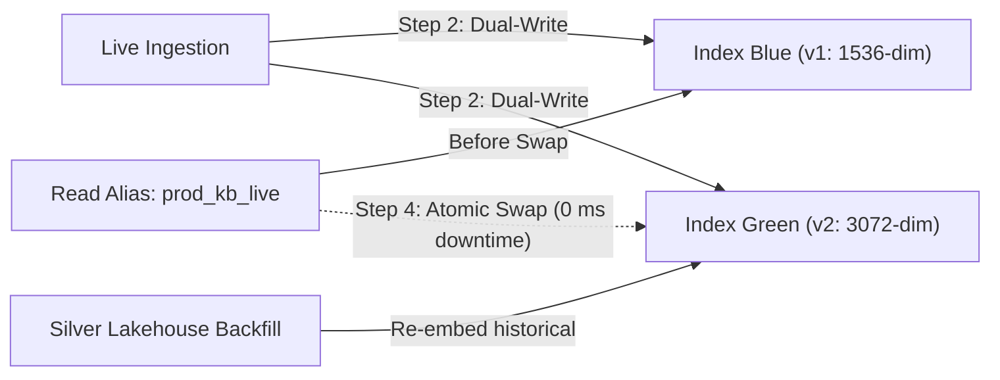

# Chapter 07 — Zero-Downtime Re-Embedding, Versioning & Migrations

> **Lecture 25 · Chapter 07 of 07** · Level: 🟠 Advanced · Phase 6 — Enterprise Data, Semantics & SQL
> **Source:** `FDE S12` · **Roadmap Reference:** [`roadmap-v1.md`](../../roadmap-v1.md#lecture-25--ai-data-contracts-lakehouse-storage--knowledge-lifecycle)
> **Roadmap topics:** Embedding model upgrades (`1536d -> 3072d`) · Blue/Green index aliases · dual-write during backfill · knowledge versioning (`embeddingModelVersion`, `chunkerVersion`) · atomic alias swap & instant rollback.

---

## 07.0 What this chapter is for

Vectors from two different embedding models (e.g., `text-embedding-3-small` at `1536` dims vs. `text-embedding-3-large` at `3072` dims, or even two versions of the same model) **live in incompatible vector spaces**. You cannot mix them in the same index, and you cannot take production search offline for 6 hours while re-embedding 10 million chunks.

**Blue/Green Index Migrations** let you upgrade embedding models, chunking strategies, or metadata schemas with **zero search downtime** and **instant rollback**.

By the end of this chapter you should be able to:

1. Version every chunk with `embeddingModel` and `chunkerVersion`.
2. Execute a **4-step Blue/Green index migration**: Create Green $\rightarrow$ Dual-Write + Backfill $\rightarrow$ Verify Parity/Recall $\rightarrow$ Atomic Alias Swap.
3. Roll back in `< 1 second` by flipping the read alias back to Blue if live metrics regress.

---

## 07.1 The 4-Step Blue/Green Re-Embedding Migration

### Migration steps

1. **Provision Green Index:** Create `kb_chunks_v2` with the new dimension (`3072`) and distance metric. Read traffic continues hitting `prod_kb_live -> kb_chunks_v1` (Blue).
2. **Enable Dual-Write & Backfill:** New/updated documents write to **both** Blue (`1536d`) and Green (`3072d`), while a background worker re-embeds historical Silver records into Green.
3. **Verify Green Readiness:** Confirm `greenCount >= blueCount` (minus tombstones) and run offline golden-set recall evals against Green.
4. **Atomic Alias Swap:** Point `prod_kb_live` from `kb_chunks_v1` to `kb_chunks_v2`. Keep Blue warm for 24 hours for instant rollback before retiring it.

---

## 07.2 Key takeaways

1. **Never mix vectors from different models/dimensions in one index.**
2. **Use an indirection alias (`prod_kb_live`) + Dual-Write + Backfill** for zero-downtime migrations.
3. **Keep the old Blue index warm briefly after swap** so rollback is a 1-line alias flip.

---

**Next:** [Lecture 25 — Complete Notes (Master Consolidation)](./Lecture_25_Complete_Notes.md)

