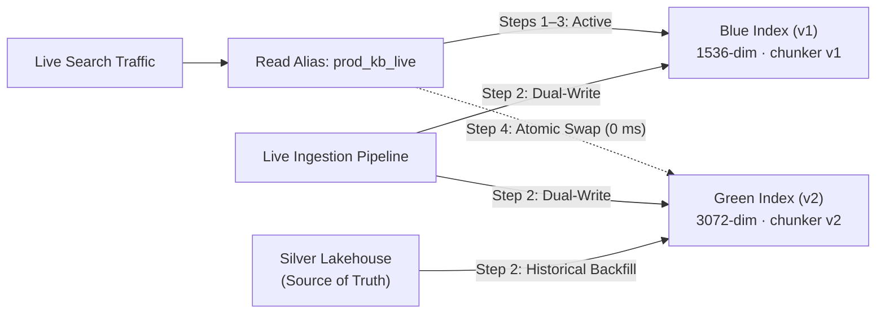
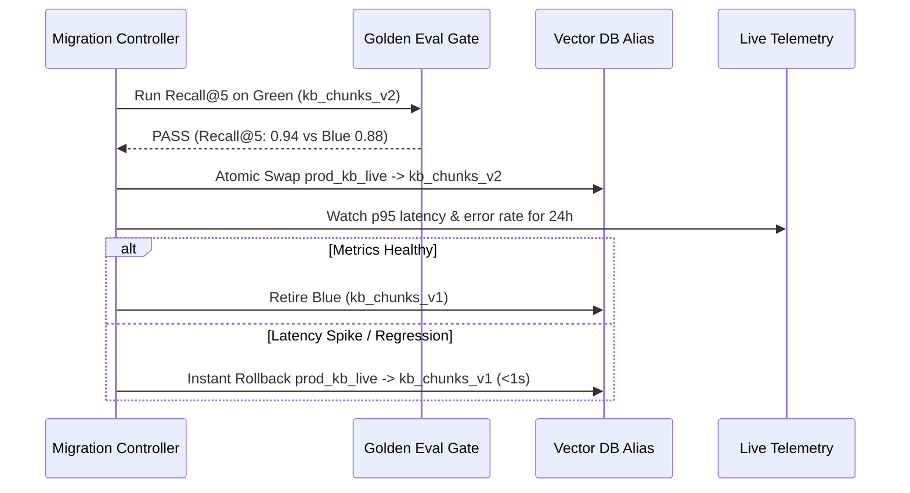

# Chapter 07 — Zero-Downtime Re-Embedding, Versioning & Migrations

> **Lecture 25 · Chapter 07 of 07** · Level: 🟠 Advanced · Phase 6 — Enterprise Data, Semantics & SQL
> **Source:** `FDE S12` · **Roadmap Reference:** [`roadmap-v1.md`](../../roadmap-v1.md#lecture-25--ai-data-contracts-lakehouse-storage--knowledge-lifecycle)
> **Roadmap topics:** Embedding model upgrades (`1536d -> 3072d`) · Blue/Green index aliases · dual-write during backfill · knowledge versioning (`embeddingModelVersion`, `chunkerVersion`) · atomic alias swap & instant rollback.

---

## 07.0 What this chapter is for

Embedding models, chunking strategies, and metadata schemas are **not static**. Six months after launch, you will want to upgrade from `text-embedding-3-small` (`1536` dimensions) to `text-embedding-3-large` (`3072` dimensions), switch from 512-token fixed chunks to semantic section chunking, or add a new required payload index.

Here is the catch: **vectors from two different embedding models (or even two versions of the same model) live in completely incompatible vector spaces.** You cannot mix `1536d` and `3072d` vectors in the same index, and you cannot take production search offline for 6 hours while re-embedding 10 million chunks.

**Blue/Green Index Migrations** solve this by letting you build, backfill, and evaluate the new index in parallel—then swap production traffic atomically in `0 ms` with `< 1 second` rollback.

By the end of this chapter you should be able to:

1. Stamp every chunk with **knowledge versioning metadata** (`embeddingModel`, `embeddingDims`, `chunkerVersion`, `contractVersion`).
2. Execute the **4-Step Blue/Green Index Migration**: Provision Green $\rightarrow$ Dual-Write + Backfill $\rightarrow$ Verify Parity & Recall $\rightarrow$ Atomic Alias Swap.
3. Explain why **Dual-Write during backfill** prevents losing live updates that arrive while historical re-embedding is running.
4. Perform an **instant `< 1s` rollback** if production latency or retrieval quality regresses after swap.

---

## 07.1 Why you can never "re-embed in place"

Attempting to overwrite vectors in-place inside a live collection causes two immediate failures:
- **Dimension mismatch:** A `3072d` vector cannot be upserted into a `1536d` HNSW index—the database rejects it.
- **Cosine-space corruption:** Even if two models share `1536` dimensions (e.g., `ada-002` vs. `text-embedding-3-small`), their vector spaces are rotated differently. Comparing a `v2` query vector against a `v1` document vector produces **random garbage similarity scores**.

> [!IMPORTANT]
> **Always point your application at an Indirection Alias (`prod_kb_live`), never a physical collection name (`kb_chunks_v1`).** That single layer of indirection is what makes zero-downtime swaps and instant rollbacks possible.

---

## 07.2 The 4-Step Blue/Green Re-Embedding Migration



### Step-by-step execution

1. **Step 1 — Provision Green Index:**
   Create physical collection `kb_chunks_v2_3072d` with the new dimensions (`3072`), distance metric (`Cosine`), and tenant payload index (`is_tenant: true`). Read traffic continues hitting `prod_kb_live` $\rightarrow$ `kb_chunks_v1_1536d` (Blue).
2. **Step 2 — Enable Dual-Write + Historical Backfill:**
   - **Dual-Write:** Every *new* or *updated* document (and every GDPR delete!) is written to **both** Blue and Green. This guarantees Green never misses live changes while the 4-hour backfill runs.
   - **Backfill:** A background worker reads the Silver Lakehouse (Chapter 05) in batches, chunks with `chunkerVersion: "v2"`, embeds with `3072d`, and upserts into Green.
3. **Step 3 — Verify Parity & Golden Recall:**
   Before switching any user traffic:
   - Check **count parity:** `greenDocCount === blueDocCount` (minus any tombstones).
   - Run your **offline golden-set eval** directly against `kb_chunks_v2_3072d` and confirm Recall@5 and MRR meet or beat Blue.
4. **Step 4 — Atomic Alias Swap & Warm Standby:**
   Flip `prod_kb_live` from `kb_chunks_v1_1536d` to `kb_chunks_v2_3072d` in a single atomic operation:

```json
// Atomic Qdrant Alias Swap (0 ms downtime, < 1s rollback)
{
  "actions": [
    { "delete_alias": { "alias_name": "prod_kb_live" } },
    { "create_alias": { "collection_name": "kb_chunks_v2_3072d", "alias_name": "prod_kb_live" } }
  ]
}
```

Keep Blue warm (receiving dual-writes) for **24–48 hours** after the swap. If live latency or user feedback degrades, flip the alias back to Blue in `< 1 second`. Only after the soak window passes do you disable dual-writes and delete Blue.

---

## 07.3 Versioning every chunk payload

Every chunk stored in Blue or Green should carry explicit provenance and version stamps:

```json
{
  "chunkId": "chk_doc42_01",
  "tenantId": "tenant_acme",
  "sourceId": "doc_42",
  "sourceVersion": 3,
  "embeddingModel": "text-embedding-3-large",
  "embeddingDims": 3072,
  "chunkerVersion": "semantic_v2",
  "ingestedAt": "2026-11-26T14:00:00Z"
}
```



> [!TIP]
> **Shadow-read before swapping.** During Step 3, you can also send `5%` of live queries to Green asynchronously ("shadow traffic") and compare p95 latency and result overlap against Blue before flipping the alias.

---

## 07.4 Common mistakes

| # | Common Mistake | Why It Hurts | What To Do Instead |
| :---: | :--- | :--- | :--- |
| 1 | **Hardcoding physical index names in app code** | Forces an app deploy to switch indexes and prevents instant rollback | Always read/write through an indirection alias (`prod_kb_live`) |
| 2 | **Upgrading embedding models in-place** | Mixes incompatible vector spaces, causing silent garbage retrieval | Provision a fresh Green index and migrate via Blue/Green alias swap |
| 3 | **Skipping Dual-Write during historical backfill** | Documents created/deleted during the 4-hour backfill are missing from Green | Enable Dual-Write (and Dual-Delete) to Blue + Green before starting backfill |
| 4 | **Deleting Blue immediately after the swap** | Any unexpected production regression requires a 4-hour re-backfill | Keep Blue warm for 24–48h so rollback is an instant 1-second alias flip |
| 5 | **Swapping without checking count parity & Recall@5** | A silent backfill bug swaps production onto a half-empty index | Gate the alias swap on `greenCount === blueCount` and golden-set eval pass |

---

## 07.5 Key takeaways

1. **Never mix vectors from different embedding models or dimensions** in the same physical index.
2. **Use an indirection alias (`prod_kb_live`) + Dual-Write + Silver Backfill** for zero-downtime migrations.
3. **Gate the atomic alias swap** on document count parity and golden-set retrieval evals.
4. **Keep Blue warm for 24–48 hours** after swapping so rollback is an instant `< 1 second` alias flip.

---

**Next:** [Lecture 25 — Complete Notes (Master Consolidation)](./Lecture_25_Complete_Notes.md)
