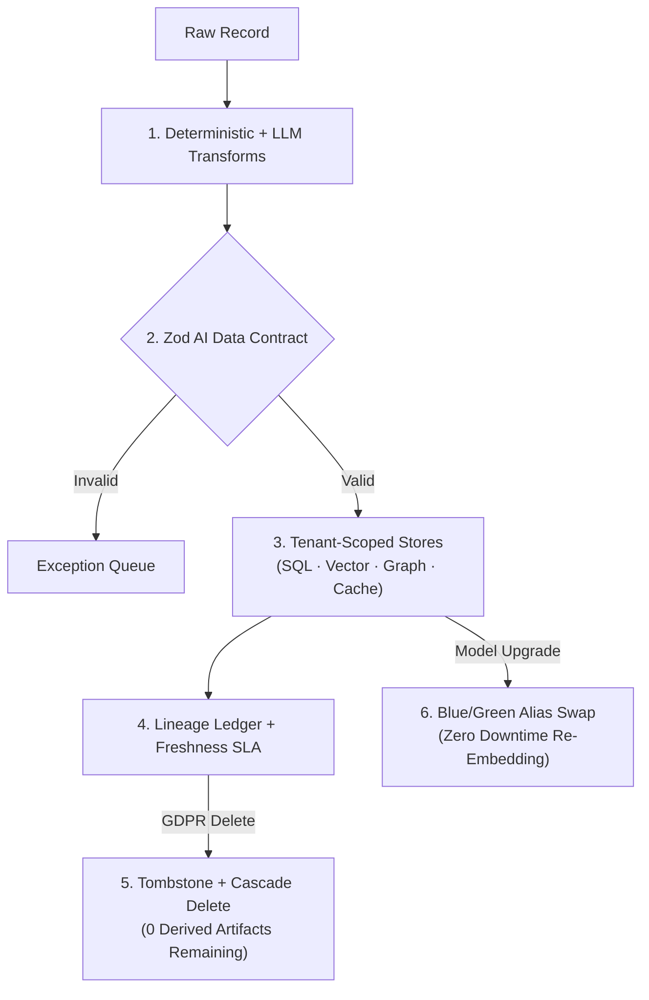

# Lecture 25 — Complete Notes
## AI Data Contracts, Lakehouse Storage & Knowledge Lifecycle

> **Phase:** 6 · Enterprise Data, Semantics & SQL · **Level:** 🟠 Advanced
> **Scope:** A single-pass consolidation of the seven chapter notes in this folder.
> **How to use this file:** Read it to *revise and navigate*. Every section links back to the chapter that explains it in full.
>
> | Chapter | File |
> | :--- | :--- |
> | 01 · LLM-powered extraction & deterministic transforms | [01_LLM_Powered_Extraction_and_Deterministic_Transforms.md](./01_LLM_Powered_Extraction_and_Deterministic_Transforms.md) |
> | 02 · AI data contracts & exception queues | [02_AI_Data_Contracts_and_Exception_Queues.md](./02_AI_Data_Contracts_and_Exception_Queues.md) |
> | 03 · Knowledge freshness SLAs & lineage tracking | [03_Knowledge_Freshness_SLAs_and_Lineage_Tracking.md](./03_Knowledge_Freshness_SLAs_and_Lineage_Tracking.md) |
> | 04 · GDPR & cascade deletion propagation | [04_GDPR_and_Cascade_Deletion_Propagation.md](./04_GDPR_and_Cascade_Deletion_Propagation.md) |
> | 05 · Lakehouse & warehouse integration | [05_Lakehouse_and_Warehouse_Integration.md](./05_Lakehouse_and_Warehouse_Integration.md) |
> | 06 · Tenant-aware filtering & isolation | [06_Tenant_Aware_Filtering_and_Isolation.md](./06_Tenant_Aware_Filtering_and_Isolation.md) |
> | 07 · Zero-downtime re-embedding & migrations | [07_Zero_Downtime_Re_Embedding_and_Migrations.md](./07_Zero_Downtime_Re_Embedding_and_Migrations.md) |

---

## 1. Executive summary

**The lecture in five sentences.**

1. Production ingestion pairs **deterministic transforms** (hashing, date/currency normalization, PII masking) with **LLM enrichment** and a **Zod AI Data Contract** that quarantines invalid records into an **Exception Queue**.
2. Every ingested source record is tracked in a **Derived-Artifact Lineage Ledger** (`sourceId` $\rightarrow$ SQL rows, vector chunks, graph nodes, cache keys) with explicit **freshness SLAs**.
3. **GDPR Cascade Deletion** writes a **tombstone** first (to block zombie resurrection from in-flight workers), deletes across SQL, Vector, Graph, and Cache, and verifies zero remaining derived artifacts.
4. **Lakehouse Medallion layering** (Bronze $\rightarrow$ Silver $\rightarrow$ Gold) and **mandatory `tenant_id` pre-filtering** ensure incremental, reproducible, tenant-isolated retrieval.
5. **Blue/Green Index Migrations** (create Green $\rightarrow$ dual-write + backfill $\rightarrow$ verify $\rightarrow$ atomic alias swap) upgrade embedding models and dimensions with **zero search downtime**.

---

## 2. The arc of the lecture in one diagram

---

## 3. Cheat sheet

| Concept | One-line definition | Chapter |
| :--- | :--- | :--- |
| **Hybrid Ingestion** | Deterministic pre/post-transforms wrapping System-1 LLM enrichment | [01](./01_LLM_Powered_Extraction_and_Deterministic_Transforms.md) |
| **AI Data Contract** | Zod/JSON-Schema + freshness SLA + owner enforced before indexing | [02](./02_AI_Data_Contracts_and_Exception_Queues.md) |
| **Exception Queue** | Quarantine queue for invalid records so valid records keep flowing | [02](./02_AI_Data_Contracts_and_Exception_Queues.md) |
| **Lineage Ledger** | Mapping `sourceId` $\rightarrow$ SQL, Vector, Graph, and Cache IDs | [03](./03_Knowledge_Freshness_SLAs_and_Lineage_Tracking.md) |
| **Tombstone Record** | Persistent delete marker blocking zombie re-ingestion | [04](./04_GDPR_and_Cascade_Deletion_Propagation.md) |
| **Medallion AI** | Bronze (raw) $\rightarrow$ Silver (contract-valid) $\rightarrow$ Gold (chunked/embedded) | [05](./05_Lakehouse_and_Warehouse_Integration.md) |
| **Pre-Filtering** | Passing `tenantId` inside the vector/SQL query, never post-filtering | [06](./06_Tenant_Aware_Filtering_and_Isolation.md) |
| **Blue/Green Swap** | Dual-write + backfill + atomic alias flip for zero-downtime re-embedding | [07](./07_Zero_Downtime_Re_Embedding_and_Migrations.md) |

---

## 4. Self-check questions (Release Gate Prep)

1. Why should a pipeline quarantine invalid records in an Exception Queue instead of crashing the whole batch?
2. How does a **tombstone** prevent "zombie resurrection" during a GDPR cascade delete?
3. Why is post-filtering `topK` vector results by `tenantId` in application code a security and recall bug?
4. Walk through the 4 steps of a zero-downtime Blue/Green re-embedding migration from `1536d` to `3072d`.

