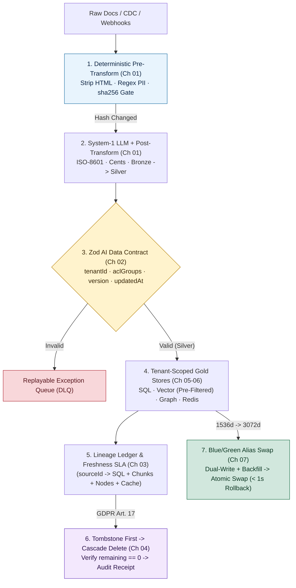

# Lecture 25 — Complete Notes
## AI Data Contracts, Lakehouse Storage & Knowledge Lifecycle

> **Phase:** 6 · Enterprise Data, Semantics & SQL · **Level:** 🟠 Advanced
> **Scope:** Master revision guide consolidating all seven chapters of Lecture 25.
> **Thesis:** Production AI knowledge pipelines must treat ingestion as a governed lifecycle: **deterministic-first hybrid extraction**, **Zod AI Data Contracts with replayable Exception Queues**, **derived-artifact Lineage Ledgers**, **tombstone-first GDPR cascade deletion**, **Medallion Lakehouse incremental syncs**, **mandatory `tenant_id` pre-filtering**, and **Blue/Green alias swaps** for zero-downtime re-embedding.

---

## 1. Executive Summary

**The lecture in five sentences:**

1. Production ingestion wraps **System-1 LLM enrichment** inside **deterministic pre/post-transforms** (HTML stripping, regex PII redaction, `sha256` content-hash idempotency, ISO-8601/cents normalization) so unchanged records cost `$0` and downstream stores never receive format drift.
2. **AI Data Contracts** (enforced via Zod/JSON Schema before embedding) require `tenantId`, `sourceId`, `version`, `aclGroups`, and `updatedAt` — quarantining invalid records into a replayable **Exception Queue (DLQ)** so valid records still meet freshness SLAs.
3. A **Derived-Artifact Lineage Ledger** maps `(tenantId, sourceId, version)` to SQL rows, vector chunks, graph nodes, and Redis `cacheKeys`, enabling orphan-chunk cleanup, query-time **freshness SLA** checks, and semantic cache invalidation.
4. **GDPR Cascade Deletion** writes a persistent **tombstone** first (blocking in-flight workers from "zombie resurrection"), runs idempotent deletes across SQL, Vector, Graph, and Cache, and verifies `remainingDerivedCount === 0` before emitting a signed receipt.
5. **Medallion Lakehouse** layering (Bronze $\rightarrow$ Silver $\rightarrow$ Gold via snapshots/`VERSION AS OF`), **mandatory `tenant_id` pre-filtering**, and **4-step Blue/Green alias swaps** keep multi-tenant retrieval isolated, reproducible, and upgradable with zero downtime.

### Chapter Index

| Chapter | Topic | Core Focus | File |
| :---: | :--- | :--- | :--- |
| **01** | Hybrid Extraction & Transforms | Deterministic $\rightarrow$ LLM $\rightarrow$ Deterministic sandwich, `sha256` idempotency | [01_LLM_Powered_Extraction_and_Deterministic_Transforms.md](./01_LLM_Powered_Extraction_and_Deterministic_Transforms.md) |
| **02** | AI Data Contracts & DLQ | 4 contract clauses, Zod enforcement, replayable Exception Queues, schema evolution | [02_AI_Data_Contracts_and_Exception_Queues.md](./02_AI_Data_Contracts_and_Exception_Queues.md) |
| **03** | Freshness SLAs & Lineage | Derived-Artifact Lineage Ledger, orphan chunk cleanup, query-time TTLs, Redis invalidation | [03_Knowledge_Freshness_SLAs_and_Lineage_Tracking.md](./03_Knowledge_Freshness_SLAs_and_Lineage_Tracking.md) |
| **04** | GDPR Cascade Deletion | Tombstone-first erasure, zombie resurrection prevention, idempotent 4-store sweep, receipts | [04_GDPR_and_Cascade_Deletion_Propagation.md](./04_GDPR_and_Cascade_Deletion_Propagation.md) |
| **05** | Lakehouse Integration | Bronze $\rightarrow$ Silver $\rightarrow$ Gold, snapshot/watermark syncs, `VERSION AS OF` evals | [05_Lakehouse_and_Warehouse_Integration.md](./05_Lakehouse_and_Warehouse_Integration.md) |
| **06** | Tenant-Aware Isolation | Shared vs. per-tenant vs. dedicated, mandatory pre-filtering, GraphRAG edge scoping | [06_Tenant_Aware_Filtering_and_Isolation.md](./06_Tenant_Aware_Filtering_and_Isolation.md) |
| **07** | Zero-Downtime Migrations | Blue/Green alias (`prod_kb_live`), dual-write + backfill, `< 1s` rollback | [07_Zero_Downtime_Re_Embedding_and_Migrations.md](./07_Zero_Downtime_Re_Embedding_and_Migrations.md) |

---

## 2. Master Architecture Diagram

---

## 3. Chapter-by-Chapter Short Revision Notes

### 3.1 Chapter 01 — LLM-Powered Extraction & Deterministic Transforms

Never pay an LLM to normalize dates, parse currency, strip HTML, or hash strings. Wrap fast **System-1 LLM enrichment** inside a **Deterministic $\rightarrow$ LLM $\rightarrow$ Deterministic** sandwich:
- **Stage 1 (Pre-Transform):** Strip HTML/boilerplate (saving 30–60% tokens), redact credit cards/SSNs via regex, and compute `sha256(metadataVersion + normalizedText)` so the 95–99% unchanged records skip at `$0`.
- **Stage 2 (System-1 LLM):** Extract semantic fields (`category`, `urgency`, raw date/amount strings) with `temperature: 0` and JSON Schema.
- **Stage 3 (Post-Transform):** Convert dates to `ISO-8601` and amounts to integer `amountCents`, then pass to the Zod gate. Bumping `metadataVersion` (`v1` $\rightarrow$ `v2`) cleanly invalidates old hashes on prompt upgrades.

> 📖 **Need depth?** Read [Chapter 01 — LLM-Powered Extraction & Deterministic Transforms](./01_LLM_Powered_Extraction_and_Deterministic_Transforms.md)

### 3.2 Chapter 02 — AI Data Contracts & Exception Queues

Broken upstream records poison vector indexes and cause cross-tenant leaks. Enforce a **Zod AI Data Contract** *before* chunking/embedding across four clauses: **Schema/Types** (mandatory `tenantId`, `sourceId`, `version`), **Semantic Quality** (no `"TBD"`/`"N/A"` slop, min length), **Freshness SLA** (`freshnessSlaMinutes`), and **Ownership/Security** (`@owner`, `aclGroups`). Use minor version bumps for additive optional fields and major bumps for breaking renames.

| Batch Strategy | Valid Docs (9,998) | Bad Docs (2) | Verdict |
| :--- | :--- | :--- | :---: |
| **Crash on Error** | Blocked; SLA breached | In crash log | ❌ |
| **Silent `catch`** | Indexed | Lost forever | ❌ |
| **Exception Queue (DLQ)** | Indexed on schedule | Quarantined with `ZodError` + `rawPayload` for replay | ✅ |

> 📖 **Need depth?** Read [Chapter 02 — AI Data Contracts & Exception Queues](./02_AI_Data_Contracts_and_Exception_Queues.md)

### 3.3 Chapter 03 — Knowledge Freshness SLAs & Lineage Tracking

One source document fans out into SQL rows, vector chunks, graph nodes, and Redis semantic caches. Track all derived IDs in a **Lineage Ledger** keyed by `(tenantId, sourceId, version)`. When `doc_42` updates from `v3` (12 chunks) to `v4` (9 chunks), diff against the ledger to **delete orphaned `v3` chunks** (`chk_10..chk_12`) and **invalidate Redis `cacheKeys`** immediately.

- **Query-Time Freshness:** Assign `freshnessSlaMs` per document class (`15m–1h` for live pricing $\rightarrow$ abstain/fallback; `24h` for runbooks $\rightarrow$ warn; `30d` for signed MSAs) and evaluate `now - ingestedAt <= freshnessSlaMs` at retrieval time.

> 📖 **Need depth?** Read [Chapter 03 — Knowledge Freshness SLAs & Lineage Tracking](./03_Knowledge_Freshness_SLAs_and_Lineage_Tracking.md)

### 3.4 Chapter 04 — GDPR & Cascade Deletion Propagation

Deleting a row from Postgres is incomplete if vector chunks, graph nodes, and Redis caches still leak PII. Execute GDPR Article 17 erasure in four strict steps: (1) **Write a persistent tombstone first**; (2) query the Lineage Ledger for all derived IDs; (3) run **idempotent** deletes across SQL, Vector, Graph, and Cache (treating `404` / `0 rows` as success); (4) verify `remainingDerivedCount === 0` and emit a PII-free **Deletion Audit Receipt**.

- **Preventing Zombie Resurrection:** Every ingestion worker must check `isTombstoned(tenantId, sourceId)` immediately before committing to any store. Also sweep DLQ `rawPayload` entries and semantic caches.

> 📖 **Need depth?** Read [Chapter 04 — GDPR & Cascade Deletion Propagation](./04_GDPR_and_Cascade_Deletion_Propagation.md)

### 3.5 Chapter 05 — Lakehouse & Warehouse Integration

Structure AI pipelines as a **Medallion Lakehouse**: **Bronze** (immutable raw landing), **Silver** (contract-validated, PII-masked, deduped), and **Gold** (chunked/embedded Vector & Graph). Never embed directly from Bronze. Sync Gold incrementally using Iceberg snapshot IDs, Snowflake Streams, or `(updated_at, source_id)` tuple watermarks — advancing the watermark **only after** Gold upserts and soft-delete (`is_deleted = true`) cascades commit.

- **Reproducible Evals:** Pin offline RAG benchmarks to `VERSION AS OF <snapshot_id>` so corpus edits never masquerade as prompt regressions.

> 📖 **Need depth?** Read [Chapter 05 — Lakehouse & Warehouse Integration](./05_Lakehouse_and_Warehouse_Integration.md)

### 3.6 Chapter 06 — Tenant-Aware Filtering & Isolation

Choose isolation topology by scale: **Shared Index + `is_tenant: true` payload index** (1,000+ SMBs), **Per-Tenant Collection** (10–500 enterprise), or **Dedicated Cluster** (regulated/sovereign). Always extract `caller.tenantId` and `aclGroups` from verified server-side JWTs (never from LLM arguments) and make `tenantId` a **required** parameter in store interfaces. Stamp `expiresAt` for automated TTL retention sweeps.

- **Pre-Filter, Never Post-Filter:** Fetching global `topK = 5` and filtering in app code destroys recall and leaks other tenants' vectors into app memory. In GraphRAG, stamp `tenant_id` on **every node AND every edge** so 2-hop traversals cannot bridge tenants.

> 📖 **Need depth?** Read [Chapter 06 — Tenant-Aware Filtering & Isolation](./06_Tenant_Aware_Filtering_and_Isolation.md)

### 3.7 Chapter 07 — Zero-Downtime Re-Embedding & Migrations

Vectors from different embedding models or dimensions (`1536d` vs. `3072d`) live in incompatible spaces and cannot be updated in-place. Always read/write through an **indirection alias (`prod_kb_live`)** and run a **4-Step Blue/Green Migration**:
1. **Provision Green (`3072d`)** with tenant payload indexes while traffic stays on Blue (`1536d`).
2. **Dual-Write + Dual-Delete** live updates/GDPR erasures to both Blue and Green while backfilling history from Silver.
3. **Verify Parity & Recall:** Confirm `greenCount === blueCount` and golden Recall@5 (optionally shadow-read 5%).
4. **Atomic Alias Swap (`0 ms` downtime):** Flip `prod_kb_live` $\rightarrow$ Green, keeping Blue warm for 24–48h for `< 1s` rollback.

> 📖 **Need depth?** Read [Chapter 07 — Zero-Downtime Re-Embedding & Migrations](./07_Zero_Downtime_Re_Embedding_and_Migrations.md)

---

## 4. Cheat Sheet & Common Traps

### 4.1 Quick Reference

| Component | Key Mechanism | Primary Guarantee |
| :--- | :--- | :--- |
| **Hybrid Ingestion** | `sha256(version + cleanText)` + regex PII mask | `$0` on unchanged docs; zero format drift |
| **AI Data Contract** | Zod gate before embedding + replayable DLQ | Bad rows quarantined; healthy batch meets SLA |
| **Lineage & GDPR** | Tombstone first + 4-store delete + `count === 0` check | Zero zombie resurrection; provable erasure |
| **Lakehouse & Tenant** | Silver $\rightarrow$ Gold deltas + mandatory pre-filtering | Linear sync cost; zero cross-tenant leakage |
| **Blue/Green Swap** | Dual-write + Silver backfill + atomic alias flip | Zero-downtime model upgrades; `< 1s` rollback |

### 4.2 Common Traps

| Trap | Why It Breaks Production | Fix |
| :--- | :--- | :--- |
| **Embedding directly from Bronze** | Indexes raw HTML, unredacted PII, and contract slop | Enforce Bronze $\rightarrow$ Silver Zod contract before embedding. |
| **Overwriting `v3` chunks without deleting orphans** | Shorter `v4` leaves ghost `v3` chunks & stale Redis cache | Diff `vectorChunkIds` in Lineage Ledger; invalidate `cacheKeys`. |
| **Deleting SQL/Vector before writing tombstone** | In-flight worker commits chunks 200ms later (zombie PII) | Write persistent tombstone first; check `isTombstoned()` on commit. |
| **Post-filtering `topK` by `tenantId` in app code** | Collapses recall and loads competitor vectors into memory | Pre-filter inside Vector/SQL/Graph engines using JWT `tenantId`. |
| **Deleting Blue index immediately after swap** | Any regression forces a 4-hour re-backfill | Keep Blue warm with dual-writes for 24–48h for `< 1s` rollback. |

---

## 5. Self-Check Questions (Release Gate Prep)

1. Why should deterministic transforms sit on **both sides** of an ingestion LLM call, and why must `metadataVersion` be part of the `sha256` content hash?
2. Why does a replayable **Exception Queue (DLQ)** beat both crashing the batch and silently `catch`-ing invalid records?
3. How does a **tombstone record** prevent "zombie resurrection" during a GDPR Article 17 cascade delete across SQL, Vector, Graph, and Cache?
4. Why is **post-filtering** `topK` vector results by `tenantId` in application code both a security bug and a recall bug, and how do you isolate multi-hop GraphRAG queries?
5. Walk through all 4 steps of a zero-downtime Blue/Green re-embedding migration from `1536d` to `3072d`, including why Dual-Write is mandatory.
