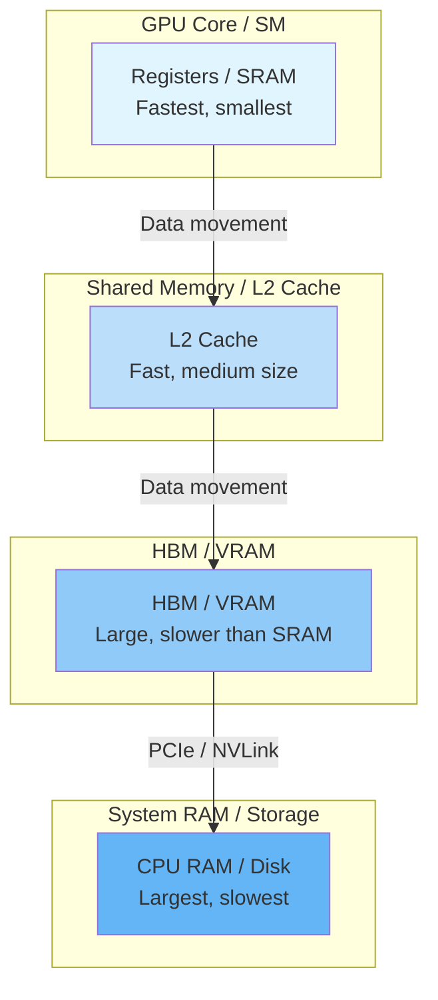
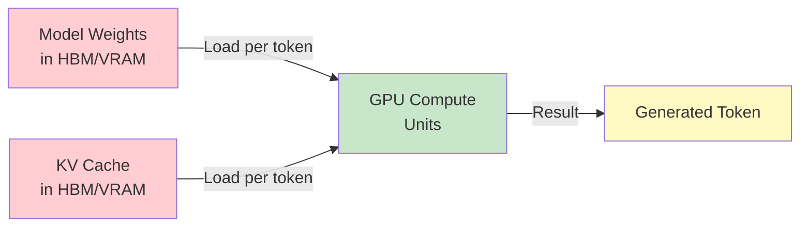
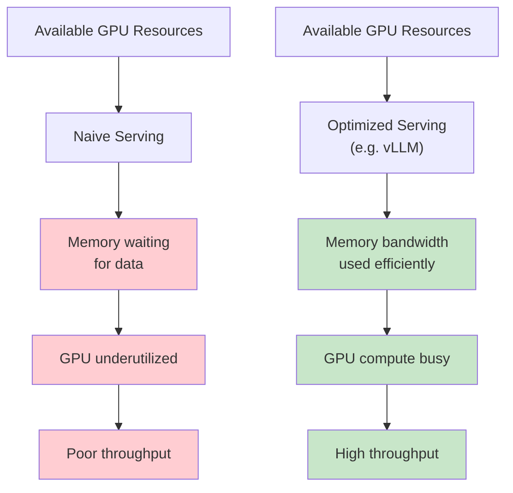

# Chapter 01 - LLM Hardware Mechanics: GPU VRAM, HBM, and Memory Hierarchy

## Overview

Running open-weight LLMs in production requires high-performance GPU hardware. This chapter covers the fundamental GPU hardware concepts — VRAM, HBM (High Bandwidth Memory), and the memory hierarchy — that determine whether your inference engine succeeds or struggles.

---

## 1. GPU VRAM and HBM

### VRAM (Video RAM)

VRAM is the dedicated memory on a GPU used to store:

- Model weights (the trained parameters)
- KV cache (attention key/value states)
- Intermediate activations during forward passes
- Runtime data required for generation

VRAM is expensive and limited. A typical consumer GPU might have 8–24 GB, while data-center GPUs (H100, A100) can have 80 GB or more.

### HBM (High Bandwidth Memory)

HBM is a type of memory stacked vertically and connected to the GPU via a wide interface. It provides:

- Very high memory bandwidth to the GPU compute units
- Much higher bandwidth than traditional GDDR memory
- Lower latency for moving data between memory and compute

Both VRAM and HBM are limited and expensive resources. The challenge is not simply having powerful GPUs — it is using memory bandwidth and compute resources efficiently.

---

## 2. GPU Memory Hierarchy

GPU memory is organized into multiple levels, each with different speed and capacity characteristics:



| Level | Speed | Capacity | Use Case |
|-------|-------|----------|----------|
| Registers / SRAM | Extremely fast | Very small | Immediate computation operands |
| L1 / Shared Memory | Very fast | Small | Thread-block shared data |
| L2 Cache | Fast | Medium | Frequently accessed data |
| HBM / VRAM | High bandwidth | Large (GBs) | Model weights, KV cache |
| System RAM | Slower | Very large | Overflow, host-side data |
| Disk / Storage | Slowest | Enormous | Model checkpoints, datasets |

### Why This Matters

For every token generated during inference, the GPU must repeatedly:

1. Load model weights from HBM/VRAM into compute units
2. Load KV cache entries from memory
3. Perform matrix computations
4. Write results back

If memory cannot supply data quickly enough, the compute units sit idle waiting for data — this is the **memory-bandwidth bottleneck**.

---

## 3. Data Locality: Why Moving Weights Costs More Than Computing

A key principle in high-performance inference is **data locality**: keep data close to where it is needed.

- Moving model weights from VRAM to compute units consumes memory bandwidth
- Computing on data already in SRAM/registers is fast
- Frequent data movement between memory levels wastes time and energy



**Key insight:** The cost of loading weights and KV cache from memory often dominates the cost of the actual computation. This is why inference is described as **memory-bandwidth bound** rather than compute-bound.

---

## 4. Why Raw GPU Power Is Not Enough

Simply buying a powerful GPU does not guarantee efficient LLM serving. A naive system may fail to:

- Efficiently utilize available VRAM/HBM bandwidth
- Keep GPU compute resources busy (avoid idle cycles)
- Manage KV cache memory efficiently
- Handle multiple concurrent requests without fragmentation



---

## 5. Key Takeaways

| Concept | Meaning |
|---------|---------|
| **VRAM** | GPU memory storing weights, KV cache, activations |
| **HBM** | High-bandwidth memory stacked on the GPU package |
| **Memory Hierarchy** | Registers → SRAM → L2 → HBM → System RAM → Disk |
| **Data Locality** | Keeping data close to compute to minimize movement |
| **Memory-Bandwidth Bound** | Inference limited by data movement speed, not compute speed |

> **Training asks:** How fast can the GPU perform computation?
>
> **Inference asks:** How efficiently can the GPU move and reuse the data required to generate tokens?

---

## Pseudo Code: Memory Access Pattern During Inference

```typescript
// PSEUDO CODE — illustrates data movement, not runnable
interface GPU {
  hbm: Memory;           // High Bandwidth Memory / VRAM
  sram: Memory;          // On-chip SRAM / registers
  computeUnits: ComputeUnit[];
}

class InferenceStep {
  constructor(private gpu: GPU) {}

  generateToken(weights: Tensor, kvCache: KVCache, inputToken: Token): Token {
    // 1. Load weights from HBM to SRAM (memory-bound step)
    this.gpu.sram.load(this.gpu.hbm, weights);

    // 2. Load KV cache entries from HBM to SRAM (memory-bound step)
    this.gpu.sram.load(this.gpu.hbm, kvCache.recentEntries());

    // 3. Compute attention + feed-forward (compute step)
    const output = this.gpu.computeUnits.matmul(
      this.gpu.sram, weights, inputToken
    );

    // 4. Write result back to HBM
    this.gpu.hbm.store(this.gpu.sram, output);

    return output;
  }
}
```

---

## 6. Study Questions

1. What is the difference between VRAM and HBM?
2. Why is inference typically memory-bandwidth bound while training is compute-bound?
3. What data does the GPU need to load from memory for every generated token?
4. How does data locality affect inference performance?
5. Why can a powerful GPU still deliver poor inference throughput?

---
