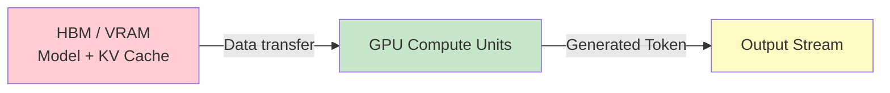
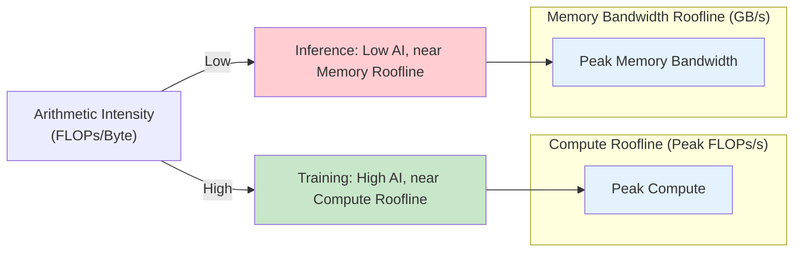

# Chapter 02 - Compute-Bound Training vs Memory-Bandwidth-Bound Inference

## Overview

This chapter explains the fundamental difference between training and inference workloads on GPUs: training is **compute-bound** while production inference is **memory-bandwidth bound**. Understanding this distinction is key to designing efficient LLM serving systems.

---

## 1. Training: Compute-Bound Workload

### Characteristics

Training involves learning from data, which means:

- Model **weights are updated** through backpropagation
- Large, relatively fixed **batches** of data
- GPU spends significant time performing **large matrix multiplications**
- Workload runs for **weeks or months**

### Forward + Backward Pass

```text
Training Pipeline
──────────────────
Input (Batch of Examples)
  │
  ▼
Forward Pass
  │ Matrix multiplications, activations
  │
  ▼
Loss Calculation
  │ Compare predictions to ground truth
  │
  ▼
Backward Pass (Backpropagation)
  │ Compute gradients of loss w.r.t. weights
  │
  ▼
Weight Updates
  │ Adjust model parameters
  │
  ▼
Iterate with next batch
```

### Why Training Is Compute-Bound

During training, the GPU must perform:

- **Large matrix multiplications** for every forward pass
- **Gradient computation** via backpropagation (chain rule through all layers)
- **Weight updates** after each batch

The volume of computation per batch is so large that the GPU's compute units are saturated. Memory bandwidth is relatively sufficient because:

- Model weights are reused across many examples in a batch
- The compute-to-memory-access ratio is high
- The bottleneck is the number of FLOPs (floating-point operations) the GPU can perform per second

**Result:** Training throughput is measured in tokens/sec per GPU or samples/sec, limited by GPU compute capacity (TFLOPs, FLOPs/s).

---

## 2. Inference: Memory-Bandwidth-Bound Workload

### Characteristics

Inference involves running a trained model to serve user requests:

- Model **weights are fixed** (read-only)
- **Continuous, dynamic** user requests (unpredictable batch sizes and lengths)
- GPU repeatedly **accesses model data and KV cache** per generated token
- Workload runs in **production serving** 24/7

### Inference Pipeline

```text
Inference Pipeline
──────────────────
User Request
  │
  ▼
Load Model Weights + KV Cache
  │ From HBM/VRAM to compute units
  │
  ▼
Token Generation (Autoregressive)
  │ Matrix multiply + attention
  │
  ▼
Output Token
  │ Stream to user
  │
  ▲
  │
User Request N ──────────────────┘
```

### Why Inference Is Memory-Bandwidth Bound

During inference, the system repeatedly needs to access per-token:

- **Model weights** (for matrix multiplications)
- **KV cache** (Key and Value states from previous tokens)
- Other runtime data required for attention and generation



For each generated token, the system must:

1. Load model weights from HBM/VRAM into compute units
2. Load KV cache entries from HBM/VRAM
3. Perform the forward pass (matrix multiplication + attention)
4. Write the new token back

**The critical point:** The compute units spend significant time **waiting for data** from memory. If memory cannot supply data quickly enough, compute units sit idle.

### Memory Access Per Token

| Resource | Access Pattern | Frequency |
|----------|---------------|-----------|
| Model Weights | Load once, reuse across many tokens (but quantized models may reload) | O(1) per token with caching |
| KV Cache | Read and update per token | O(1) per token, grows with sequence length |
| Activations | Read/write per layer | O(layers) per token |

As the KV cache grows (longer conversations), the memory bandwidth requirement increases linearly.

---

## 3. The Roofline Model: Visualizing the Boundary

The **roofline model** is a useful way to understand where a workload sits relative to the hardware's compute and memory bandwidth limits.



### Arithmetic Intensity (AI)

Arithmetic intensity = FLOPs / Bytes accessed

- **Training:** High AI → Many FLOPs per byte loaded → Compute-bound
- **Inference:** Low AI → Few FLOPs per byte loaded → Memory-bandwidth bound

### Why AI Differs

| Workload | FLOPs per Token | Bytes Accessed per Token | AI |
|----------|----------------|-------------------------|-----|
| Training | Very high (full forward + backward) | Relatively low (weights reused) | High → Compute-bound |
| Inference | Moderate (forward only) | High (weights + KV cache per token) | Low → Memory-bound |

---

## 4. Implications for LLM Serving

Because inference is memory-bandwidth bound, simply buying faster GPUs with more compute won't solve throughput problems. Instead, you must:

1. **Reduce memory traffic** — fewer bytes loaded per token
2. **Increase data reuse** – keep KV cache and weights in faster memory
3. **Optimize memory access patterns** – coalesced access, caching strategies
4. **Use efficient KV cache management** – avoid redundant data movement

This is why specialized **LLM inference engines** (like vLLM) focus on memory efficiency rather than raw compute.

---

## 5. Key Takeaways

| Aspect | Training | Inference |
|--------|----------|-----------|
| **Primary Constraint** | Compute-bound | Memory-bandwidth bound |
| **Weights** | Updated via backpropagation | Fixed / read-only |
| **Batch Pattern** | Large, fixed batches | Dynamic, continuous requests |
| **GPU Usage** | Large compute workloads | Continuous production serving |
| **Main Bottleneck** | Compute units saturated | Memory bandwidth insufficient |
| **Main Operation** | Forward + backward pass | Forward pass + token generation |
| **Arithmetic Intensity** | High | Low |
| **Performance Goal** | Maximize FLOPs utilization | Maximize throughput per bandwidth |

> **Remember:**
>
> > **Training asks:** How fast can the GPU perform computation?
>
> > **Inference asks:** How efficiently can the GPU move and reuse the data required to generate tokens?

---

## 6. Study Questions

1. What does "compute-bound" mean? What about "memory-bandwidth bound"?
2. Why does training have higher arithmetic intensity than inference?
3. What data does the GPU need to access from memory for each generated token during inference?
4. How does KV cache growth affect memory bandwidth requirements?
5. Why can't we simply buy a faster GPU to solve inference throughput problems?

---

## Pseudo Code: Training vs Inference Compute vs Memory Pattern

```typescript
// PSEUDO CODE — illustrates compute vs memory patterns, not runnable

// Training: High arithmetic intensity
function trainingStep(model, batch) {
  // Load batch from disk → VRAM (one time)
  const predictions = forwardPass(model, batch.inputs);
  
  // Compute loss
  const loss = computeLoss(predictions, batch.targets);
  
  // Backward pass - compute gradients
  const gradients = backwardPass(loss, model);
  
  // Update weights
  model.weights = optimizer.update(model.weights, gradients);
  
  // High FLOPs / moderate memory access = compute-bound
}

// Inference: Low arithmetic intensity
function inferenceStep(model, kvCache, inputToken) {
  // Load weights from VRAM to compute (every token)
  loadWeights(model.weights);
  
  // Load KV cache from VRAM to compute (every token)
  loadKVCache(kvCache);
  
  // Forward pass - one matrix multiply
  const logits = forwardPassOneStep(model, inputToken);
  
  // Sample next token
  const nextToken = sample(logits);
  
  // Update KV cache
  updateKVCache(kvCache, inputToken, logits);
  
  // Low FLOPs / high memory access per token = memory-bound
  
  return nextToken;
}
```